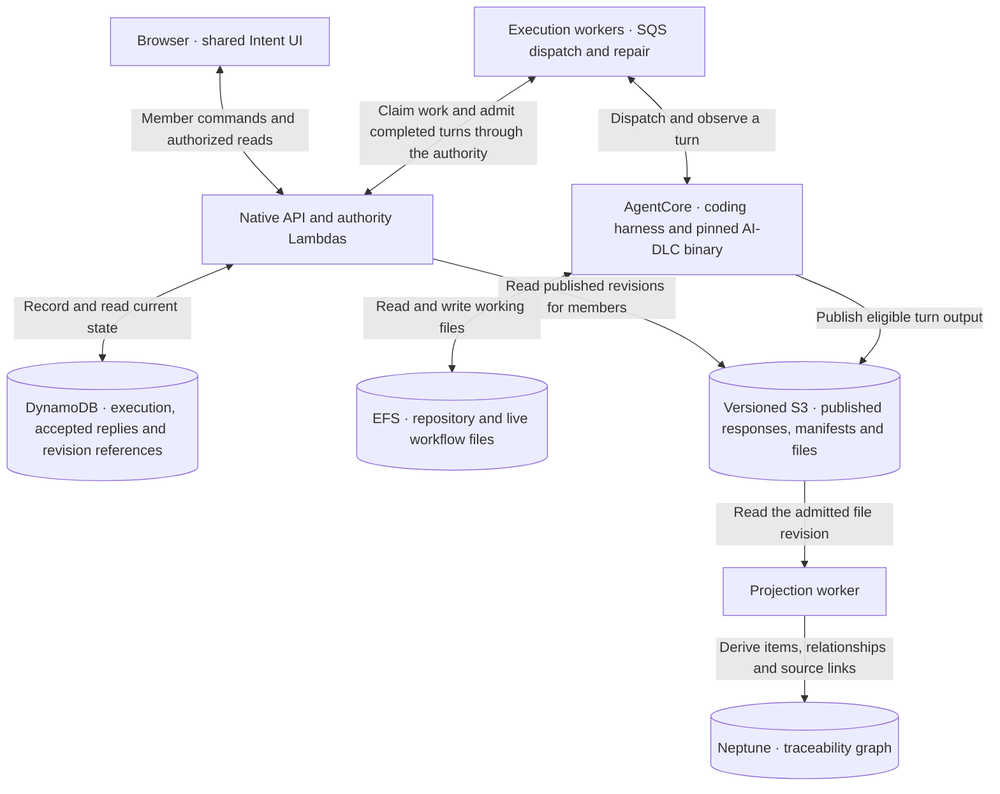

# Native Execution in Collaborative

**Status on November 26, 2026.** Native Execution brings the installed AI-DLC methodology into Collaborative’s shared Intent workspace. A member starts work against a connected repository, answers AI-DLC’s questions in the browser, and can trace what changed back to a specific turn. AI-DLC runs in Amazon Bedrock AgentCore and keeps its working files on EFS. Collaborative owns access, accepted replies and published results.

The AgentCore architecture was deployed in DEV at `c43b36a7`. A signed-in member saw and answered the first plan question there. That run also exposed a failure on the very next turn. The subsequent correction at `fb65bef1`, which reads and writes AI-DLC’s questionnaire files directly, has passed installed-agent and browser qualification. Its DEV deployment and fresh signed-in journey are still pending. All of this work is consolidated on `feat/native-aidlc-execution`.

## What a member can do

1. **Create and start an intent.** **New intent → Native AI-DLC** opens the normal creation flow. The member selects an authorized methodology package, one application repository and a coding harness. A request can include supported uploads, tracker issue text, discussions and selected attachments. **Prepare workspace** provisions the workspace. **Start** captures the exact source commit, input revisions, package, harness, model selection, credential scope and runtime image.
2. **Work through the methodology.** The intent has the familiar **Overview**, **Work** and **Graph** navigation. Work shows the response, available questions and activity. Members can draft answers together, discuss a published revision or ask Quorum for advice. Submitting a reply records the member and the exact question revision. AI-DLC determines the next stage and its required approvals.
3. **Inspect and take the work away.** Members can reopen previous turns, compare published files, follow a graph item to its source, and download a file or revision ZIP. For eligible repository changes, they can prepare a Git bundle rooted at the commit captured at Start. Hosted branch and pull-request creation are still open.

The initial scope is serial execution in one GitHub.com, GitLab.com or Bitbucket Cloud repository. Claude Code, Codex and OpenCode have passed the installed ARM64 journeys with scripted providers. Kiro remains unavailable for new native runs pending managed authentication and workflow qualification. The signed-in game evidence covers Codex with GitHub.

## Who calls what, and where the data lives

The harness invokes the pinned `aidlc` binary with the original CLI arguments inside the intent’s workspace. An earlier design forwarded commands to a separate workflow Lambda that maintained an operation list. Its list fell behind the installed method and produced `NATIVE_ENGINE_COMMAND_DENIED` for legitimate calls, including reading the project description. The November 25 DEV cutover removed the forwarder, workflow Lambda and its dedicated permissions. The application still checks project membership and admits one writer per execution. Platform-selected custom MCP servers are outside this native release.

**The browser’s changed-file view comes from a publication.** At a turn boundary the runtime captures eligible files with their paths and hashes in versioned storage. The worker verifies the publication against the current execution and writer before admitting it. The browser then requests that revision and its file comparisons through the authorized API. WebSocket events signal new activity, and reconnecting clients can reread durable history. The live EFS checkout keeps unfinished edits and generated dependencies. The publication excludes Git internals, private harness files and platform-injected credentials. Published downloads remain available after the runtime stops.

**The graph follows publication.** A projection worker reads the admitted manifest and supported authored content, derives nodes and relationships, and writes them to Neptune. A source link identifies the same revision and file that the member can download. The graph can be rebuilt, and a delay in projection leaves the publication available. Yjs separately synchronizes answer drafts and presence. A submitted answer has its own durable record. [Real-time collaboration](../using-the-platform/real-time-collaboration.md)

## How questions and answers work

**Plan selection uses the offer AI-DLC actually issued.** The first recommendation arrives as structured CLI output, before a stage questionnaire exists. On the corrected build, **Use a different plan** and a written preference such as “Let’s use Express” open the eleven names from that offer, in order. Displaying those names launches no harness and makes no model request. The written preference stays in history with zero selected options. Only the subsequent explicit selection delivers the corresponding plan choice to AI-DLC.

**Stage questions come from the active workflow file.** The runtime resolves the questionnaire from the current AI-DLC directive, intent, stage and construction unit when applicable. It binds the form to that publication and file hash. **Guide me** shows the unanswered blocks in their original order with their own option letters and written-answer slots. **I’ll edit the file** permits partial saves to those slots and waits for the member to say they are ready. **Chat** keeps the conversation with the harness. A clarification leaves the unanswered slots open.

**A submission has three observable steps.** The authority accepts one reply against the displayed revision. The runtime checks the current file, writes the selected letters or literal text into the corresponding `[Answer]:` slots, and reads back the bytes. The installed method then consumes the saved answers and issues its next directive. A required approval gets its own interaction. A double-click cannot accept two replies. If the file has changed, the member’s reply stays in history and the UI offers the current file for review. After an interrupted write, an exact match can let the member continue from saved answers without rewriting them.

## What works well, and where it has been demonstrated

| Capability                         | Observed result                                                                                                                                                                                                                                                                                                                                             |
| ---------------------------------- | ----------------------------------------------------------------------------------------------------------------------------------------------------------------------------------------------------------------------------------------------------------------------------------------------------------------------------------------------------------- |
| Shared Intent and first question   | In DEV, a signed-in member started the 3D game request and saw three selectable choices on the first Codex turn. Earlier signed-in recovery also reopened unfinished work on EFS and returned the next question.                                                                                                                                            |
| File-backed answers                | On the corrected build, four local Chrome journeys compared the member’s submissions with the entire saved questionnaire. Guided answers, partial edits, clarification, refresh and interrupted-write recovery preserved the intended bytes. The installed CLI consumed all eight answers in the game fixture and reached a separate Requirements approval. |
| Results a developer can use        | In installed qualification, the graph source and downloaded game file resolved to the same terminal publication. The Git bundle imported against the original Start commit and the imported game passed its test.                                                                                                                                           |
| Repair and release reproducibility | A DynamoDB Local run routed all 960 expected queue pointers across 12,000 rows. A separate installed run recovered a dropped dispatch and advanced the accepted command once. After consolidating the worktrees, the qualified runtime image and all 49 Lambda ZIP archives matched the reviewed release.                                                   |

These installed runs used the actual AI-DLC 2.11.1 binary and coding harnesses with scripted model providers. Chrome used local substitutes for membership, AWS services and collaboration. The questionnaire audit found 27 stage paths across seven AI-DLC distributions. Installed journeys exercised Requirements Analysis, Intent Capture and Deployment Pipeline, plus Code Generation’s separate plan approval. Four construction-unit paths have source and fixture coverage. Other supported structured prompts still follow their own AI-DLC protocols.

## What has been difficult

**A warm session can still take five minutes to do the wrong work.** In the November 25 DEV game, the member typed an Express preference. Codex reused the same thread, runtime and filesystem, created Express before an explicit selection, generated eight Requirements questions, and published a response without a usable form. Acceptance to publication took **341.686 seconds**, including **334.606 seconds inside the harness**, 14 shell calls and two file edits. Memory samples showed headroom and zero out-of-memory events. Exact-turn CPU usage and the provider’s share of elapsed time were unavailable.

The correction removes model work where choices already exist. In one local Chrome run on the corrected build, a written preference opened the eleven plans in **216 ms**. Explicitly selecting Express reached the answer-mode question in **18.198 seconds**. **Guide me** displayed the eight existing questions in **2.061 seconds**, and submitting all eight answers reached Requirements approval in **16.347 seconds**. Displaying the plans and the existing questions made zero provider requests. The other two steps used a scripted provider. Real-provider generation and signed-in browser latency still need measurement on this build.

**Tests could show a working form while missing the member’s failure.** Earlier scripted runs supplied the expected question or had the test provider fill the file. A real harness could take a different action, and the UI could still lose the question even though AI-DLC saved it. The corrected browser tests take the member’s choices through the ordinary submission path, compare the entire saved file to independently expected bytes, and observe the installed method consume it. This checks each part of the round trip.

**Recovery depends on knowing what survived.** Once AI-DLC has created a workflow, EFS retains the source tree, workflow records and unfinished work across session loss. The platform must confirm the previous writer stopped before a member resumes in a fresh session. At the initial plan offer there is no active workflow to resume. An accepted preference remains readable, and starting again requires a fresh decision. Ambiguous questionnaire formats and file revisions likewise require review. These boundaries prevent stale work from becoming a current member decision.

**Completion needs a precise meaning.** The label **AI-DLC reported complete** requires a terminal directive from the installed method, matching completed workspace state and an admitted publication with no open gate. An accepted answer records what the member submitted. AI-DLC owns its checks, reviewers and verdict. A signed-in terminal journey with the required reviews and matching downloads is still a release gate.

## What remains before release

**NE-01 through NE-10 are closed.** They established the release scope, EFS recovery, turn ownership, member commands, shared creation flow, pinned inputs and downloadable results. **NE-11 through NE-25 remain open at release level.** The remaining work falls into three groups.

- **Product functionality.** Hosted Git delivery needs branch and PR creation, reconciliation when a remote write has an uncertain outcome, merge observation and tracker updates. Retention, cleanup and release scope also need final decisions.
- **Member acceptance.** The first check on the corrected DEV build is a fresh Codex game from written plan preference through explicit Express selection, guided answers, a downloaded file matching the member’s submission, and the next genuine method question or approval. The broader two-member journey covers competing submissions, reconnect, discussion, access revocation, completion and downloads.
- **Operations and support.** Remaining checks include real-provider and Kiro qualification, cold and warm timings, activity cost, deployed IAM and storage isolation, interrupted writers, queue and dead-letter recovery at the intended load, and an alarm reaching its assigned operator. Release navigation and member guidance also remain open.

The detailed acceptance record is `docs/concepts/native-execution.md` under **AgentCore cutover and verification inventory**. The local checkout also contains three records behind this summary.

- `.native-evidence/agentcore-member-game-d08b7d2d-20261125-01/` contains the signed-in game’s first question, second-turn timings and missing-form diagnosis.
- `.native-evidence/native-file-question-dev-plan-20261125-07/` contains the installed-agent matrix, independent Chrome file comparisons, timing samples and questionnaire coverage.
- `.native-evidence/native-file-question-main-plan-20261126-01/HANDOFF.md` contains the consolidated checkout’s reviewed DEV plan, standard deployment commands and signed-in acceptance steps.
