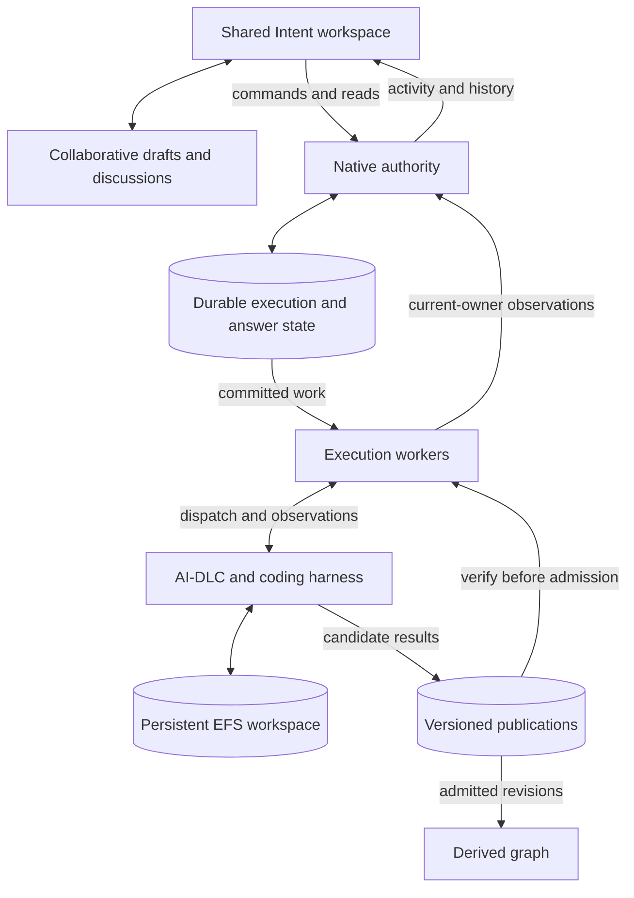

# Native execution

Native execution brings an AI-DLC methodology package into the shared Intent
workspace. A coding harness runs the methodology in a dedicated workspace while
project members review results, discuss proposals, answer questions and follow
progress together.

AI-DLC decides the workflow steps and required human gates. The platform manages
access, execution, accepted answers, published results and collaboration. Native
and the [platform execution backend](execution.md) share the Intent experience;
each backend retains its own execution commands.

!!! note "Feature status"

    Native execution is under development. Shared interaction, publications,
    history and workspace recovery are implemented, but the complete deployed
    journey is not yet qualified. Verified workflow completion and platform Git
    delivery are unfinished. The single checklist at the end of this page tracks
    the work needed for an integrated release.

## Working with a native intent

A native intent starts with a request, a methodology package and one connected
application repository. The methodology source and application repository serve
different purposes: the package supplies the development process; the application
repository supplies the code to work on.

The normal **New intent** entry offers **Platform** and **Native AI-DLC**.
Platform remains the existing default; switching backend retains the title and
prompt already entered. Native creation reuses workflow-source configuration
and verified package import on that page. Owners and administrators can configure
sources there, and members can import and select a package from an authorized
source. A member selects one connected application repository and a harness,
then creates a title-only or written draft. The shared Intent workspace supports
prompt correction, workspace preparation and explicit **Start**. Preparation does
not start agent work. The settings-page package link remains a convenience entry
into the same form. The NE-08 entry point is independently verified as deployed.
Uniform availability across spaces was independently verified as deployed on
2026-11-06. NE-09 attachment, tracker, source and effective-setting integration is
complete locally and in the installed runtime image, with deployed artifacts
independently verified on 2026-11-11. The dated acceptance records below
distinguish these scopes. NE-10's repository-file policy and result downloads
are locally and installed-image qualified, with deployed artifacts independently
verified on 2026-11-11.
A fresh live creation journey remains unrun.

The release implementation uses platform-wide native admission controls and
normal project membership. Existing and newly created spaces require no native
project enrollment. Repository access, verified packages, supported harnesses,
credential authorization and explicit Start remain required.

Kiro is temporarily unavailable for new native executions while AI-DLC input
and authentication qualification is pending. Creation shows the disabled Kiro choice
and its reason, and a prepared Kiro draft cannot Start through either the
application or a direct API request. Claude Code, Codex and OpenCode remain
selectable for development when enabled by the platform administrator. Existing Kiro configuration and history remain
readable; other platform Kiro behavior is unchanged.

The platform's **Agent CLIs** setting also gates new native selections. Creation
and prepared-draft status show disabled choices, and Start checks the shared
policy before resolving configuration or admitting work. A failed policy read
blocks new Start requests. An execution already admitted keeps its pinned
configuration and Start identity when that policy changes or becomes unavailable.
The dedicated native image and the additional Kiro restriction still apply.

Start captures the prompt and input revisions, immutable attachment versions,
tracker provenance, package, application source commit, harness, model selection,
credential scope and execution image. Later project settings
changes do not silently change that execution. Credential rotation within the
captured scope is supported; changing the source of credentials requires a new
configuration.

The shared Intent workspace provides the current response and questions, activity,
discussions, files, graph navigation and revision history. Native intents also
appear in the project, dashboard and sidebar. Native creation now begins in the
normal **New intent** entry. The local, installed-image and deployed-artifact
scopes are recorded below.

## Questions, decisions and collaboration

When AI-DLC needs input, it publishes its response and, where supported, a
structured question form. Members can edit the answer together before submitting
it. Available questions from the current workflow step can appear together;
summary confirmations and required approvals remain separate interactions.
Grouping is a presentation choice. AI-DLC's interaction-mode question remains
unless the member has already expressed a preference in their retained request
or answers; platform instructions are not evidence of a human selection.

The platform records an accepted answer against the exact question and revision
that the member saw. Competing or stale submissions cannot replace it. A retry
of an uncertain submission checks the same request instead of creating another
answer. Accepted answers remain part of the intent's history.

Answer acceptance, delivery to the agent and application of a workflow decision
are separate observations. A successful submission does not by itself establish
that AI-DLC applied an approval or completed a stage. Missing delivery information
is shown as uncertain or unavailable.

If a structured form cannot be captured, the response remains available for
inspection and an eligible turn can accept a written reply. The platform does not
invent missing options, answer questions automatically or advance a human gate.
In a native execution with the protected engine, that acceptance is the
application's only: the engine applies a reply only to a question it recorded,
and after any other reply it refuses the workflow commands of the next turn
until a form is presented and answered (known limit, NE-24).
Current forms support up to 32 questions and 16 options per question, with written
answers where required. Unsupported forms must remain explicit rather than lose
questions or choices.

Structured interaction support selects the verified official AI-DLC **2.11.1**
package identity and runtime archive bytes. A different version or fork does not
inherit support from a similar JSON shape. The adapter preserves question text,
literal option labels (including recommendation text), descriptions, order and
single/multiple selection semantics. The current scope-confirm offer includes
three choices: its alternative-plan choice has no command and remains available
for a human reply and AI-DLC follow-up. Scope/compose commands stay with the
workflow's existing validation and binding owner; they are not browser actions.

The current display transport accepts complete rendered question groups
(`version: 2`) or the two pinned typed intake asks (`version: 3`,
`scope-confirm`/`compose-offer`). Both produce the same validated pending-input
schema, version 2. The obsolete four-question version 1 is removed. Unsupported,
conflicting, unavailable or over-limit forms degrade to the inspectable response
and eligible written reply without truncation, invented choices or implied
approval. A stopped harness turn alone never establishes workflow completion.

Shared answer drafts use the platform's real-time collaboration service. Accepted
answers are durable separately from those drafts. Unsubmitted native drafts are
not guaranteed to survive a collaboration-server restart or expiry after all
members disconnect.

Members can discuss a published revision and request Quorum assistance. Quorum
provides advice through the discussion service. Its response does not submit an
answer or approve the native workflow. See [Discussions](../using-the-platform/discussions.md)
and [Real-time collaboration](../using-the-platform/real-time-collaboration.md).

## Files, history and traceability

The running workspace contains mutable project files, generated dependencies and
unfinished edits. At a completed turn boundary, native publishes a verified
revision of its eligible files and response. Each publication identifies exact
file bytes and belongs to the current execution and turn.

Members can inspect current and earlier publications, compare public source
files, download individual files and request a ZIP of a published revision.
Another authorized member can reopen that revision independently of runtime
availability. Files in published revisions are read-only; editing or applying
changes through the platform is not currently supported.

Repository content belongs to the space's authorized members. Native does not
withhold or redact a repository file because its name or contents resemble
credentials: `.env`, `.npmrc`, templates and other checked-out configuration
follow the same rules as ordinary source files. Source comparisons, file views,
graph extraction and downloads use that same publication inventory. Graph
extraction still depends on supported content and file roles; unsupported formats
remain readable or downloadable without invented graph structure.

Platform-injected credential bytes, private runtime and harness files and Git
internals remain outside the public inventory. Generated `node_modules`
dependencies follow the revision's recorded filesystem policy. Publication
verifies exact file bytes and rejects filesystem escapes,
links, concurrent mutations and configured size-limit violations. These checks
do not introduce a repository-secret classifier. Both newly published files and
retained repository files follow the selected member-visibility rule.

A publication or ZIP contains the admitted public file inventory. It is not a
complete backup of the live workspace or necessarily a complete Git tree.
Unpublished edits and generated dependencies can remain on EFS without appearing
in a download. The download identifies the exact published revision; a ZIP
contains its files under `files/` and a `result-manifest.json` with checksums,
source identity and the declared public inventory. It preserves repository
filenames, case, Unicode spelling, binary data, empty files, BOMs and line endings.
Stored publications supply downloads independently of the runtime or live
workspace. File modes, excluded entries, submodules and other repository features
need an explicit delivery contract before native can publish code back to a Git
provider.

The graph derives sections, items and relationships from published content and
links them to the exact source revision. It can be rebuilt from publications.
File locations and authored workflow markers do not establish execution progress,
approval or completion. A graph projection problem does not prevent access to
otherwise authorized published files or replies; membership verification still
has to succeed.

## Completion and delivery

Workflow completion must follow the pinned methodology's effective plan,
required checks, review outcomes and human gates. Native does not add a blanket
final approval beyond the selected workflow's requirements.

Completion is reported per published revision as **complete**, **failed** or
**not verified**. An agent stopping, a successful CLI exit, a published review
document or an accepted approval answer is not sufficient evidence of workflow
completion, and none of them changes that report.

For the pinned **AI-DLC 2.11.1** package on Claude Code, Codex and OpenCode, a
protected workflow engine owned by this project is the completion authority
(NE-11, implemented, qualified locally and in the installed image, and deployed
to the development stack; the corrected image was redeployed on 2026-11-18 and
independently verified on 2026-11-19, and the live acceptance on it has not
run yet, see the dated records below for what is not yet qualified). The pinned engine's own records are not an
independent authority, because the coding process can write the state and
human-presence files its guards read. The protected engine therefore runs the
same pinned engine code in a separate service with its own workspace and state:

- The coding runtime's `aidlc` command forwards workflow operations to that
  service. It submits the workspace's files and receives the engine's result and
  file changes. It cannot write the engine's state, journal or evidence.
- The engine records the effective plan, each stage directive it issued, the
  member decisions it applied, and the checks and reviews it observed. Project
  checks and independent reviewers run as separate isolated jobs.
- After each publication the engine writes one immutable evidence record bound
  to that exact revision. **Complete** requires the engine's own terminal
  completion, every required gate applied from an authenticated member decision,
  every required check and review observed and still current, and result files
  identical to those the engine saw at its terminal step. **Failed** is the
  engine's own recorded failure for those files. Everything else, including a
  turn stopped at an open gate, a later file change, a missing or stale
  observation, or an unavailable engine, is **not verified**.

The pinned workflow decides what blocks completion. If it completes with a failed
advisory check or reviewer concerns, the revision is reported complete and the
failed checks or concerns are shown beside it. Native adds no approval of its own.

Executions started before this change, other packages and Kiro have no protected
engine. Their results remain readable and remain **not verified**.

Native Git delivery is not implemented. Source checkout, file comparison and
result download do not create commits, branches or pull requests. The remaining
work must bind the deliverable bytes, required workflow evidence, authorized
member and destination, then confirm the provider's result. Tracker updates and
merge handling also need an explicit policy. See the shared
[Git integration guide](../using-the-platform/git-integration.md) for the platform
backend's existing behavior; it does not automatically apply to native intents.

## Persistent workspace recovery

**EFS is the only recovery path for native executions.** The project
workspace survives loss of the runtime process or coding session. It retains
workflow files, generated dependencies and unfinished edits so AI-DLC can
reconcile its own work in a fresh session.

Native turns do not capture, export, upload or restore private CLI recovery
snapshots. Public result publication remains necessary for inspection,
history and delivery. Removing private restore machinery does not remove those
publications or their integrity checks.

When session recovery is needed, the platform must confirm that the previous
process has stopped before admitting another writer. The member then confirms
**Resume in a fresh session**. Native opens the same surviving workspace with a
fresh CLI session and invokes AI-DLC's supported resume entrypoint. AI-DLC checks
its workflow records and incomplete work, then continues or asks for input.

**AI-DLC 2.11.1 recovery starts after workflow creation.** The initial scope or
plan-selection offer has no active workflow and is outside recovery coverage.
After session loss at that point, the application shows **Intake recovery is
unavailable** and does not offer fresh-session resume. Published proposals and
accepted answers remain readable. Native does not route a later resume message
through the earlier offer's answer command or turn it into plan consent.

Eligibility comes from the surviving workspace's active pointers, matching
committed intent registry entry and initialized workflow state. It is checked
when loss is observed and again before a fresh CLI starts. The last publication
alone is insufficient: a workflow may have been created during an interrupted
turn after that publication. Missing, incomplete or ambiguous workflow records
make recovery unavailable; this structural observation does not establish
approval, completion or permission to skip AI-DLC's reconciliation.

Resume confirmation does not approve a workflow gate or replay an earlier answer.
Previously delivered, uncertain and undelivered answers remain distinct. The
member reviews any retained answer against the recovered question and submits
it anew if appropriate. Native must not replace unfinished workspace content with
an older publication.

This recovery model depends on the original EFS workspace being available and
correctly bound to the intent. A missing, replaced or unreadable workspace must
produce an explicit unavailable result. EFS deletion, corruption and disaster
recovery are outside session-resume coverage; backup and retention policy are
separate operational concerns.

**NE-03 implementation:** private exact session restore has been removed after
the completed NE-02 tool proof. This remains a pre-release feature; earlier native
development formats are not a supported compatibility contract. The platform
backend's checkpoint and recovery contracts remain separate. Local validation and
the deployment boundary are recorded below.

## Responsibilities and data flow

| Responsibility                                          | Owner                                                      |
| ------------------------------------------------------- | ---------------------------------------------------------- |
| Methodology steps, workflow records and required gates  | The pinned AI-DLC engine and coding harness                |
| Authoritative workflow state and completion evidence    | The protected workflow engine, for the reviewed package    |
| Access, accepted commands and answers, execution state  | The platform's native authority                            |
| Dispatch, status observation, cancellation and recovery | Native workers operating under current execution ownership |
| Mutable project files and unfinished work               | The EFS workspace with one admitted writer                 |
| Published revisions and accepted-answer history         | Durable platform records and versioned object storage      |
| File relationships and graph navigation                 | A rebuildable projection of admitted publications          |
| Shared drafts and presence                              | The collaboration service                                  |
| Discussion assistance                                   | The discussion service and advisory Quorum execution       |



DynamoDB execution state is authoritative for native control. Workers cannot
replace accepted commands or answers based on local runtime state. Conditional
writes and writer ownership prevent duplicate or stale work from becoming the
current execution. The runtime has no direct native control-table or graph-write
permission.

Application WebSocket notifications indicate that durable activity is available;
authorized reads provide the content. Cursor-based replay and polling repair
missed notifications. Collaborative document synchronization is a separate
transport and does not accept execution commands.

### Package integrity

A workflow package is imported from an authorized source and pinned to verified
release bytes, materialization and object versions. Importing a package does not
grant continuing access to its source or to the application repository. Start
rechecks the relevant permissions and captures the selected configuration.

Package storage is restricted to its publishing worker. Its protection includes
conditional object creation, versioning, copy/delete restrictions, multipart
upload behavior and lifecycle policy. A source adapter or package version label
alone does not establish that the installer, methodology protocol and harness
combination is qualified.

Application repository credentials belong to trusted platform operations. They
are supplied for the authorized checkout and removed before methodology and
harness commands run. Files, diagnostics and download paths still require
explicit credential exclusions and current member access.

## Support matrix and settings

The current implementation runs serial turns against one application repository.
CLI availability, package import and local adapter tests do not establish a
qualified deployed combination. Release support must name the tested package,
harness, model, provider and image.

### Selected release contract

The initial serial release targets **AI-DLC 2.11.1**, **all four harnesses** and
**all three application repository providers** below. These scope decisions were
confirmed on 2026-10-26. Each advertised combination must pass qualification
before release; Kiro is a required row even while its qualification is blocked.
The temporary native Kiro admission restriction was approved on 2026-10-27.
Full Kiro instruction-channel, input and authentication qualification belongs
to NE-18 and must pass before this restriction is removed for release.

| Scope              | Initial release requirement                                                                                                                                                                                                                                       |
| ------------------ | ----------------------------------------------------------------------------------------------------------------------------------------------------------------------------------------------------------------------------------------------------------------- |
| Methodology        | AI-DLC 2.11.1, imported from the authorized methodology source and pinned to verified package bytes and materialization. Other versions and forks require their own qualification before being advertised.                                                        |
| Claude Code        | AWS Bedrock with the resolved project/platform model selection captured at Start.                                                                                                                                                                                 |
| Codex              | AWS Bedrock with the resolved OpenAI model selection captured at Start.                                                                                                                                                                                           |
| OpenCode           | AWS Bedrock with the resolved model selection captured at Start.                                                                                                                                                                                                  |
| Kiro               | Kiro's managed provider with the captured supported model selector. Its actual workflow and EFS resume journey must be qualified before release.                                                                                                                  |
| Application source | GitHub.com, GitLab.com and Bitbucket Cloud; one connected repository per execution, with its exact source commit captured.                                                                                                                                        |
| Inputs             | Written requests, supported uploaded files and imported tracker issue text, complete discussions and selected attachments. NE-09 captures immutable input versions at Start; deployed acceptance is separate from local qualification.                            |
| Settings and tools | Existing model selection and credential-scope resolution, plus repository/package instructions and tools in the dedicated native runtime. Platform-managed environments, custom MCP server selections and uploaded custom rules are outside this initial release. |
| Advanced features  | Graph enrichment, optional debug archives, artifact edit/apply, Quorum edits, parallel units, per-unit delivery, multiple repositories and cross-engine migration are outside this release.                                                                       |

The first application acceptance path is **AI-DLC 2.11.1 → Claude Code → GitHub**,
using the existing dev configuration. Record the actual resolved Bedrock model,
credential source, region, harness version, package/materialization identifiers,
application commit and immutable execution-image digest before qualification.
Use that combination first for the recovery proof in NE-02 and the complete
journey in NE-19. Those records identify the tested combination; a settings
default or model placeholder is not evidence of which model executed it.

Every additional release row must likewise identify its model/provider selection
and execution image. Qualification of one model does not qualify every model
accepted by that harness. An unset or automatic selector must be recorded as
provider routing, not described as an immutable underlying model version.
The other harness/provider rows remain required until their evidence is complete;
passing the first path does not remove them from the release scope.

The shared native settings notice appears during draft creation and in the
Intent configuration view. It describes this target and the current input limits
without enabling unfinished input paths or claiming deployed qualification.
The normal **New intent** entry keeps Platform as the default and offers an explicit Native AI-DLC choice. It does not remember a backend or infer workflow consent.

### Current implementation

| Area                        | Current behavior and limit                                                                                                                                                                                                                                                                                                                                                                                                      |
| --------------------------- | ------------------------------------------------------------------------------------------------------------------------------------------------------------------------------------------------------------------------------------------------------------------------------------------------------------------------------------------------------------------------------------------------------------------------------- |
| Coding harnesses            | Claude Code, Codex and OpenCode remain selectable for development when enabled by the shared platform CLI policy. Kiro is temporarily unavailable for new native executions, with authoritative Start rejection and an explicit runtime guard. All four harnesses still require release qualification; Kiro's full input and authentication path remains NE-18 work.                                                            |
| Methodology sources         | Import adapters cover GitHub.com, GitLab.com and Bitbucket Cloud with their supported source bindings. Installer and provenance constraints require separate qualification; importing from a provider is not a claim of full workflow support.                                                                                                                                                                                  |
| Application source          | One selected connected GitHub, GitLab or Bitbucket repository per native execution, including selection from a space with several repositories. Authoritative Start resolves and captures the default branch, exact commit, binding revision and credential identity; the worker never resolves the branch again. CodeCommit, simultaneous multiple-repository execution, submodule and LFS materialization remain unsupported. |
| Package and harness         | Selected for the native draft and pinned for execution. Repository and package instructions remain part of the workspace.                                                                                                                                                                                                                                                                                                       |
| Models                      | Start captures the resolved project/platform model selection. An unset selection or automatic routing is not an immutable provider-model version.                                                                                                                                                                                                                                                                               |
| Credentials                 | The starting member's effective credential scope is captured. A responding member does not replace it. Rotation within that scope is allowed; revocation does not silently fall back to another scope.                                                                                                                                                                                                                          |
| Environments and tools      | Native uses its dedicated runtime. Platform-managed environments, custom MCP server selections and uploaded custom rules do not currently apply. Repository/package configuration can still supply instructions and tools.                                                                                                                                                                                                      |
| Platform execution controls | Agent-tier assignments, v2 stage scheduling, platform sensors, parallelism, rewind/recompose and per-unit PR strategies do not control native methodology execution.                                                                                                                                                                                                                                                            |
| Optional features           | Native graph enrichment and debug archive capture are off. Platform preferences do not enable them for native runs.                                                                                                                                                                                                                                                                                                             |

### Native input admission and consumption

After native draft creation, **Inputs and application source** uses the same
repository selector as creation, the shared file picker and upload transport,
and the existing tracker issue and attachment pickers. GitHub Issues, GitLab
Issues and Jira Cloud issue text and complete discussions become reference
Markdown. Their files remain individually selectable. Uploaded and imported
files share the platform's filename, extension/MIME, 50-file, 5 MiB per-file and
25 MiB aggregate limits. Supported types are PDF, DOCX, XLSX, text, Markdown,
CSV, HTML, PNG, JPEG, WebP and SVG. Unsupported files produce explicit per-file
results; native retains failed or skipped selections until retry or explicit
exclusion. A missing comment page fails the issue-text import rather than
silently truncating it. Upload expiry does not remove a selected native input.

The authenticated native `POST /inputs` command accepts a strict operation and
expected input revision. Membership, project identity and the existing tracker
or source-control binding owners govern reads and transfers. The native adapter
uses the shared attachment promotion/import owners; managed intents retain their
existing store and routes. Short-lived upload destinations exist only in the
upload response. Imported provider URLs, tokens, secret references and storage
keys are absent from public input metadata and model instructions.

Start requires both the saved prompt revision and input revision. Its atomic
DynamoDB acceptance fences competing draft edits and records the exact package
and materialization, prompt hash, source commit and binding/connection identity,
effective model and credential scope, plus every attachment's immutable S3
version, byte count, content digest and tracker provenance. No pending upload or
selected unresolved import may be silently omitted. An equivalent retry returns
the original accepted execution; conflicting revisions cannot replace it. A lost
response needs status reconciliation or an explicit retry, never automatic replay.
Later tracker edits, replacement object versions, repository branches, defaults
or another member's answer cannot retarget that accepted work.

The private credential facade rechecks the original starter's tracker access
and captured credential identity through the tracker owner before each dispatch,
as well as its existing project, methodology, source and model boundaries.
Rotation within the captured connection is allowed; replacement or revocation
fails closed without alternate credentials. Its new invocation permission names
only the tracker function. The runtime receives a read-only grant for this
execution's committed input prefix and verifies bucket ownership, exact object
versions, sizes and SHA-256 digests before exposing files under
`.aidlc/references/`. Every turn verifies retained reference files and rebuilds
changed local copies from the admitted versions. Symlinks, hard links, traversal,
invalid manifests and oversized/incomplete streams cannot redirect or substitute
these input writes. Reference metadata explicitly treats the files as untrusted
data, not authority to run actions or skip methodology gates. PDF/DOCX/XLSX text
extraction uses the image's installed MarkItDown; OCR and complete visual-layout
interpretation are not promised. Supplied HTML and SVG must not be executed or
rendered.

The managed-environment, custom MCP-selection and uploaded-rule exclusions are
unchanged. Native keeps repository/package instructions and its dedicated tools.
Main's optional AgentCore MCP Gateway remains disabled by default and does not
route native turns through managed execution. NE-09 does not add Git delivery,
tracker writes, workflow completion or NE-10's general result-file policy.

The Intent configuration view shows captured settings rather than current defaults.
Unsupported settings need to remain visible as limitations wherever users choose
or inspect native execution. The selected package determines its methodology
agents and reviewers; the platform should not duplicate that workflow model.

Native activity uses the shared usage parser and pricing service, including
reported cache reads, cache writes and one-hour cache writes. Estimates exclude
credits and infrastructure. Codex continuation in an existing CLI session has no
authoritative cumulative baseline, so that turn does not report an invented
usage delta. A fresh CLI session, including EFS workspace recovery, starts from
the parser's zero baseline. These activity samples do not decide turn completion,
publication or question identity; the explicit native harness decoder does.
Native discussions do not write managed execution metrics or completion events.

The optional organization IAM role path and permissions boundary apply to native
controller and package roles through the shared Terraform inputs. Dynamically
created runtime roles keep the dedicated `/native-runs/` path and native runtime
permissions boundary; these settings do not replace that isolation contract.

Artifact edit/apply, Quorum edits, parallel units, per-unit delivery,
multi-repository execution and cross-engine migration are outside the serial
integration target. Optional enrichment and debug archives also remain outside
that target unless explicitly selected for release. Their absence must not be
presented as an implemented capability or become an implicit release blocker.

<a id="recovery-compatibility-and-operation"></a>

## Recovery and operation

Cancellation requests stop the current execution; a requested stop and a
confirmed stop are different states. Recovery requires confirmation that the
previous writer has stopped. Status refresh, elapsed time or a missing response
cannot establish that fact. Published revisions and accepted decisions are
independent of whether a process is currently running.

Operators can close admission for new work while keeping services available for
current runs. Deploy matching frontend, authority, worker and runtime contracts
together. The transition to EFS-only recovery can discard compatibility with
native development runs; it must preserve the existing platform backend and the
integrity of newly accepted native work.

Repair workers rediscover committed work after missed notifications. Operational
acceptance must establish repair delay at the intended scale, usable alerts and
an incident owner. Normal member actions should be diagnosable through activity,
status, history and explicit error messages rather than private runtime logs.

Archive, replacement-run and resource-cleanup behavior is not yet defined.
Stopping a runtime is separate from deleting its workspace or publications, and
the UI currently prevents deletion of a space containing native intents. These
lifecycle actions need clear permissions, retention and user-visible outcomes.

For shared deployment and validation procedures, see [Setup](../getting-started/setup.md)
and [Testing](../development/testing.md). The checklist below distinguishes an
implemented capability from proof that it works through the deployed user path.

### First-path EFS resume qualification

**Current scope, corrected by the user on 2026-11-03:** NE-02 qualifies the
native execution tool. Generated application files and command results are
opaque fixture data. Verify that the platform accepts, stores, exposes and
preserves those bytes with the correct execution, publication and access
identities. Generated-game correctness, source-quality review, independent
application test/build qualification and browser playability are not completion
gates. A complete game is unnecessary. Errors in generated content are not
platform defects unless the tool violates its own transport, persistence,
authorization or recovery contract. This scope supersedes the game-quality and
playability requirements in the dated historical observations below; those
observations retain their original outcomes. The tool's regression tests and
genuine workflow human gates remain required.

NE-02 uses separate fresh qualification intents in the existing dev-enabled space,
with AI-DLC 2.11.1, Claude Code and a connected GitHub application repository.
Deploy the same candidate's frontend, authority, workers and runtime before
testing. Record the candidate commit and deployed versions, exact Bedrock model,
credential source, region, immutable runtime-image digest, harness version,
package/materialization identifiers and application source commit. Verify these
against the accepted execution configuration before exercising recovery; a
Terraform default or mutable image tag is insufficient.

1. Start through the application, select a plan as a real member, and verify that
   AI-DLC has created its workflow before reaching a real workflow question.
   The initial scope/plan-selection offer is not a recoverable boundary for
   2.11.1. Record the created workflow, interaction and publication identifiers
   and any accepted answer's delivery status. Let the runtime remain idle beyond its 900-second session timeout,
   then submit the next real member answer through the application. Ordinary
   application reads do not detect expiry or keep the runtime alive. The next
   dispatch must detect the lost session before sending that answer to the
   harness, retain its acceptance and expose recovery through normal status reads.
2. In a separate intent, interrupt its runtime during an active tool after it has
   created unfinished edits and dependency links. Preserve its EFS workspace.
   Ordinary intent cancellation is a terminal user command and does not substitute
   for unexpected runtime loss in this scenario.
3. For both cases, require confirmed predecessor stop and a member's **Resume in
   a fresh session** action through the browser. Trace the accepted public request
   to the authority, worker and runtime. Confirm the same workspace identity and
   a different CLI session identity, with no concurrent predecessor writer.
4. Verify AI-DLC resumes against the surviving edits and dependencies, exposes
   real command results, admits a new publication and reaches its next real
   question. Compare retained file and dependency identities and verify result
   delivery through the application; do not assess generated application quality
   or require its tests/build to pass.
   Previously accepted answers must retain their delivery classification and
   history; recovery itself must not replay an answer or approve a gate. For the
   expired waiting session, inspect the original revision's
   `answer.resumeRetention.delivery: "undelivered"`, unchanged acceptance and
   member, and absent delivery time/resulting publication. The current interaction's
   generic delivery status alone cannot establish this history. Capture evidence
   that the turn used no private recovery capture, export, import or restore.
5. Separately lose a session at the initial plan-selection offer. Confirm that the
   browser explains that intake recovery is unavailable, the recovery API refuses
   the action, and no fresh CLI starts. Its proposal and any accepted answer must
   remain in history, without plan consent or automatic answer replay.
6. Exercise missing and incorrectly bound workspaces using isolated qualification
   resources. The browser must show that resume is unavailable, with no replacement
   workspace, model turn or admitted publication. Preserve existing dev workspaces
   and earlier failed intents. Start these faults from a created workflow so the
   intake restriction does not mask a workspace-binding failure.

**Local readiness, 2026-10-26:** the frontend recovery service and authenticated
API wrapper now run against the real public router, execution API and authority
store in regression tests. A lost response preserves the confirmation and command
identities and produces one authority transaction; denied membership produces no
dispatch or state change. A further process-loss regression reproduced an
acknowledged fresh-session resume becoming terminally failed if its runtime died
before publication. The worker now recognizes the current resume episode, turn
and writer as in-flight work and uses the existing fenced, confirmed-stop recovery
path. The real HTTP/executor fixture reaches a third writer generation while
preserving unfinished work and accepted-answer history without replay. All 1,398
native-runtime-control tests pass, including stale ownership, cancellation and
unconfirmed-stop cases. Fixture authentication, persistence and inert subprocesses
do not establish deployed browser, harness or EFS qualification.

The operator fixture is `scripts/native-recovery-qualification.mjs`. Its local
`barrier-command` action prints a bounded, foreground Bash command for Claude to
run after real implementation edits and dependency installation. The operator
`stop` action verifies that this command is an active Claude child before stopping
the exact accepted runtime session. Capture changed-file and dependency-link
hashes before stopping, compare the changes with the preceding publication, and
use `inspect --marker-sha256` after the resumed run publishes to compare retained
evidence. An old marker alone does not prove an active interrupted tool.
Prepare the scoped user-run stop command first. Start the expiring barrier only
after the operator is ready, and never reuse the expired October 27 command.

The `missing-project` and `wrong-project` actions require an isolated intent at a
recoverable boundary with a confirmed predecessor stop. They preserve the
original project in a nonce-scoped quarantine and stop their diagnostic session
before returning; they do not modify authority records or delete EFS data. All
operator actions require explicit account, region, resource and writer identities,
and a separately authorized operator profile. `solution-read` is rejected.
The 27 focused helper tests and all 300 release-script tests pass; these checks
do not establish live fault qualification.

**Dev qualification preparation, 2026-10-26:** deployment of `010ce5d5` and
the subsequent `fbda6296` worker correction was confirmed. The frontend entry
asset and deployed API, authority and execution-worker archives match their local
deployment artifacts byte for byte; the worker correction keeps the same runtime
image. The signed-in application imported the selected package, prepared a fresh
qualification intent and accepted Start through the public API. The accepted
execution matches the package, model and image pins recorded before Start:

| Pin                     | Recorded value                                                              |
| ----------------------- | --------------------------------------------------------------------------- |
| Region                  | `us-east-1`                                                                 |
| Harness                 | Claude Code `2.1.296`, verified in the exact image with networking disabled |
| Effective model setting | `global.anthropic.claude-sonnet-5-5`, from the space override               |
| Credential source       | Platform Bedrock credentials, captured by the accepted Start                |
| Runtime image digest    | `sha256:ef179ee0335bffe0184b376abc9768306f4602952b26dc8c9ca7ca6c552068b9`   |
| AI-DLC release          | `v2.11.1`                                                                   |
| Methodology commit      | `895a35d86d20336d9b7bc4aedc9440e4a12c83ab`                                  |
| Package identity        | `sha256:577eced0d4425aba7cd4fdaec100315363e104d28fa47f1aec141aac606dfb56`   |
| Materialization         | `sha256:be88b2f8c1240dfb86ad4a75e9d3104931f65c35d789b572127028b0631d0386`   |
| Application repository  | `JWThewes/flappy-bird` on GitHub                                            |
| Application commit      | `d99d2511c43f07ff2451e7e13f5a8f45b16dfce2`                                  |
| Application branch      | `ai-dlc/initial-game-1776942523258--task-project-scaffold`                  |

The accepted execution captures the space's model selection, which differs from
the platform fallback. Its runtime uses the prepared EFS access point and a
dedicated execution endpoint. The initial AI-DLC scope/plan-selection offer was
published before the waiting-session expiry test. After more than 900 seconds of inactivity, a
browser reply was accepted and the worker detected the lost session before
dispatching it. The application exposed a confirmed predecessor stop and accepted
the member's explicit fresh-session confirmation. Writer generation 2 reused the
same execution, configuration and EFS binding, used a different CLI session, and
admitted publication 2. History retained the original answer as undelivered with
its identity, text, author and acceptance time unchanged, and no delivery time,
resulting publication or approval. The observed recovery used no private checkpoint
capture or restore.

This is partial proof: publication 2 reported `next does not take --on-instruction
where` from the pinned workflow's resume command and contained no workflow
question. The pinned engine reads the complete AI-DLC user message, including the
previously appended platform guidance; even clean CLI arguments reproduced the
failure. Moving guidance outside that message exposed the independent intake
limit: an exact resume returns **No workflow state found** before an active intent
exists. The selected release therefore limits recovery to created workflows.
The offered question's request-answer route is not a supported fallback: a later
resume message can satisfy that route's input check and produce a workflow-create
instruction without a plan choice.

The two publications preserved the complete file inventory and application
source; five engine hook-health timestamps changed. Publication admission and
these retention checks do not qualify workflow recovery. Platform transport
guidance must use a separate harness instruction channel while the resume user
message remains the literal supported entrypoint. The interrupted-tool case is
prepared but not started: the pinned application commit contains an empty Phaser
scene, so its implementation/build/test fixture needs a source-baseline decision.
The missing/wrong-workspace cases also remain unqualified. NE-02 stays open.

**Recovery candidate, 2026-10-27:** the local candidate requires a created workflow
observed in the surviving EFS workspace, including its active pointers, committed
intent registry and initialized state. It checks this state before fresh-session
admission and again immediately before the CLI starts. Current workspace state
can establish creation after an older intake publication; publication alone
cannot establish recovery eligibility. Missing or unrecognized state leaves
recovery unavailable. Accepted answers, delivery classifications and immutable
publications remain intact, including interrupted-resume and lost-acknowledgement
paths.

The AI-DLC user request and resume entrypoint now remain literal. Platform
transport guidance uses the harness instruction channel and supplies no human
answer, interaction-mode selection or workflow consent. The earlier exact-image,
network-disabled Claude hook check used literal `/aidlc --resume` with zero model
tokens; it remains an offline hook check, not live recovery proof.

The approved temporary Kiro restriction uses native capability/status responses,
the existing creation/configuration UI, and the authenticated Start authority.
It rejects a new Kiro Start before configuration capture or dispatch, including
direct requests and forged availability overrides. Already admitted
configurations and readable work are preserved, and the runtime retains
`native_execution_transport_kiro_unqualified`. This does not qualify Kiro or
remove it from the four-harness release requirement.

Local validation of this candidate on Node **24.21.0**:

| Check                                                                                        | Result                                                                       |
| -------------------------------------------------------------------------------------------- | ---------------------------------------------------------------------------- |
| `npm test -- --maxWorkers=4`                                                                 | **11,544 passed, 10 skipped**; 390 files passed                              |
| `npx vitest run --project=native-runtime-control --maxWorkers=4`                             | **1,437 passed** across 52 controller files                                  |
| Seven focused recovery suites through `vitest.native-foundation.config.js`                   | **284 passed**, including runtime, authority and fence                       |
| `npm --prefix frontend test -- --maxWorkers=4`                                               | **2,104 passed** across 150 files                                            |
| Five focused native creation, interaction, execution and service suites                      | **417 passed**                                                               |
| `npm --prefix frontend run build`; `npm run build -w native-runtime-control`                 | Frontend and all eight controller bundles built                              |
| `npm run architecture:check`; `npm run dep:check`                                            | 413 production modules, zero violations; zero errors, 17 dependency warnings |
| `npm run lint -- --ignore-pattern '.worktrees/**'`; `npm run secretlint -- '!.worktrees/**'` | Zero lint errors, 82 warnings; secret scan passed                            |
| `npm run format:check -- . '!.worktrees/**'`; `git diff --check`                             | Passed                                                                       |
| `uv sync --group docs --locked --offline`; `uv run --no-sync zensical build`                 | Passed using a local evidence-directory UV cache                             |

These suites overlap; their counts are separate results, not an aggregate.
The full backend suite used local Docker test services and inert test credentials.
The first backend run found two capability-response assertions that needed the
new field; both were corrected before the successful full rerun. The architecture
check also prompted local extraction of recovery-result and record validation,
followed by the successful controller/full reruns. The frontend build retains its
bundle-size advisory. No deployed browser journey, newly built runtime image,
credentialed provider call or live recovery fault was exercised in this stage.
The earlier source-hash comparison matched all 31 recorded candidate files at
stage entry; earlier passes remain historical evidence. Exact commands, source
hashes and local logs are recorded under
`.native-evidence/ne02-2026-10-27-candidate/`.

Deploy this candidate's frontend, API/authority, workers **and a newly built
runtime image** before the next proof. `scripts/deploy-terraform.sh` builds the
source-derived AgentCore image and wires its digest into native services;
`scripts/deploy-frontend.sh` then builds and uploads the frontend. Generate a
fresh candidate-specific plan with `--phase plan --plan-file`, review it, and
apply that same `--plan-file` path with `--phase apply --skip-seed`. Reusing an old
image or deploying only backend archives cannot validate the transport and
pre-spawn recovery corrections.

At this candidate handoff, live acceptance remained pending for created-workflow waiting-session expiry,
interruption during an active tool with retained edits/dependencies and real
build/tests, the next genuine workflow question, visible intake rejection,
missing/wrong EFS workspace rejection, and exact deployed/configuration/image
alignment. The application fixture choice is still pending separately and does
not block this local candidate. Do not start NE-03 until the actual NE-02 live
proof passes.

**Dev deployment and live qualification, 2026-10-27:** the user deployed
`526837eb8394735e6b365bdfbcda249af84c5e3f` with
`scripts/deploy-terraform.sh dev --phase all --skip-seed` and
`scripts/deploy-frontend.sh dev`. Scoped reads using `solution-read` verified
account `746558295630`, region `us-east-1`, the served frontend entry and all
521 assets, all nine native Lambda archives and bundled entrypoints, and the
five authority aliases at version **15** against the candidate bytes. The
browser's loaded chunks were included in that comparison.

The deployed runtime image is
`sha256:074c50086bee10ca4d086fa3df0a9f87251a684bfa34df6ec67cf08cd65f6eeb`,
with source-derived tag `cc2d6c57451852b2`. All five changed runtime production
files match the candidate inside that exact image. Its installed harness is
**Claude Code 2.1.296**, with image Node **24.19.0**. That image inspection used
disabled networking and no model calls; the fresh browser executions below
made the authorized real model calls.

Both fresh Claude Starts captured **AI-DLC 2.11.1**,
`global.anthropic.claude-sonnet-5-5` from the space override, platform Bedrock
credentials, `efs-workspace-v1`, and the verified image digest. The fresh
package job is `ae854a6a-c445-464d-b08f-0f5451af857e`, with package
`sha256:577eced0d4425aba7cd4fdaec100315363e104d28fa47f1aec141aac606dfb56`
and materialization
`sha256:be88b2f8c1240dfb86ad4a75e9d3104931f65c35d789b572127028b0631d0386`.
The current methodology source binding and imported package provenance match
the accepted configurations. The connected application uses GitHub OAuth for
`JWThewes/flappy-bird`; both executions resolved branch
`ai-dlc/initial-game-1776942523258--task-project-scaffold` to
`d99d2511c43f07ff2451e7e13f5a8f45b16dfce2`. Their actual runtime version,
endpoint, 900-second idle timeout and EFS access-point/mount configurations
match their accepted authority records.

The temporary Kiro behavior **passes deployed checks**. Creation visibly
disables Kiro and explains its temporary unavailability. Fresh Kiro draft
`a09241ef-2f80-4de2-ba00-0597f930c116` was created and prepared through the
public API to exercise bypass of that UI. Its configuration explains the
restriction, Start is disabled, and a valid direct Start request returned
**409 `NATIVE_EXECUTION_KIRO_UNAVAILABLE`**. A consistent authority read
confirmed no execution record. This exercised no Kiro model work and does
not qualify Kiro for release.

The waiting scenario is **blocked on the pending application fixture decision**.
Fresh intent `a3603caa-8c60-4d8e-ba0f-18605f92e773` published
`8c29e19314bcfcca1e902c22963c9d919bfd8524ddca6ce14c52ebae795715e1`
from CLI session `6a89dea9-a923-417e-b57c-2788651ea74a`. Its actual question
asks how to handle the missing source baseline: `index.html` contains an
empty Phaser scene, with no bird, pipes, score, flap/restart inputs,
`package.json` or test tooling. The reply remains unanswered. No plan was
selected and no created workflow was verified, so this is not a created-workflow
recovery proof. The separate fixture choice must be resolved before continuing it.

Fresh intake intent `616beab2-4f20-4e7d-b988-35aab343eea1` reached the
initial express-plan offer, with publication
`655d9c5fc9c41240ad88c8d353dfa11b00d26bd0703d85da24f0aa02907c6221`
and CLI session `b9753320-74ee-4985-bc6c-370b572deccc`. Its natural-expiry
intake rejection **passes**. After **954.585 seconds** from the recorded idle
baseline, the member submitted the existing instruction to keep the source
baseline decision open, selecting no plan option. The browser received **202**.
Dispatch detected the lost session before sending the reply to the harness.
Current EFS state reported `workflowResumeState: "not_created"`; the authority
recorded `INTAKE_UNAVAILABLE`, `canRecover: false`, and confirmed predecessor
stop at `2026-10-27T10:14:26.689Z`.

The browser visibly explains that AI-DLC 2.11.1 requires a created workflow
and offers no fresh-session resume action. A valid direct recovery request
using the current recovery ID and `confirmWorkspaceResume: true` returned
**409 `NATIVE_EXECUTION_CONFLICT`**, leaving the authority revision unchanged.
The original publication's API and actual browser history preserve answer
`8f3a7e1f-77e1-481f-a473-dddace526048`, its author, exact bytes and acceptance
time `2026-10-27T10:14:23.222Z`. Its original `deliveryStatus: "pending"` is
unchanged, with no delivery time, resulting publication or recorded approval.
The same EFS binding, configuration, writer generation **1** and original
publication remain. Scoped lifecycle evidence shows only the initial CLI
launch, no continuation/resume dispatch, and no private checkpoint capture
or restore.

| Remaining NE-02 proof                                                      | Status and prerequisite                                                                                         |
| -------------------------------------------------------------------------- | --------------------------------------------------------------------------------------------------------------- |
| Created-workflow waiting expiry, fresh CLI and next real workflow question | **BLOCKED** on the pending application fixture decision; the source-baseline question remains unanswered.       |
| Post-resume `answer.resumeRetention.delivery: "undelivered"`               | **NOT RUN**; intake denial preserves the answer but admits no resume episode.                                   |
| Active-tool interruption, retained edits/dependencies and real build/tests | **BLOCKED** on the fixture decision and separately authorized operator credentials or user execution.           |
| Missing/wrong EFS workspace rejection                                      | **BLOCKED** on isolated, recoverable created-workflow resources and operator authorization; no faults were run. |

No operator fault, deployment or change to historical intents was performed
during this stage. No implementation correction was needed, and the candidate's
backend/frontend suites were not repeated. Redacted evidence and documentation
validation results are under `.native-evidence/ne02-2026-10-27-live/`;
`pin-comparison.json` records the deployment/configuration comparisons,
`intake-recovery-proof.json` records the completed negative proof, and
`waiting-blocker.json` retains the exact unanswered source-baseline question.
NE-02 remains unchecked; NE-03 must wait for the remaining live proof.

**Approved game fixture and fresh qualification, 2026-10-27:** the user resolved
the source-baseline decision: build a minimal game and tests on the pinned empty
scaffold. The approved scope is one playable Phaser scene with simple shapes,
flap controls, obstacles/collision, score, game-over/restart, and keyboard-accessible
pause/resume through `P` and a visible control. Pause must preserve the run and
score. Add the smallest suitable package/build/test setup, deterministic gameplay
and pause/resume/restart tests, controls documentation and an actual browser
playability check. Keep Phaser **3.60.0**, the version in the scaffold. Application
changes belong to the native workspaces and their publications; no GitHub push
or PR delivery is requested.

Fresh requests explicitly acknowledge the intentionally empty baseline. The
earlier waiting and intake intents remain unchanged. This stage uses the deployed
implementation `526837eb8394735e6b365bdfbcda249af84c5e3f`, with documentation
head `cb0392871097f006e30d15696801ff154d313ffe`. Each new Start was checked against
the same immutable runtime image, AI-DLC 2.11.1 package/materialization, Claude
model and platform Bedrock scope recorded above. All four executions resolved
the approved application branch to
`d99d2511c43f07ff2451e7e13f5a8f45b16dfce2`; scoped AWS reads verified their separate
runtime endpoints, EFS bindings and 900-second idle timeouts.

| Scenario                          | Fresh native intent                    |
| --------------------------------- | -------------------------------------- |
| Created-workflow waiting recovery | `5dcf330b-1ce8-47c5-972b-9bd5d4b9315b` |
| Interrupted active tool           | `26b5b329-9c15-421d-9fc6-69f11a714c43` |
| Missing EFS project               | `f3cc998d-e457-4e4c-948c-985a2da1eb39` |
| Incorrectly bound EFS project     | `33ab1cb2-8f74-4c41-aff2-71c27b3cb8fe` |

Each express plan was explicitly selected through the application, preserving
its six approval gates. Current stage evidence is recorded separately under
`.native-evidence/ne02-2026-10-27-game/`; `accepted-pin-comparison.json` records
the four accepted-configuration/resource comparisons. The previous
`.native-evidence/ne02-2026-10-27-live/` evidence remains unchanged.

The created-workflow waiting recovery **passes its recovery checks**. The
requirements approval question in publication
`c07099e6b6da43642e489c8b6a9dcc62ddaab94032b1c9a674572a864282b8ac`
was left idle for **974.635 seconds** after the recorded baseline, with no runtime
keepalives. The actual browser approval was accepted at
`2026-10-27T13:03:02.818Z` as answer
`c6e9fd82-7448-4660-90bb-e31ff00cdcd3`. Dispatch detected session loss before
delivery, observed a created workflow in EFS, and confirmed the predecessor stop
at `2026-10-27T13:03:05.951Z`. The member then explicitly confirmed
**Resume in a fresh session** through the browser.

Writer generation **2** retained binding
`750fc226-5c11-4ca7-84e7-c0d685e0bc72`, EFS access point
`fsap-03451764da3b9a46d`, configuration and runtime target. CLI identity changed
from `28b1b8dc-7f1e-4c55-b088-6368d45715fd` to
`f741550b-167a-4a6d-8f59-d2a6e07c380c`. New publication
`6c12d45367e9dcf153d587e1270e4a1c7b7ea6225201918da9624fdf848dd0f7`
contains the real requirements approval question. The active pointers, committed
intent registry, initialized state, answered requirements questions and
requirements document all survived byte-for-byte; the requirements gate
remained open.

The original revision's answer retained its ID, actor, acceptance time and bytes
both before and after the new publication. Its
`answer.resumeRetention.delivery` is **`undelivered`**, with no delivery
timestamp, resulting publication or recorded approval. The recovery request
contained only its request ID, recovery ID and explicit workspace-resume
confirmation. Lifecycle evidence and metadata-only listing of the exact attempt's
private recovery prefix show no checkpoint capture, export, import or restore.
The original answer was not replayed. After reviewing the surviving requirements,
the member submitted a distinct approval of the new question at
`2026-10-27T13:08:09.818Z`; this starts implementation without treating recovery
confirmation as consent. `waiting-created-recovery-proof.json` and the original
answer history captures record this proof.

After that distinct approval, the native harness implemented the game in its
workspace. Member-visible tool results record **17 passing tests** in
`tests/rules.test.js` and a successful **Vite 7.3.7 production build** (10 modules,
4.83 seconds). An initial score-boundary test failed; the harness adjusted its
setup and reran all 17 tests. Its Chromium playability attempt could not launch
because the runtime lacks `libglib-2.0.so.0`. These are actual native test/build
results, but the final application files have not passed publication review,
and an actual browser playability check remains **NOT RUN**.

The implementation turn then **failed publication** with
`native_execution_output_result`. Its content-free diagnostic records
`result_mismatch` at result record **176**, with **3** assistant text blocks and
**1** observed query boundary. The runtime rejected the result at
`2026-10-27T13:22:19.217Z`; runtime stop was confirmed at
`2026-10-27T13:24:36.775Z`. Publication
`6c12d45367e9dcf153d587e1270e4a1c7b7ea6225201918da9624fdf848dd0f7`
remains the last admitted revision. It contains the recovered requirements
question, not the game result. The failed execution and its history are preserved.
`waiting-native-validation-observed.json`, `waiting-game-output-rejection.json`
and `waiting-output-rejection-lifecycle.json` record these separate boundaries.

Inspection of static executable code in the exact deployed Claude 2.1.296 image
shows that its engine can queue completed parent-query results while background
work runs, then emit those results in order after later assistant messages.
An inert fixture of that producer sequence reproduces the deployed parser's
`result_mismatch`: it compared every result only with the latest response.
This identifies a supported sequence the parser rejected; it does not claim
that private live transcript bodies were read or reconstructed.

The bounded runtime correction validates deferred results against ordered
assistant responses from the current invocation. The final observed response
must still have a successful terminal result before publication; failed,
incomplete, reversed, duplicate terminal and foreign-session results remain rejected.
The existing text/query limits, credential checks and silent-notification
handling remain enforced. Executor-level tests cover both successful publication
and refusal when a later result is absent or failed, without private checkpoint
operations. This correction requires a newly built runtime image and fresh
deployed qualification; its local tests do not establish a live pass.

The interrupted-tool workflow followed its approved qualification procedure:
install real dependencies, leave genuine game edits unfinished, then enter the
existing helper's foreground barrier before the separately executed scoped stop.
The native harness installed Phaser **3.60.0** and wrote a deterministic game
core with **15 passing tests**. Input routing, the Phaser scene and final
build/browser validation were still unfinished. The **150-second** barrier
expired normally without an operator stop. Publication
`9ce6bb50f85c87557daa12ce8601e5f63556747d116be53adcad57c2cdbbef86`
preserves that partial work and asks whether to retry with a fresh nonce or
finish implementation. This question remains unanswered, and the old stop
command is stale. No interruption, dependency-link retention or fresh-session
reconciliation is claimed. A retry needs a new live foreground barrier with
genuine unpublished work; the helper requires at least **45 seconds** remaining
when it inspects the barrier.

The two isolated workspace-negative cases have created workflows and confirmed
predecessor stops after natural expiry. Their prepared commands remain scoped
to the exact intent, attempt, writer and nonce in `missing-operator-command.json`
and `wrong-operator-command.json`. The user chose to execute these helpers, which
quarantine each original project and stop their diagnostic session. No operator
profile was authorized for the agent; `solution-read` remains read-only.
Their result files and subsequent browser rejection still need verification.

| NE-02 check at this stage                                                      | Status                                                                                      |
| ------------------------------------------------------------------------------ | ------------------------------------------------------------------------------------------- |
| Deployed candidate/configuration/image alignment                               | **PASS** for deployed `526837eb`; the parser correction is not deployed.                    |
| Temporary Kiro unavailability and intake-expiry rejection                      | **PASS**, retained from the preceding deployment stage.                                     |
| Created-workflow waiting expiry, fresh CLI, preserved answer and next question | **PASS**, with the exact identities and retention evidence above.                           |
| Native game tests and production build after resume                            | **PASS** for the observed commands; final source/publication review remains open.           |
| Game result publication                                                        | **FAIL**, with a locally reproduced parser correction awaiting deployment.                  |
| Actual game browser playability                                                | **NOT RUN**; native Chromium could not launch and no game result was admitted for download. |
| Interrupted active tool and retained dependency links                          | **BLOCKED**; the barrier expired without the separately executed stop.                      |
| Missing/wrong EFS workspace rejection                                          | **BLOCKED** pending the user-run helper results and browser checks.                         |

**Local correction validation, Node 24.21.0:** the 163 focused parser/executor
tests pass. The full AgentCore project passes **3,165 tests**, with **10 skipped**
for Bun-dependent and Linux-only coverage on this host. All **43** controller
caller checks pass; the nine-test workspace journey file was rerun with
loopback access after the sandbox denied two local HTTP listeners. The 22 native
wiring tests, six architecture tests, architecture check, dependency check,
lint, formatting, secret scan and documentation build pass. Lint reports
82 warnings and the dependency check reports 17 warnings, with no errors.
The full backend and frontend suites were not repeated for this runtime-only
correction. Logs and source hashes are recorded in this stage's
`repair-validation.json` and `repair-image-source.json`; the latter identifies
the new image's expected source-derived tag, not a deployed digest.

NE-02 remains unchecked. Preserve these runs and deploy the runtime correction
before starting a fresh, matching positive proof. NE-03 and full Kiro
qualification remain in their existing sequence.

**Workspace-fault follow-up, 2026-11-02:** the user ran the prepared handoff after
a machine reboot. It stopped at the first helper: `missing-operator-result.json`
reports `ok: false`, `runtime_response_invalid`, and
`diagnosticStop.confirmed: true`, without a workspace receipt. Its original
1,331 bytes remain unchanged, SHA-256
`f02e94345522b8fdc2fba793d1ac0a0e6e059793ccd0426d47667a295b3e7061`.
The script's exit-on-error behavior prevented the missing-result verifier and
wrong-project command from running. Neither fault has a successful verified
operator result.

Scoped reads with `solution-read` reverified account `746558295630`,
`us-east-1`, both accepted runtime version **2** endpoints, their EFS access
points and the original immutable image
`sha256:074c50086bee10ca4d086fa3df0a9f87251a684bfa34df6ec67cf08cd65f6eeb`.
The API, authority, execution worker, provisioner and wakeup package hashes and
image settings still match deployed `526837eb`; the execution-authority alias
remains version **15**. All 272 runtime source hashes still match the locally
validated parser correction `3280c8b4`. Its expected image tag
`d2dff54e22d80b4f` remains a source-derived build identity, not a deployed digest.

The missing-case runtime log records command request
`ff81f1fe-8353-4881-ba9c-1517ca3871ac` at `08:05:32.500Z`.
The logged command matches the original fixed **20,655-byte** helper command
exactly. The same diagnostic log stream records `SIGTERM` at
`08:05:33.511Z`, corroborating the helper's checked stop acknowledgement.
These observations establish receipt of the command and diagnostic stop, not
the outcome of the rename or quarantine. The old helper discarded which
response-validation check failed and returned no filesystem observation.
The exact response-contract mismatch and the first mutation's outcome remain
unknown; the command must not simply be rerun.

Both authority records are unchanged from their October 27 expiry evidence:

| Case            | Intent                                 | Preserved boundary                                                                                        |
| --------------- | -------------------------------------- | --------------------------------------------------------------------------------------------------------- |
| Missing project | `f3cc998d-e457-4e4c-948c-985a2da1eb39` | Revision **313**, writer **1**, publication **2**, accepted answer `89de5291-d7d0-48f0-aa62-7fae7a6ebe36` |
| Wrong project   | `33ab1cb2-8f74-4c41-aff2-71c27b3cb8fe` | Revision **470**, writer **1**, publication **2**, accepted answer `167f809d-46bb-4724-888e-c52037835307` |

Both remain `RECOVERY_REQUIRED` with the same created-workflow recovery episode,
confirmed predecessor stop, session and EFS binding. Publication, interaction,
accepted member, acceptance time, answer hashes and the original `pending`
delivery classification are unchanged. No new writer or publication is recorded.
This is preservation evidence, not the waiting case's separate retained,
undelivered-answer proof.

The local operator helper now records bounded response metadata and failure
phase without retaining raw stdout, stderr, headers or SDK exceptions. It
explicitly requests the documented binary event-stream response format while
keeping acknowledgement, session, completion, scope and exit checks enforced.
This transport change is not yet a live fix for the unidentified mismatch.
The new `inspect-workspace` action requires a stopped, created workflow and
checks the recorded owner, project inode and original nonce's quarantine.
It reports intact, missing, replacement or partial-quarantine observations
without moving, deleting or repairing project files. Like the existing fault
helpers, it bootstraps only `native-status` and confirms its diagnostic stop.
Only user execution or a separately authorized operator profile may run it;
`solution-read` remains rejected.

The signed-in dev browser was reopened after the reboot. No browser recovery
was submitted against an unverified fault. Missing-workspace mutation status
remains **UNKNOWN**, the wrong-workspace fault is **NOT RUN**, and both browser
rejection proofs remain **BLOCKED** on verified filesystem observations.
The exact, guarded inspection handoff and fresh evidence are under
`.native-evidence/ne02-2026-11-02-workspace-faults/`. The handoff preserves the
failed result and writes distinct inspection receipts; an inspection is not a
replacement success receipt for the failed mutation. A read-only control uses
the previous response-format request so its diagnostics can be compared with
the explicit event-stream request. Each diagnostic stop must be confirmed before
the handoff starts another session for that intent.

**Local helper validation, Node 24.21.0:** all **42** focused helper tests pass.
The full release-script run passes **313 of 315** tests. Its local HTTP fixture
passes separately with loopback access after the sandbox's `EPERM`; the release
metadata check passes against a byte-identical snapshot of all **46** tracked
release inputs after the root check also scanned unrelated `.worktrees`
manifests. Those worktrees remain untouched, and the full root run is not
reported as green. Lint and dependency checks report their existing **82** and
**17** warnings with no errors; the architecture check reports no violations.
Formatting, the secret scan and the documentation build pass. The inspection
receipt verifier passes **27** synthetic checks; these establish no live outcome.
No runtime, frontend or application source changed in this follow-up. The
earlier parser correction still requires user deployment, and game publication,
browser playability, interrupted-tool recovery and both workspace rejections
remain open. NE-02 stays unchecked.

**Inspection receipts and contract correction, 2026-11-02:** the user ran the
inspection handoff from `1128a1bd`. All three diagnostic stops are confirmed,
but neither workspace inspection passed. The five new result/verifier files and
the original failed mutation receipt remain byte-for-byte unchanged.

| Inspection               | Actual command response                                                                                       | Qualification consequence                                                                 |
| ------------------------ | ------------------------------------------------------------------------------------------------------------- | ----------------------------------------------------------------------------------------- |
| Missing, implicit Accept | Request `162b81f0-a4ee-4d1c-bee7-75df589acffa`: verified event stream, exit **1**, `workspace_invalid`.       | The command rejected a workspace invariant; the first mutation's outcome remains unknown. |
| Missing, explicit Accept | Request `eb2d77ad-2176-408d-82c7-b6d6ca91da24`: identical **154-byte** stdout and failure.                    | Explicit Accept did not resolve this failure.                                             |
| Wrong, explicit Accept   | Request `e7dff25d-f893-4977-8859-f21ed77a54e5`: exit **0**, **569-byte** JSON, rejected at report projection. | Command completion alone did not establish a valid inspection receipt.                    |

The two missing-case stdout hashes are both
`21f7371b0c9b0a4ea5092cc455bb77ecc4989fddb31b9a8df450bf26f44a5515`.
The wrong-case stdout hash is
`fb8c7205a92a701b4442817385f99f226e3faf708932722dc0219f8b83d37068`.
Scoped runtime logs match all three **22,586-byte** generated commands exactly.
Their respective diagnostic streams record `SIGTERM` at `09:02:06.446Z`,
`09:02:27.835Z` and `09:02:36.008Z`. Neither the retained responses nor these logs
contain the actual inode values or the missing command's failed invariant.
The wrong response's discarded JSON cannot be recovered from the retained hash.
The missing receipt's generic `quarantined: false` describes that inspection's
local mutation flag; it does not establish that the earlier fault left the
original project in place.

The executable-command investigation reproduced a concrete inode contract
defect. The native executor persists `String(lstat(..., { bigint: true }).ino)`,
which can be negative when Node exposes the file ID through `BigInt64Array`.
The operator helper accepted only unsigned digits. A signed project inode
therefore returned `workspace_invalid` inside the generated command; a signed
root or machine inode reached the JSON response and was rejected as
`runtime_response_invalid`. The real shell command, embedded functions,
serialization and streamed consumer reproduced both failure shapes. All three
unsigned layout controls passed before the repair; all twelve signed layout
cases failed. These reproductions identify the code defect, but do not recover
the missing live invariant, identify the wrong response's particular inode
field, or establish either live project's current location.

The helper and response projector now validate canonical full-width inode
strings without numeric coercion or changing recorded identities. Comparisons
remain exact: adjacent large IDs and unsigned aliases of recorded signed IDs
are rejected. Owner, configuration, package, epoch, writer, NFS, predecessor-stop
and no-active-harness checks remain enforced. Failed inspections identify the
specific validation check and fixed subject, with bounded observed/recorded
inode metadata and allowlisted filesystem error codes. Report projection records
the field it rejects. Arbitrary paths, stdout, stderr, private records and SDK
exceptions are not returned. Inspection failures no longer expose a
`quarantined` mutation flag.

All **79** focused tests pass on Node **24.21.0**. Generated-command coverage uses
real temporary files, permissions, links, renames and readback, with simulated
NFS mount/process metadata and signed file IDs; it is not live EFS proof. It
covers original, quarantined-missing and replacement projects, guard failures,
the actual operator consumer and diagnostic cleanup. The separate terminal
verifier passes **46** checks using generated serialized reports across five
filesystem layouts, denied receipts and the preserved live failures. These
synthetic results never qualify a workspace fault.

The full release-script run passes **350 of 352** tests. The same sandbox
loopback failure passes when rerun with loopback access; the metadata check
passes against the unchanged **46** tracked release inputs after the root run
also scanned unrelated `.worktrees` manifests. The full root run remains
explicitly not green. Lint, dependency, architecture, formatting and secret
checks pass. No runtime or frontend source changed.

Current scoped reads still show authority revisions **313** and **470**, writer
**1**, the same publications, accepted answers, EFS bindings and confirmed stops.
The five deployment owners and execution-authority alias still match deployed
`526837eb` and image
`sha256:074c50086bee10ca4d086fa3df0a9f87251a684bfa34df6ec67cf08cd65f6eeb`.
Fresh evidence and a guarded, two-inspection handoff are under
`.native-evidence/ne02-2026-11-02-inspection-contract/`. It preserves all failed
receipts, uses the original nonce-scoped quarantines, writes distinct output
files, and repeats neither fault nor the resolved Accept comparison. The
inspection runs from the corrected checkout without redeploying the runtime.
User execution remains necessary because no operator profile is authorized for
the agent. No browser recovery is submitted while filesystem state is unknown.
The missing mutation remains **UNKNOWN**, the wrong mutation **NOT RUN**, and
both browser rejection proofs **BLOCKED**. Waiting recovery retains its earlier
pass; parser deployment, game publication/playability and a fresh active-tool
proof remain open. NE-02 stays unchecked.

**Verified inspections and browser recovery attempt, 2026-11-02:** both corrected
inspections from `a7c4ddf2` now pass every verifier check, with confirmed diagnostic
stops. They establish the filesystem state independently of the earlier failed
receipts, which remain unchanged.

| Isolated intent                                | Verified filesystem observation                                                                     | Remaining qualification                                                              |
| ---------------------------------------------- | --------------------------------------------------------------------------------------------------- | ------------------------------------------------------------------------------------ |
| Missing `f3cc998d-e457-4e4c-948c-985a2da1eb39` | Project absent; original inode `-6973646241848332581` preserved in the original nonce's quarantine. | Browser attempt **FAIL**: recovery remains in `FENCING` before workspace validation. |
| Wrong `33ab1cb2-8f74-4c41-aff2-71c27b3cb8fe`   | Original project inode `5919596651590142328` still present; no quarantine or replacement.           | Wrong-project fault and browser rejection **NOT RUN**.                               |

The missing inspection's root is `1538196158438670172`, machine inode is
`-3605233117112043272`, and quarantine inode is `8140747515712229876`.
The quarantined project's inode exactly matches the recorded original.
The wrong inspection's root is `-4931017981954711920`; its project and machine
inodes are positive. Its **569-byte** stdout SHA-256,
`fb8c7205a92a701b4442817385f99f226e3faf708932722dc0219f8b83d37068`,
exactly matches the previously rejected response. This confirms the signed-root
projection defect with live evidence. The missing project's recorded signed
inode also establishes why the later unsigned inspection validator rejected
that identity. The original missing mutation receipt remains failed; its
discarded response bytes are not recovered or replaced by a fabricated receipt.
The independent successful inspection now proves that the original was
quarantined and remains preserved.

Before the browser action, scoped `solution-read` checks reconfirmed account
`746558295630`, region `us-east-1`, authority revisions **313 / 470**, writer
**1**, resource/configuration pins and predecessor-stop evidence. All five
deployment owners still match implementation `526837eb`; the immutable runtime
image remains
`sha256:074c50086bee10ca4d086fa3df0a9f87251a684bfa34df6ec67cf08cd65f6eeb`.
Neither the approved application source pin nor the accepted configuration was
changed.

The signed-in browser submitted exactly one explicit fresh-session confirmation
for the missing intent. The public recovery POST returned **202** at
`2026-11-02T10:08:31.606Z`, request
`5c6d6d6e-3ee0-4df2-bfd6-a0523a526bc7`, recovery episode
`8587ede1-0565-412a-8822-f6ef2701e9e5`. At the authoritative read at
`11:01:16.721Z`, revision **328** was still `RECOVERING / FENCING`, with actual
writer **1**. The browser continued displaying “Resuming in a fresh session”;
it did not display the required missing-workspace rejection. A later scoped read
at `12:05:20.761Z` still showed `FENCING`, revision **344**, writer **1** and the
same publication. Scoped runtime lifecycle reads through `12:05:32.884Z` found
no new turn.

The before/after comparison finds identical canonical hashes for all **67**
pre-existing immutable records. Only the recovery event and
the answer-retention observation were added. Both publication records, the
output cursor, accepted responses and the exact S3 fence version/bytes remain
unchanged. Publication
`b8e6edd41cc2d5599e2c19b624b19d6eb05a108a9da935e6c3ae688e462a9894`,
CLI identity `347e5f42-5c6a-4020-8935-c773de24cf7f`, AWS session
`588f4912-f5cc-433d-9d18-b90fd2298dfc` and EFS binding
`abf4667b-b37e-49e2-a02b-de4da8e17644` remain the predecessors. No new writer,
publication or runtime turn was observed. No private checkpoint is recorded.
These safety observations do not substitute for the missing browser rejection.

The original revision visibly retains answer
`89de5291-d7d0-48f0-aa62-7fae7a6ebe36`, actor
`e4787488-c071-709b-50c7-f2cd87682d0b`, accepted at
`2026-10-27T12:55:32.904Z`. Its immutable text hash and acceptance identity are
unchanged. The new retention fact records `delivery: undelivered`; the historical
view says it was not sent again, with no delivery timestamp, resulting
publication or recorded approval. No new answer or workflow consent was sent.

The deployed retry log retains only a generic code, without the execution scope,
failing control operation or SDK error type. Scoped logs cannot establish the
cause of this stalled recovery. A bounded local correction now records
allowlisted operation/error/status metadata and the existing scope hash for
failures during authority reads, authorization, fencing and predecessor stop.
It preserves the original errors and every ownership/stop check; a
`ResourceNotFoundException` is still not positive stop evidence. This is a
diagnostic correction, not a claimed live repair of the unidentified failure.

The final owning-project command, `npm test -- --project=native-runtime-control`,
passes **1,450** tests on Node **24.21.0** with local Gremlin and DynamoDB
containers. Earlier logs retain the sandbox loopback failures and the
standalone configuration's missing-DynamoDB-endpoint failure with dummy test
credentials. The final root-project run supplies the correct local endpoints.
Lint passes with the existing **82** warnings, dependency checks with **17**
warnings, and architecture checks with **0** violations. The secret scan passes;
unrelated `.worktrees` are excluded from the scoped lint/secret checks.

Fresh evidence is under
`.native-evidence/ne02-2026-11-02-workspace-rejection/`, including the token-free
public request capture, actual UI screenshots and authority/fence comparisons.
The single user-run handoff is
`handoff/run-wrong-workspace-fault.sh` in that directory. It pins the reviewed
checkout, original command and successful inspection hashes, rechecks the
unchanged wrong-case authority at revision **470**, preserves the original in
the nonce-scoped quarantine, creates only the intended empty replacement and
verifies its diagnostic stop. It writes fresh result filenames and never repeats
the missing fault. **63** local checks exercise its real generated command,
streamed consumer, signed metadata, preserved files, authority guards and
terminal verifier; a successful inspection cannot be labeled a successful fault.
These are synthetic filesystem/SDK checks, not live fault qualification.

The user runs that one wrong-project action with their existing dev operator
profile. It requires no deployment. The parser correction `3280c8b4` and the new
control diagnostics remain undeployed; deployment and renewed live verification
are subsequent work. Waiting recovery, temporary Kiro unavailability and intake
rejection retain their earlier passes. Missing/wrong browser rejection, game
publication/playability and fresh active-tool recovery remain open. The expired
October 27 active-tool stop command must not be reused. NE-02 stays unchecked.

**Verified wrong-project fault and browser attempt, 2026-11-02:** the user ran the
single guarded wrong-project handoff. Its receipt and terminal verifier pass
every check. The original project inode `5919596651590142328` is preserved in
`.ne02-quarantine-957535fc-5e38-43ad-985b-af115f6cead6/project`; the empty replacement
has the different inode `-7351887095847076373`. Root, machine, workspace record,
configuration, attempt, writer and nonce match the successful inspection and
prepared command. The diagnostic stop is confirmed with token
`e8b8eaa5-29ce-433a-a975-bd041d61f573`. The new receipt's SHA-256 is
`1d93b9727d2bfba2b2908790885c0e6eea7aec11810d0b349aa9de5b84fb3d8b`.
All earlier receipts, including the failed missing mutation, remain unchanged.
The agent independently verified this receipt without invoking any operator
action.

Scoped reads reconfirmed the account, region, runtime endpoint, accepted image,
EFS access point and stopped writer before the browser action. All **67**
authority records and the S3 fence matched the preceding wrong-case handoff.
The signed-in browser then submitted exactly one explicit fresh-session
confirmation for `33ab1cb2-8f74-4c41-aff2-71c27b3cb8fe`. Its public recovery POST
returned **202** at `2026-11-02T13:11:35.415Z`, request
`f5744c21-2e24-43af-9050-105964ad6448`, recovery episode
`c87b2c44-fd08-4a07-8ef9-4beec42b1297`. No answer or workflow approval was sent.

The wrong-workspace browser qualification is **FAIL**. At `13:15:22.751Z`,
authority revision **473** was still `RECOVERING / FENCING`, with actual writer
**1**; the planned writer **2** was not admitted. The browser displayed
“Resuming in a fresh session” instead of the required workspace rejection.
Scoped lifecycle reads through `13:15:25.308Z` found no new runtime turn.
The missing case also remained in `FENCING`, revision **361**, writer **1**, at
`13:15:27.605Z`. Both filesystem faults are established, but neither browser
rejection has passed. No additional fault or recovery retry was performed.

For the wrong case, all **66** pre-existing records other than the mutable
`EXECUTION` record have identical canonical hashes. Only the expected recovery
event and answer-retention fact were added; no record was deleted. Both
publications, the output cursor, accepted responses, S3 fence bytes/version and
predecessor-stop evidence remain unchanged. The retained publication is
`24b6d3c1a8c25c1dde39ad9e542efe1964d58949365709cc173cda802c006be6`,
CLI identity `327a7b7d-b62e-4a4e-923c-0b6313ea3b8d`, AWS session
`f71491ca-9c59-444a-afa1-2e4b98e17091` and EFS binding
`c5193bbe-843d-47e2-ad99-ded5933c60b1`. No new writer, publication or CLI identity
was observed; no private checkpoint is recorded.

The original revision visibly retains answer
`167f809d-46bb-4724-888e-c52037835307`, actor
`e4787488-c071-709b-50c7-f2cd87682d0b`, accepted at
`2026-10-27T12:55:36.769Z`. Its immutable response, text hash and acceptance facts
are unchanged. The original dispatch classification was `pending`; the new
retention fact is `delivery: undelivered`, without a delivery timestamp,
resulting publication or recorded approval. Recovery intentionally clears the
mutable pending-response/dispatch pointers while preserving this ledger.
That removal prevents automatic replay; it does not delete the accepted answer.
The original-revision browser card explicitly says the answer was not sent again.

Fresh package metadata still matches the five previously verified deployment
owners from `526837eb`, with runtime digest
`sha256:074c50086bee10ca4d086fa3df0a9f87251a684bfa34df6ec67cf08cd65f6eeb`.
The parser repair `3280c8b4` and control diagnostics `ef69e016` remain undeployed.
The generic deployed retry log still does not establish the failing operation.
The next dependency is user deployment of that candidate's backend and fresh
runtime image, followed by deployed alignment and scoped failure diagnosis.
A backend-only deployment retaining the old image cannot qualify the parser
repair. Existing executions retain their accepted pins; renewed positive game
qualification must accept the newly verified image digest.

Evidence is under `.native-evidence/ne02-2026-11-02-wrong-rejection/`, including
the fault-receipt reconciliation, token-free public request/response metadata,
actual browser screenshots and before/after authority comparisons. **17**
checks of those captured records pass; they establish preservation, not the
missing browser rejection. Local evaluation of the actual Terraform source-hash
expressions verifies all **272** runtime source hashes against the parser
candidate and still yields tag `d2dff54e22d80b4f`. This is a source-derived tag,
not a built or deployed digest. The documentation-only follow-up does not repeat
unaffected application suites. Markdown formatting, the scoped secret scan,
`git diff --check`, evidence-script syntax, `uv sync --group docs --locked` and
`uv run --no-sync zensical build` pass. Waiting recovery, temporary Kiro
unavailability and intake rejection retain their prior passes. Missing/wrong
rejection, game publication/playability and fresh active-tool recovery remain
open; NE-02 stays unchecked.

**Verified deployment and confirmed-stop repair, 2026-11-02:** the user deployed
`d0529c735d6c52e57b07ada90d35d44eec44f219`. Scoped `solution-read` reads first
reconfirmed account `746558295630` and region `us-east-1`. All **522** deployed
frontend files, including the entry document, match the local deployment
output. All entries in the **six** native Lambda packages match a fresh build
of that candidate; the **five** authority aliases also match. The new base
runtime image is source tag `d2dff54e22d80b4f`, immutable digest
`sha256:534ccfd547671cee197ae10e3700fccd4b9ec51cc16d099f7cdafddbab568a2b`.
The deployed image pins agree. A network-disabled, read-only check of that
exact image verifies **267** shipped source modules and Claude Code
**2.1.296**, with zero model calls or CLI sessions. The parser repair and scoped
controller diagnostics are now deployed; this image inspection is not a new
game-publication or recovery proof.

Both existing fault intents correctly retain their accepted runtime image
`sha256:074c50086bee10ca4d086fa3df0a9f87251a684bfa34df6ec67cf08cd65f6eeb`,
runtime endpoint, EFS access point, configuration and application source pins.
The current image policy permits these referenced recovery executions without
retargeting them to the new base image. Fresh positive qualification must use
the newly verified image.

The deployed diagnostics establish why both browser recovery confirmations
stall: the controller repeats `StopRuntimeSession` despite an authoritative
positive stop for the exact predecessor writer and session. That repeated
operation returns **HTTP 404** before workspace validation. The missing case
records request `2bda201d-9ea0-40a5-ad7a-bd66e9eb87d3` at
`2026-11-02T13:34:08.315Z`; the wrong case records
`3f51da5d-887a-4076-9d13-d3849597460e` at `2026-11-02T13:34:59.139Z`.
The allowlisted diagnostic reports the service error name as `unknown`;
private provider response bodies were not collected. The exact provider reason
beyond the stop operation and HTTP status is therefore unverified.

At `13:39:22Z`, the missing and wrong cases remain `RECOVERING / FENCING`,
authority revisions **368** and **479**, actual writer **1**. All **69** missing
and **68** wrong records other than mutable `EXECUTION` match their preceding
authority snapshots; fence bytes and versions also match. Accepted answers,
retention facts, publications, predecessor-stop evidence and source/session
identities are unchanged. No new writer, publication or checkpoint is observed.
The earlier missing-project inspection and wrong-project fault receipt still
establish the isolated filesystem faults and preserved quarantines. No fault,
inspection, recovery confirmation or model turn was initiated in this follow-up.
The browser rejection checks remain **FAIL: stalled before workspace validation**.

The focused controller repair reuses the validated stop confirmation only for
the same EFS predecessor generation, session and prepared runtime, after fencing
and fresh ownership checks. A missing, unconfirmed, wrong-session or different
generation stop still needs an exact positive response; an HTTP 404 never
becomes stop evidence. Checkpoint recovery retains its existing stop requirement.
The real public recovery API, store, supervisor and Stop adapter reproduce the
six-day delayed-confirmation failure for both writer generations **1** and **2**.
Both regression cases fail against the deployed implementation and pass with
the repair. Cancellation and lease takeover after fencing still prevent the old
worker from advancing.

The cancellation regression also exposed an invalid authority transition:
cancelling during `FENCING` retained a resume command for a successor writer that
was never admitted. The store now removes only that proposed command during
cancellation. Its accepted-answer ledger, publications and positive predecessor
stop remain intact; a command for an already admitted writer is preserved.
This is local regression evidence, not a live cancellation result.

Final local validation passes **178** focused tests and all **1,460** controller
tests in **52** files with
`npm test -- --project=native-runtime-control --maxWorkers=4`. An earlier full
run recorded **1,459** passes and one five-second DynamoDB Local test timeout;
that failed log is preserved. The final run uses the existing timeout and all
tests. All eight native controller bundles build. Lint, module boundaries and
native architecture checks pass, with their existing warnings recorded.
Formatting, the scoped secret scan, `git diff --check`,
`uv sync --group docs --locked` and `uv run --no-sync zensical build` also pass.

Evidence is under `.native-evidence/ne02-2026-11-02-deployed-d0529c73/`, including
deployed byte comparisons, installed-image hashes, scoped diagnostics, authority
comparisons, the failing reproductions and final validation logs. The next
dependency is user deployment of the controller repair, followed by verification
of the queued recoveries and their visible workspace rejections. Frontend and
runtime source are unchanged by this repair; the verified new base image remains
the deployment target. Do not repeat either filesystem fault or the already
accepted recovery confirmations. Waiting recovery, temporary Kiro unavailability
and intake rejection retain their earlier passes. Fresh game publication,
playability and active-tool recovery remain open; the expired October 27 barrier
is unusable. NE-02 remains unchecked and NE-03 must wait.

**Interrupted controller deployment and ECR helper diagnosis, 2026-11-02:** the
user ran the `bfdc4d65` handoff. Terraform apply failed while configuring private
ECR authentication for the AgentCore and Yjs Docker providers. The failed plan
`terraform/ne02-2026-11-02-stop-bfdc4d65e3ba.tfplan` remains preserved with SHA-256
`f4d12310fee4bc0a7301d1f42590cb65634d2d0b7f190c7cf1b466fda678ba17`.
The handoff correctly rejected reuse of that path.

The required `/usr/local/bin/docker-credential-ecr-login` symlink points to
`/Applications/Docker.app/Contents/Resources/bin/docker-credential-ecr-login`,
which is absent. Docker itself is reachable. The locked Docker provider
**3.9.0** replaces credential-helper errors with “couldn't find registry config”
when reading `config_file_content`. Its actual installed binary reproduces the
same error with the missing helper; the same isolated Terraform fixture plans
successfully with a working helper returning synthetic credentials. This test
uses a nonexistent Docker socket with the daemon check disabled, performs no
apply and makes no AWS calls. The original provider diagnostic does not retain
the underlying error, and the time or cause of the helper's removal is unknown.

Fresh `solution-read` evidence confirms all **six** native Lambda packages still
have their previously deployed bytes. The authority, execution worker and
credential packages therefore still lack the `bfdc4d65` repair. The deployed
base image remains
`sha256:534ccfd547671cee197ae10e3700fccd4b9ec51cc16d099f7cdafddbab568a2b`.
Normalized Terraform state comparison shows changes to eight local package-hash
records, with no changed AWS resource attributes in that state comparison.
The partial state also retains **18** deposed local packaging instances; a fresh
plan must reconcile them. No state repair or deployment was run by the agent.

Both fault executions remain `RECOVERING / FENCING`, writer **1**, at revisions
**377** and **484**. All **69** missing-case and **68** wrong-case non-execution
records, fence bytes/version and positive stop confirmations remain unchanged.
No new publication, checkpoint or accepted-answer replay is observed.
The workspace rejection checks remain stalled before validation.

Evidence and a new single-command user handoff are under
`.native-evidence/ne02-2026-11-02-ecr-auth/`. The handoff installs the standalone
Homebrew ECR helper when needed, selects its executable explicitly, checks
private ECR authentication without printing credentials, and runs the reviewed
backend deployment with a fresh plan. Six local preflight cases cover valid,
malformed, empty, wrong-user, expired and missing-helper responses, including
suppression of private output. An initial shell fixture incorrectly rejected
helper input without a newline; its failure is preserved and the corrected
actual-provider control passes. Runtime and frontend source are unchanged.
The nine existing ECR deployment tests, formatting, scoped secret scan,
`git diff --check` and documentation build pass. Existing controller validation
remains applicable; live deployment and all remaining NE-02 qualification
requirements are still pending.

**Saved-plan credentials and interrupted-package cleanup, 2026-11-02:** the
standalone ECR helper is now installed. The subsequent bare `terraform apply`
failed during S3 backend credential resolution. The user-run wrapper's
`AWS_PROFILE=solution` export is scoped to its child process tree and does not
configure a later command entered in the parent terminal. The backend does not
store a profile. No new apply is claimed from this error.

The saved plan
`terraform/ne02-2026-11-02-ecr-7115d5e72c8f.tfplan`, SHA-256
`db2d5e7b583e510434d611457326d0693fd7205e8a3b5024c7b16db1265423d5`,
and its original JSON are preserved. At **15:10 UTC**, `solution-read` confirmed
the plan's lineage and state serial **1383** still match the remote state.
Actual authority, execution and credential package bytes still match the
previous deployment, so the controller stop repair remains undeployed.

Replaying the ordinary plan inspector against that exact JSON reproduced another
blocker before apply: it rejected **18 deposed local packaging instances** as
native service removals. Every one has a retained current instance at the same
address, and this plan deletes no AWS resource. The focused inspector repair
allows cleanup only for the three existing package-helper type/name pairs, with
a nonempty deposed identifier and a matching managed current instance that
survives. Whole-helper removal, missing or different current instances, resident
service deletion, storage deletion and runtime-image retention remain guarded.
The unchanged saved plan now passes the repaired inspector.

The **33** focused tests pass, including the separate authenticated apply script,
deposed cleanup and its rejection controls. The full release suite reports
**356 passed / 1 failed**: its release-metadata scan enters the pre-existing
untracked `.worktrees/` checkouts and rejects their package versions. Those
checkouts remain untouched. Lint and dependency checks pass with existing
warnings; formatting, the changed-file secret scan and documentation build pass.
The broad root secret scan was stopped after **148 seconds** because its scope
includes the unrelated untracked checkouts; it is not recorded as a pass.
Existing controller/runtime tests are not repeated for this deployment-tooling-only
change.

Evidence and the single user-run apply handoff are under
`.native-evidence/ne02-2026-11-02-apply-credentials/`. The handoff sets the
operator profile and region for the complete process tree, selects the installed
ECR helper, preserves the original plan/JSON and applies an identical plan copy
through `scripts/deploy-terraform.sh --phase apply --skip-seed`. Terraform still
checks the saved plan against locked current state. Frontend and runtime source
are unchanged. No agent deployment, operator fault or new recovery confirmation
was performed; deployment and the remaining live NE-02 checks are still pending.

**Verified controller deployment and opaque resume rejection, 2026-11-02:**
the user deployed `f0ca575cae75441b1400d043c1ab0fc42965714b`.
Fresh `solution-read` evidence verifies account **746558295630**, region
**us-east-1**, all **eight** distinct native bundles across **nine** Lambda
functions, and all five authority aliases at version **17**. Every downloaded ZIP
entry matches the reviewed build. The frontend entry, main bundle and native
creation/service bundles still match the earlier **522-file** deployment proof.
The base runtime image remains
`sha256:534ccfd547671cee197ae10e3700fccd4b9ec51cc16d099f7cdafddbab568a2b`;
the earlier installed-image and Claude **2.1.296** verification remains applicable.
Both fault executions retain their accepted
`sha256:074c50086bee10ca4d086fa3df0a9f87251a684bfa34df6ec67cf08cd65f6eeb`
image, model, package, application commit and EFS bindings. Their executable
endpoints remain ready at runtime version **2**.

The stop repair advances the existing confirmations from `FENCING` to
`RESTORING`, with writer generation **2** reserved and its fence active. The
missing intent adds event `native-400` at **15:19:53.534 UTC**; the wrong intent
adds `native-507` at **15:21:07.457 UTC**. All **69** and **68** prior records
outside `EXECUTION`, respectively, retain their canonical hashes. The original
publication, accepted answer, retention classification and predecessor stop proof
remain unchanged. Reserving generation 2 is not evidence of a new CLI admission.

Both browser status refreshes still show **“Resuming in a fresh session”**.
Their public GET responses report `RECOVERING`; neither workspace rejection has
passed. Scoped execution logs now report `RuntimeClientError`, HTTP **424**, on
`native-resume`, followed by the existing short retry decision. The correct
executable runtime log groups contain boot telemetry and no new harness lifecycle
boundary in the inspected window. Runtime request IDs, selected log metadata,
browser receipts/screenshots and before/after authority hashes are preserved
under `.native-evidence/ne02-2026-11-02-deployed-f0ca575c/`. These reads do not
recover the original SDK error body or prove its hidden runtime rejection code.

A local reproduction composes the real runtime server and filesystem checks, an
AgentCore HTTP error envelope, the actual SDK deserializer, public recovery API,
conditional authority and fence. A missing project and a replacement project
both return runtime HTTP **409** with `native_execution_workspace_invalid`.
When that JSON is replaced by an opaque SDK error, both tests remain
`RECOVERING`, reproducing the observed stall. The two failing controls are
preserved separately from passing repair validation. This establishes the local
contract defect; the exact hidden cause of the live 424 remains unverified until
the repaired controller obtains a current workspace observation.

The focused controller repair uses the existing `native-status` operation to
read the positively stopped predecessor after an opaque resume error. It accepts
only a cold response with the exact predecessor identity, writer, publication and
interaction as evidence for a **negative** verdict. Its workflow observation is
computed from current EFS state. An unavailable workflow blocks recovery;
verified intake blocks it as intake. A created workflow, unreadable response,
foreign identity or stale boundary never acknowledges a successor or grants
recovery. The read does not ingest the predecessor's activity, replay its answer,
read a private checkpoint or change the pinned image. Authority is rechecked
around the read; the ordinary fence and confirmed-stop path still closes any
runtime opened during diagnosis.

Validation passes **239 focused tests** and the owning
`npx vitest run --project=native-runtime-control` suite:
**1,477 tests across 52 files**. Coverage includes both real filesystem faults
through HTTP/SDK, preserved work and answers, no new runtime owner or model turn,
foreign/stale observations, a cancellation race, and a lost acknowledgement
after a real inert subprocess turn without replay. All eight deployment bundles
build. Lint, the changed-file secret scan and architecture/dependency checks
pass; dependency warnings remain **17**, with zero errors. Formatting and the
documentation build are recorded with the final candidate evidence.

The repair is **local and undeployed** at this boundary. Its single user handoff,
`handoff/deploy-workspace-observation.sh` in that evidence directory, selects
profile `solution`, verifies the existing ECR helper and uses
`scripts/deploy-terraform.sh dev --phase all --skip-seed` with a fresh
candidate-specific plan. The preserved plans and inspection receipts remain
unchanged. No frontend deployment, image change, repeated workspace fault or
additional recovery confirmation is needed. The queued recoveries must be
verified again after the controller deployment. Missing/wrong browser rejection
remain **FAIL** at the observed stall; repaired live rejection, game
publication/playability and active-tool recovery remain open. NE-02 stays
unchecked, and the expired October 27 active-tool stop command remains unusable.

**Verified missing/wrong-workspace rejections, 2026-11-03:** the user deployed
`8ffd126762b7e9a292d01523d1feb748c2a056b3`. Fresh `solution-read`
inspection confirms account **746558295630**, region **us-east-1**, and every
downloaded package entry across **nine** native Lambda functions against the
reviewed candidate. Execution and cancellation both contain the corrected
`execution-worker.mjs`, SHA-256
`90727c1e6946eb3479beb56c307ef71280d1de993c7ea321a738e24bf5892013`.
All five authority aliases now select version **18**, with unchanged authority
bytes. The base runtime digest remains
`sha256:534ccfd547671cee197ae10e3700fccd4b9ec51cc16d099f7cdafddbab568a2b`.
The frontend entry and previously verified chunks are unchanged. Both fault
executions retain their accepted `074c5008…` image, executable endpoint version
**2**, EFS bindings, configuration, package, model and application source pin.

The two already queued recovery confirmations now finish with
`RECOVERY_REQUIRED`, reason `WORKFLOW_STATE_UNAVAILABLE`,
`workflowResumeState=unavailable` and `canRecover=false`. Scoped diagnostics show
the opaque resume error followed by a cold predecessor status response:
generation **1**, publication sequence **2**, `recovered=true`, and no identity
mismatch. The controller then closes generation **2** and confirms its runtime
stop. Each corresponding runtime logs `SIGTERM` with `busy=false` within a
second of that confirmation. Generation 2 was reserved before this deployment;
these checks did not admit another writer, publication or CLI/model turn.

| Scenario and preserved intent                  | Backend and browser result | Confirmed stop, UTC | Public GET request ID                  |
| ---------------------------------------------- | -------------------------- | ------------------- | -------------------------------------- |
| Missing `f3cc998d-e457-4e4c-948c-985a2da1eb39` | **PASS**                   | 07:15:06.059        | `89303d84-e117-4c4e-b673-6729c08a3fcf` |
| Wrong `33ab1cb2-8f74-4c41-aff2-71c27b3cb8fe`   | **PASS**                   | 07:15:06.442        | `27a05279-0b1e-42de-8ccb-a3fb02c8f1e9` |

Both actual browser status refreshes return HTTP **200** with recovery disabled.
Both pages visibly explain that recovery is unavailable because an existing
workflow could not be verified, while published work and accepted answers remain
available. Neither offers “Resume in a fresh session.” No recovery confirmation,
workspace fault, saved answer or operator diagnostic command was submitted during
this verification.

All **70** and **69** existing records outside `EXECUTION`, respectively, retain
their pre-deployment canonical hashes. Each intent adds only its recovery-required
lifecycle event (`native-15106` and `native-14655`). Both publication-2 identities,
original CLI identities, answer authors, acceptance times and answer text hashes
remain unchanged. The original retained answers still have delivery
**undelivered**, with no delivery timestamp, resulting publication or recorded
engine approval. The browser shows those retained answers in their original
revisions. No new output or publication record, queued reply or private checkpoint
appears. The fences remain closed throughout the browser checks.

The evidence, screenshots, public response metadata, stop corroboration and
**36 passing evidence assertions per scenario** are under
`.native-evidence/ne02-2026-11-03-deployed-8ffd1267/`. The prior **141-file**
manifest, its five candidate source hashes and ten external references were
verified before editing this tracker. The failed original missing-project
receipt remains failed; the later successful inspection establishes its absent
project and preserved original quarantine. The successful wrong-project receipt
and both quarantines remain preserved. No fault or inspection was repeated.
The raw body behind the SDK 424 remains unavailable; the current EFS observation
establishes the negative verdict. Provider billing and quarantine file bytes
were not independently re-audited in this stage.

No additional operator action or deployment is needed for these two rejection
checks. This stage changes documentation only; the previously recorded controller
tests remain applicable. Documentation formatting and site-build validation are
recorded with its evidence. Created-workflow waiting recovery, intake rejection
and temporary Kiro unavailability retain their prior passes. Result publication
through the application and a fresh interrupted-active-tool recovery proof remain
open. Generated-output quality and playability are excluded by the corrected
scope above. NE-02 stays unchecked, NE-03 has not started, and the expired October 27 stop
command must not be reused.

**Tool-only fixture scope, 2026-11-03:** the user's correction arrived after
draft `cd022952-432a-4574-8e79-ca9cb11b08a0` was created and its isolated
workspace requested. A consistent authority read found no execution record,
CLI writer or publication. No generated-game model work had started.
The prepared draft was reused with an explicit prompt amendment through the
application before Start. The reduced fixture requests only small draft files
and a real dependency installation, then a member/operator readiness question.
It does not start an expiring barrier or request game-quality verification.
The original draft request and preparation receipts are preserved under
`.native-evidence/ne02-2026-11-03-game-positive/`; subsequent tool qualification
is recorded separately under
`.native-evidence/ne02-2026-11-03-tool-recovery/`.

Pre-Start reads reconfirmed the nine deployed controller package hashes,
five authority aliases, unchanged frontend assets and runtime image
`sha256:534ccfd547671cee197ae10e3700fccd4b9ec51cc16d099f7cdafddbab568a2b`
against implementation `8ffd126762b7e9a292d01523d1feb748c2a056b3`.
Start accepted amended prompt revision **1**, AI-DLC **2.11.1**, Claude Code,
the existing platform Bedrock/model scope and application source
`d99d2511c43f07ff2451e7e13f5a8f45b16dfce2`. The accepted attempt is
`bab30bfb-a158-486f-b12c-9b6df147e5ad`, runtime session
`6b241d97-23d9-47b5-8e58-94934098a08b`, EFS binding
`84cc90a6-eb79-4b33-9b60-e731a9809102`, writer **1**. All four admitted
publications identify CLI session `8a240037-b848-4114-ad42-67372ee8cdf0`.

**Opaque result publication passes for this execution.** Sequences **1–4**
admitted publications `79b36712…64202`, `7a8810cb…4d2`, `64bc2680…b827`
and `220186c6…bc73`, containing **24**, **41**, **48** and **58** files
respectively. The production
publication reader verified every immutable object version, byte length,
digest and execution identity without evaluating or running the generated
content. The signed-in application's first three publication inventories
match storage metadata, and its retrieved file has the same bytes/hash. Anonymous requests
for that publication, interaction and file each returned **401**; a separate
nonmember account was not exercised. The original publication and all its
file versions still matched after sequence 3 was admitted.

The express plan was selected through the real member interaction. Its
accepted answer and the subsequent routine fixture choices have distinct
command IDs, actor/acceptance metadata and delivered-history records. Sequence
2 exposed the real requirements question for created workflow
`261103-phaser-fixture-scaffold`. The actual requirements gate was then
approved for the minimal fixture only. The authority read at that stage showed
**AWAITING_USER**, sequence **4**, writer **1**, no private recovery checkpoint,
and readiness interaction
`e6ebb2d1f2cc63619f400ddbcf64094fd3ef56c6266de280432fd5af681a029c`.
The application visibly asked whether the member/operator was ready for the
interruption step; this question was unanswered at that stage.
Controller `CALL_FAILED`/`EBUSY` observations
delayed admission and dispatch; existing retries progressed without repeated
Start or answer submissions. The underlying SDK error cause is not established.

At that handoff, the active-tool interruption remained **NOT RUN**. No operator
readiness, barrier or stop had occurred. The admitted fixture provided the preceding
publication; the unpublished edit and actual dependency links still require
direct workspace inspection during the live interruption. The local terminal
handoff waits for operator readiness, verifies a fresh live barrier and a
changed `src/draft.js` byte identity, and stops only the exact pinned execution.
It then waits for application recovery and reads the same workspace to compare
retained file bytes, dependency links and the new CLI/writer identities.
It does not submit answers, start model work, bootstrap a diagnostic session,
or perform a second stop. A temporary computer-control
`cgWindowNotFound` failure prevented actions at the requirements gate. Access
was restored after reconnecting the tool, and the buffered token-free browser
receipts were exported without a capture error.
The user-run handoff is `handoff/run-active-tool-stop.sh` under the current
evidence directory. It pins the reviewed commit, exact publication and resource
identities, and refuses changed state or existing output files. Its readiness
window is 15 minutes; the barrier itself is not started until the member has
explicitly confirmed readiness and lasts at most 150 seconds. Natural session
expiry does not authorize a different writer or reuse of a failed handoff.
No deployment, repeated workspace fault or generated-output quality check is
required. NE-02 remains unchecked.

Local validation for this scope/evidence update: **79 existing qualification
helper tests** and **26 handoff contract checks** pass. The handoff tests use
real temporary file bytes, Git differences, dependency symlinks and a child
process, with simulated AWS responses, Linux process metadata and signed NFS
inode IDs; they are not a live stop/recovery pass. They reject changed pins
between inspection and stop, an expired/dead barrier, already-published work
and ambiguous stop results, as well as changed retained bytes, reused CLI
identity, unexpected writer generations and a retained response on recovery.
Syntax checks for the evidence helpers, secret
checks, canonical-document formatting and the documentation site build pass.
No application test/build or playability qualification was performed.

**Expired operator readiness, 2026-11-03:** the user ran the reviewed terminal
observer, but no barrier answer was submitted before its initial 15-minute
deadline at **08:57:19.083 UTC**. It returned
`readiness_wait_expired` / `qualificationStatus: NOT_RUN`. Its inspection log
is empty, and no inspection or stop receipt exists. All original output bytes
remain preserved. A consistent authority comparison before the next browser
action found the same writer, publication and turn; all **13** immutable
publication, interaction and accepted-answer/request records still matched.
This was a coordination timeout, not an interrupted-tool recovery result.

The next member action was **Not yet**, through the actual readiness question.
The API accepted command `d0c27e9a-6464-4da1-898a-23945e0760d3` at
**09:04:53.276 UTC**. Dispatch detected natural session loss before delivery,
and the controller confirmed writer 1's predecessor stopped. The member then
explicitly confirmed **Resume in a fresh session** through the browser
(recovery `cbecd3f4-2ecf-4918-87ca-fe9fa4f38968`). Writer **2** was admitted
against the same accepted configuration and EFS binding. This refresh does
not qualify an active-tool interruption.

The refreshed CLI is `0019fe5c-00ce-4c03-8cac-684820772501`. It produced
publication `d54f882046f128e143ac5bc0e7edeacbb20b8195f0bce9de4dda11f4972a43eb`
(sequence **5**, **59** verified opaque files) and readiness interaction
`4193aea11ba9acf2f1a9d9218cfba87eb08f7688deeee248811cbb17a1bcd2ed`.
The application exposes that new question. The original revision still
shows the accepted **Not yet** answer, its original member and acceptance
time, and an explicit retained/undelivered notice. Authority retains the
matching immutable answer and `delivery: undelivered` observation; writer 2
has no response pointer to replay. The EFS fence is active for writer 2,
and writer 1's stop confirmation precedes recovery.

The replacement local handoff under
`.native-evidence/ne02-2026-11-03-active-readiness/handoff/` removes the initial
coordination countdown. While the reviewed question remains unanswered, it
only reads authority; it does not inspect a runtime, start model work or stop
a session. Its 15-minute observation deadline starts only after the exact
barrier answer is accepted after operator readiness. The actual foreground
barrier still lasts at most **150 seconds**, and a stop still requires at least
**45 seconds** remaining, a live Claude descendant, the exact reviewed writer,
an unpublished edit and verified dependency links. Old answers, changed pins,
an expired/dead marker or an uncertain stop result fail closed. The agent
must remain active to observe the user's terminal readiness and submit the
separate member answer. The expired handoff and its nonce are not reused.
The new packet pins writer **2**, publication **5** and nonce
`162d653d-1e44-4fc0-b232-03547c3a23e2`; its read-only preflight against the
actual authority passes. No barrier or operator stop has started.

The revised handoff's **28 contract checks** pass. An initial local test used
inconsistent simulated and real barrier clocks; the test clock was corrected,
then all checks passed. This is local handoff validation, not a live stop.
Syntax and secret checks, canonical-document formatting and the documentation
site build also pass.
New receipts and comparisons are kept separately under
`.native-evidence/ne02-2026-11-03-active-readiness/`. No deployment or repeated
workspace fault is required. Generated-output quality remains outside the
completion verdict, and NE-02 remains unchecked.

**Accepted-answer observer repair, 2026-11-03:** the replacement observer became
ready at **09:17:25.206 UTC**. The member sent the separately reviewed barrier
answer through the application at **09:18:03.893 UTC**, command
`9b069c13-3edb-454c-a52e-de398983a894`. The observer then failed before any runtime
inspection or stop. Its original failure receipt, empty inspection log and
reviewed sources remain preserved. The process exited; the authority still has
writer **2** and only the earlier writer **1** stop confirmation.

The local handoff incorrectly required `response.text` on the execution pointer.
The production store deliberately keeps `textSha256` there and stores the text
in the immutable response record. A scoped read of both actual records reproduced
the rejected invariant: the pointer has no text, and its hash matches the
immutable answer and the exact submitted **3,254-byte** member answer. The old
failure receipt itself contains only a generic error; this diagnosis comes from
the reproduced caller contract, not invented exception details.

The corrected handoff pins the hash of the complete reviewed member answer,
including its nonce and command. Preparation, terminal preflight and observation
use that same contract. Named failure invariants retain only value types, never
answer bodies or arbitrary SDK errors. **28** generated-command/consumer checks
and **11** public-API/store/serialization checks pass. The latter use the existing
repository execution fixture and production codecs, with local AWS transports;
they are not live interruption proof. Initial integration-test setup failures
were corrected without changing production acceptance guards and are retained
with the final logs.

Meanwhile, turn **6** finished without an operator stop and admitted publication
`635f714c0238d1a58d9d5b4c2c97c9c96ed603c8824278a4c7f538ee8369ae66`
with **61** verified opaque files and the same CLI. The member application exposes
interaction `fb4929871574b97da3a0a1dcb61dce407d082354d1c3e86981bdab39518e5ca4`.
Its structured form is absent; its published response and free-text reply field
show the real choice to retry the barrier, continue Code Generation or leave
the work unchanged. The response reports that the previous barrier ran its full
150 seconds. No live barrier inspection exists for that attempt, so it remains
**NOT RUN** for active-tool recovery.

The fresh packet under
`.native-evidence/ne02-2026-11-03-active-answer-contract/handoff/` pins writer **2**,
publication **6** and nonce `56ba01dc-2cbd-4e62-a521-0ada621edf6b`. The current
authority preflight passes. Its **3,474-byte** member answer is prepared but has
not been submitted; only after user-terminal readiness will it select the real
retry option, request one small unpublished fixture edit and run the fresh
barrier. Both earlier nonces are retired. The same stop, fence, process, EFS,
dependency-link and post-recovery preservation guards remain required.
No production change or deployment is needed for this local handoff repair.
Generated-output quality remains excluded and NE-02 stays unchecked.

**Completed tool recovery proof, 2026-11-03:** the corrected observer and actual
member path now pass the interrupted-tool acceptance. Together with the preserved
created-workflow waiting, intake and workspace-rejection proofs, this completes
**NE-02 for the native execution tool**. It makes no assertion about generated
application correctness, tests/build or playability. The earlier expired observer,
failed observer and failed mutation receipts retain their original outcomes.

The user ran the reviewed observer with `solution`; the agent used `solution-read`
only for scoped AWS reads. After verifying the live observer's readiness, the
member submitted the fresh **3,474-byte** answer through the browser at
**09:33:19.367 UTC**. Its command is
`cfc15189-f99b-4ed8-8845-249127e23057`, and its complete text SHA-256 is
`31299c8b9851148c692e7cd32b81c7fb8f19fe087437d3e60902b7b817b45c0c`.
The nonce was `56ba01dc-2cbd-4e62-a521-0ada621edf6b`, for intent
`cd022952-432a-4574-8e79-ca9cb11b08a0`, attempt
`bab30bfb-a158-486f-b12c-9b6df147e5ad` and writer **2**.
The accepted answer hash matched the reviewed packet and immutable authority.

The observer found the new foreground barrier as a live Claude descendant,
with a new unpublished edit and installed dependency links. Its one stop
completed at **09:34:54.564 UTC**, before the **09:37:15.971 UTC** barrier deadline.
The controller confirmed the predecessor stop at **09:35:00.000 UTC** and fenced
writer **2**. The actual browser offered recovery; the member confirmed **Resume
in a fresh session** at **09:35:30.555 UTC**. The accepted recovery ID is
`f8ce7f0b-8ba2-45a7-8907-a977ec74bfa2`, public request ID
`699d4c83-59ef-4e1b-bfec-bae8e50ca4c0` and HTTP request ID
`fc6e316c-99d7-4ab6-9408-54a3d6203fd2`. That request contained confirmation and
identifiers only. Writer **3** became authoritative after the confirmed stop,
without a response pointer or automatic answer replay.

The fresh CLI is `a45076cf-30d6-4687-9c94-4bd71b2203bf`; the stopped CLI was
`0019fe5c-00ce-4c03-8cac-684820772501`. Both use binding
`84cc90a6-eb79-4b33-9b60-e731a9809102`, runtime session
`6b241d97-23d9-47b5-8e58-94934098a08b`, EFS `fs-0dbff85b86169efdc` and access point
`fsap-056d12e9bf18b7b37`. The post-recovery inspection matched the original root,
project and machine inodes, workspace record and barrier marker. It also matched
the unfinished **412-byte** file, all **four** dependency symlinks and the
**one** hardlinked target. The file hash is
`1a6093c96177d055634b63ebbf1c33f9371af5c044d34337fc3ce5910e51d1b6`;
the dependency-link hash is
`fab36d8a680c1504538e5f13bc37c36968b61c9125467861f525d711b1d11479`.
The user observer performed the retained-work read at the new question, exited
normally and issued no bootstrap or second stop.

The runtime published revision **7** at **09:38:55.185 UTC**; authority admission
completed at **09:39:01.084 UTC**. Its publication is
`8f57928f01e6ac080bc8089f0e0fc6eb92b4b590ca5ba655c7b4c5ad81e7de97`
and interaction is
`b2b5a8c218eca23567809320edcf578e2c4c3cd6128b44c5b5c72e6b99541d3a`.
The production readers verified all **62** opaque files and the interaction
against their immutable storage versions, byte counts, hashes and identities.
The signed-in member saw the matching inventory, fetched the exact retained
412-byte file, and saw a real Code Generation question about the surviving
unfinished work. The reply field remained empty with **Submit Answer** disabled.
Anonymous publication, interaction and file reads each returned **401**.
No separate signed-in nonmember account was available; denied membership remains
covered by the existing public-API regression tests.

Revision **6** still exposes the original answer ID, member, acceptance time and
text hash. Its original delivery time is **09:33:23.148 UTC**, and
`answer.resumeRetention.delivery` remains **`delivered`**. The browser explicitly
says it was retained and not sent again. There is no resulting publication
assigned to that interrupted answer and no recorded application, rejection or
approval. All **29** earlier immutable publication/answer/request records remain
unchanged. The earlier waiting answer
`d0c27e9a-6464-4da1-898a-23945e0760d3` also remains **`undelivered`**, without a
delivery or resulting-publication record. The active-tool answer's delivered
classification does not substitute for that waiting-session evidence.

The accepted configuration and all observed writers retain AI-DLC **2.11.1**,
Claude Code **2.1.296**, model `global.anthropic.claude-sonnet-5-5`, platform Bedrock
credentials and source commit `d99d2511c43f07ff2451e7e13f5a8f45b16dfce2`.
Configuration SHA-256 remains
`3c92dd4556e7afedd931be395045abde08dc1be568b44bd9e552d15a15f0acab`.
The deployed implementation remains
`8ffd126762b7e9a292d01523d1feb748c2a056b3`, with runtime image
`sha256:534ccfd547671cee197ae10e3700fccd4b9ec51cc16d099f7cdafddbab568a2b`.
The authority has no private checkpoint, and the fresh turn's scoped lifecycle
evidence contains no checkpoint capture, upload, download or restore. The
legacy private-checkpoint wording still visible below the file inventory is not
runtime evidence; obsolete recovery copy belongs with NE-03 removal.

Evidence is under `.native-evidence/ne02-2026-11-03-active-answer-contract/`.
`active-tool-completion-proof.json` passes **54** combined checks.
`independent-retained-inspection-verification.json` reproduces the user's **14**
mechanical retention checks from the original receipts; those receipts correctly
retain `qualificationStatus: "NOT_RUN"` because they do not themselves prove the
member path. `prior-stage-verification.json` verifies preserved evidence and
combines the earlier scenario results without repeating faults. The **28**
handoff and **11** production-caller tests recorded above remain applicable to
unchanged source. Documentation formatting, local links, evidence syntax/secret
checks and the documentation build pass. No production implementation changed
in this completion stage; full backend/frontend/release suites were not rerun.

The fixture remains **AWAITING_USER** at the unanswered revision 7 question, with
no active model turn. Its workspace and history are preserved, as are both
quarantined fault originals. No deployment, repeated fault or further operator
action is required. **NE-03 has not started.** Full Kiro qualification remains
NE-18, and all four harnesses remain required for release.

### NE-03 implementation — 2026-11-03

The local candidate removes the native private CLI snapshot/restore stack. The
runtime no longer captures a CLI home or session database, exports/imports a CLI
session, uploads/downloads a private checkpoint, or replaces the project with an
exact filesystem restore. `session-recovery-files.js`, the private checkpoint
store/codec, dependency-link and executable-link restore planners, and their
exclusive tests and qualification fixtures are deleted. Public dependency
visibility still uses `node-dependencies-v1`, now owned by
`native-project-files.js`.

Start, reply and resume require the explicit `efs-workspace-v1` pin, command
schema 2 and writer generation. The runtime has no `native-recover` command;
missing/unknown modes, obsolete commands and invalid writer requests are rejected
before executor construction. The controller no longer admits private checkpoint
receipts, auto-selects an exact restore, or retains checkpoint pointers. Legacy
native fence readers, the recovery compatibility manifest, and old installed CLI
archive/restore qualifications are removed. The EFS fence uses schema 3 without
a checkpoint field. Both the public router and authority require
`confirmWorkspaceResume: true`; confirmation admits one fresh session and never
replays an accepted answer. The internal `RESTORING` phase and `RESTORE_FAILED`
reason remain names for the existing EFS admission/retry transitions; they do not
invoke filesystem or CLI restoration. New audit facts and UI copy describe fresh
sessions; recorded historical events are unchanged.

The following paths remain intentional:

- Public result snapshots, immutable versioned publications, public file
  verification, interaction/answer history, comparison and export. Their
  `native_snapshot_*` errors describe public file capture only.
- Pinned methodology-package archive materialization, including its cold-cache
  `restore` operation. It installs the attested package; it does not restore user
  work or a CLI session.
- Shared platform workflow checkpoints and CLI stores used by platform execution
  and ordinary live-session replies. Native repair checkpoints track scan progress.
  Diagnostic/debug archives and bounded initialization/probe observations remain
  separate from recovery authority.
- EFS workspace identity/configuration pins, current-workflow observation,
  predecessor stop evidence, writer fencing, and immutable retained answers.
  Negative assertions against the retired private prefix remain as regression
  controls; no implementation reads or writes that prefix.

Terraform removes the native runtime boundary's private-checkpoint grant and the
execution worker's private-checkpoint read grant. Public publication, execution
fence, EFS and package permissions remain. No npm package or container dependency
was exclusive to the deleted implementation: Node built-ins, Python, CLI drivers
and SDK packages still have shared/current callers. Lockfiles and the Dockerfile
therefore do not change. Installed qualification now targets the surviving EFS
protocol and retains installed failure/cancellation checks; Kiro qualification
remains deferred to NE-18.

Implementation commit `ce718ec8450743ce19a46d304036772996042564` follows the verified
starting commit `a6ebc303cbdd167e3ff2c768368805b11584de8a` on
`feat/native-aidlc-execution`. Logs, source hashes, the isolated release-test
manifest and the final checkout identity are recorded in
`.native-evidence/ne03-2026-11-03-removal/`. Local validation used Node **24.21.0**,
npm **11.19.0** and Terraform **1.17.0**:

| Check                        | Command or scope                                                                                                                                                                                                                  | Result                                                        |
| ---------------------------- | --------------------------------------------------------------------------------------------------------------------------------------------------------------------------------------------------------------------------------- | ------------------------------------------------------------- |
| Full backend                 | `node --no-experimental-webstorage node_modules/vitest/vitest.mjs run --maxWorkers=4`, with the root Docker/Testcontainers setup                                                                                                  | **11,086 passed, 8 skipped**; 382 files passed, 1 skipped     |
| Full frontend                | `npm --prefix frontend test -- --maxWorkers=4`                                                                                                                                                                                    | **2,099 passed** across 150 files                             |
| Frontend build               | `npm --prefix frontend run build`                                                                                                                                                                                                 | **Passed**, including TypeScript                              |
| Release tooling              | `node --test --test-concurrency=4 scripts/test/*.test.mjs` in an isolated, hashed copy of tracked source                                                                                                                          | **358 passed**                                                |
| Code checks                  | `npm run lint -- --ignore-pattern '.worktrees/**'`, `npm run dep:check`, `npm run sdk:check`                                                                                                                                      | **Passed**; no lint/dependency errors, 16 dependency warnings |
| Formatting and secrets       | `oxfmt --check` on changed files; `secretlint --secretlintignore .gitignore --no-glob` on all 1,705 existing tracked files; `git diff --cached --check`                                                                           | **Passed**                                                    |
| Native architecture          | `node scripts/native-architecture.mjs`                                                                                                                                                                                            | **409 production modules, 0 violations**                      |
| Packaging                    | Bundle all eight native controller entry points with the owning package's esbuild settings; stage the packaged qualification sources and import both EFS protocol entry points                                                    | **Passed**; local bundles/imports only                        |
| Terraform                    | `terraform -chdir=terraform fmt -check -recursive`; isolated `TF_DATA_DIR`, temporary local backend override, `init -backend=false -lockfile=readonly`, `validate -no-tests`; `test -filter=tests/native-architecture.tftest.hcl` | **Passed**; 2 mocked infrastructure tests; override removed   |
| Native IAM/deployment wiring | `python3 -m unittest discover -s terraform/modules/compute/native-runs/tests`                                                                                                                                                     | **22 passed**                                                 |
| Source and documentation     | Changed JavaScript syntax, local Markdown link targets, `uv sync --group docs`, `uv run zensical build`                                                                                                                           | **Passed**                                                    |

The regression suites cover Start/reply/resume boundaries, explicit member
confirmation, obsolete/unknown request rejection, unavailable workflow/workspace
cases, predecessor stop and writer fencing, lost acknowledgements, retained
answers without replay, public file verification, history/download/export and
shared platform consumers. Existing lint, SDK, provider-deprecation and frontend
bundle-size warnings remain recorded. The skipped tests are not counted as proof.

The direct checkout release run encountered the pre-existing metadata scanner
errors in `.worktrees/native-resume-confirmation/package.json` and
`.worktrees/ne02-fault-qualification/package.json`. The isolated full release run
preserves those unrelated worktrees and tests the tracked source; its manifest
records the exact bytes. The subsequent recovery REST test-fixture correction
is covered by the final full backend run, and the retained dependency fixture's
only subsequent change is its comment. Earlier fixture/runner and cached-backend
initialization failures are recorded separately from the passing final checks.
Commit hooks were not rerun; the checks above were executed explicitly.

At this implementation boundary, the change had not been installed in a newly
built runtime image, deployed, or exercised against a live model. Local mocked
infrastructure tests and bundles do not prove deployed IAM, installed CLI or EFS
behavior. The subsequent installed-image checks are recorded below.
The NE-02 deployed commit `8ffd126762b7e9a292d01523d1feb748c2a056b3` and image
`sha256:534ccfd547671cee197ae10e3700fccd4b9ec51cc16d099f7cdafddbab568a2b`
remain historical proof of NE-02, not proof of these deletions.

Deployment must coordinate the frontend, authority/API, worker, native runtime
image and tightened Terraform policies. Use matching new native runs after that
rollout; there is no migration or compatibility path for earlier development
executions. Existing records, EFS workspaces and cloud objects are not deleted or
rewritten. Admission/deployment and any fresh live qualification are operator
handoff work, outside this local implementation. Generated content remains opaque
fixture data; application quality and workflow approval are not inferred from
these tests. NE-04 turn-ownership work is not part of this change.

### NE-03 installed-image qualification — 2026-11-03

The ARM64 runtime image was built locally from a tracked-source archive of
`c5cd18516216aee3aaa4ab63d85211d2bfa760d6`, with the existing dev
`ENABLE_NATIVE_INTERACTION_PROBE=true` build argument. Its immutable local image
identity is
`sha256:d3d0805e5ac809800b08aacfe5cdc34c5e28030bdc4152e2409d9e0bd5d6689c`.
No source files were mounted over the packaged runtime during qualification.
All **268 packaged production files** matched the candidate hashes before each
of the four container checks, and the four removed private recovery modules
were absent. The controller used a separately bundled candidate adapter with
in-memory AWS ports.

Fresh fixture preparation and verification passed for the attested **AI-DLC
2.11.1** release, **32** frozen OpenCode dependency packages and the locked Linux
ARM64 test binding. Host tooling used Node **24.21.0**; the image retains its
Dockerfile-pinned Node **24.19.0**. The existing installed runner completed with
`--installed-only --packaged-image --cli claude,codex,opencode`, the immutable
image above and those fresh asset/cache/binding directories.

| Installed check     | Result                                                    |
| ------------------- | --------------------------------------------------------- |
| Linux regressions   | **155 passed** across 4 files                             |
| Claude Code 2.1.296 | **PASS**; 3 CLI sessions and 11 admitted publications     |
| Codex 0.162.1       | **PASS**; 2 CLI sessions and 10 admitted publications     |
| OpenCode 1.19.0     | **PASS**; 2 CLI sessions and 7 admitted publications      |
| Kiro                | **NOT RUN**; full qualification remains deferred to NE-18 |

Each selected CLI passed installed failure, incomplete-output, descendant
cancellation and login-shell dispatch checks, plus its existing workflow and
fresh-session transport fixture. Claude exercised the three-choice plan gate,
replacement sessions and retained workspace. Codex also exercised the fixture's
dependency rebuild and reconciliation question. The current OpenCode fixture
does not exercise those two branches; its pass covers its recorded transport
and gate checks. These results do not expand the advertised release matrix.
Generated content is opaque fixture data; no generated application's quality
or playability was qualified.

The containers used **disabled networking**, a deterministic local provider and
disposable Linux directories. This is installed CLI/package and runtime protocol
evidence, not an AWS EFS mount, deployed IAM, real-provider or browser result.
There were no implementation fixes or repeated host backend/frontend suites in
this stage. Exact build/fixture/matrix commands, timestamps, source hashes and
results are under
`.native-evidence/ne03-2026-11-03-image-qualification/`, including
`qualification-summary.json` and `installed-matrix-result-1.json`.

Deployment remains user-executed. The single handoff is
`handoff/run-ne03-deploy.sh` in that evidence directory. It checks the final
candidate commit, clean tracked tree, qualified image, evidence and local
configuration hashes; selects the existing `solution` profile, dev account and
`us-east-1`; and verifies the installed ECR credential helper without printing
credentials. It runs the ordinary Terraform deployment with a new preserved
plan and `--skip-seed`, then deploys the matching frontend. It refuses a repeated
attempt and retains phase/output receipts for inspection. Its `--check-only`
mode performs local checks before any credential or deployment operation.

Wait for both deployment stages before creating a new native run. The returned
deployment receipt still requires independent comparison of deployed Lambda and
frontend bytes and the actual ECR image, followed by a fresh-run tool check.
The local image ID is not a claim that the eventual registry image is identical.
No deployment, cloud mutation, previous-workspace fault or NE-04 work was
performed during this local qualification.

### NE-03 deployed-byte and installed-image verification — 2026-11-03

The user completed the guarded deployment of
`558f552c59cf0c75cd0307129f2aaba2c365ac95` on
`feat/native-aidlc-execution`. Its terminal receipts record infrastructure and
frontend completion at **12:16:58 UTC**. Independent verification used the
`solution-read` role in account `746558295630`, region `us-east-1`; the deployment
receipt alone was not treated as a pass.

All **nine native Lambda packages** match independently rebuilt candidate
bundles, including cancellation's execution-worker bundle. Service ZIP
checksums agree, functions are active, and their updates succeeded. All **five
authority aliases** select the matching published authority version without
weighted routing. All **523 frontend files** match a separate build from the
candidate, and the deployment's CloudFront invalidation is complete.

ECR tag `a8baca084128c883` resolves to
`sha256:a0d0eb04dfa2cad5f0d1ad0363d610369f732127f0143ca05ec03b73dbe26200`.
Every deployed native image URI/digest pin agrees. This registry image differs
from the earlier local qualification image, so its own installed checks were
run with fresh, verified AI-DLC **2.11.1**, OpenCode dependency and Linux binding
fixtures. The **155 Linux regressions** and existing **Claude Code 2.1.296**,
**Codex 0.162.1** and **OpenCode 1.19.0** installed scopes pass. Each of four
container checks verifies all **268 packaged production source files**; the
four removed private recovery modules are absent. Kiro remains **NOT RUN**
under NE-18. These network-disabled fixtures retain the scope limits described
above, including OpenCode's unexercised reconciliation/dependency-build branches.

The deployed runtime boundary and execution-worker policy have exactly the
expected S3 resources for public publications, pinned packages and cancellation
fences; neither grants access to private recovery bytes. The worker has only its
expected managed VPC execution policy. The preserved Terraform plan has no
S3, DynamoDB or EFS resource deletions; its replacement actions concern image,
local packaging and Terraform coordination resources.

Read-only comparison preserves **348 immutable records** across the earlier
active-tool, missing-workspace and wrong-workspace fixtures, along with all
**10 saved response rows**. Their configuration hashes, attempt/session/writer
identities, turn numbers and publication pointers remain unchanged. The only
changed baseline records are mutable execution pointers whose recorded
version/timestamp updates predate this deployment. This is historical-data
preservation evidence, not a compatibility guarantee for earlier native runs.

**Fresh application run: NOT RUN.** The dev application tab is open, but Chrome
rejects browser execution because **Allow JavaScript from Apple Events** is
disabled. The user has been asked to enable that access or perform the
application check. No fresh intent, model turn, workflow answer, recovery
confirmation or operator fault has been submitted in this verification stage.
Once browser access is available, use one fresh, minimal native intent to
verify the new run's image/EFS pins and actual result admission, member delivery
and export. Keep generated content opaque and preserve genuine human gates.
No repeated deployment or workspace fault is needed.

Exact read-only comparisons, the fresh image qualification, preserved-history
checks, initial browser-access failure and source hashes are under
`.native-evidence/ne03-2026-11-03-deployed-558f552c/`. The registry/package/IAM
checks do not claim a live model or new AgentCore/EFS execution. No production
implementation changed during verification, and NE-04 has not started.

### NE-03 fresh application check and worker connection repair — 2026-11-03

After browser access was enabled, one fresh Claude intent,
`0c886f19-89da-4c1c-927a-b48bed4a634b`, was created and prepared through the
application. Start returned **202** at **13:15:28 UTC**, with request
`bf48b75e-1fcb-49f7-bcb9-35d2713269d7`. The fixture requests one small Markdown
document and explicitly excludes application implementation, builds, playability
and output-quality checks. No workflow answer, recovery confirmation, repeated
Start or operator fault was submitted.

The new execution has attempt `34b956ba-fbbe-4d6c-8cfc-93954acd0314`,
epoch/writer/turn **1**, and configuration hash
`473bde9a4ccce2b0c64f8b70ea13a57f019ae7d49c465abff4394d6abaa1c3f3`.
Twelve independent read-only checks pass for its pinned image, execution endpoint,
role, EFS mount/access point, environment and permissions. It uses the verified
registry image above and `efs-workspace-v1`; its schema-3 fence has no private
checkpoint. The runtime installed AI-DLC **2.11.1**, launched Claude and uploaded
the turn's **24-file, 53,294-byte** public result at **13:21:44 UTC**.

The exact public manifest and every referenced file version pass the production
publication reader's identity, length and hash verification. Its manifest also
references the preserved one-file source baseline, which independently passes.
These initial **29 immutable object reads** established uploaded bytes separately
from authority admission. No generated file was interpreted or executed.
Previous **348 immutable records** and **10 saved response rows** remain unchanged.
Unauthenticated reads of the new intent and publication both return **401**;
additional member-role combinations were not exercised.

**Fresh application delivery: PASS after delayed reconciliation.** Scoped worker
diagnostics first recorded **`EBUSY` at `authority-read`** while the authority
remained `RUNNING` and the browser showed harness setup. An ordinary retry
observed `publication_ready` and completed authority admission at
**13:30:00.938 UTC**, about eight minutes after the upload. This happened with
the original deployed bytes, before any repair deployment, without another
Start, operator action or response replay.

The exact publication is now admitted with its separately verified immutable
interaction. The browser displays `AWAITING_USER`, all three AI-DLC plan choices
and free text, and the same proposal in history. Its first human gate remains
unanswered. Publication `STOPPED` metadata is not treated as workflow completion.
The member-created result archive downloads successfully and contains all
**24** published files plus the platform provenance manifest; every file's bytes,
length and hash match. Individual-file delivery is checked against the same
publication. Signed download capabilities are used without AWS credentials and
are not retained. The first create/prepare observations use UI, resource timing
and authority records; detailed page-context network capture began before Start.

The worker entry point created a new set of SDK clients on every Lambda
invocation. A real SDK transport probe against a loopback authority endpoint
reproduces **64 open connections after 64 warm polls**. The repair retains the
worker and its SDK connection pools for the warm Lambda lifetime while execution
state, authorization, supervisor and graph connection remain scoped to each
queued record. Both execution and cancellation probes now use **one connection
across 64 distinct identities**, without failures or identity leakage. All
**1,374 native controller tests** pass. Lint, formatting, scoped secret checks,
all **409** native architecture modules, local documentation links and the docs
build also pass. This establishes a connection accumulation defect and its local
repair; attributing the observed deployed `EBUSY` failures to that defect still
requires deployment and live confirmation. The successful retry does not prove
the repair or erase the observed delivery delay.

Independent packaging compares all nine native functions with deployed
`558f552c`: only the execution and cancellation bundles change. All **268 runtime
image inputs** retain their existing hashes and produce ECR tag
`a8baca084128c883`; frontend, runtime, shared source, dependencies and Terraform
are unchanged. The repair therefore needs the ordinary controller deployment,
without rebuilding the runtime image or publishing the frontend. The guarded
user-executed handoff is
`.native-evidence/ne03-2026-11-03-fresh-run/handoff/deploy-worker-connections.sh`.
It pins the reviewed commit, source/configuration/evidence hashes, account and
profile, and preserves a new deployment plan and receipts.

At the end of this fresh-run stage, the repair was local and undeployed. The
operator handoff required comparison of actual packages and image pins, then
inspection of this exact execution and retained publication before deciding
whether further tool-only observation was necessary.
Do not answer its human gate, replay a saved response, redrive a queue manually
or repeat a workspace fault. Evidence is under
`.native-evidence/ne03-2026-11-03-fresh-run/`. The selected Claude fresh-run
contracts pass; the worker repair's deployed behavior remains unverified.
Generated-output quality remains outside the verdict; NE-04 has not started.

### NE-03 worker deployment and preserved-result verification — 2026-11-03

The operator's deployment receipt records
`aeb031f43e9e126c7137d07d09fb068523d63c9e` finished at **13:54:13 UTC**.
Independent read-only inspection confirms that all **nine** deployed native
Lambda packages match the candidate's pinned bundle entries and service
checksums. All functions are active with successful updates; the five authority
aliases point to verified version **20**, without weighted routing. Only the
execution and cancellation program bundles differ from deployed `558f552c`;
the inspected function configuration is unchanged.

The existing ECR tag **`a8baca084128c883`** still resolves to
**`sha256:a0d0eb04dfa2cad5f0d1ad0363d610369f732127f0143ca05ec03b73dbe26200`**.
Every function image pin and the existing execution endpoint agree. All **523**
served frontend files still match the independently built baseline. The runtime
and frontend source inputs are unchanged, so no image build, installed-image
requalification or frontend deployment was repeated. The tightened IAM policies
and all **12** existing runtime/image/EFS/role checks pass.

The preserved fixture remains **AWAITING_USER** with its original attempt,
writer, epoch, turn, runtime/CLI session, configuration, publication and
interaction. The production readers verify the same immutable manifest, all
**24** file versions, source baseline and interaction. Its **31** authority keys
are unchanged; all **30** non-execution rows match exactly, including both ready
export records and all **25** immutable history rows. The only changed baseline
row is the mutable execution pointer, whose observed version/timestamp update
predates deployment at **13:36:58 UTC**. No row or fence change occurred during
the browser inspection. The browser's authenticated read returns **200** with
the same publication and interaction; it still renders the original three
choices and free text, with the human gate unanswered. The earlier **348**
immutable records and **10** saved response rows also remain unchanged.

Scoped execution/cancellation-worker and runtime log reads cover
**13:54:13–14:00:28 UTC** after deployment. They contain **zero scoped events**,
including no observed `EBUSY` recurrence. This is a quiet observation window
while the fixture awaits a human reply; it provides neither a live warm-connection
probe nor causal proof for the earlier delivery delay. The successful delivery
before this deployment and the local connection regression remain separate
evidence. No new workflow progress is needed to repeat NE-03's passed tool
contracts.

The requested deployment and preservation checks pass. Evidence and exact
observation limits are under
`.native-evidence/ne03-2026-11-03-deployed-aeb031f4/`. This stage changes
documentation only. No Start, answer, runtime invocation, recovery, queue
redrive, workspace fault or cloud mutation was performed by the verifier.
Generated-output quality remains outside the verdict. No operator action is
required for these checks; **NE-04 has not started**. Kiro remains deferred to
NE-18.

### NE-04 runtime turn ownership — 2026-11-03

Start, reply and EFS resume now create the same explicit turn context after
validating their admission. Preparation, harness execution, public publication,
status persistence, cancellation and activity callbacks receive that context.
The writer retains its identity/configuration/directory pins, installed package,
activity log and terminal cancellation latch. Each turn owns its admitted
payload, report, task, activity handle and continuation input. Completing a turn
releases its payload and transient references; only its public report and the
minimal verified CLI continuation evidence remain.

There is one current-turn pointer and one admission latch. The separate mutable
task, executing flag, owner-directory variable and full copied publication head
are removed. A reply uses the completed report's exact receipt/interaction and
the frozen continuation evidence. The runtime stays busy until the task finishes
status persistence and activity teardown. Start copies its input before the
first asynchronous inspection, and delayed output/diagnostic callbacks retain
their originating turn rather than modifying a later one. `settle()` likewise
waits for and returns the turn it observed.

`native/turn-interaction.js` now owns workflow gate/wait recognition, the bounded
pending-question reader, structured/degraded form decoding and its credential
checks. The executor coordinates these results without implementing their
formats. Supported formats, fallback behavior and wire decoding are unchanged;
NE-07's adapter simplification is separate. Public schema-2 commands, durable
owner/request/status records, exact publication and interaction receipts,
writer fencing, fresh-session EFS checks and retained answers remain intact.
All entrypoints schedule preparation only after durable admission, and the
final cancellation fence still has no asynchronous gap before model spawn.

Local validation uses Node **24.21.0**:

| Check                                                                           | Result                                                                                         |
| ------------------------------------------------------------------------------- | ---------------------------------------------------------------------------------------------- |
| Focused executor, preparation, pending question, runtime HTTP and output suites | **248 passed**, including 7 new regression cases                                               |
| Full AgentCore and native controller suites                                     | **4,418 passed, 8 skipped** across 152 passing files and 1 skipped file                        |
| Previous-executor comparison in an isolated source copy                         | All 3 selected new regressions fail as expected against `c420d1f1`; they pass on the candidate |
| Packaging/qualification and architecture script regressions                     | **28 passed**                                                                                  |
| Native architecture                                                             | **410 production modules, 0 violations**                                                       |
| Lint, formatting, scoped secret checks, dependencies and SDK alignment          | **Passed**; existing repository lint/dependency and Smithy-range warnings remain               |

The new tests cover request mutation during admission, late callbacks crossing
turns, busy status during durable publication persistence, cancellation during
reply preparation/file publication/interaction publication, and cancellation
during fresh-session preparation with preserved workspace bytes and predecessor
status. The existing real local subprocess, HTTP, cancellation/fencing,
duplicate/lost-acknowledgement, history and export tests remain covered. Skipped
tests are not counted as proof. Evidence is under
`.native-evidence/ne04-2026-11-03-turn-ownership/`.

This implementation changes runtime JavaScript and its tests. Frontend and
controller source, public protocols, IAM and dependency versions are unchanged. A new runtime
image is required before deployed NE-04 behavior can be claimed; the previously
verified `aeb031f4` deployment and image remain NE-03 evidence. Image qualification
and deployment observations must be recorded separately. No cloud mutation,
workflow answer, repeated fault or generated-application quality check is part
of this implementation. NE-05 has not started; Kiro remains deferred to NE-18.

### NE-04 packaged runtime validation — 2026-11-03

Implementation commit `ca0db8f8dcfc4464f7c6e7850732b60b952052c1` was built from
a tracked-source archive into the immutable local ARM64 image
`sha256:f32b9a1f3b11947e7c60378d61bbba8d2262f4dfceed228e843335adf8d320e8`.
The image retains Node **24.19.0** and the existing dev interaction-probe build
argument. Its runtime entry points and separate interaction decoder import
successfully. All **269 packaged production files** match the committed
candidate before each of the four qualification containers; production source
is read from the image, with no source overlay.

The installed runner passed **162 Linux regressions** across four files and
the existing installed scopes for **Claude Code 2.1.296**, **Codex 0.162.1** and
**OpenCode 1.19.0**. Each CLI passed failure/incomplete-output, descendant
cancellation, login-shell dispatch and the EFS fresh-session transport fixture.
The qualified transport fixtures admitted 11, 10 and 7 publications respectively.
This does not expand their existing coverage: the OpenCode fixture does not
exercise dependency rebuild or the reconciliation-question branch. **Kiro was
not run**, as defined by NE-18.

These checks use disabled networking, deterministic local providers, disposable
Linux workspaces, the actual packaged runtime and separate controller adapters
with in-memory AWS ports. They verify tool contracts, not generated-application
quality, AWS EFS, deployed IAM, real-provider behavior or browser behavior. The
reused attested **AI-DLC 2.11.1**, locked Linux binding and **32** cached dependency
packages were reverified. The prior **145 NE-02** and **65 NE-03** sealed evidence
files remain unchanged. Source/image identity, commands, logs, comparison
results and exact boundaries are recorded in
`.native-evidence/ne04-2026-11-03-turn-ownership/`.

**At this stage, NE-04 was complete locally and in the installed image; deployment
was pending.** The following section records the subsequent deployed verification.
The runtime source fingerprint produces Terraform image tag **`0a7e090fc869ab30`**.
Deploy the new runtime image and ordinary Terraform image-pin/configuration
updates together; frontend/controller source and IAM are unchanged.
The user-executed handoff is `handoff/run-ne04-deploy.sh` in this stage's evidence
directory. Its local check mode and rejection/syntax checks pass **14 checks**.
It verifies the final branch/commit, clean tracked tree, full runtime source
file set, image, qualification and configuration hashes; uses the existing
`solution` dev profile; and preserves a new plan with `--skip-seed`. No frontend
deployment, workflow answer or repeated workspace fault is needed. A deployment
receipt still requires independent verification of the registry image, deployed
pins and preserved state; the local image ID alone does not prove registry bytes.

### NE-04 deployed image and preservation verification — 2026-11-04

The operator deployed `5e5ad76caf85ad4d82504d3a8008fe4cd67b6e4f`, finishing at
**08:17:29 UTC**. Independent read-only verification confirmed image tag
**`0a7e090fc869ab30`** at registry digest
`sha256:32fc8539bf72d2dfba07c2ba352c12d8f9b7d3470a34fff35b1e822acbcbb33d`.
This is the deployed build's identity, distinct from the earlier local image.
The registry manifest hash and local immutable image identity agree. All
**269 packaged production files** match the committed candidate in each of four
qualification containers. The actual registry image passed **162 Linux tests**
and the existing installed Claude Code **2.1.296**, Codex **0.162.1** and OpenCode
**1.19.0** scopes. These remain offline tool checks with deterministic providers
and in-memory AWS ports; they do not claim a new live workflow or model turn.

All **nine native Lambda packages** match the candidate's unchanged controller
bytes. All five authority aliases select verified version **21**, including its
image configuration. All **33 image pins across 12 Lambda consumers** match the
new digest. The shared AgentCore runtime is **READY** at version **142** with
that image. The **523 frontend files** remain unchanged. The native permission
boundary, public publication grants, and the existing execution's runtime,
EFS access point and role pins also pass their scoped checks.

Intent `0c886f19-89da-4c1c-927a-b48bed4a634b` remains `AWAITING_USER` with its
original attempt, writer, configuration and image. Its original image remains
available in the registry. All **31 authority records**, including **25 immutable
history records** and **two ready export records**, are unchanged. Production
readers verified the original publication's **24 files**, source receipt and
interaction. The earlier **348 immutable records and 10 saved responses** also
remain unchanged. No answer was submitted or replayed.

The existing browser tab initially displayed an access-unavailable state.
Its ordinary **Refresh status** control restored the same publication and
unanswered question. All **19 captured scoped GETs** returned **200**; the
original three choices, free-text alternative and disabled submission button
remain visible. Capture cleanup completed without pending requests or errors,
and a second authority read confirmed no state changes during inspection.

**NE-04 deployment and preservation verification is complete. No operator action
is required.** The verifier performed no deployment, new Start, runtime
invocation, queue redrive or workspace fault. Generated-output quality remains
outside the verdict; Kiro remains deferred to NE-18. The prior **282 sealed
evidence files** remain unchanged. Commands, registry identity, installed checks,
deployed pins and browser/authority receipts are recorded under
`.native-evidence/ne04-2026-11-04-deployed-5e5ad76c/`.
NE-05 had not started at that verification boundary.

### NE-05 controller observations and projection ownership — 2026-11-04

Implementation `4f82d70161999943a090983901fff878a185404e` on
`feat/native-aidlc-execution` separates observation failures from execution
decisions under the existing authority. Unreadable responses cannot establish
that the writer was lost. The observer now returns explicit outcomes:

| Observation                              | Controller behavior                                                                                                                                                                                                                                    |
| ---------------------------------------- | ------------------------------------------------------------------------------------------------------------------------------------------------------------------------------------------------------------------------------------------------------ |
| Unreadable runtime status                | Recheck authority and retry status for the same execution. A structured owner rejection or a verified conflicting report still requires recovery.                                                                                                      |
| Uncertain Start or reply acknowledgement | Retain the durable dispatch marker and accepted answer. Read status before another decision; never resend the attempted model command.                                                                                                                 |
| Pending or unavailable activity catch-up | Keep activity separate from the successful status observation. Acknowledge only persisted cursors and wait for terminal closure before admitting publication. A cold journal that positively reports missing closure still requires explicit recovery. |
| Lost execution ownership                 | Return `ownership_lost` and leave a wakeup for the current authority. Do not adopt another lease, repeat cancellation cleanup or commit a stale publication/activity batch.                                                                            |
| Unavailable authority                    | Return `authority_unavailable`, retaining the existing lease and delivery marker until authority can be read and claimed again.                                                                                                                        |
| Pending graph projection                 | Claim and acknowledge the independent `PROJECTION` row. Pending graph work cannot make a waiting or stopped execution runnable.                                                                                                                        |

These outcomes and allowlisted diagnostics belong to the controller; public
execution states and member request shapes are unchanged. The obsolete
execution `projected()` mutation is deleted. Projection fixtures now use the
actual projection owner, including takeover, cancellation, lost acknowledgement
and concurrent reply cases. Projection writes condition on their own version,
lease and source binding; an ambiguous acknowledgement succeeds only for the
exact committed progress record. Public publication history can still project
after cancellation while current membership and source authorization hold.
Stored publication metadata and existing public-history projection readers
remain separate from dispatch authority.

Local validation passes **1,404 controller tests** and **3,044 AgentCore tests
with 8 skipped**. The controller run includes the new **DynamoDB Local**
projection/accepted-answer race, existing graph integration, SDK/HTTP observation,
EFS recovery, member gates, publication, history and export coverage. Seven
new uncertainty cases failed against the original controller and now pass.
The broader run also identified one remaining test expecting a thrown lease-loss
error; it now checks the explicit outcome, and the entire controller project
passes again. **12 packaging/deployment and architecture regressions**, lint,
formatting, scoped secret checks, dependency/SDK checks, the architecture check
and documentation build pass. Commit hooks retain their existing advisory
dependency-audit findings; dependencies were not changed.

All **nine** controller packages build from **104** source inputs. Compared with
the verified NE-04 deployment, bundle bytes change for **authority, execution,
cancellation and credentials**. The other five packages remain byte-identical.
The **269 runtime source files**, Terraform image tag `0a7e090fc869ab30`,
frontend, infrastructure and deployment inputs are unchanged. The image baseline
is the previously verified registry digest
`sha256:32fc8539bf72d2dfba07c2ba352c12d8f9b7d3470a34fff35b1e822acbcbb33d`;
no new installed-image qualification is claimed. The prior **95 sealed NE-04
evidence files**, **329 committed source references** and **18 external
references** verify unchanged.

**At this local stage, NE-05 was complete locally; controller deployment and
independent deployed verification were pending.** The operator handoff pins the reviewed checkout,
commit, bundle inputs and validation, preserves a fresh Terraform plan and
refuses a repeated attempt. Its original, single-use command was:

```bash
bash /Users/jwthewes/development/sample-collaborative-ai-dlc/.native-evidence/ne05-2026-11-04-controller-transitions/handoff/deploy-controller.sh
```

The handoff uses profile `solution` for the dev deployment. It does not require
a frontend deployment, runtime-image change or another workspace fault. After
the operator reports completion, verify deployed controller bytes and aliases,
existing image pins, scoped diagnostics and the preserved publication/history/
unanswered gate. This local stage performs no cloud mutation or fresh live flow
and makes no new deployed/browser claim. Generated-output quality remains outside
the verdict; Kiro remains deferred to NE-18, and NE-06 has not started.
This is the historical local-stage record. The following section records the
completed first deployment and the rejected repeat; do not rerun this handoff.
Evidence and exact validation commands are under
`.native-evidence/ne05-2026-11-04-controller-transitions/`.

### NE-05 deployed-byte and preservation verification — 2026-11-04

The first operator invocation successfully deployed
`7de995bc30b4d3e387da0b6bcea76d74bad36da9`, containing implementation
`4f82d70161999943a090983901fff878a185404e`. It started at **09:30:31 UTC**
and finished at **09:36:05 UTC**. The later returned exit-1 output came from the
intentional repeated-attempt guard, before credential setup, log creation or
deployment. It did not overwrite the first run. The original log, plan and both
receipts retain their supplied SHA-256 hashes, including the receipts' historical
`verificationStatus: PENDING`; independent verification has separate records.

Local decoding of the saved plan agrees with its single successful apply:
**33 added, 14 changed, 33 destroyed**. The 33 replacements are **17
`terraform_data` records, 8 local archive-plan files and 8 build provisioners**.
No cloud resource was replaced. The 14 in-place cloud updates are **nine native
Lambda functions and five authority aliases**. No unexpected resource scope was
found. The computed logging fields retain their existing Text format and log
groups, and the checked controller environment settings are unchanged.

Independent `solution-read` verification in account **746558295630**, region
**us-east-1**, downloaded all **nine** native Lambda packages and the active
published authority version. Their entrypoint bytes match the exact candidate
bundle manifest; its **104 source inputs** match the committed candidate and
working tree. All five authority aliases select verified version **22**, without
weighted routing. Exactly **authority, execution, cancellation and credentials**
changed relative to NE-04; the other five packages remain byte-identical.

Registry tag **`0a7e090fc869ab30`** still resolves to
`sha256:32fc8539bf72d2dfba07c2ba352c12d8f9b7d3470a34fff35b1e822acbcbb33d`,
and the registry manifest bytes hash to that digest. All **33 image pins across
12 Lambda consumers**, the **READY** shared runtime at version **142**, and all
**523 deployed frontend files** remain unchanged. The **269 runtime source
files** and the frontend, shared, infrastructure and deployment source scopes
also remain unchanged. The existing execution's runtime, endpoint, EFS and role
pins pass their 12 checks and retain its original available image. NE-04's
qualification of the unchanged registry image is reused; no new image
qualification or repetition of the 4,448 host tests was performed.

Intent `0c886f19-89da-4c1c-927a-b48bed4a634b` remains `AWAITING_USER` on its
original attempt and writer. All **31 authority records**, including **25
immutable history records** and **two ready exports**, remain identical to NE-04.
Production readers verified the publication's **24 files**, source receipt and
original interaction. The public history view preserves six events; both
existing export objects pass exact-version, checksum and downloaded-byte
checks without issuing signed URLs. The earlier **348 immutable records and
10 saved responses** remain unchanged. A final authority and fence read confirms
no changes during browser inspection.

The exact browser view displayed revision 1, its 24 files, the original three
choices, the free-text alternative and a disabled **Submit Answer** button.
It also displayed a sidebar warning that some native statuses could not refresh;
that warning alone does not identify an affected intent or cause. Native browser
control repeatedly lost the selected window. The successful visible observation
is preserved, but no authenticated HTTP request receipts or separate history/
export page render were captured.

**An existing operational issue was left open at this verification boundary.** Bounded diagnostics from
**09:25:31–10:06:05 UTC** found execution and projection retries, rather than a
quiet deployment period. Five-minute samples before and after deployment both
return **`NATIVE_EXECUTION_INVALID`**; the sampled execution diagnostic fails
`authority-read` for a scope hash that does not match the four preserved
fixtures. Its actual intent and rejected record field were then unidentified.
At 09:25 UTC, before deployment, metrics already showed **2,332 execution** and
**5,334 projection** messages in flight. At approximately 13:40 UTC their
approximate counts were **2,383** and **6,405**. Cancellation, provisioning and
its dead-letter queue were empty. Lambda error/throttle metrics do not establish
successful processing: these workers return application retries as partial
batch failures.

The broad log read captured **30,309 events**, reaching its eight-page bound for
authority, execution and projection. Separate filtered samples establish the
same retry code before and after deployment; uncollected logs are not claimed
as checked. The backlog predates NE-05 and is not established as introduced by
it. Its cause and disposition require a separate scoped investigation.
Neither quiet metrics nor these observations prove fresh fault-injection,
uncertain-dispatch, lease-race or real-model behavior.

**At this boundary, the deployment, candidate bytes and preserved fixtures were
verified; full NE-05 operational verification awaited the invalid-scope investigation.**
No deployment retry is needed. A guarded follow-up, complete report, completion
record and integrity manifest are under
`.native-evidence/ne05-2026-11-04-deployed-7de995bc/`. All **12 referenced prior
manifests**, **3,081 sealed evidence/external files** and **786 historical source
references** verify unchanged. No deployment, runtime/model invocation, workflow
answer or replay, queue mutation or workspace fault was performed by this
verifier. Generated-output quality remains outside scope; Kiro remains deferred
to NE-18, and **NE-06 has not started**.

### NE-05 invalid-scope investigation — 2026-11-04

The follow-up identified the exact rejected records without invoking a runtime,
answering a gate, receiving queue messages or changing cloud state. A complete
one-page inventory of the identity-only `NativeByProjectCreatedAt` index returned
**47 identities** in one project. Consistent primary reads found **35 execution
records**; the other 12 identities have no execution row. This is complete for
the discovered keys, not a claim about orphan records absent from that
eventually consistent index.

Diagnostic scope hash
`b14dfc8af1a2430e8c21341b146917703d11a28e9b06ebec24970f0810a1e82b`
matches project `22371643-2db5-42a4-a571-e47fc35745f5`, execution
**`3a70749e-24ab-42c3-8ba2-592592fbf2c0`**, using the actual diagnostic and
partition-key functions. Its version **5890** is `RECOVERING`, phase `FENCING`,
turn 14, writer 2, with proposed writer 3. The stored
**`recovery.workflowResumeState` is absent**. `validateRecovery()` requires
`"created"` for a `RECOVERING` row; all other conditions in that check pass.
The latest recorded recovery request is **2026-10-27 07:59:54.921 UTC**.

The unmodified captured row fails `createNativeExecutionStore().get()` through
a local read-only port at that exact condition under both the deployed NE-05
code and pre-NE-05 candidate `5e5ad76c`. Its canonical hash is
`020fb78b670e7bae445c3cdc21e160a5981b6e8b21e446738525a369b3c8a1da`.
The same row passes the pre-NE-03 validator at
`a6ebc303cbdd167e3ff2c768368805b11584de8a`. Commit
`ce718ec8450743ce19a46d304036772996042564` introduced the explicit requirement
when deleting the prior recovery contract. A local cloned-row probe adding only
that field passes both later validators, isolating the rejection; it does
**not** prove the current workspace contains a resumable workflow or authorize
backfilling the field. Current recovery admission requires the recorded
`"created"` observation, carries it into `RECOVERING`, and validates before
writing.

All **35** captured execution rows have identical validation outcomes before
and after NE-05: **nine accepted, 26 rejected**. The other 25 rejections are
older development contracts:

| First rejected condition                           | Records | New periodic projection targets |
| -------------------------------------------------- | ------- | ------------------------------- |
| Removed `recoveryCheckpoint` row field             | 18      | 18                              |
| Missing required turn or writer generation fields  | 4       | 2                               |
| Missing required `configuration.recoveryMode`      | 3       | 0                               |
| Missing recovery workflow state on the scope above | 1       | 1                               |

All 25 older records also lack `configuration.recoveryMode`. The exact identities,
versions, binding/attempt IDs and captured hashes are retained in
`affected-scopes.json`; no old mode or record was rewritten. Only the named
`RECOVERING` execution produces a new periodic execution pointer. There are
**21 rejecting projection targets** and five other rejected rows with no new
periodic target under the current routing rules. This does not identify every
previously queued pointer.

The retry mechanism is established beyond its pre-deployment timestamp. The
enabled repair rule runs every **five minutes**. Its routing uses execution
status and publication presence; it does not validate the execution contract or
consult completed projection progress. All **30 published heads** already have
complete version-2 projection records and no active projection lease. The
projection claimant nevertheless reads and validates the execution first, so
the 21 incompatible published rows fail before reading their completed progress.
Local calls through that actual claimant reproduce the rejection before any
preparation read or projection write.

Both deployed consumers use batch size 1 and `ReportBatchItemFailures`; their
queues have **720-second visibility**, **14-day retention** and no redrive
policy or receive-count cutoff. A thrown domain rejection therefore keeps its
existing pointer retrying, while repair adds another pointer. Three logged
repair sweeps each report 31 sends. From **13:45–14:00 UTC**, each five-minute
metric period reports **one execution send and zero deletions**, and **30
projection sends and nine deletions**, matching the observed routing. These
aggregate metrics do not identify individual messages.

The complete filtered **13:59–14:01 UTC** window contains **95 execution
diagnostic/retry pairs**, correlated by request ID and log stream, all for the
named scope and `NATIVE_EXECUTION_INVALID`. It also contains **1,161 projection
retries** with that code. Projection logs omit scope identity, so no individual
projection message is attributed to a particular rejected row. The authority
inventory and actual claimant establish the multiple rejected contracts.
At approximately **14:02 UTC**, the queues still held **2,387 execution** and
**6,510 projection** messages in flight. No throttle datapoints were positive;
this is ongoing failed processing, not a healthy-queue verdict.

The target's **354 projected authority/history records** remain unchanged
through the investigation, including metadata for 13 publications, 13 saved
responses and 24 answer observations. Token fields and private bodies were not
retained. The known original intent `0c886f19-89da-4c1c-927a-b48bed4a634b` still
has the exact accepted execution and publication hashes, zero answer rows and
the unchanged fence version. Earlier package, image, frontend and full test
evidence was accepted without repeating those checks.

**NE-05's scoped done criteria and deployed verification are complete.** The
investigation establishes incompatibility with previous development executions,
which this checklist explicitly excludes; it finds no new NE-05 replay,
ownership or projection regression. This does not declare the development
queues healthy. The remaining decision is an explicit disposition of the
26 incompatible development executions: retire their automatic processing
under exact identity/version/hash guards while retaining records, publications,
accepted answers and workspaces, or separately qualify recovery for selected
retained executions. No retirement, acknowledgement of queued work, data-retention
policy, compatibility restoration or field backfill was authorized or performed.

The complete report, validator/source comparisons, bounded cloud reads,
preservation receipts, disposition proposal and integrity manifest are under
`.native-evidence/ne05-2026-11-04-invalid-scope-investigation/`. The original
deployment and sealed verification directories remain unchanged. Generated
application quality is outside scope, Kiro remains deferred to NE-18, and
**NE-06 has not started**.

The preceding disposition proposal records the question at the close of that
investigation. The user decision below answers it and supersedes its proposed
preservation and retirement prerequisites.

**Update 2026-11-17.** The retry loop described above is corrected in code and
awaits deployment and one purge of the two queues (NE-25). Until then the
queues stay as measured that day: about 100,900 projection and 6,070 execution
pointers. Deployed on 2026-11-18 and purged on 2026-11-19; see the
redeployment record of 2026-11-19. Since NE-09 the store also requires the pinned inputs and repository
commit, so it now rejects all 35 development executions started before its
deployment on 2026-11-11.

### Development-data decision and NE-06 — 2026-11-04

The user has resolved the preceding investigation's disposition question:
**this is a development environment; existing development executions are
disposable and could be deleted.** Compatibility with, or preservation of,
those executions and their publication/answer data is not a requirement or a
gate for NE-06. No retirement or migration system, fixture-preservation
exercise, queue cleanup or fresh live workflow is required to advance the
implementation. The NE-05 reports and sealed diagnostic/test evidence remain
historical evidence. The obsolete-row queue condition remains an observed
environment condition, not a newly established NE-06 regression.

This decision does not request cloud deletion or other operator mutations.
Local implementation, validation and a fresh deployment handoff come first.
New executions must still enforce authorization, pinned configuration,
explicit human confirmation, idempotent acceptance, retained accepted answers
and no automatic command replay. The already successful NE-05 deployment and
its attempted-handoff guard must not be rerun or reset.

**NE-06 is locally complete** on `feat/native-aidlc-execution`, starting from
`5126bc87270c39a1189e6000e4e337ae6fd99f0e`. Implementation
`390642ed2ca610660a57f2b97a44006592249023` replaces concentrated route classification
with explicit method definitions in `lambda/native-runtime-control/api.js`.
Authentication, project admission, exact path/body/query validation and membership
rechecks surround those definitions. Each method uses its existing operation
owner; this adds no dispatch framework or workflow adapter.

The member command contract under
`/api/projects/{projectId}/native-intents/{intentId}` is now explicit:

| POST suffix | JSON request                                                                       | Acceptance and retry contract                                                                                                                                                                                     |
| ----------- | ---------------------------------------------------------------------------------- | ----------------------------------------------------------------------------------------------------------------------------------------------------------------------------------------------------------------- |
| `/start`    | `requestId`, `promptRevision`                                                      | A lowercase UUIDv4 and nonnegative integer revision are required. Concurrent or repeated Start requests converge on the accepted execution and its original configuration. A different prompt revision conflicts. |
| `/response` | `requestId`, `interactionId`, `contentSha256`, `text`, optional `selection` object | A reply is bound to the member, exact interaction and content. The same request returns its recorded acceptance; conflicting content or ownership fails. The authority's reply validator is reused.               |
| `/cancel`   | Empty object                                                                       | Repeated cancellation converges on the same execution. The cancellation epoch fences a stale dispatch or reply; the browser invents no cancellation identity.                                                     |
| `/recover`  | `requestId`, `recoveryId`, `confirmWorkspaceResume: true`                          | Both IDs are lowercase UUIDv4 values. Confirmation is mandatory; one recorded recovery episode is accepted once, even across member/request retries. Accepted answers remain recorded, without automatic replay.  |

Unknown command fields and invalid query/path shapes are rejected. The real
frontend service always serializes Start's prompt revision and rejects reply or
resume overrides. The public execution view exposes `turnSequence`; its old
`sequence` alias is removed. Publication, interaction and engine command sequence
fields retain their existing meanings. `lambda/shared/native-runtime-command.js`
defines the six current engine envelopes. The controller validates commands
before marking dispatch attempted; the runtime HTTP boundary and executor
validate them independently. Required sequence/writer fields, exact envelope
keys and EFS recovery replace permissive or retired shapes. Configuration,
package provenance, credentials, fencing and human-gate owners retain their own
admission checks.

The **44 public-command tests** use the real frontend service and authenticated
API wrapper, public Lambda router, command authority, execution API and conditional
store. HTTP/Lambda transport, JWT verification and local AWS storage are injected;
this is local application-boundary evidence, not deployed authentication or cloud
proof. Successful Start, reply, cancel and confirmed resume run from current
records. Cases include malformed/extra fields, absent confirmation, membership
denial including a platform administrator without membership, post-commit access
revocation, same-identity and conflicting duplicates, a lost storage acknowledgement,
and lost HTTP responses for all four commands. They check frozen request identities,
a single acceptance, pinned configuration, retained answers and stale-worker
cancellation. No retired execution protocol is needed to pass them.

Finite local validation is recorded under
`.native-evidence/ne06-2026-11-04-public-command-contract/`:

| Check                                                                                    | Result                                                                                                                                                                                                                                                                |
| ---------------------------------------------------------------------------------------- | --------------------------------------------------------------------------------------------------------------------------------------------------------------------------------------------------------------------------------------------------------------------- |
| Full backend suite, including controller/shared/AgentCore and DynamoDB Local integration | **11,196 passed; eight skipped** across 387 files. The 44 public-command, 32 shared envelope and 42 runtime HTTP cases are included.                                                                                                                                  |
| Full frontend suite and production build/typecheck                                       | **2,104 passed** across 150 files; build/typecheck passed.                                                                                                                                                                                                            |
| Release/script suite                                                                     | **357 of 358 passed** in the checkout. Its sole failure reads versioned manifests in unrelated untracked `.worktrees/`; that exact metadata test passes in an isolated candidate snapshot. Both results are retained; the root invocation is not reported as passing. |
| Native package and infrastructure wiring                                                 | All eight build entrypoints, covering nine Lambda functions, pass; **22 wiring checks** pass.                                                                                                                                                                         |
| Static checks                                                                            | Lint, formatting, secret scanning, dependency rules, SDK alignment and documentation build pass. Architecture checks cover **411 production modules with zero violations**. Non-failing lint/dependency/build warnings remain in the logs.                            |

Initial fixture failures from omitted prompt revisions, synthetic non-UUID recovery
IDs and old request/view shapes were corrected, then the affected focused and full
suites passed. An initial sandbox-denied Docker attempt is retained separately
from the subsequent successful Docker-backed runs. Unrelated worktrees remain
untouched; no existing evidence or execution was removed. Secret scanning excludes
those unrelated worktrees; release metadata was checked against tracked candidate
files without them. Successful broad suites were not repeated after these final
results. Local commit hooks were skipped after explicit checks to avoid duplicate
tests and network audits.

At the initial local implementation boundary, **deployment and installed-image
qualification were pending**. All nine native
packages have local byte manifests from **105 production source inputs**;
authority, execution, cancellation and credentials differ from the deployed NE-05
candidate. The other five entrypoints are byte-identical, although Terraform's
shared source triggers can rebuild their packages. Runtime and frontend bytes also
change. The **270 runtime source files** compute tag **`9f2b66d03e798aca`** with
the existing dev interaction fixture enabled. This is a source-derived tag;
NE-05's earlier image and installed qualification cannot prove these new runtime
bytes.

The original combined handoff,
`.native-evidence/ne06-2026-11-04-public-command-contract/handoff/qualify-and-deploy.sh`,
was prepared at that boundary and remains **unattempted**. Its sealed evidence and
guard remain unchanged. The completed qualification below supersedes that handoff
with a deployment-only command; the operator need not repeat local qualification.

### NE-06 installed-image qualification — 2026-11-04

**Local installed-image qualification passes** for committed candidate
`5dff13ca055e909665d8f37d959abf9e18025c1b`, including implementation
`390642ed2ca610660a57f2b97a44006592249023`. No production repair was needed. The
production Dockerfile built an exact committed source archive for Linux ARM64
with `ENABLE_NATIVE_INTERACTION_PROBE=true`. The immutable local image is:

```text
sha256:45d5a43214073bd2742df5fe3e2dc4280b73d5cc4f73ac06d3d40d379b09697e
```

The archive SHA256 is
`866d11499189afa0b3e20b8b6c0459f25a9815e6bdc3ccd3666bace252f05cc3`.
All four qualification containers independently audited the actual **270
production files under `/opt`**, including `shared/native-runtime-command.js`.
Their source manifest SHA256 is
`1f1deaf6e83572afee5fcd8b5a8b14bf9d8757d13521f2110f8ced9acccae13a`.
Candidate production files were not mounted over the image. The separately
staged candidate Lambda adapter has its own recorded hash.

Fresh qualification fixtures were prepared and independently verified through
`scripts/native-qualification-package.mjs --workflow 2.11.1`: six pinned public
release assets, the 32 locked OpenCode dependency-cache packages and Linux ARM64
bindings `1.1.5`. All **235 fixture files** were hashed again after qualification
and remained unchanged. No private CLI state was reused. The real installed
package verifier checked the offline release attestations.

`scripts/native-qualification.mjs --installed-only --packaged-image
--cli claude,codex,opencode` ran against the immutable image ID and verified
fixtures, cache and bindings. The overall command and all four container tiers
exited zero:

| Tier / installed CLI | Result | Finite evidence                                                                                                                                             |
| -------------------- | ------ | ----------------------------------------------------------------------------------------------------------------------------------------------------------- |
| Linux regressions    | PASS   | **162 tests** across four files, exercising process, filesystem, manifest, executor and controller EFS boundaries.                                          |
| Claude **2.1.296**   | PASS   | 11 publications, 12 CLI turns, three sessions; real review completion, two session losses, preserved gate and explicit fixture-human approval.              |
| Codex **0.162.1**    | PASS   | 10 publications, 10 CLI turns, two sessions; resumed stage/gate, explicit reconciliation answer and surviving dependency rebuild.                           |
| OpenCode **1.19.0**  | PASS   | Seven publications, seven CLI turns, two sessions; resumed binding, stage and gate. Dependency rebuild and the reconciliation-question branch are excluded. |

All three installed CLIs ran on Node **24.19.0** and additionally passed login-shell
workflow dispatch, rejection of an unconfigured launcher, failed and incomplete
output handling, and cancellation of real descendant processes. The containers
used `--network none`, an unprivileged user, a read-only image and disposable
local workspace directories. Scripted local providers and injected AWS ports
keep this evidence offline: it does not qualify cloud model behavior, deployed
IAM, real EFS service wiring, browser behavior or deployed latency. Generated
application content remains opaque fixture data. Kiro remains deferred to NE-18;
NE-07 and NE-08 are outside this work.

An initial Public ECR authentication attempt with `solution-read` was denied
`sts:GetServiceBearerToken` before the build. Using `solution` solely for
nonmutating public registry authentication through the existing temporary-config
wrapper resolved it. The failed command and sanitized reason are retained;
credentials were not retained and the user's global Docker configuration is
unchanged.

Fresh evidence is under
`.native-evidence/ne06-2026-11-04-image-qualification/`: the source archive and
manifests, immutable image metadata, fresh fixtures, complete command stdout,
stderr and exit receipts, `qualification.json`, handoff validation, completion
receipt and integrity manifest. The **24 handoff checks** pass, including
side-effect-free `--check-only`, source/fixture/image/qualification drift, denied
credential-helper responses and repeat-attempt refusal. Shell syntax and targeted
format checks pass. Earlier accepted backend/frontend, package and static suites
were not repeated; their sealed evidence and the explained root release-suite
exception remain unchanged.

At this installed-image qualification boundary, **runtime, controller and
frontend deployment, independent deployed verification and live proof were
pending**. The exact operator command prepared for that stage was:

```bash
bash /Users/jwthewes/development/sample-collaborative-ai-dlc/.native-evidence/ne06-2026-11-04-image-qualification/handoff/deploy-ne06.sh
```

The fresh deployment-only handoff pins the final documentation candidate in
`handoff/candidate.json` and permits only this canonical documentation to differ
from the qualified commit. `--check-only` verifies branch/HEAD, clean tracked
source, deployment configuration, runtime/bundle inputs, immutable qualification
receipts and every fixture hash before any credential setup or mutation. Normal
execution uses profile `solution`, account `746558295630`, region `us-east-1`,
checks the standalone ECR helper, and preserves one deployment attempt with its
log, plan and receipts. It calls `scripts/deploy-terraform.sh dev --phase all
--skip-seed` with a fresh retained plan, then `scripts/deploy-frontend.sh dev`.
It does not repeat the completed Linux or installed-CLI qualification.

Terraform builds and pushes its own deployment image. The qualified local image
ID is not its registry digest: subsequent independent verification must match the
actual registry artifact and installed bytes, native bundle/alias bytes and
frontend bytes against this candidate. No Terraform operation, image push,
deployment, cloud runtime/model invocation, cloud cleanup or fresh live test was
performed here. Existing development executions remain disposable; preserving or
retiring them and clearing old queues are not prerequisites for this handoff.

### NE-06 deployed acceptance — 2026-11-04

**Deployment and independent deployed artifact verification are complete** for
`619848c73b789a3f6404323e1387bf66cad5b905`. Its production source is identical to
qualified commit `5dff13ca055e909665d8f37d959abf9e18025c1b`; only this canonical
document differs. The user's deployment-only attempt started at **16:00:57 UTC**
and finished at **16:12:24 UTC**, with matching candidate and qualified-image
receipts. Its original log, saved plan, receipts and single-attempt guard remain
unchanged. **Do not rerun that handoff, clear its guard or reapply its plan.**

Independent reads used `solution-read` in account `746558295630`, region
`us-east-1`. STS and IAM confirmed the assumed `ReadOnly` role, its
`ReadOnlyAccess` managed policy and absence of inline policies. The saved plan was
decoded locally with `terraform show -json`; no plan, refresh or apply ran during
verification. Its **152 added / 55 changed / 152 destroyed** totals match the
deployment log. The replacement pairs are 47 `local_file`, 47 `null_resource`,
56 `terraform_data`, one local `docker_image` and one `docker_registry_image`
with `keep_remotely=true`. **There are no AWS resource replacements in this
plan.** The 55 AWS changes are in-place updates to 48 Lambda functions, six
aliases and the shared AgentCore runtime. The full deployment's shared-source
package triggers explain this broader scope: 36 Lambda updates have no
environment change and 12 update image configuration. The sixth alias is the
v2 orchestrator's `live` alias; independent package-byte acceptance here covers
the nine native functions and five authority aliases.

All **nine downloaded native Lambda entrypoints** match the candidate bundles,
and all **105 bundle source inputs** match the deployed commit. Their ZIP
checksums match Lambda's reported checksums; every function is Active with a
Successful update. Authority, execution, cancellation and credentials are the
four changed owners versus NE-05; the other five entrypoints are unchanged.
The authority's **commands, execution, preparation, projection and results**
aliases all route without weights to published **version 23**, whose downloaded
package and configuration also match.

The current ECR tag **`9f2b66d03e798aca`** resolves to these independently hashed
artifacts:

| Artifact                   | SHA256                                                             |
| -------------------------- | ------------------------------------------------------------------ |
| Registry index             | `b8ba493868fc2b7d45bcc924b11197df61423aa09c24e0d43e695cf4be4cc5df` |
| Linux ARM64 image manifest | `d57b1dbc1ee98329bdf69b9e730285a4a1199015ea6b88a8a7c365ee755c074d` |
| OCI configuration          | `6ececa1aeaee84cb7c1d7e054dd068a373f4a05f76f818b168bf7e6b82566737` |

The platform manifest and configuration digest exactly match the sealed local
qualification build. All **23 ordered filesystem layer identities** and the
complete runtime configuration match immutable local image
`sha256:45d5a43214073bd2742df5fe3e2dc4280b73d5cc4f73ac06d3d40d379b09697e`.
This establishes equality of the actual registry runtime, installed CLIs and
dependency bytes, including the **270 packaged production files** and
`/opt/shared/native-runtime-command.js`. Those source hashes also match the
deployed commit and the previously recorded production manifest. The registry
index and local image ID remain distinct identities. No image execution,
pull or qualification repeat was needed for this proof.

All **33 image pins across 12 current Lambda consumers** select the verified
registry digest or its immutable URI. The shared AgentCore runtime and its
DEFAULT endpoint are both **READY on version 143**, using that image and the
planned VPC configuration. These are current defaults for new executions;
historical execution pins were neither queried nor retargeted.

A fresh inventory verifies **all 523 current frontend files** against the
deployment build, an exact production rebuild from committed source and verified
public deployment configuration, downloaded S3 objects and CloudFront responses.
The root page, its asset references and the native service code in
`index-2cSux8wZ.js` and `useNativeIntents-Cji9kpM4.js` match. The distribution is
Deployed and enabled, its default origin is the expected bucket, and the
deployment invalidation is Completed. The complete bucket listing contains
1,953 objects, including 1,430 retained objects outside this build; they are not
current candidate files or a cleanup gate. CDN byte proof covers the responding
**DUS51-P7** point of presence at the recorded times, not every edge or an
existing browser cache.

Fresh evidence is sealed under
`.native-evidence/ne06-2026-11-04-deployed-619848c7/`, including the user receipt,
read helpers and exit logs, plan-scope explanation, downloaded packages,
source/image/configuration comparisons, frontend inventory and byte receipts,
completion report and integrity manifest. An initial sandbox plugin-startup
failure was resolved by permitting the local saved-plan decoder. An isolated
frontend rebuild with symlinked dependencies changed preload ordering; rebuilding
the verified source at its original dependency-resolution root matched every
deployment file. Both diagnostic attempts remain recorded. No production repair
or broad test/installed-qualification repeat was needed.

**No operator action remains for NE-06 deployed artifact acceptance.** The local
public-command done criteria and installed-CLI scopes above remain their own
evidence. This verification does not claim a fresh live workflow, deployed
Start/reply/cancel/resume behavior, human-gate handling, model behavior or browser
interaction: none was invoked. Existing development executions remain disposable,
with no preservation, migration, retirement or queue-cleanup gate. Earlier sealed
evidence remains historical and unchanged. Kiro stays deferred to NE-18, generated
application quality is outside scope. NE-07 had not started at the end of this
deployed-artifact verification.

### NE-07 harness and question adapters — 2026-11-04

This stage starts from `c69276b89033ec098c2f7a35dceafe8e02690d84`, after the
independently verified NE-06 deployment. Implementation and local installed-image
qualification are complete for
`01a776358678a33894e0c53853b95490e692a65b`. Fresh evidence is isolated under
`.native-evidence/ne07-2026-11-04-harness-question-adapters/`. Earlier evidence and
attempted deployment plans remain unchanged.

`turn-output.js` retains bounded UTF-8/JSON framing, credential rejection and
cross-field session checks, then selects one explicit harness decoder in
`harness-output.js`. Each decoder owns its protocol's terminal state. Codex uses
its thread/start/completion sequence, OpenCode its session-bound text and stop
records, and Claude its current parent-query/result sequence. The installed
Claude 2.1.296 producer selects the final content block when it is text; the obsolete concatenated
multi-block terminal alternative is removed. Deferred FIFO results, silent
background queries, memory-annotation comparison and local-command results
that omit reasons remain supported because the current producer still emits them.
Original visible bytes remain intact. Kiro's existing bridge decoder is retained,
but admission and full qualification remain deferred to NE-18.

Package preparation selects the official AI-DLC 2.11.1 interaction contract only
after existing package verification. The selection binds upstream commit
`895a35d86d20336d9b7bc4aedc9440e4a12c83ab` and runtime archive SHA-256
`9f213c8254e646123b3f4bcefe347a61c95c72fee9fda4bf9afab42ccb20f44a`.
Question decoding accepts the current rendered groups and pinned typed asks;
it removes version-1 compatibility, wording cleanup and speculative
approval-then-choice parsing. Actual rendered approval labels and a current
engine gate determine approval presentation; summary confirmations stay
separate. Backend, immutable publication/interaction admission and frontend
validation retain their own trust boundaries.

Fresh verified package assets establish the scope/compose producers and the
stage/question protocols for all three enabled harness distributions. Synthetic
fixtures follow those contracts through chunked harness decoding, turn
interaction decoding, public publication and pending-input validation, the real
Intent page and reply serialization. They cover grouped choices and required
written answers, interaction mode, scope/compose, exact approvals and optional
choices, separate summaries, the 32-question/16-option bounds and explicit
degradation. They are deterministic contract tests, not live model observations.
NE-04 turn/cancellation ownership and NE-06 public-command guarantees remain
unchanged. No workflow engine, old-run migration or cleanup system is added.

The composed matrix contains **57 cases** across Claude, Codex and OpenCode,
plus **three** unsupported-methodology cases through the same frontend path.
The full backend suite passes **11,204 tests**, with **eight skipped**; the full
frontend suite passes **2,172 tests**. NE-06's **44** actual frontend-to-public-router
cases remain green. The full release suite passes **358 tests** in a clean
candidate snapshot whose **1,715** source files match the implementation commit.
Unrelated `.worktrees/` content remains intact. Lint, formatting, secrets, SDK
alignment, module boundaries, the **412-module** architecture check, native
packaging, **22** wiring checks, frontend TypeScript/production build, Terraform
formatting and docs sync/build pass. Module boundaries retain **15 warnings**
and no errors.

The first focused runs exposed an obsolete concatenated-result fixture, a
missing-thread error classification change and slow assertions over the
512-option form. Each was corrected and rerun successfully. Formatting also
moved a TypeScript suppression comment off a multiline test import; the corrected
import passes the **138-test** page suite and complete frontend build. These
nonzero attempts remain recorded and are not labeled PASS.

The production Dockerfile built committed source for **Linux ARM64** with
`ENABLE_NATIVE_INTERACTION_PROBE=true`. The qualified immutable local image is
`sha256:f556dbadbd65d2856d016ad5fc32c3d73d226433b9393a60f0359cbcda35f0d4`;
the source-derived runtime tag is **`20fdffca5bcde73e`**. Global Docker
configuration is unchanged. Fresh fixture preparation and independent
verification cover AI-DLC **2.11.1**, the **32-package** frozen OpenCode cache
and Linux binding **1.1.5**; all **235** fixture files retain their recorded
bytes and modes after qualification.

Packaged-image qualification passes **162 Linux tests** and the finite installed
**Claude 2.1.296**, **Codex 0.162.1** and **OpenCode 1.19.0** scopes. Each of
the four qualification containers audits the same **271 production files**
under `/opt`, with source SHA-256
`06a9447c70a0ab2b16523fc1118833d5071aedf94182da5777e87461d976e894`;
checkout production files are not overlaid. The controller adapter is packaged
separately. Fresh private CLI state exercises actual installed protocols,
workflow dispatch, failed/incomplete turns, cancellation and the existing
workflow-resume/approval journeys with fixed local provider responses. Claude
retains the three-choice scope offer and records **11** publications; Codex
records **10** and OpenCode **seven**. OpenCode's finite scope does not include
the shell dependency-build or reconciliation-question proof. None of this is
live model compliance, deployed IAM/runtime/EFS or browser proof.

Compared with the accepted NE-06 bundle manifest, bytes change for **authority,
execution, credentials, projection, results and cancellation**. API, provisioner
and wakeup bundle bytes match. The runtime image and frontend also change:
the new **523-file** frontend manifest has **404** identical files, **118** new
hashed paths and a changed `index.html`. There is no Terraform configuration or
dependency-version change. The normal deployment wrapper may still rebuild
other package resources because their shared-source packaging hash changes.

**At this local-stage handoff, deployment remained an operator action.** The
deployment-only handoff was prepared at
`.native-evidence/ne07-2026-11-04-harness-question-adapters/handoff/deploy-ne07.sh`.
Its `candidate.json` pins the final reviewed HEAD, qualified source/image,
configuration and validation evidence. The operator instructions required
`--check-only` first, then execution from the user's terminal. It checks local inputs before
credential setup, refuses another attempt in its single-use deployment
directory, preserves logs/plan/start/finish receipts and uses profile `solution`.
It does not repeat the completed local qualification. At that point, the
registry digest and independent deployed bundle/alias, image platform/config/layer,
current runtime-pin and frontend-byte verification remained pending. The
subsequent operator attempt and independent verification are recorded below.
Kiro remains deferred to NE-18; NE-08, NE-09 and NE-11 are not advanced by this stage.

### NE-07 deployed acceptance and receipt diagnosis — 2026-11-05

**Independent deployed artifact verification is complete** for
`095041b78405c3dfe7fb7347167977a548e0b2e6`, whose production bytes match qualified
source `01a776358678a33894e0c53853b95490e692a65b`. The original command receipt
remains **`COMMANDS_FAILED`, exit 1, phase `finished`**. The user's attempt ran
on November 4 from **21:02:34 UTC** through **21:13:47 UTC**. Its log contains
the completed Terraform apply, frontend deployment, final local preflight and
“Deployment commands finished” messages. Those milestones do not rewrite the
failed receipt. All four original files—start receipt, finish receipt, log and
saved plan—retain their original hashes.

The returned “already attempted” message is the single-attempt guard. It runs
before credentials and log capture, so it neither retries deployment nor changes
the original attempt. **Do not rerun that handoff, clear the guard or reapply the
saved plan.**

The logger has a confirmed portability defect on the installed `/bin/bash`
**3.2.57**. It starts `tee` through process substitution, captures `$!`, restores
stdout/stderr in its EXIT trap and waits on that PID. Three isolated minimal
reproductions exit the body successfully, but `wait` returns **127**, reporting
“not a child of this shell”; the trap converts initial exit 0 to exit 1.
Two copied wrappers with fully successful inert deployment stubs reproduce the
original `finished`/exit-1 receipt and complete log. The wait diagnostic goes to
restored terminal stderr, outside `deploy.log`. This strongly explains the
historical receipt; the original terminal stderr, initial EXIT status and actual
`tee` exit were not retained, so those historical values remain unrecorded.

The original 56 guard cases exercised a forced credential failure and direct
success-receipt creation, but missed successful wrapper completion through EXIT.
A small future-handoff correction starts `tee` as an explicit background child
reading a private FIFO. Nine isolated wrapper cases cover the original defect,
corrected success, a large/delayed log, credential/Terraform/frontend failures,
logger failure and the preserved repeat guard. The correction and fixtures live
only in the new evidence directory. The attempted handoff is unchanged, and a
logger correction does not require another deployment.

Independent cloud reads used `solution-read` in account `746558295630`, region
`us-east-1`. STS and IAM confirmed the `ReadOnly` role, only the managed
`ReadOnlyAccess` policy and no inline policies. Local `terraform show -json`
decoded the preserved plan without plan, refresh or apply. Its **152 added /
55 changed / 152 destroyed** totals match the log. Replacement pairs comprise
47 `local_file`, 47 `null_resource`, 56 `terraform_data`, one local `docker_image`
and one `docker_registry_image` with `keep_remotely=true`. **No AWS resource is
replaced.** The broader shared-source deployment updates 48 Lambda functions,
six aliases and the shared runtime in place; 12 Lambda updates change image
configuration. The sixth alias belongs to the v2 orchestrator. Byte acceptance
here covers the nine native functions and five authority aliases.

All **nine downloaded native Lambda entrypoints** match the candidate bundles,
their ZIP checksums match Lambda, and all **105 source inputs** match committed
source. Every function is Active with a Successful update. The changed owners
are **authority, execution, credentials, projection, results and cancellation**;
API, provisioner and wakeup bytes match NE-06. The **commands, execution,
preparation, projection and results** authority aliases all route without
weights to downloaded and verified published **version 24**. Published
configuration matches the current function configuration.

ECR tag **`20fdffca5bcde73e`** resolves to these independently hashed artifacts:

| Artifact                   | SHA256                                                             |
| -------------------------- | ------------------------------------------------------------------ |
| Registry index             | `347bea34a7fe3cc8e7c9fca0d00a59a84d83974948bdc03862f48fce4751ce01` |
| Linux ARM64 image manifest | `4fa5f149c33b2c357d088824f599f2b59ae14cab1ef31818e0b1aa6e2d0631fa` |
| OCI configuration          | `6aba3f6083566560c2573daa9add507107edb6e68182b87b9f8ee2a3139bac93` |

The platform manifest and configuration digest match the sealed qualification
build. All **23 ordered filesystem layers** and the complete runtime
configuration match the qualified local image recorded above. This establishes
equality of the **271 packaged production files**, installed CLIs and dependency
bytes. The packaged source SHA-256 remains
`06a9447c70a0ab2b16523fc1118833d5071aedf94182da5777e87461d976e894`.
The registry index and local image ID are distinct. No image pull, image
execution or installed-qualification repeat was needed.

All **33 image pins across 12 current Lambda consumers** select that verified
digest or immutable URI. The shared runtime and its DEFAULT endpoint are
**READY on version 144**, with the planned VPC configuration. These checks cover
current defaults for new executions. All **101 pinned deployment configuration
inputs** retain their candidate hashes.

All **523 current frontend files** match the sealed candidate, the actual
deployment build, downloaded S3 objects and CloudFront responses. The **528
source/configuration inputs** match, and public build configuration matches the
saved plan. The entrypoint references verified assets; the changed native
question/service code in `useNativeIntents-BnZ7bKlB.js` includes
`unsupported_methodology` and matches at S3 and the CDN. The distribution is
Deployed and enabled, its default origin is the expected bucket, and the
deployment invalidation is Completed. The complete bucket inventory contains
2,071 objects, with 1,548 outside the current build; those retained objects are
not a cleanup gate. CDN proof covers responding **DUS51-P7** at the recorded
times, not every edge or an existing browser cache. No frontend rebuild or
application-test repeat was necessary because every deployment file matches the
already-qualified candidate.

Fresh evidence is under `.native-evidence/ne07-2026-11-05-deployed-095041b7/`,
including separate original receipt/milestone conclusions, logger reproductions,
read identity and calls, downloaded artifacts, configuration/frontend proofs,
the completion report and integrity manifest. A local configuration-check helper
initially assumed a byte-count field absent from the sealed hash manifest; its
failed attempt remains recorded, and the corrected SHA-256 comparison passes.
Earlier sealed evidence and unrelated `.worktrees/` remain unchanged.

**No operator action remains for NE-07 deployed artifact acceptance.** This
does not establish fresh live workflow/model, Start/reply/cancel/resume,
human-gate, EFS or browser behavior: none was invoked. Existing development
executions remain disposable, with no compatibility, preservation, migration or
cleanup prerequisite. Kiro stays deferred to NE-18; NE-08, NE-09, NE-11, Git
delivery and lifecycle cleanup were not advanced.

### Main integration before NE-08 — 2026-11-05

Local implementation and installed-image qualification are complete for merge
`513005a19163b1f5fdf4e9a64fe7a1926cb19e04`. Its parents are the NE-07 checkpoint
`279104efd6778d45ad6e6a44787aa24360ea6844` and reviewed `origin/main`
`3f90d8cab8fcf0b245e08bbc1726867bd15d821c`. The integration preserves both
histories. A fresh main fetch before the commit found no movement. Evidence is
under `.native-evidence/main-integration-2026-11-05/`; the accepted assessment and
previous deployment receipts remain unchanged.

The merge retains main's named intent handlers, awaited graph lifetime, shared
question reference previews/header/branding, managed completion labels, CLI
administration, source-control configuration and dependency updates. Native
backend/access guards, realtime scope, answer/revision and submission checks,
debug settings, binding revision/invalidation protection and both discussion
bundles remain. Main's deleted legacy CodeCommit connection modules stay deleted;
native application source support remains GitHub, GitLab and Bitbucket.

New native Start uses the shared disabled-CLI policy at admission, with the
authority's exact `disabled-clis` SSM grant and safe public/UI availability
mapping. Policy read failures reject new work; duplicate Start and existing
execution configuration remain pinned. Native's additional Kiro restriction
and dedicated image are unchanged. Native discussions exclude managed metrics
and events; managed measured success and failure record metrics once. Native
usage includes the shared cache categories/pricing and treats a continuing Codex
session's cumulative baseline as unknown. The explicit NE-07 decoder still owns
turn, publication and question identity. Organization IAM inputs reach native
controller/package roles while runtime roles retain their native path and boundary.

The full backend suite passes **11,568 tests**, with **eight skipped**; the full
frontend suite passes **2,267 tests** and its TypeScript/production build. The
backend skips are five optional Bun sensor checks on the host and three Linux
process checks; the latter run in the packaged Linux tier below. All **503**
release/script tests, **31** mocked Terraform tests, init/validate, formatting,
lint, secrets, SDK alignment, **421-module** architecture check, **22** native
wiring tests and docs build pass. Dependency direction has no errors and reports
**17** warnings. Function-specific complexity allowances record main's inherited
scores; the old inline intent handler allowance falls from 557 to 54.

Owning-package installs/builds produce **52** bundle outputs. **17** standalone
imports cover the native packages and affected SDK packaging boundaries,
including both discussion outputs. The frontend installs DOMPurify **3.4.17**.
Production audits pass their high-severity threshold: the backend retains five
moderate archiver-chain findings, the frontend none. These audit results do not
establish exploitability.

Initial focused/full failures were fixture mismatches: full binding rows,
managed graph reads, the exact safe native error body, the new question-preview
graph dependency and main's repository-search argument. Corrected fixtures and
the full reruns pass; the original nonzero receipts remain. The inherited
complexity check and a newline-escaping error in an inert handoff output stub
also retain their failed attempts and successful corrections.

The production Dockerfile built the exact merge source for **Linux ARM64** with
`ENABLE_NATIVE_INTERACTION_PROBE=true`. The immutable local image is
`sha256:6b535e24e44adc580e45564dba174dd41eb077937665ebb65cebb078cbabd564`,
with source-derived tag **`0176cd52b080ec91`**. Public ECR read authentication
used the authorized `solution` fallback after a verified `solution-read`
`GetServiceBearerToken` denial. Global Docker configuration is unchanged.

Fresh verified AI-DLC **2.11.1** assets, **32** frozen OpenCode cache packages
and the merged lock's Linux Rolldown binding **1.2.15** support qualification.
All **235** fixture files retain their bytes and modes. Packaged qualification
passes **163 Linux tests**, then the finite installed **Claude 2.1.296**,
**Codex 0.162.1** and **OpenCode 1.19.0** scopes. Each of four containers audits
the same **278** production files under `/opt`, with source SHA-256
`38ff0451a893d55634788c9ec15348d461ba872e6de576713376352c470b09a6`.
No checkout production modules are mounted over them. The separately bundled
controller adapter is also identified in every audit.

The image's actual dependency closure is recorded independently of the root lock:
Node **24.19.0**, Zod **4.6.7**, MCP SDK **1.32.2** and AWS SDK **3.1162.0**.
The production Dockerfile installs from its owning package ranges. Its extracted
lock audit has one moderate Hono finding and no high/critical findings. Installed
journeys use fresh private CLI state, disabled networking and deterministic local
providers. They cover workflow dispatch, failure/incomplete output, cancellation
and workspace resume/approval; Claude records **11** publications, Codex **10**
and OpenCode **seven**. OpenCode's finite scope excludes dependency-build and
reconciliation-question proof. Live models, deployed IAM/runtime/EFS, browser
behavior and generated application quality are not qualified here.

Deployment spans the shared platform. Source/package manifests identify **49**
Lambda function targets affected by shared/native packaging hashes, the ARM64
runtime and native image pins, managed environment/tool control and core metadata,
API/IAM/SSM/maintenance configuration, and frontend. Among the nine native
packages, authority, execution, credentials, projection and cancellation have
changed bundle bytes; the other four match NE-07 but share packaging invalidation.
Default development settings keep optional organization boundaries, Instances/
amd64 builds and the storage diagnostic disabled. The Yjs image source is
unchanged. Unchanged SYSTEM baseline inputs justify `--skip-seed`; publishing a
managed methodology release remains separate from deploying its code support.
This is a source-derived surface inventory, not a remote Terraform plan.

The deployment-only handoff is
`.native-evidence/main-integration-2026-11-05/handoff/deploy-main-integration.sh`.
Its local checks pin the final feature HEAD, qualified source/image, fixtures,
configuration and validation evidence before credentials or mutation. Ten
execution/logging scenarios and 32 drift-guard cases pass with inert tools,
including real Bash 3.2 success/failure, large/delayed output, `--check-only` and
repeat refusal. Logging uses the independently tested FIFO child correction,
with preserved single-attempt log/plan/start/finish receipts. Local qualification
is not repeated by deployment. The local image ID is not a registry digest;
deployment and independent deployed-byte/configuration verification remain
later stages. No push, deployment, cloud mutation or credentialed model call
was performed. NE-08 remains unstarted; NE-09 and NE-18 scope is unchanged.

### Main integration deployed verification — 2026-11-05

The operator deployed `d66caebd4339a0ace858b09e147c29e3c5140fab` successfully
between **10:20:27Z and 10:32:53Z**. The original single-attempt log, plan and
start/finish receipts remain unchanged. Initial independent read-only verification
found **one API snapshot discrepancy**, leaving exact deployed configuration
acceptance pending. The correction and its final independent confirmation are
recorded below.
The local-stage results above remain the qualification record and were not rerun.

Fresh evidence is under
`.native-evidence/main-integration-2026-11-05-deployed-d66caebd/`, including the
saved-plan review, downloaded packages, registry identity, configuration/IAM,
frontend proof, discrepancy diagnosis and a guarded corrective handoff. Reads
used the independently verified `solution-read` / `ReadOnly` role in account
`746558295630`, `us-east-1`; its attached policy is AWS `ReadOnlyAccess` v191.
Credential material, signed download URLs and secret configuration bodies were
not retained.

The saved plan and completed apply agree on **168 added, 65 changed and 162
destroyed**. Of **153 replacements**, 150 are local package/build bookkeeping,
one is the local Docker image, one is registry publication with
`keep_remotely=true`, and **one is an AWS API Gateway deployment snapshot**.
Those totals do not mean 162 AWS resources were destroyed. The 49 source-triggered
Lambda targets resolve to **48 deployed package targets** and the expected absent
SSO pre-token function under `auth_mode = "local"`; no extra changed package target
was found.

All **48 current Lambda archives**, plus the **two published versions** referenced
by active aliases, match the sealed build's **64 archive entries**, including
packaged dependency content. All **106 native source inputs** match the candidate.
The five native authority aliases point without weights to **version 25**;
the managed orchestrator's `live` alias points without weights to **version 116**.
Rollout status, handlers and relevant function configuration match. This covers
shared API/authentication, intents/projects/agents, both discussion outputs,
workflow/source/package workers, managed services and WebSocket connection
packages as well as all nine native functions.

ECR tag `0176cd52b080ec91` resolves to registry index
`sha256:fb10982fd44262ad5083d39031c569f03fd00d8d9bee719a62df15fa286225f1`.
Its Linux ARM64 platform manifest is
`sha256:9ee035d277ed0a7e16e7e3eccff59af9903fb3c741e4fdba4a91536af2d4de13`,
and its configuration digest is
`sha256:24533002af20dcb477db7f373b2265102476f18710ea683e1fed81d71b0a8435`.
The platform/configuration and all **23 ordered rootfs layer identities** match
the qualified build. This establishes the same **278 packaged production files**
and installed CLI/dependency closure, including Node 24.19.0, Zod 4.6.7, MCP SDK
1.32.2 and AWS SDK 3.1162.0. The local Docker ID above is a different identity
from the registry index digest. No installed journey or container test was rerun.

The shared runtime and `DEFAULT` endpoint are **READY on version 145**.
All **33 image pins across 12 consumers** and **715 environment fields across
48 functions** match the candidate and deployed runtime metadata. Managed
control/tool `CORE_IMAGE` and `CORE_RUNTIME` fields identify the new artifact;
Instances/amd64 and optional storage diagnostics remain disabled. No managed
methodology release was published or promoted by verification.

All **26 inspected inline policies**, **19 role configurations**, **61 Lambda
invoke-permission statements**, **13 event rules/targets** and **six event-source
mappings** match the intended deployment. The 11 native controller/package roles
use the default `/` path and no optional organization boundary. The provisioner
still restricts dynamic role creation to `/native-runs/native_*` with the required
native runtime permissions boundary. The plain `disabled-clis` SSM parameter is
`String`, version 1, with an empty list; native authority has exactly the intended
`ssm:GetParameter` permission for that parameter. Main's CodeCommit configuration
references and maintenance/managed-service wiring match. These are configuration
and authorization inspections, not proof of a new public Start.

All **407 intended REST methods** and their current integrations/authorization,
the Cognito authorizer, and **five WebSocket routes with three integrations**
match. At that point, `dev` served deployment snapshot **`meoh0y`**, whose
410-method summary also contains retired **GET/OPTIONS
`/api/codecommit/connect-info`** and **POST `/api/codecommit/repos`**. The snapshot
was created before those methods were removed during the same apply. The current
control plane correctly has 407 methods, including the new admin configuration
and repository-list routes. Source inspection shows no handler for the retired
GET/POST operations; no API or Lambda was invoked to test that observation.

The prepared `api-stage-refresh/refresh-api-stage.py` handoff checks pinned source,
configuration and current routing, then permits a fresh Terraform plan containing
only an API deployment replacement and the existing stage pointer update. It
rejects any other managed resource change, preserves a single attempt and its
receipts, and passes **16 inert-port guard/logging scenarios**. Its `--check-only`
path performs no credentials, cloud reads or Terraform operation. At the end of
this verification stage, the corrective action had not been executed or
authorized by that request. The subsequent attempts and final confirmation of
the new 407-method snapshot are recorded below. The original deployment handoff
and saved plan must not be replayed.

All **628 current frontend artifacts** match the candidate, actual S3 objects
and responding CloudFront bytes, with **539 source/configuration inputs** linked
to the pinned build. The complete bucket inventory contains 2,510 objects;
1,882 retained objects outside the current build are not a cleanup prerequisite.
The distribution is enabled/Deployed and its invalidation Completed. CDN evidence
covers the responding edges and recorded times, including the root response at
FRA56-P16, not every edge or an existing browser cache.

Verification made no cloud changes or public command, Lambda/runtime/model,
human-gate, EFS or browser invocation. Existing development executions remain
disposable and were not inventoried. Live product behavior remains unexercised;
NE-08 is unstarted, NE-09 unchanged and Kiro deferred to NE-18.

### API snapshot refresh correction — 2026-11-05

The operator attempted the reviewed API refresh at **11:12:25Z**. Terraform
planning succeeded, but the handoff stopped at **11:17:05Z** with
`plan_exceeds_two_API_resources`, before any apply. The saved plan contains
**63 changed managed resources**: the intended deployment replacement and stage
update, plus **15 Lambda updates, one alias update and 45 local package
bookkeeping replacements**. Its counts are **46 add / 17 change / 46 destroy**;
two deferred data reads bring the changed/read entry count to 65. The failed
plan, log and start/finish receipts remain unchanged and must not be applied or
retried through their original guard.

The API integration URIs depended on complete Lambda resources, which pulled
package preparation into the target graph. The upstream package helper hashes
the whole source directory, including generated `.build` files, before building
its archive. Main's deployment changed those generated files. Replacing only
their bytes in memory with the pre-deployment bundles reproduces all **15** main
package filenames; current files reproduce all **14** known new filenames in
the failed plan. Current compiled bundles still match the already verified
main-deployment archives. The fifteenth package read, for workflows, was deferred
through its module-wide dependency on the lookup grant; the managed orchestrator
update also made its published version and alias target unknown. These are
package-input and dependency effects, not evidence of a new qualified payload.
All root variable values match the main deployment plan. The external helper's
changed working-directory metadata is not part of its content hash.

The bounded Terraform correction reuses the Lambda module's static function ARN
for **24 shared API URI outputs**, the API-owned agents integrations, and the
workflows lookup grant. Function targets, URI values and that narrow permission
remain identical. Lambda invocation permissions retain their function-resource
dependencies. The actual Terraform graph, generated with a temporary local
backend and outbound IP traffic denied, excludes **all 61 unintended managed
changes** from the two API targets after the repair. Other dependencies remain;
any unreviewed change still causes the operator guard to stop. Generated-package
hashing itself is unchanged, and no package/runtime/frontend rebuild is part of
this correction.

The stage's access logging is unchanged. Its real provider unknown mask is
`access_log_settings = [{}]`, with no unknown leaf; only `deployment_id` is
unknown. The new guard compares exact known settings and recursively checks
unknown leaves. It rejects unknown logging fields, changed settings, additional
resources, deferred apply-time reads, output changes and unreviewed refresh
observations. The correction-stage, independently authenticated `solution-read`
check found `dev` on **`meoh0y`**, with **407 correct current methods** and **410
published methods**, including the same three retired methods. Full current method,
authorizer and published integration/configuration hashes are pinned.

Local-backend initialization/validation, the affected **two mocked Terraform
runs**, and **25 handoff tests** pass. The handoff tests include the real failed
plan shape, exact provider masks, positive API-only plan fixtures, source/config
and saved-plan drift, authorization/integration changes, nonzero commands,
delayed output exceeding 2 MiB, `--check-only` and repeat refusal. At this local
checkpoint, **the real corrected Terraform plan and apply had not yet run**.

Fresh evidence and the replacement handoff are under
`.native-evidence/main-integration-2026-11-05-api-refresh-correction/`. Its
`handoff/refresh-api-stage.py` pins the final reviewed feature HEAD and inputs,
checks locally before credentials, uses profile `solution`, and allows only a
new API deployment plus the existing stage pointer update (**1 add / 1 change /
1 destroy**). It preserves one attempt's plan/log/start/finish receipts, repeats
full route/configuration checks before apply, verifies the resulting exact
published snapshot, and still requires independent confirmation afterward.
The failed attempt and all prior evidence remain sealed. Exact deployed API
acceptance remained pending until the operator action and independent confirmation
recorded next. Prior image, package, frontend and live-boundary conclusions are
unchanged.

### API snapshot refresh verified — 2026-11-05

The operator completed the corrected handoff from
`f04281802ddcf9304d457c4fbe17803fa7bf2f75` between **12:59:09Z and 13:04:47Z**.
Both plan and apply exited zero. Independent local decoding of the saved plan
and comparison with the completed log confirm exactly **1 added / 1 changed /
1 destroyed**: replacement of the API deployment snapshot and update of the
existing `dev` stage pointer. No Lambda, alias, package, runtime or frontend
change was planned. The 12 recorded refresh observations have `no-op` planned
actions; they are not additional mutations. Stage settings are unchanged.

Fresh verification through the independently confirmed `solution-read` /
`ReadOnly` role completed at **13:15:58Z**. API `olyuzk7xv3`, stage `dev`, now
points to **`acqkcx`**, created at **13:04:34Z**, replacing `meoh0y`. The current
resource inventory, published deployment summary and published OpenAPI export
each contain **exactly 407 intended methods**. All 407 complete method and
published-operation hashes match the reviewed pins, including authorization,
API-key requirements, integrations and shared path configuration. Authorizers,
export components and stage settings match; there is no canary traffic, and the
stage was unchanged across the read window.

Retired **GET/OPTIONS `/api/codecommit/connect-info`** and **POST
`/api/codecommit/repos`** are absent from all three route sets. This closes the
remaining discrepancy: **main-integration deployed artifact and configuration
acceptance is complete**. The earlier verified 48 Lambda packages, runtime/IAM
configuration and 628 frontend artifacts remain accepted evidence and were not
downloaded or qualified again.

Final evidence is under
`.native-evidence/main-integration-2026-11-05-api-refresh-confirmed-f0428180/`.
All **22 checked original receipts, plans, logs and handoff references** remain
byte-identical. Verification made 18 read-only AWS CLI calls: 16 exited zero;
two export reads encountered a local `/dev/fd` output restriction before a
private workspace FIFO completed the export in memory. The failed read receipts
are retained. No credentials or raw export were saved.

No cloud mutation, public command, Lambda/runtime/model or browser invocation
was performed by verification. Fresh live behavior remains unexercised. No
operator action remains for this integration; **NE-08 is next and unstarted**,
with Kiro still deferred to NE-18. Existing development executions require no
preservation or cleanup gate.

## NE-08 normal intent creation — local acceptance, 2026-11-05

This stage follows the independently confirmed main-integration checkpoint
`6c511deb4cb60e097b73646181864b4741c79732`, including main
`3f90d8cab8fcf0b245e08bbc1726867bd15d821c`. NE-09 has not started.
Existing development executions remain disposable; no preservation, compatibility
or cleanup gate was added.

Normal **New intent** now owns backend selection and the written request.
Platform retains the existing default and Compose flow. Native uses the same
request fields and existing source configuration and package-import components,
including member access and import recovery. Creation selects verified AI-DLC
2.11.1 package metadata, a supported harness and one connected application
repository. Previous native-creation URLs redirect to this entry; the shared
workspace still selects its native adapter through the existing discovery helper.

The optional `applicationSource: { provider, repository }` draft field is validated
at the public boundary, retained in the immutable request fingerprint and returned
only in protected detail. The normal form always supplies it. Omitting it retains
the existing single-connected-repository API behavior. An explicit selection is
resolved through the project's `HAS_REPO` edge and rechecked before configuration
capture. A removed or changed repository cannot silently select another.

Draft creation puts its original identity in the URL before POST. Pending or
uncertain creation locks the backend, package, harness, repository and request.
Retries retain the exact request; reload only reads its original identity. An
authoritative pre-write rejection permits correction with the same ID. Navigation,
project and account changes fence late callbacks. Prompt correction and Start
retain their existing revision, authorization and idempotency contracts.

Validation passed **11,590 backend tests (eight host skips)** and **2,282 frontend
tests**, including nine new real-frontend/public-router cases and a production
shell/router journey from creation through configuration review, prompt correction,
preparation and explicit Start. External service ports are local fixtures; these
results do not claim live model behavior. Frontend build/typecheck, eight native
builds covering nine functions, dependency direction, SDK, architecture and
22 native wiring checks pass. Production audits report five backend moderate
findings and none in the frontend; dependencies were not changed.

Only authority and credential entrypoint bytes differ from the deployed main
baseline; the other seven match. All **278 runtime inputs** and their inventory
match qualified source `513005a19163b1f5fdf4e9a64fe7a1926cb19e04` and tag
`0176cd52b080ec91`. The accepted qualified local image remains
`sha256:6b535e24e44adc580e45564dba174dd41eb077937665ebb65cebb078cbabd564`;
its independently verified registry index remains
`sha256:fb10982fd44262ad5083d39031c569f03fd00d8d9bee719a62df15fa286225f1`.
The preceding 163 Linux and installed Claude/Codex/OpenCode results remain accepted
and were not repeated. Kiro remains deferred to NE-18.

Evidence and the fresh handoff are under
`.native-evidence/ne08-2026-11-05-intent-creation/`. At this local checkpoint,
controller packages and frontend needed deployment, followed by independent
verification of deployed bundles/aliases and frontend bytes. The unchanged runtime
needed no new image qualification. The subsequent deployed acceptance is recorded
below. A fresh live workflow and the complete release journey remain separate
acceptance tiers.

## NE-08 deployed artifact acceptance — 2026-11-06

The operator's original deployment of
`b1143d22be8a3c983e75f444bddd805e3ab32074` ran on 2026-11-05 from
`14:24:59.959Z` to `14:36:00.023Z`. Its saved plan, complete log and final receipt
agree: exit `0`, phase `finished`, status `COMMANDS_FINISHED`. The original
`verificationStatus: PENDING` correctly required independent verification and
remains preserved in that immutable receipt.

The output returned on 2026-11-06 came from the repeat-attempt guard. After the local
preflight, the handoff detects the existing `deployment/` directory and exits `1`
before credentials, log capture or deployment commands. Its generic pending
preflight message and repeat refusal do not mean the original deployment failed.
The original attempt was not retried, its saved plan was not applied again, and
all four original file hashes and the local evidence manifest remain unchanged.

Read-only verification used `solution-read` in account `746558295630`,
`us-east-1`, after independently confirming the `ReadOnly` role, its sole managed
`ReadOnlyAccess` policy and absence of inline policies. Evidence is under
`.native-evidence/ne08-2026-11-06-deployed-b1143d22/`.

The locally decoded saved plan and logged apply both report **87 added, 33 changed
and 87 destroyed**. All 87 replacements are local build/package records:
26 `local_file`, 26 `null_resource` and 35 `terraform_data`. There are **no AWS
resource replacements**. The AWS updates comprise 27 Lambda functions and six
aliases. Besides all nine native functions, this includes 18 packages whose
contents still match the accepted main integration. API stage/routing, Lambda
environment values, IAM, runtime and registry resources have no planned changes.
Computed Lambda logging blocks resolve to the same Text/default-group settings.

All **27 deployed packages**, both referenced published versions and all six
effective alias resolutions pass. Every archive entry matches its expected
content; the downloaded archives also match the retained original deployment
archives byte for byte. All **106 native source inputs** match the candidate.
Only native authority and credential entrypoints differ from the accepted
baseline; the other seven native entrypoints and all 18 extra packages match.
Authority aliases `commands`, `execution`, `preparation`, `projection` and
`results` all resolve to verified **version 26**, with no weighted routing.
The unchanged v2 package is republished as **version 117**, selected by `live`.

Tag `0176cd52b080ec91` independently resolves to the accepted registry index
`sha256:fb10982fd44262ad5083d39031c569f03fd00d8d9bee719a62df15fa286225f1`
and Linux ARM64 platform
`sha256:9ee035d277ed0a7e16e7e3eccff59af9903fb3c741e4fdba4a91536af2d4de13`.
Configuration and all 23 layer descriptors/rootfs links match the preserved
qualification. All **33 current image pins across 12 consumers** match; native
admission/configuration and the shared runtime/`DEFAULT` endpoint agree on READY
**version 145**. No image pull, rebuild or qualification rerun was needed.
API `olyuzk7xv3/dev` still selects accepted snapshot `acqkcx`; the native creation
route, five native event mappings and wakeup schedule also match.

All **629 candidate frontend artifacts** match actual S3 and responding CloudFront
content hashes, including `index.html`, baked configuration, native creation code,
92 entry references and static import/preload references from 409 chunks.
The completed three-page inventory contains 2,655 objects; 2,026 retained objects
are outside the current build. The deployment invalidation is complete. CDN proof
covers the responding `DUS51-P7` and `FRA56-P16` points of presence at the recorded
times, not every edge or existing browser cache.

**NE-08 deployed artifact acceptance passes; no operator action remains for this
scope.** This verification makes no fresh live workflow, public-command,
model, human-gate or generated-application claim. Earlier local and installed
qualification remains accepted within its recorded scopes; OpenCode still excludes
dependency rebuild and reconciliation-question coverage. Historical executions
and queues were not investigated. Kiro remains deferred to NE-18, and NE-09 is
unstarted.

## NE-08 uniform space availability — local repair, 2026-11-06

After the deployed-byte acceptance above, normal **New intent → Native** in
another space returned “Native preparation is not enabled for this project”.
The current development configuration still selected the original pilot project
through `native_preparation_project_ids`. The preceding package and frontend
verification remains valid for its recorded scope; it did not exercise creation
in another space.

The user's resolved release decision on 2026-11-06 was: “Yeah let's remove any
configuration for that. We're now preparing native execution for release so there
should be no difference”. This bounded repair removes the Terraform variable,
module argument, Lambda environment setting `NATIVE_PREPARATION_PROJECT_IDS`,
controller injection/helper, API and worker project gates, and obsolete
disabled-project UI handling. There is no replacement rollout setting.
The current ignored `terraform/environments/dev.tfvars` loses only that obsolete
field and its pilot-only comment, with Terraform alignment of the two retained
native flags. Safe before/after hashes record the intentional change; historical
configuration hashes and sealed deployment evidence are not rewritten.

The public router still authenticates the caller, validates project and execution
IDs, checks normal membership and rechecks it around protected reads and writes.
Platform administration does not grant project membership. Package, application
repository, execution and credential bindings remain project scoped. The
preparation queue now validates its project ID and execution UUID explicitly,
independently of deployment configuration. Existing global service, admission,
drain and shared disabled-CLI controls remain; so do normal preparation
prerequisites, pinned settings, explicit Start and EFS/IAM isolation.

The composed frontend-service → authenticated public router → authority/store
regressions exercise listing, draft creation, correction, preparation and explicit
Start across three project identities, including a new project added after router
construction. They retain denied-membership cases, cross-project binding and
credential rejection, membership races, duplicate identities and uncertain
responses. Separate worker/provisioner and warm execution/cancellation cases
exercise the removed gates without a project list. Local fixture ports do not
establish live runtime or model behavior.

At the initial local checkpoint, the native/shared/controller host suite passed
**6,145 tests with eight host skips**; the full frontend suite passed **2,283 tests**.
Frontend build/typecheck,
eight controller builds covering nine functions, 22 native wiring checks,
dependency/SDK/architecture checks, lint, formatting and secret scanning pass.
Isolated local-backend Terraform validation passes. Mocked Terraform cases cover
both open admission without a project list and closed admission with services
retained, alongside the existing package-repair checks. The full backend suite
could not start because Docker Desktop requires organization sign-in (HTTP 407).
The host suite explicitly excludes its one unconditional DynamoDB integration
case while that prerequisite is unavailable. Four other DynamoDB cases and three
Linux-only process cases skip through their existing guards. This was the recorded
validation gap at that checkpoint; the final local validation below resolves it.

All **278 production runtime inputs** and their inventory match qualified source
`513005a19163b1f5fdf4e9a64fe7a1926cb19e04`, tag `0176cd52b080ec91`, and the
previously accepted immutable local image and registry digests above. Runtime and
dependency bytes are unchanged, so packaged Linux and installed-CLI qualification
were not repeated. AI-DLC remains pinned to verified **2.11.1**, Kiro remains
deferred to NE-18, and NE-09 has not started.

The initial evidence and handoff are preserved under
`.native-evidence/ne08-2026-11-06-remove-project-pilot/`. That handoff was not
attempted and is superseded by the final-validation handoff below. Deployment was
pending at that checkpoint.
The handoff pins the reviewed commit, current configuration, bundle/frontend
manifests and accepted runtime qualification. Its local `--check-only` precedes
credentials and cloud tools. The saved-plan guard permits the nine native
environment removals, native package work and five authority alias updates;
unrelated changes or drift stop the attempt. The wrapper retains a single
attempt's plan, complete FIFO-captured log and start/finish receipts and refuses
repeated attempts. Independent deployed verification must follow; a successful
operator receipt alone does not prove the repaired cross-space user journey.

## NE-08 uniform space availability — final local validation, 2026-11-06

Parent review accepted the production implementation at
`9a11774c5b801eae52207a2076b788ec99ea5ab4` without a material production-code finding.
This continuation changes only the optional local DynamoDB test boundary and this
canonical document. The earlier HTTP 407 Docker receipt and limited validation
checkpoint remain accurate historical evidence.

With scoped local Docker access, the complete root backend suite ran on Node
**24.21.0** against Testcontainers' real local DynamoDB and Gremlin endpoints:
**11,616 tests passed and eight skipped**, across **400 passing files and one
skipped file**. The remaining skips are three Linux-only command-process cases
on the macOS host and five script-sensor cases requiring Bun, which is absent
from the test PATH. No DynamoDB cases were excluded from this run. The real
stop-condition regression passed, including cancellation races, lost
acknowledgements and late observers.

`stop-evidence.test.js` now follows the existing optional integration convention:
without `DYNAMODB_LOCAL_ENDPOINT`, that one integration case skips explicitly.
When supplied, its URL must use HTTP and a literal loopback host before the
AWS client is constructed. Missing, nonlocal, wrong-protocol and malformed
endpoint probes all recorded **zero DynamoDB requests**. The earlier
dummy-credential AWS rejection remains recorded; it was not a successful table
creation or evidence of safe optional-test behavior.

The two formerly excluded release cases both passed, with **zero skips**:
SSO-plan privacy and command-specific destroy-variable normalization. These use
only built-in `terraform_data` resources and temporary local state. A confined
Terraform port verified every invocation before allowing the real binary;
no AWS provider or project deployment backend was loaded. The earlier **502
reported release passes**, including the empty-file reporter pass, remain a
separate accepted result. This targeted completion is not represented as a new
unfiltered `npm run test:release` invocation.

Real AWS credentials and configuration were absent from these checks. No
deployed-stack plan/apply/refresh, deployment, image push or live native workflow
was run. The accepted nine bundles, 629 frontend artifacts and 278 runtime
production inputs remain unchanged. Frontend builds/tests, runtime builds,
installed-CLI qualification and production audits were therefore not repeated.
AI-DLC remains pinned to verified **2.11.1**, and Kiro remains deferred to NE-18.

Final local receipts and the replacement deployment-only handoff are under
`.native-evidence/ne08-2026-11-06-remove-project-pilot-final-validation/`.
The new guard requires the completed backend and offline release checks and pins
the final commit, the bounded test/document changes, unchanged production bytes
and current ignored configuration. It retains the reviewed FIFO logging,
single-attempt receipts, nine-native-function/five-alias/33-local-helper plan
scope and `--check-only` before credentials or mutation. Deployment and subsequent
independent verification were pending at this checkpoint; the later operator
attempts and deployed verification are recorded below. No fresh live cross-space
creation or Start journey is claimed. NE-09 remains unstarted.

## NE-08 uniform space availability — plan-review correction, 2026-11-06

The operator attempted the final-validation handoff at
`69ee16ae068241d28059c0337cf90496a5f0e501`. It stopped during saved-plan review
at `2026-11-06T09:34:19.392Z` with “Known native package filename required: api”.
**No apply occurred.** Its original plan, log, start/finish receipts and sealed
handoff remain preserved. The preceding local validation and deployed baseline
acceptance retain their recorded scopes; the project-pilot removal remained
undeployed at that checkpoint.

Local decoding of that exact Terraform 1.17 plan identified a guard assumption
error. All eight native package filenames and recipes are known, but the completed
preparation data sources appear only in refreshed `prior_state`, outside
`resource_changes` and `planned_values`. The original guard required an entry in
`resource_changes`. The correction corroborates the preparation query and result
with the new managed recipe and independently reproduced package identity.
Preparation against **436 checked inputs** reproduces all eight filenames and
recipes without rebuilding controller bundles or runtime images. Pending unknown
preparation cannot fall back to state; unknown filenames remain refused.

The entire saved plan contains **2,175 resource-change records**: 2,118 managed
no-ops, nine metadata reads, 14 AWS updates and 34 local helper replacements.
The AWS updates are exactly nine native functions and five authority aliases;
there are **no AWS replacements**, resource drift or output changes. The nine
known environments lose only `NATIVE_PREPARATION_PROJECT_IDS`. Deferred checksums,
three default logging blocks and the new authority version follow their checked
package, log-group and alias dependencies.

One of the 34 local replacements is outside this deployment: Discussions and its
result handler share the same accepted ZIP bytes but retain different timestamp
triggers for that file. Its current modification time matches only one trigger.
Both Lambda resources are no-ops. Changing one file timestamp cannot satisfy both
owners. The corrected guard therefore **still rejects the original plan**.
The fresh handoff asks the existing deployment wrapper to plan the complete
`module.native_runs[0]` and its dependencies. It admits only the nine native
updates, five alias updates and **33 native helper replacements**, and requires
all **127 existing native managed resources** to appear. It does not change the
Discussions cache, Terraform state or application configuration.

Terraform reports `complete=false` for this explicit module target. Confined
built-in/local-backend fixtures verify that behavior, including retention of
dependencies and unused resources inside the selected module. An inert test of
the actual existing plan wrapper verifies forwarding of the exact target.
**93 real-plan contract regressions, 73 preflight cases, 22 FIFO/receipt cases
and eight actual-wrapper/validator cases pass.** The positive plan projection
removes only the unrelated helper and changes the completeness flag; every other
actual plan field and unknown mask remains intact. This is conditional offline
proof, not a newly generated real-stack plan. Adversarial cases reject missing or
foreign packages, source/credential/configuration drift, alias routing changes,
unrelated mutations and saved-plan modification. Cached ZIPs, when present, must
match the accepted bundle entries. Saved-plan hashes are checked around decoding,
after review and again before apply.

The fresh evidence and deployment-only handoff are under
`.native-evidence/ne08-2026-11-06-project-pilot-plan-correction/`. The final
candidate differs from the completed local-validation commit only in this
canonical record; production, bundle, frontend, dependency and runtime bytes
remain unchanged. Their accepted suites and installed qualification are not
repeated. The current ignored development configuration retains its intentionally
updated hash. Local `--check-only` precedes credentials or an attempt directory;
the normal path remains exclusively an operator action after parent review.
**At this correction checkpoint, a new guarded plan/apply and independent deployed
verification remained pending.**
No new live workflow, runtime/model call or cross-space acceptance is claimed.
AI-DLC remains verified **2.11.1**, Kiro remains deferred to NE-18, and NE-09 is
unstarted.

## NE-08 uniform space availability — deployed verification, 2026-11-06

After parent review, the operator completed the corrected deployment for
`99986a346b7b259dd0a0efd7ddec6edcd23ee573` at `2026-11-06T10:41:29.901Z`.
Independent checks used the verified `solution-read` role in account
`746558295630`, `us-east-1`, with only managed ReadOnlyAccess and no inline
policies. The successful attempt's five original files and the earlier failed
attempt remain unchanged. The original completion receipt retains its historical
`verificationStatus=PENDING`; this new record supplies the independent result.

The **actual successful saved plan**, decoded locally with `terraform show`,
matches its pinned scope and recorded review. Its 189 resource-change records
contain 133 managed no-ops, nine metadata reads, **14 AWS updates** and **33 local
helper replacements**: 17 `terraform_data`, eight `local_file` and eight
`null_resource` instances. The AWS updates are the nine native functions and five
authority aliases. There are no AWS replacements, runtime changes or unrelated
managed mutations. All **127 native managed resources** are present. This is the
real applied module-targeted plan, distinct from the earlier conditional offline
projection. Terraform still reports `complete=false` for whole-stack planning;
this acceptance does not establish whole-stack completeness.

All **nine current native environments** omit
`NATIVE_PREPARATION_PROJECT_IDS`. Every remaining environment field matches both
the applied plan and the accepted deployed baseline. Global native admission,
authorization and credential references, execution bindings and other configured
function settings remain intact. Actual downloaded archives match all candidate
entry inventories and bytes linked to **106 source inputs**. Authority, execution,
cancellation and provisioner are the four changed logical bundle owners;
execution and cancellation share an output. The other five owners retain their
accepted bundle bytes. All nine functions are active with successful updates.
The five authority aliases resolve without weighted routing to **version 27**;
that published archive and all five effective alias environments also match and
omit the pilot field.

All **629 current frontend artifacts** match the accepted build in S3 and through
static CloudFront responses, including the root entrypoint, chunk references and
native request/access handling. The obsolete project-disabled UI handling is
absent. The complete three-page bucket listing contains 2,682 objects; 2,053
retained objects outside the current build were neither fetched nor removed.
The deployment invalidation is complete. HTTP byte proof covers the responding
`DUS51-P7` edge at the recorded times, not every edge or existing browser cache.

Fresh registry reads resolve tag `0176cd52b080ec91` to the accepted index digest
`sha256:fb10982fd44262ad5083d39031c569f03fd00d8d9bee719a62df15fa286225f1`
and ARM64 platform digest
`sha256:9ee035d277ed0a7e16e7e3eccff59af9903fb3c741e4fdba4a91536af2d4de13`.
All **278 runtime inputs** remain identical to qualified source `513005a1`.
All **33 current image pins across 12 configuration consumers** match, and the
shared runtime and `DEFAULT` remain **READY at version 145**, with unchanged
environment, network, protocol and lifecycle configuration. No image pull,
rebuild or installed qualification was needed.

The 16 native API methods and integrations, five enabled worker mappings and
repair schedule match their accepted targets. API `olyuzk7xv3/dev` still uses
snapshot `acqkcx`, with no alternate canary deployment. One initial local metadata
check stopped because API Gateway omits its documented default `INTERNET`
connection type; the corrected verifier checks that default explicitly and the
bounded route recheck passes. This was a verifier representation issue, not a
deployment retry.

Evidence is under
`.native-evidence/ne08-2026-11-06-project-pilot-deployed-99986a34/`. The current
ignored development configuration retains hash
`cf0e2b3329581ee98aa966b69caf21bce35d3efd82e5833108dcf74aaea29376`.
The user's equal-availability decision is deployed and independently accepted
for these configuration and artifact scopes. Existing and newly created spaces
use ordinary authenticated membership without operator enrollment. **Fresh live
cross-space creation, preparation and Start remain unexercised**; no protected
workflow, Lambda/runtime/model invocation, human-gate answer or queue operation
was part of this verification. Prior local test and installed-image results keep
their finite scopes and were not rerun. No additional deployment command is
needed for this acceptance. AI-DLC remains verified **2.11.1**, Kiro remains
deferred to NE-18, and NE-09 is unstarted.

## NE-09 inputs, settings and tools — local and installed acceptance, 2026-11-06

**NE-09 is implemented and locally qualified. Deployment and independent
deployed/live acceptance remain pending.** A member can create a native draft
through the normal entry, select its application repository, upload supported
files and import tracker issue text, complete discussions and selected files.
The shared Intent configuration exposes import failures and exclusions and
shows captured configuration after Start. The input admission contract above
describes the immutable revisions, credential scope and runtime consumption.
No project enrollment, additional harness/provider scope, managed environment,
custom MCP selection or uploaded-rule setting was added.

### Main integration and implementation identity

The normal merge `ced8e51be23492f64de56f7e857357cded64cd29` has parents
`1bd20d16ac1bae954e8fd78aa08fa47b88d9cf77` (accepted NE-08 checkpoint) and
`ac302ff448a2685106e56cc7244f851683a5ceba` (recorded main). It includes all six
new main commits, including tracker attachments, shared MCP ownership, managed
discussion/credential fixes and strengthened CI. No rebase, squash, partial
cherry-pick or remote merge was used. A final read-only fetch at **12:46:51 UTC**
still observed that same main tip.

`bda220e2` repairs integration wiring and the Gateway test fixture while
preserving the native runtime observation guard. Production implementation
`2ce9a8be86401e6743c10414db52a8e5f4f29743` contains NE-09. `46112ac9` includes
the new materialization regression in the installed Linux test selector.
`4fd7230c804c955c3b7139197ba1465af804f4a8` fixes the offline OpenCode qualifier
to preserve its actual production instruction configuration. The final
documentation commit is pinned by the handoff's `candidate.json` and the stage's
`completion.json`; production runtime bytes remain those of `2ce9a8be`.

Main's attachment owners are reused through
`lambda/shared/intent-attachments.js`,
`lambda/shared/intent-tracker-attachment-import.js` and
`lambda/shared/intent-attachment-intake.js`. The managed intents modules retain
their entry points through these shared owners. Native's small store/API adapter
uses the same attachment policies, provider normalization, credential checks,
promotion and per-item outcomes. The frontend shares the file picker, upload
service and tracker attachment component. Source resolution stays in
`lambda/source-control/native-source.js`; tracker reads and access checks stay
in `lambda/trackers/native-input.js`. The existing AgentCore attachment owner
materializes the admitted versions for the actual native executor.

The native authority captures input identity and versions, request revisions,
package/materialization, resolved application commit, binding and connection
identity, effective model/provider and the starting member's credential scope.
Public serializers, authoritative store transactions, private dispatch checks
and runtime byte verification enforce that same snapshot. Later edits or
another member's answer cannot substitute current input, source or credentials.
An unresolved selected import blocks Start until retry or explicit exclusion.
Main's opt-in Gateway remains **off**; native retains its dedicated tools.

### Validation and installed qualification

Fresh evidence is under
`.native-evidence/ne09-2026-11-06-inputs-settings-tools/`.
Every invocation retains its command, stdout/stderr, exit status and timing.
The final validation set includes:

- **11,897 backend tests passed, eight host skips**, across 417 files.
  The skips comprise three Linux-only and five Bun-only cases. Root Testcontainers
  used explicit local endpoints with AWS configuration/credentials absent;
  the endpoint guard still rejects fallback to AWS.
- **2,363 frontend tests passed**, plus the original-root TypeScript/Vite build.
  Its **629 files** are pinned for deployment. The composed public input suite
  adds **41 frontend serializer/public JWT router cases**, including all nine
  supported application/tracker provider combinations, and a real local
  DynamoDB concurrency case: **42 passed** together.
- Caller-level coverage includes uploaded and imported bytes/provenance,
  partial failures, missing/revoked access and scope replacement, cross-project
  denial, malformed/oversized/traversal inputs, unsupported files, competing
  edits, duplicate/conflicting/lost Start responses and unchanged admitted
  input/configuration/source after subsequent edits.
- All **41 Lambda workspace build scripts** passed. Lint, formatting,
  secretlint, SDK alignment, native architecture and wiring, dependency
  boundaries, ShellCheck, docs build and production dependency audits passed
  their configured thresholds. The backend audit retains five moderate
  transitive advisories; the frontend production audit reports none.
- The unfiltered release suite passed **512 tests** in the clean committed
  CI snapshot. The later qualification-tooling changes passed **17 focused
  cases**; those counts overlap. The dependency checker passed at the original
  dependency root: 1,009 modules, 4,769 edges, 19 warnings and no errors.
- Terraform formatting, isolated local-backend initialization/validation and
  TFLint **0.65.0** passed. CI's exact Terraform **1.15.0** subsequently passed
  validation and all **33 mock runs** in one invocation. Host Terraform
  **1.17.0** also validated; its actual provider schemas underpin the handoff
  plan fixtures. No real project plan, refresh or apply was run.

Initial development failures remain in evidence. They include stale controller
and frontend fixtures, a Testcontainers startup timeout, the dependency check
against a symlinked CI dependency tree, the Gateway mock's nested-null behavior
and packaging-helper assumptions. The fixes were followed by the passing checks
above. The Gateway fixture exercises an explicitly incompatible observed-runtime
artifact with an expected failure; the production guard is unchanged, and the
separate release fixtures cover its valid/invalid observation contracts.

The production Linux ARM64 Dockerfile built committed source `2ce9a8be` with
`ENABLE_NATIVE_INTERACTION_PROBE=true`. Fresh verified AI-DLC **2.11.1** fixtures,
Linux bindings and the 32-package OpenCode cache were prepared through
`scripts/native-qualification-package.mjs`. Qualification used
`--installed-only --packaged-image --cli claude,codex,opencode`, fresh private
CLI state and actual `/opt` production/dependency auditing. No candidate
production modules were mounted over the image.

| Installed harness | Version | Offline provider requests | Actual admitted input reads | Verdict |
| ----------------- | ------- | ------------------------- | --------------------------- | ------- |
| Claude Code       | 2.1.296 | 39                        | 3                           | Pass    |
| Codex             | 0.162.1 | 27                        | 3                           | Pass    |
| OpenCode          | 1.19.0  | 24                        | 3                           | Pass    |

Each harness read an uploaded text file, imported issue Markdown and a tracker
CSV from the admitted versions; later object versions were ignored. The journeys
also cover explicit human gates, fresh-session workspace continuation and
failure/incomplete/cancellation behavior. The first OpenCode run failed because
the offline adapter replaced its instruction configuration. The corrected
adapter and real OpenCode row pass; the prior passing Claude/Codex rows remain
separate retained evidence. The Linux selector correction adds seven actual
installed materialization tests to the previous 163: **170 passed across five
files**. Six retained source-audit receipts identify the same **301 `/opt`
production files** and separate candidate controller adapter. All 17 production
dependencies resolve, five critical production imports load, and installed
MarkItDown **0.1.8** extracts the finite PDF/DOCX/XLSX input fixtures.

These are actual installed CLI executions against finite offline provider
responses and local disposable filesystems. They are not live models, AWS EFS,
browser journeys, deployed IAM proof, generated-application quality, workflow
completion or Git/tracker delivery. Kiro was not qualified and remains NE-18.

### Exact image identity and deployment-only boundary

The qualification's immutable local image ID is
`sha256:a6ff70060e15d3942e8722e952cfe7ad0eaeafac02cf01c07d7b80c52fef20f7`.
This Docker store reports an **OCI index** as that local ID. The captured OCI
blobs establish the actual qualified ARM64 platform and configuration:

- Platform manifest:
  `sha256:32dba380a6855fe56b9ca617c0cb268e48d34cc6edfc3e3e4cec1e31466ce907`.
- Image configuration:
  `sha256:44e894f36fc13a1a3fcec932bcc0479f99adbaca64083421b479bbe17db9f8ff`.
- Terraform runtime source SHA-1:
  `5f94c35930d0e905ce4cfc95c888abbabc97bf4a`; source tag **`defb9ff1846f009e`**.

The first evidence helper sorted path components instead of Terraform's path
strings, producing a provisional tag `8607736f5edcdcc2`. Its original record is
preserved. The corrected manifest uses the actual Terraform expression and the
same 301 verified source files. A further production-context build uses the
exact `default` builder and produces index
`sha256:04f584d57f3e5581e15c0019eeca33f7f3614e6c3307689fc2b5476f34ddc047`.
Its **platform manifest, configuration and all 23 runtime layers equal the
qualified image**; only index/provenance identity differs. The guarded operator
process selects the `default` Docker context after verifying that its socket
resolves to the already qualified Desktop daemon. Global Docker configuration
remains unchanged. The handoff checks platform/configuration identity explicitly
and never equates a local OCI index with an image configuration or a future ECR
digest. No registry push or new registry digest is claimed here.

All **50 actual installed Lambda package recipes** were prepared and built
locally. Their source/hash/command/archive manifests identify **47 changed
archive filenames serving 48 functions**. The deployment scope also includes
12 image-setting consumers, five native authority aliases and the managed
durable alias, four input/import IAM policies, the shared runtime, 17 new API
resources/methods/integrations/CORS/permission resources, and API deployment/stage
publication. The 159 known package helpers include 150 associated with changed
archives. These are source-derived deployment surfaces, not a claim that an AWS
plan with those counts has been executed. Gateway resources remain absent.

The original handoff was
`.native-evidence/ne09-2026-11-06-inputs-settings-tools/handoff/deploy-ne09.sh`.
The failed operator attempt and its replacement are recorded in the
2026-11-10 correction below; this original command must not be repeated.
Its `--check-only` path validates the committed branch/head, source/configuration,
prepared packages, built frontend, qualified image/fixtures and evidence before
credentials, Docker or Terraform. The operator path is pinned to `solution`,
account `746558295630`, `us-east-1`, and one immutable attempt directory.
It first prepares only the image owner, verifies the published ARM64
platform/configuration and pulled runtime bytes, then requires a **full untargeted
plan** for all managed and native changes. It applies only the reviewed saved
plan, reuses the captured frontend build, publishes assets before the entry point
and retains older assets. It performs no seed, legacy cleanup or execution replay.

The handoff's **153 plan/command/workflow cases** and **six FIFO cases** pass through
inert ports and actual provider/schema forms. They cover fresh package metadata
in refreshed `prior_state`, refusal to replace a pending unknown read with stale
data, omitted managed changes, image/configuration substitution, source drift,
access/account mismatch, saved-plan tampering, partial failure and repeat
attempts. FIFO success, failure and logger-failure receipts hash the fully drained
log. Earlier failing helper/fixture attempts remain recorded. The production
operator path was never invoked.

The final `completion.json`, `integrity-manifest.json` and handoff candidate pin
the exact documentation HEAD, source, configuration and completed local proof.
The prior NE-08 seal and nine original successful/failed attempt files remain
unchanged; unrelated worktrees are preserved. The next authorized operator action,
after review of that candidate, is the guarded deployment command. Independent
deployed package/alias/IAM/route/runtime/frontend verification and any live
acceptance remain separate. No accessible local qualification is handed back to
the operator.

## NE-09 deployment handoff — Docker context correction, 2026-11-10

The original operator attempt began on **2026-11-06 at 13:32:49 UTC** for
`fc54ad2147174383b664f4373a38306e3cd2b244`. Its receipt records
`COMMANDS_FAILED`, phase `image-plan`, exit code `1`, at **13:33:26 UTC**.
Terraform reported `Error loading Docker context 'default': context 'default' not found`.
Neither image publication nor either apply step was reached. A later invocation
passed the local checks and correctly stopped at the existing-attempt guard.
That refusal does not change the original attempt's outcome.

The handoff had exported `DOCKER_CONTEXT=default` after verifying that the
Docker CLI's default endpoint reaches the qualified Desktop daemon. The installed
Docker provider **3.9.0** reproduced the same error in a fresh, local-only
Terraform fixture containing one image data source and no managed resources.
With `DOCKER_CONTEXT` absent and `DOCKER_HOST=unix:///var/run/docker.sock`,
the same installed provider successfully read the exact qualified image:
`sha256:a6ff70060e15d3942e8722e952cfe7ad0eaeafac02cf01c07d7b80c52fef20f7`.
Read-only Buildx inspection also reached the running `default` builder.
The probe used no cloud providers or credentials, performed no apply, and
neither built nor published an image.

The replacement handoff uses that explicit socket after checking the Docker
context endpoint, socket target and qualified image identity. It leaves
`DOCKER_CONTEXT` absent throughout Terraform and the Public ECR wrapper, rejects
context overrides, and preserves the user's global Docker configuration.
The same image-first, full-untargeted-plan, saved-plan and publication checks
remain in force. Its **162 inert handoff tests** pass, including environment
propagation, conflicting context refusal, saved-plan and image substitution,
source drift, failures, drained-log receipts and repeat-attempt refusal.
The existing Public ECR helper's focused regressions also pass.

Fresh correction evidence and the single-use replacement command are under
`.native-evidence/ne09-2026-11-10-docker-context-handoff/`, with entry point
`handoff/deploy-ne09.sh`. The new candidate pins its final documentation HEAD,
the corrected handoff and the preserved original qualification. All **2,990**
original sealed evidence files and all **nine** files from the failed NE-09
attempt retain their hashes. The old attempt directory is never removed,
renamed, overwritten or resumed.

Runtime, Lambda, frontend, Terraform source and deployment configuration are
unchanged by this correction. The accepted local and installed qualification
therefore retains its recorded scope and is not repeated by deployment.
The replacement candidate's credential-free `--check-only` verifies the final
source, configuration, packages, frontend, correction and evidence pins.
**At this correction's handoff, the replacement operator deployment and
independent deployed verification remained pending.** No new cloud plan/apply,
runtime/model call or live acceptance was claimed by the local correction.
The subsequent interrupted publication is recorded below.

## NE-09 deployment handoff — Interrupted image push, 2026-11-10

The operator attempted the Docker-context correction at
`854f85df45d43c7f20a5e267461e5d01e0bd3490` on **2026-11-10 at 15:21:37 UTC**.
Image preparation built the candidate and entered publication, which was
interrupted and timed out while uploading a layer. Terraform reported an error
restoring a nonexistent deposed object. The attempt ended at **15:45:51 UTC**
with `COMMANDS_FAILED` in phase `image-publish`; it never reached registry
verification, the full deployment plan/apply or frontend publication.
The original receipt incorrectly recorded exit code `0`. Its failed status,
unfinished phase and preserved log remain authoritative; the receipt is not
rewritten.

Read-only reconciliation at **15:53 UTC** found no completed ECR tag
`defb9ff1846f009e`, no state lock and no active Terraform or Buildx process.
Remote state serial **1466** retained one healthy `docker_image` instance and
no `docker_registry_image` instance. The retained local image,
`sha256:e40ec1650cc49af325c37716a6c11978d9bb8ae467cb12ea6e1e9e8a2a4f26db`,
has the same ARM64 filesystem layers and runtime configuration as the qualified
image. Its outer index differs; authenticated registry platform/configuration
verification remains required before the full deployment.

Fresh recovery evidence and the replacement entry point are under
`.native-evidence/ne09-2026-11-10-interrupted-image-push/`, at
`handoff/deploy-ne09.sh`. The replacement creates a fresh image plan from current
state. It permits creation of the missing registry resource only when that plan
leaves the inspected local image unchanged and retains its exact image ID.
All existing source, package, configuration, image, full-plan and saved-plan
checks remain in force. It never resumes an old saved plan or clears an attempt
guard. Earlier evidence seals and both attempted handoffs retain their hashes.

The wrapper now records nonzero failure for any unfinished phase even if its
child reports exit code `0`, preserves that raw code separately, and records
interruption signals as failures. **All 170 inert handoff tests pass**, including
the observed retained-image/registry-create state, rejection of image
substitution or rebuild during that recovery, interruption receipts, drained
logs, source drift and repeat-attempt refusal. These local tests do not represent
another registry upload or deployed acceptance.

Runtime, Lambda, frontend, Terraform source and deployment configuration remain
unchanged. The final candidate pins the documentation commit, recovery evidence
and original local/installed qualification. **At this handoff, the fresh operator
retry and independent deployed verification remained pending.**
Recovery preparation performed read-only AWS/state inspection and local checks;
it did not run a cloud plan/apply, push an image, modify state, unlock the backend
or exercise a live native workflow.

## NE-09 deployment handoff — Reviewed Docker build defaults, 2026-11-11

The operator attempted the interrupted-push recovery at
`a18cd91f1c22be0ed7eebfcdd01282bc344afdb4` on **2026-11-11 at 08:38:36 UTC**.
The attempt stopped at **08:39:20 UTC**, with `COMMANDS_FAILED`, exit code `1`
and phase `image-plan-review`. No image apply, push, full deployment or frontend
publication was reached. All **11** attempt files, including the saved plan and
its JSON, retain their hashes.

The saved plan reports one drift row for the retained `docker_image`: **13**
unused build fields changed from `null` to `0`, `false` or empty maps during
refresh. Image identity, source arguments, Dockerfile, build context and
filesystem/configuration pins are unchanged. The planned image action is
`no-op`; the only planned managed change creates the missing
`docker_registry_image`. The blanket drift guard rejected this metadata refresh.

The replacement handoff under
`.native-evidence/ne09-2026-11-11-image-defaults-handoff/` records that exact
reviewed drift and accepts it only during image planning. The complete drift row
must match the preserved observation, retain the inspected image ID and agree
with an unchanged planned image. Additional drift, changed build settings,
image replacement, unresolved fields and drift in the full deployment still
stop the attempt. The plan-review receipt records the accepted drift explicitly.
Every operator attempt still creates and reviews a fresh plan.

**All 187 inert handoff tests pass.** The new cases validate the actual saved
operator plan, then reject image/build substitutions, extra drift, missing
review evidence and use of the exception during the full deployment.
The prior failure/signal, drained-log, source, package, full-scope and
repeat-attempt checks remain covered. Earlier evidence seals and attempted
handoffs are preserved.

This correction changes the local handoff and canonical documentation only.
Production sources, configuration and original local/installed qualification
remain unchanged. The candidate pins its final documentation HEAD and
preserved evidence; `handoff/deploy-ne09.sh --check-only` verifies those inputs
without credentials, Docker or Terraform. **The new operator retry, independent
deployed verification and live acceptance were pending at this handoff.**

## NE-09 deployment handoff — Full-plan review correction, 2026-11-11

The operator attempted the Docker-defaults handoff at
`29a913be14db887438d56c44ebb5418eb7929e2c` on **2026-11-11 at 09:01:18 UTC**.
The image publication completed and authenticated manifest checks plus a
digest-qualified pull verified its ARM64 platform, configuration and all **23**
runtime layers against installed qualification. The published index is
`sha256:e40ec1650cc49af325c37716a6c11978d9bb8ae467cb12ea6e1e9e8a2a4f26db`.
The attempt stopped at **09:06:59 UTC**, with exit code `1` in
`full-plan-review`, before full apply or frontend publication. All **21**
attempt files, including both saved plans, logs and registry proof, are preserved.

The full plan exposed assumptions in the handoff that its earlier fixtures did
not cover. EFS reported changed `size_in_bytes` counters while its planned action
and configuration remained unchanged. Package preparation recorded the repository
as `path.cwd`, whereas the qualification fixture recorded `terraform/`; all **50**
archive recipes and filenames still match. AWSCC retained the current managed
runtime version in its planned value, while the existing dependent observation
correctly left the new version unresolved. Two Lambda environment maps and eight
Lambda logging blocks were deferred in full, the API deployment normalized an
empty description to null, and managed `CORE_IMAGE_URI` correctly referred to
the repository URL, with its digest supplied separately.

The fresh handoff under
`.native-evidence/ne09-2026-11-11-full-plan-handoff/` checks these actual forms.
Only the computed EFS usage counters may vary; filesystem identity, encryption,
key, tags, throughput and every other field must match the reviewed baseline,
and the planned filesystem must remain `no-op`. Package invocation paths are
pinned exactly. The runtime observation must depend on the update and supply
the runtime-version output. Deferred Lambda settings require their reviewed
owners, baseline hashes and unchanged source bindings; no unknown values are
filled from old state. Other drift or configuration changes still stop the attempt.

After full apply and before frontend publication, the handoff now reads the
runtime and all **12** image-consuming Lambda configurations. It requires a
ready runtime with a new version and the verified image, matching Lambda package
hashes and runtime pins, preservation of unrelated environment values, and the
reviewed logging destinations. Failed or incomplete readback stops publication
and leaves a receipt. The production runtime-observation source already provided
the necessary dependency; no runtime, Lambda, Terraform or frontend source
change was needed.

**All 224 inert handoff tests pass**, including the unmodified saved full plan,
an already-published image with no planned image changes, and rejection of
unreviewed drift, settings, package inputs, runtime bindings and readback results.
The actual saved full plan passes scope review with **228** managed changes and
**50** package records. Its bytes were neither changed nor applied during review.
Read-only API checks matched the current runtime version `145` and all twelve
Lambda baselines to the saved before-state. The prior evidence seals and all
attempts remain intact.

The final candidate pins this documentation, corrected handoff and original
local/installed qualification. Its check-only command uses no credentials,
Docker, Terraform or deployment commands. Preparation performed no cloud
mutation. **The image is published; the full deployment, independent deployed
verification and live acceptance were pending at this handoff.**
The operator's next attempt must create and review fresh plans in the new
directory; previous attempts must not be rerun or their saved plans applied.

## NE-09 deployed artifact acceptance — 2026-11-11

The operator completed the full handoff for
`59175e1f2d59c6f3e7c640e032ca2c1a5761873d`, from **09:44:46 to 09:57:50 UTC**
on **2026-11-11**, with `COMMANDS_FINISHED`, phase `finished` and exit code `0`.
The fresh image plan required no image changes; the full saved plan contained
the reviewed **228** managed changes. Its runtime readback passed before frontend
publication. Independent verification is recorded under
`.native-evidence/ne09-2026-11-11-deployed-59175e1f/`.

**Deployed artifact verification passes.** Fresh AWS reads used the
`solution-read` profile and verified its `ReadOnly` role. All **51** current
Lambda archives and both active published archives match the qualified package
bytes, with their configurations checked against the reviewed source and plan.
The five native authority aliases resolve without weighted routing to version
**28**; the managed orchestrator's `live` alias resolves to version **118**.
All **12** runtime consumers match the independently observed image and version.
The shared runtime and its `DEFAULT` endpoint are both `READY` at version
**146**. Fresh registry manifest reads confirm the qualified ARM64 platform,
configuration and all **23** layers behind the published immutable image.

All **four** changed IAM policies match, along with **16** selected inline
policies and **12** role trust and policy-binding configurations. API deployment
`n7mhg1` matches the original apply log. All **412** current and published methods
pass authorization and integration checks: the **407** previously accepted
methods remain unchanged, and the five new methods cover native inputs,
managed attachment imports and their CORS responses. Both relevant Lambda invoke
policies match the plan, with the stage and authorizers preserved and no canary.

All **629** qualified frontend files match both S3 and public CDN responses.
The root entry and its referenced files match, cache policies are correct and
the deployment invalidation is complete. Three initial verifier assumptions were
corrected locally: the image-phase review precedes registry verification,
Lambda names its retention field `RetentionPeriodInDays`, and null/absent CORS
response-model maps mean no configured models. The initial results are preserved,
and bounded follow-up checks confirm the corresponding deployed state.

The original handoff seal and all **27** completed-attempt files retain their
hashes. This verification made no cloud mutations, repeated deployment,
runtime invocation or browser interaction. The original installed qualification
is reused through exact artifact identity. **A fresh native creation/Start
journey with uploads and tracker imports remains separate live acceptance;
NE-10 is the next implementation item.**

## NE-10 public files and usable results — local and installed acceptance, 2026-11-11

**NE-10 is implemented and locally qualified, including the installed production
image. The deployed-artifact acceptance record below covers the completed
rollout; live acceptance remains separate.** The selected policy is that authorized
space members can view
repository content as checked out. Native does not classify `.env`, `.npmrc`,
`.aws`, `.ssh`, templates or other repository filenames as private merely because
they can contain credentials. Known platform-injected credential bytes and
platform-private runtime paths retain their separate protections.

Commit `05912f31f776253a1fbae5bb26c7b4f8b2556e26` implements the common public-file
policy in capture, source baselines, publication admission, ordinary and historical
file reads, comparison, graph extraction and result archives. Supported graph
roles and content types still determine what can be extracted; unsupported files
remain viewable or downloadable. Retained revisions use their recorded dependency
policy. Missing historical baselines are not reconstructed from later checkouts.

The result UI identifies an individual file and its revision or the complete
published revision represented by a ZIP. An empty text file has an explicit empty
state. ZIPs preserve original case, Unicode spelling, colon and reserved-looking
names, binary bytes, BOMs and line endings; exact duplicate entries, traversal and
file/directory collisions still fail. The archive manifest declares
`inventory: native-public-files` and `completeWorkspace: false`, with exact file
hashes and source identity. This is the admitted publication inventory, not a
complete Git tree or an export of unpublished workspace edits.

The composed public-file journey captures a real local workspace, admits the
production publication codec and immutable object versions, then checks source,
current and historical reads, graph inputs and download bytes. After cancellation
it removes the entire disposable runtime workspace and still obtains the retained
files and ZIP through the normal member API. Revoked membership denies access.
Filename preservation does not weaken exact version, content hash, byte count,
size, filesystem-link, mutation or private-path checks.

Validation passes:

- Full backend: **11,903 passed, eight host-dependent skips**.
- Full frontend: **2,367 passed**, with the production build passing.
- Release-script suite on the final test-tooling source: **514 passed**.
- Lint, formatting, secret checks, dependency and architecture checks pass.
  The canonical documentation links and site build pass.
- All **50** Lambda package recipes prepare and build or reuse an exact
  previously qualified archive. Package identities were refreshed after the
  test-tooling corrections; the older package evidence is preserved.
- The installed ARM64 image passes **174 Linux tests across seven files**,
  including the composed public-file and source-baseline cases.
- Claude Code **2.1.296**, Codex **0.162.1** and OpenCode **1.19.0** each pass
  the finite installed workflow/resume journey, read all three admitted input
  files, and pass failure, incomplete-output and cancellation cases.
- Production dependency/import checks and installed MarkItDown **0.1.8**
  extraction for finite PDF, DOCX and XLSX fixtures pass.

The image has **301** production inputs, runtime source SHA-1
`47ac8752eb742514328bedb4fb6f399023fc0c0f`, tag `3d95c00a6c6e3c8c` and local
image ID
`sha256:3e4652b5b75a02cef59bb06b4833031f99e9d8b0cc59fac8a97007c558cfafd3`.
It was built from the actual production context with the default builder,
`linux/arm64` and the native interaction probe enabled. The qualified platform
manifest is
`sha256:65201aac3c4db79326761dc86cf58f00bf41b274c23e11fa0ff29a3f65c0a3cd`;
its configuration is
`sha256:e6573eb150d12074dc29543db9017bdb503a6b47292bc3bfd1a721732f9ff315`.
All **23** runtime layers are recorded. A future registry push must preserve the
qualified platform and configuration even if outer provenance metadata changes.

The first installed attempt exposed a test transport using SDK instance identity
across separately installed SDKs. The correction retains local prototype identity
after bundling and operation names across SDK copies. The actual bundled
authoritative Start is now a regression test. Qualification tooling commit
`5148977bbe670d609ad4739746ab1c602a44bb02` changes only test fixtures and their
regression after the production commit; all runtime inputs remain identical.
The related **588** host tests and **five** bundled-adapter tests pass. The initial
failed attempts retain their logs; the final complete installed run passes against
the same production image.

Fresh evidence and the deployment-only handoff are under
`.native-evidence/ne10-2026-11-11-public-files/`. The handoff derives its baseline
from the independently verified NE-09 deployment, preserves all original attempts,
and checks the final source, configuration, generated package inputs, ZIPs,
runtime and frontend bytes. The reviewed scope has **47** changed package
recipes representing **46** distinct archives and **48** changed functions,
**six** aliases, **12** runtime-setting consumers and the shared runtime. No IAM,
route or API deployment changes belong to this item. Finite tests exercise the
fresh scope, retained deployment guards, stopped attempts, refusal to replay,
source/package substitution, runtime readback and complete log preservation.
That initial handoff stopped at full-plan review, as recorded below. Its attempt
is preserved.

Qualification used finite offline provider replies, local disposable filesystems
and in-memory AWS ports. It did not exercise live models, AWS EFS, a browser or a
cloud deployment. NE-11 verified workflow completion, NE-12 Git delivery and
NE-18 Kiro qualification remain separate and unstarted by this item.

## NE-10 full-plan recovery — reviewed handoff, 2026-11-11

**The operator published the qualified NE-10 image, then the handoff stopped at
full-plan review before applying the application changes or publishing the
frontend.** The original attempt at
`.native-evidence/ne10-2026-11-11-public-files/handoff/deployment/` is preserved
and must not be repeated. Its **21** files, the original **6,035** sealed evidence
files and **four** recorded links retain their identities.

The stopped full plan contains **19** refresh differences. Fourteen are API
Gateway empty/default readbacks for the NE-09 input and attachment-import
routes. Three are IAM role inline-policy readbacks that match the permissions
already independently verified after NE-09. One records runtime version
**146** and its last-update time, also confirmed by NE-09 verification. One
records Docker's null-to-default build options after the completed image apply.
The API, IAM and Docker resources require no planned change. The runtime's
configured properties remain unchanged apart from NE-10's qualified image.

Fresh evidence and the recovery handoff are under
`.native-evidence/ne10-2026-11-11-full-plan-handoff/`. The guard accepts only
these exact recorded refresh entries and the existing computed EFS usage
rule. It permits entries to disappear after Terraform records a refresh.
Unknown or changed drift still requires another review; IAM, route and API
deployment mutations remain outside NE-10. The unmodified stopped full plan
passes the remaining source-derived scope: **205** managed changes comprising
**55** AWS resources and **150** local package helpers, with all **50** package
recipes verified.

The published image digest is
`sha256:2d1cff4da168f1dfed0565ce77b843e63532f98daf37c634475f0becab203855`,
with tag `3d95c00a6c6e3c8c` and size **848,119,686 bytes**. Its ARM64 platform,
configuration and all **23** runtime layers match the installed qualification
above. The recovery handoff requires both image resources to remain unchanged,
rechecks the exact published image, and refuses another build or push.
Production source, Lambda packages and frontend bytes are unchanged, so the
complete local and installed qualification is reused.

All **421** handoff plan and workflow tests pass, including the preserved real
plan, unexpected drift, image substitution, failed phases, runtime readback,
saved-plan identity and refusal to replay. These tests intercept production
commands; they do not deploy. The operator subsequently completed this guarded
command; its attempt is now preserved and must not be repeated:

```bash
bash '/Users/jwthewes/development/sample-collaborative-ai-dlc/.native-evidence/ne10-2026-11-11-full-plan-handoff/handoff/deploy-ne10.sh'
```

The command prepared new plans and a new attempt. The following record covers
independent deployed package, alias, IAM/route-preservation, runtime and
frontend-byte verification. Live acceptance remains separate.

## NE-10 deployed artifact acceptance — 2026-11-11

**Deployment `dfe39f6fcce446f020ba3778646b1edd32a90999` is independently verified.
No further deployment is required for this candidate.** The operator completed
the fresh handoff; verification used the separate `solution-read` role and fresh
evidence under `.native-evidence/ne10-2026-11-11-deployed-dfe39f6f/`.
The completed attempt, saved plans and original qualification remain preserved.

All **51** deployed Lambda ZIPs and their configurations match the qualified
packages and source-bound plan. Both active published versions also match.
The five native authority aliases resolve to version **29** and the managed
orchestrator's `live` alias resolves to **119**. All six aliases are unweighted,
resolve to the verified code and environment, and stayed stable during the
checks. The removed project-pilot setting remains absent.

The runtime and its `DEFAULT` endpoint are **READY at version 147**. Fresh
registry bytes confirm tag `3d95c00a6c6e3c8c` at
`sha256:2d1cff4da168f1dfed0565ce77b843e63532f98daf37c634475f0becab203855`.
The ARM64 platform, configuration and all **23** layers match the sealed
installed qualification. Runtime role, environment, network, protocol and
lifecycle settings match the saved plan. All **38** captured runtime settings
across **12** Lambda consumers match that independently observed version and
image. The optional MCP Gateway remains disabled.

All **16** selected inline IAM policies, **12** roles and the active native runtime
permissions boundary match the plan and preserve NE-09's verified permissions.
All **412** current and published API methods preserve their accepted
configuration, authorization and integration hashes. Both relevant Lambda invoke
policies match; authorizers and stage settings are preserved. API deployment
`n7mhg1` is unchanged, with no canary.

All **629** qualified frontend files match both S3 and public CDN responses.
The root entry and referenced files match, cache policies are correct and the
deployment invalidation is complete. The original **2,552** handoff evidence
files and **27** completed-attempt files retain their hashes. The earlier
**6,035** qualification files, **four** links and **21** stopped-attempt files
are also preserved.

Verification made no cloud mutations, deployment retries or runtime invocations.
It reuses the complete local and installed qualification through exact deployed
artifact identity. **A fresh browser/native creation and result-file journey
remains separate live acceptance. NE-11 verified workflow completion is the
next implementation item.**

### NE-11 completion dependency inspection — 2026-11-11

NE-11 started from independently verified NE-10 and clean source commit
`31680843605de1a25782bb54b9bd03cd662debe9`. Evidence is isolated in
`.native-evidence/ne11-2026-11-11-completion-boundary/`; the NE-10 deployed
verification, successful handoff and original qualification seals are unchanged.
This inspection does not complete NE-11 or require a deployment.

The inspection used the exact pinned AI-DLC **2.11.1** runtime archive
`sha256:9f213c8254e646123b3f4bcefe347a61c95c72fee9fda4bf9afab42ccb20f44a`
at methodology commit `895a35d86d20336d9b7bc4aedc9440e4a12c83ab`. The audit,
state, orchestration, shared engine and human-turn hook modules have identical
bytes across the Claude, Codex and OpenCode release layouts. The executable
probe used the Codex layout and the already-qualified ARM64 image
`sha256:3e4652b5b75a02cef59bb06b4833031f99e9d8b0cc59fac8a97007c558cfafd3`.
It ran without network or cloud credentials, with a read-only image and mounted
release copy, and modified only synthetic files in disposable container storage.

**Fifteen assertions reproduce the boundary and preserve the current refusal:**
the public audit CLI rejects a direct `HUMAN_TURN` claim, while an importable
internal audit function and a raw append from a child launched by the production
native command runner can satisfy the stock human-presence check. That child
shares the collector's UID and can read its synthetic mode-0600 private file.
It can also rewrite the workflow's terminal status and stage checkboxes, which
the stock state reader accepts. Native still reports `not_verified`.

This is not proof that every engine guard can be bypassed. The stock `next`
probe returned a hook-trust instruction, not a completed workflow; no live
approval, check, review or terminal transition was demonstrated. The first probe
incorrectly expected the internal audit function to enforce the public CLI
restriction, and the second incorrectly expected `next` to return `done`;
both failed receipts are retained alongside the corrected observations.
Separate source inspection shows that `done` also serves archived work and
utility-command bookkeeping, so even an authentic `done` directive alone cannot
establish workflow completion. No deployed EFS or process-containment
qualification was performed.

The required integration must provide:

1. **Applied methodology requirements.** The pinned engine must attest to its
   effective plan revision, amendments, executed or skipped stages and applicable
   checks, reviews and human gates. A package-default preview is insufficient.
2. **Applied member decisions.** The engine must consume authenticated platform
   decisions bound to the original proposal and execution identity, with
   idempotent application and readback after a lost acknowledgement. Accepted
   selections and transport delivery remain distinct from application.
3. **Observed check and review outcomes.** The evidence producer must identify
   the actual check or reviewer invocation and inspected result revision.
   Failed, unavailable, skipped and incomplete checks must remain distinct from
   passing outcomes; agent-supplied verdicts cannot create independent approval.
4. **An immutable terminal binding.** A completion or failure record must bind
   the execution and writer identity, captured configuration and inputs,
   methodology and effective plan, decision and check evidence, and exact
   admitted result revision. Later file changes or stale callbacks must not
   inherit verification. This does not establish NE-12's complete Git-tree or
   delivery contract.
5. **A protected producer.** Coding tools, project-supplied checks and reviewer
   workloads must not be able to change the engine's authoritative state, code,
   credentials or evidence. A signature over local claims, a same-UID collector
   or filesystem modes alone do not establish that boundary.

These are acceptance requirements, not an implemented API or a second platform
workflow engine. The remaining ownership choice is whether to require upstream
AI-DLC support or maintain a protected adapter and the necessary runtime
isolation in this project. Neither choice adds a blanket final approval or
permits changing the selected workflow's gates. Until that choice and its
qualification are complete, retained and new results stay **not verified**;
NE-11 remains open and NE-12 is not advanced.

## NE-11 verified workflow completion — implementation and host validation, 2026-11-13

_The installed qualification record that follows this one supersedes the
statements here about the missing image, container-backed suites and handoff._

**NE-11 is implemented and validated on a development host. It is not complete:
the installed ARM64 image has not been rebuilt or qualified for this source, the
container-backed test suites have not run, and nothing is deployed.** Docker
Desktop refused every daemon request on 2026-11-13 with an administrator-enforced
sign-in requirement, which blocks all three. No deployment handoff exists for
this stage, because a handoff must bind a qualified image.

Ownership follows the explicit “Own it here” decision: this project owns the
protected methodology interface and the isolation of its producer. The selected
workflow's gates are unchanged and no final approval is added.

### What was built

A separate **workflow engine** Lambda runs the pinned AI-DLC 2.11.1 engine from
the qualified runtime image, in its own temporary workspace. Its state, command
results and evidence are immutable S3 object versions under prefixes the coding
runtime cannot write. Every command is journaled in the native authority table
under the execution, attempt, cancellation epoch, writer generation, turn and
configuration that issued it. Start captures the engine's published function
version and the worker binds one immutable Lambda alias per execution; the
runtime role may invoke only that alias.

The five required properties from the dependency inspection are met as follows.

1. **Applied methodology requirements.** Evidence carries the effective plan
   read through the pinned engine's own plan resolution, including amendments and
   each stage's executed or skipped state, plus the gate, check and reviewer
   requirements of every stage directive the engine actually issued. A stage the
   plan executes without a recorded directive leaves the result not verified.
   Repository methodology settings are read by the source owner at the admitted
   commit; settings submitted by the runtime are not used.
2. **Applied member decisions.** The engine consumes the accepted reply from the
   authority's response ledger, checks it against the question it issued for
   that publication, and records the decision as applied only when the engine's
   audit shows the resulting event. An accepted selection that the engine has not
   applied stays `pending` and counts for nothing. A repeated request returns the
   journaled result without running the command again.
3. **Observed check and review outcomes.** Project checks and reviewers run in a
   separate CodeBuild job per invocation, with one input and one output
   capability. A check is recorded with its job, inspected file digest and the
   engine's own sensor event; passed, failed, unavailable, over-budget, stale and
   not recorded stay distinct. A review verdict is taken only from the isolated
   reviewer's own output. A verdict supplied by the coding process is refused,
   and one present in the audit without an observed invocation is not counted.
   A job whose start is uncertain is never retried and never passes.
4. **Immutable terminal binding.** Each admitted publication gets at most one
   proof row, written in the same transaction as the journal entry, naming the
   producer image and function version, execution and writer identity, captured
   configuration, inputs, source commit, effective plan, decisions, checks,
   reviews and the digest of the published files. The read API rejects a proof
   that does not match the located revision in every one of those fields. Files
   changed after the engine's terminal step produce a new revision reported as
   not verified; the earlier revision keeps its own result. This is not NE-12's
   Git-tree or delivery contract.
5. **Protected producer.** The engine has its own role. The coding runtime can
   invoke its alias, write its own input objects and read its own results by
   exact version; it has no access to the authority table, engine state, evidence
   or job objects. The check job's role can only pull the image. Reviewer roles
   are created under a permissions boundary that allows the image and a
   model-only alias of the credentials function; that alias returns no Git
   credential. The engine re-checks the starter's membership, the accepting
   member, source access, tracker inputs, captured configuration and image
   approval before and after each operation.

The result view shows complete, failed or not verified from this evidence, with
the applied plan, checks, reviews and decisions available for inspection.

### Defects found and corrected while finishing

- A check's working directory was accepted by prefix, so `project/../home`
  passed. Containment now uses the canonical path.
- With a protected engine, `aidlc use <version>` and `aidlc project <command>`
  were forwarded to the engine instead of the installed binary.
- The runtime command validator imported an SDK module into the
  preparation-only runtime server through the engine pin. The pin now lives in
  a dependency-free module.
- The engine's Lambda entry reaches two shared modules whose SDK clients were
  not declared where the image resolves shared imports. It would have failed at
  cold start. The runtime package now declares them, and a static import-closure
  check covers the engine's image entry points.
- A reviewer credential request on a turn started by workspace resume read a
  reply that does not exist.
- Two Terraform mock tests failed: the native module's new required image
  manifest digest and the mocked image index were not supplied.
- The interrupted work's red test was a fixture defect: it altered a package pin
  in a way that invalidated the pin.

### Validation on 2026-11-13

All runs used the development host without operator AWS configuration.

- Container-free backend suite: **6,741 passed, 10 skipped** in 164 files. The
  skips and the rest of the backend suite need the Docker test services.
- Frontend: **2,495 passed** in 165 files; the production build passes.
- Release-script suite from a clean source snapshot: **514 passed**. In the main
  checkout one release-metadata test fails on unrelated untracked worktrees, as
  in earlier stages.
- Lint, formatting, secret scan, dependency rules, AWS SDK alignment and the
  architecture check pass, the last without a budget change.
- Terraform 1.15.0 in an isolated snapshot: `fmt`, `validate`, TFLint and all
  seven mock-provider test groups pass. The **28** native wiring guards pass.
- The eight bundled control-plane Lambda entries build.

The contract cases are covered at these levels: denied access (wrong alias,
function version, binding, writer, turn or epoch; lost membership; changed
source, configuration or draft), replay and lost acknowledgement (service and
runtime client), stale writers and cancellation before commit, uncertain jobs,
and changed results. The engine process itself is scripted in host tests,
because the pinned engine and Bun exist only in the image.

### Not qualified

- **Installed image.** The Dockerfile changed, so the NE-10 image does not
  represent this source. No image was built. The engine journey with the real
  pinned engine, the job wrapper's privilege drop, loading the Lambda entry
  under the installed dependencies, and the Claude Code, Codex and OpenCode
  installed journeys have not run against this source. The retained probes of
  2026-11-11 exercised an express-plan journey, with no sensors or reviewers,
  on an earlier state of the source inside the NE-10 image.
- **Container-backed tests.** The full backend suite, including the DynamoDB
  journal test and the graph-backed suites, has not run for this stage.
- **Deployed behaviour.** IAM enforcement, the Lambda container runtime, VPC
  reachability of IAM and CodeBuild, CodeBuild capabilities for the job
  observer, process containment inside a job, EFS and live models are
  unqualified.

### Known limits

- An engine operation that does not finish, for example a Lambda timeout, a
  cancelled request or an uncertain job start, stays pending in the journal. It
  is never taken over or run again. Later workflow commands in that attempt
  report the engine as busy, its results stay not verified, and workspace resume
  cannot recover the attempt. **NE-11 ships with this behaviour.** Explicit,
  fenced abandonment is tracked as NE-23.
- **Chosen behaviour for failed checks and reviewer concerns.** The pinned
  workflow's own gates decide completion. When the engine completes a workflow
  that has a failed advisory check or a NOT-READY review, the revision is
  reported complete and the failed check or the concerns are shown beside it.
  Native does not downgrade that result and adds no gate of its own.
- Only the reviewed 2.11.1 package on Claude Code, Codex and OpenCode has a
  protected engine. Kiro remains deferred to NE-18.
- Evidence covers regular published files. Git delivery remains NE-12.

Evidence is under `.native-evidence/ne11-2026-11-11-owned-adapter/`.

## NE-11 installed-image qualification and deployment handoff — 2026-11-13

**NE-11 is qualified locally and in the installed ARM64 image within the limits
listed below, and has a deployment-only handoff. Nothing is deployed.** This
record continues the host-validation record above, which was written while
Docker Desktop was unavailable; its statements about the missing image,
container-backed suites and handoff are superseded here.

### Defects found once the container-backed checks could run

Each was found by a failing run that is retained, and corrected with a test.

- **Image ownership contract.** The full backend suite failed one test: the
  image must keep runtime code readable by the `node` user from a restrictive
  checkout and must not use a recursive `chown`, while the protected engine's
  isolated jobs need that code not to be replaceable by `node`. Runtime code is
  now copied root-owned with a symbolic mode, with no recursive layer, and the
  build fails if any of it is owned by or writable for `node`.
- **Lambda interface build.** The first image build failed. The runtime
  interface client compiles bundled sources and needs `xz`, `autoconf`,
  `automake` and `libtool`.
- **Engine function start.** The installed runtime interface client (4.0.2)
  reads its handler and task root from the environment, not from its argument
  or working directory. The function's entry point now sets both.
- **Reviewer home.** An isolated Codex or OpenCode reviewer could not start:
  the job gave the reviewer's home to the unprivileged worker before the
  observer wrote the instruction files that must be written privately.
- **Sensors in the protected engine.** Every sensor crashed at load. The
  pinned sensor tool imports its manifests as text, which the engine's module
  loader passed to Bun in a form Bun rejects. The express plan has no sensors,
  so earlier probes could not see this.
- **Review refusal.** When the pinned engine refuses a review request, for
  example until the member confirms the stage summary, the refusal was reported
  as an unavailable reviewer. The engine's own answer is now returned.

Image attempts one to three are retained with their evidence: a failed build,
an image whose reviewer path was defective, and an image whose sensors crashed.

### Qualified image

The final image was built from commit
`a7d347e11281e238bb00018a2421ec65227415f4` with the default builder for
`linux/arm64`, the interaction probe enabled and **no AWS credentials**; the
digest-pinned public base image was pulled anonymously. It has **372** runtime
inputs, runtime source SHA-1 `f76063e2f5e1cb4bc76160705034b55e16789b35`, tag
`3ea5a39747e3adc8` and local image ID
`sha256:f590acd089d4046dd9c27e52d188d4e5918ffb75023ac6e4564c7c405aaa2aee`.
Its ARM64 platform manifest, which the engine Lambda runs, is
`sha256:b7cc7c1d678e424296c6a1d1c6c2b4e66dc1699da70ad77c1c688612df359aa0`;
its configuration is
`sha256:80108117e28e3d91d3b1799267ee73e08f5c54f7d4dac86a42572ac57bec8fdd`,
with **28** layers. Claude Code **2.1.296**, Codex **0.162.1** and OpenCode
**1.19.0** are unchanged from NE-10.

### Validation at the qualified source

- Full backend suite with Gremlin and DynamoDB Local: **12,461 passed, 10
  skipped**, including the DynamoDB journal test. Two of the skips need a Linux
  root observer and ran in the image.
- Frontend: **2,495 passed**; the production build passes.
- Release-script suite from a clean snapshot: **514 passed**.
- Lint, formatting, secret scan, dependency rules, AWS SDK alignment and the
  architecture check pass without a budget change. The **28** wiring guards pass.
- Terraform 1.15.0: `fmt`, `validate`, TFLint and all seven mock-provider test
  groups pass.
- The pre-commit hook's checks were run against the content of the five
  commits made while Docker was unavailable and pass. Later commits went
  through the hook.

### Installed qualification

All runs used the final image offline, with a read-only root filesystem unless
stated, and no candidate source mounted over the image.

- **Existing journeys.** The tracked Linux tier passes **181** tests in seven
  files. Claude Code, Codex and OpenCode each pass the installed workflow and
  resume journey with its failure, incomplete-output and cancellation cases.
  These journeys run without a captured engine, so they qualify the existing
  path on the new image, not a CLI driving the protected engine.
- **Installed layout.** As an unprivileged user, as in the Lambda sandbox: all
  runtime code is readable, none is owned by or writable for `node`, and the
  engine entry and job modules load from the installed dependencies.
- **Engine function start.** The function's configured entry point, command
  and working directory start the handler under the installed runtime
  interface client against an emulated Lambda Runtime API and answer
  invocations. No AWS service is reached.
- **Express journey.** With the real pinned engine and the real runtime
  client: a stopped proposal and each open gate are not verified, the applied
  plan completes, and a later file change is not verified while the completed
  revision keeps its proof.
- **Plan with sensors and a reviewer.** In the pinned `poc` plan the real
  engine issues the first stage with three sensors and an advisory reviewer.
  All three sensors fire through the protected engine and appear in the
  evidence with their fire IDs, one failed and two passed; a later edit to the
  inspected artifact makes them stale. A verdict supplied by the coding side
  is refused. The result is not verified.
- **Isolated jobs.** The engine side runs unprivileged and uses the production
  job code. A harness stands in for CodeBuild: it accepts only the fixed build
  specification and runs its own phase commands as root in a private mount
  namespace. A passing check and a failing check are observed as such, with the
  child as UID 1000 without capabilities and unable to forge the result or
  replace observer code, on read-only and on writable root filesystems. Each
  installed CLI starts as an isolated reviewer through the production wrapper;
  with no reachable model it produces no review and nothing is recorded. With a
  scripted process in place of the CLI binary and model, the reviewer path
  completes: model-only credential alias, privilege drop, and a review bound
  to the reviewer's own output file.

### Not qualified locally

- A review requested and completed through the real pinned engine. The engine
  first requires the member's summary confirmation, which belongs to a full
  multi-turn dialogue that was not driven. The gate of that stage and the later
  stages of a plan with sensors and reviewers were not reached, so no such plan
  was taken to a verified completion.
- An isolated reviewer producing a review with an installed CLI and a model.
- The linter and type-check sensors, which run as isolated jobs with the pinned
  tool, and a project's own check commands.
- An installed CLI driving the protected engine through the `aidlc` command.
- Everything deployed: IAM enforcement, how the Lambda service starts this
  image, VPC reachability of IAM and CodeBuild, CodeBuild's capabilities for
  the job observer, process containment in a real build, EFS and live models.
- One Bun diagnostic line about its configuration override appears on standard
  error when a sensor runs. It does not change the result and was not removed.

### Deployment handoff

Deployment is required: a new Lambda function, a CodeBuild project, IAM roles
and a boundary policy, an ECR repository policy, changed role policies, the
rebuilt runtime image and the frontend. The handoff is under
`.native-evidence/ne11-2026-11-11-owned-adapter/handoff/`. It differs from the
NE-09 and NE-10 handoffs in one respect, on purpose: the full plan creates
resource types that have never been planned for this stack, so it is not
applied automatically. The first operator step publishes the qualified image,
verifies the registry bytes against the qualified platform manifest and
configuration, saves the full plan with a mechanical review and stops. The
second step applies exactly the saved plan whose SHA-256 the reviewer names,
reads the engine function back and publishes the frontend. Hard stops cover
deletions or replacements of durable resources, any second image change, the
engine's image and producer pins and the presence of the engine resources; the
IAM, alias, runtime and environment changes are for the reviewer to read. The
plan review and the operator sequence are tested with inert commands, and the
credential-free check passes at the final commit.

```bash
bash '/Users/jwthewes/development/sample-collaborative-ai-dlc/.native-evidence/ne11-2026-11-11-owned-adapter/handoff/deploy-ne11.sh' --check-only
bash '/Users/jwthewes/development/sample-collaborative-ai-dlc/.native-evidence/ne11-2026-11-11-owned-adapter/handoff/deploy-ne11.sh'
bash '/Users/jwthewes/development/sample-collaborative-ai-dlc/.native-evidence/ne11-2026-11-11-owned-adapter/handoff/deploy-ne11.sh' --apply-reviewed <saved-plan-sha256>
```

Each step is a single attempt. Independent verification of the deployed
artifacts and live acceptance remain separate, as for earlier stages.

The first of these steps was run and stopped; see the next record. The commands
above must not be run again.

## NE-11 deployment handoff — stopped at the full plan, repaired, 2026-11-13

**The operator ran the first handoff step. It published the qualified image
and then stopped while planning. Nothing else was applied, and a recovery
handoff replaces the remaining steps.** The stopped attempt is preserved under
`.native-evidence/ne11-2026-11-11-owned-adapter/handoff/` and must not be
repeated.

### What the stopped attempt did

The image phase changed only the two image build resources and pushed the
image. The registry check passed: tag `3ea5a39747e3adc8` names index
`sha256:5f37ba722700661753c3af1c1739a3e8184deb97cfe3d56f9469c2a10ba49d5d`,
whose ARM64 platform manifest and configuration are the qualified ones.
Terraform state therefore already holds the new image resources. The full plan
then failed with a 404 from the registry while reading the image index, before
any review or apply. Running services still use the NE-10 image.

### Cause and repair

The Docker provider (3.9.0) splits an image reference at the first colon after
the registry host. The engine's manifest lookup named the index by digest only,
`repo@sha256:<hex>`, which the provider requests as repository `repo@sha256`
with tag `<hex>`. The lookup had only ever run against mocks. It now names
`repo:tag@sha256:<hex>`; the provider then drops the tag and requests the
manifest by digest, so the lookup stays pinned to the exact index.

This was confirmed in the provider's source and reproduced with the locked
provider against a local registry holding an OCI index of the same shape: the
old form fails with the same error text, the new form passes the production
postcondition and selects the ARM64 platform manifest, a different tag with the
same digest gives the same result, and a wrong digest fails. A wiring guard
pins the reference form and the provider version it was verified against.
The change is Terraform-only: all **372** runtime inputs and the image tag are
unchanged, so the qualified image stands without a rebuild.

### What else was checked against real values

The stopped attempt left its saved plan, which decodes locally without
credentials. It gave real planned values for everything except the engine
function, which could not be planned.

- The mechanical review, run over that plan, raises one stop only: the missing
  engine function. With that function added as the configuration defines it,
  no rule stops. The isolated job project is planned with exactly the published
  index digest and without privileged mode; the nine other engine resources are
  creates; all **150** replacements are local packaging helpers; both image
  resources are unchanged after the publish.
- The plan cannot show the engine's producer identity. The AWS provider reports
  a function's whole environment as unknown when any one value is unknown: the
  two functions in that plan with an unknown value have no readable environment
  at all, and none is partly readable. The engine's environment names roles the
  same plan creates, so the first handoff's rule on that value would have
  stopped a correct plan. The review now accepts an environment that is unknown
  until apply and says so; a readable one must still carry the published index.
  The job project is pinned from the same module input, and the apply step
  reads the value back from the deployed function before the frontend step.
- The repository's protected-resource inspection passes on that plan.
- The frontend script has no prompt. It installs dependencies, builds and
  publishes with the operator's environment, so its bytes are not pinned in
  advance as they were for NE-10.

- The image meets Lambda's documented limits: an OCI image manifest for one
  platform, gzip layers, about 3.1 GB uncompressed against a 10 GB limit.
- The registry policy that lets Lambda retrieve the image now carries only the
  condition Lambda documents, the function ARN in `aws:SourceArn`, for this
  function and its qualifiers. It previously also required
  `aws:SourceAccount` and matched the unqualified ARN only. Lambda's
  documentation does not say that it sends the first or how a published version
  presents the second, and a condition the service does not satisfy refuses
  every retrieval. The ARN already names the account. A wiring guard pins the
  form.

Still unverifiable before a real run: the planned values of the engine
function itself and of the authority function that captures its version; that
the Lambda service accepts the registry policy and starts this image with the
configured entry point; the field names returned when the engine function is
read back, where only a different image or a different producer identity can
stop the step; whether the image repository already has a policy that the new
one would replace, which the plan step now reads and shows to the reviewer;
and every apply-time behaviour of the new IAM, CodeBuild and Lambda resources.
If Lambda finds the registry policy insufficient it adds a statement of its
own with the operator's permissions; a later plan that changes the repository
policy is the sign of that.

### Recovery handoff

The recovery handoff is under
`.native-evidence/ne11-2026-11-13-plan-recovery/handoff/`. It builds and pushes
nothing. Its first step verifies that the registry still holds the published
index, platform manifest and configuration, saves the full plan with the
mechanical review and stops; a plan that would change the image again is
refused. The second step applies exactly the saved plan the reviewer names.
Its credential-free check also verifies that the stopped attempt is unchanged.

```bash
bash '/Users/jwthewes/development/sample-collaborative-ai-dlc/.native-evidence/ne11-2026-11-13-plan-recovery/handoff/deploy-ne11-recovery.sh' --check-only
bash '/Users/jwthewes/development/sample-collaborative-ai-dlc/.native-evidence/ne11-2026-11-13-plan-recovery/handoff/deploy-ne11-recovery.sh'
bash '/Users/jwthewes/development/sample-collaborative-ai-dlc/.native-evidence/ne11-2026-11-13-plan-recovery/handoff/deploy-ne11-recovery.sh' --apply-reviewed <saved-plan-sha256>
```

Both steps were run on 2026-11-13 and the apply stopped part-way; see the next
section. These commands must not be run again.

## NE-11 deployment — apply stopped by a lost network, 2026-11-13; state recovery prepared 2026-11-16

**The recovery plan passed its review and was applied. The apply lost its
network after about thirteen minutes and stopped part-way. The stack is partly
updated, Terraform's record of it is in a local file, and a second recovery
handoff restores that record and finishes the apply.** The stopped attempt is
preserved under `.native-evidence/ne11-2026-11-13-plan-recovery/handoff/`
(`recovery-plan*`, `recovery-apply*`) and must not be repeated.

### What the stopped apply did

The saved plan held what the recovery expected and nothing else: the changes of
the first stopped plan plus exactly the seven addresses that plan never reached,
no deletion or replacement outside local packaging helpers, no image change,
policy changes that only add statements, and no earlier repository policy.

The apply finished **9** of 10 creates, **35** of 58 updates and **93** of 150
helper replacements:

- **Finished:** the engine's log group, registry policy, review boundary, two
  roles with their policies and the isolated job project; the runtime boundary
  policy; the AgentCore runtime, which now runs the NE-11 image; and 33
  functions.
- **In flight, outcome unknown:** the engine function, eleven function updates,
  the orchestrator alias and the execution role policy. For the engine function
  the create call was accepted and only the wait failed, so it probably exists.
- **Never started:** the authority function, its five aliases and its role
  policy, and the intents, cancellation and execution worker functions.

The machine went to sleep at about 17:13 UTC: one request signed then reached
AWS nine minutes late and was refused as expired, and every later call failed to
resolve its host. Terraform could not save its state or release its lock. It
wrote the state to `terraform/errored.tfstate`: serial **1522**, the same
lineage, with the engine function as its only tainted resource. The plan was
made at serial 1498 and the log shows fifteen failed uploads, so the backend
holds an intermediate snapshot from before the sleep, not the starting state.

**Until the apply is finished the stack is a combination that was not
qualified:** the runtime and most functions are NE-11, while the authority
function, its aliases and the execution worker are the earlier versions. No
native execution should be started on it.

### Recovery sequence

Terraform 1.17.0 wrote the state and the saved plan, so the same version is
required; the repository only requires 1.7 or later, and CI validates with
1.15.0. The sequence follows that version's source and was reproduced with it
against a local state backend whose network was cut during an apply: the
errored state is ahead of the backend, the lock stays held, plan and push are
refused while it is, a push without force refuses another lineage or an older
serial and leaves the backend one serial above the pushed file, and the next
plan replaces the tainted resource.

1. **Inspect, read-only and repeatable.** Shows who holds the state lock and
   when it was taken, what the backend holds, and that the errored state is the
   one this handoff was prepared for. It stops unless the lock is this apply's
   and the backend is an earlier snapshot of the same lineage written no later
   than the stopped apply.
2. **Restore the state.** Releases that lock by the ID the operator names,
   pushes the errored state without force, and reads the backend back: the same
   resources, one resource tainted.
3. **Plan, save and stop for review.** The tainted engine function may be
   replaced. Any other deletion, replacement or creation outside packaging
   helpers stops the plan, as does an image change; a planned create of
   something the restored state holds means state and stack have diverged.
   Changes the stopped apply does not explain are listed for the reviewer.
4. **Apply the reviewed plan** by its SHA-256, read the engine function back,
   publish the frontend.

The repository's plan inspection refuses every deletion under the native module
unless a decommission was verified, and so refuses the replacement of the
tainted engine function. The handoff runs that inspection over the plan without
this one entry, which its own review authorises, and records that it did.

Each step runs under `caffeinate`, so the machine cannot idle to sleep while it
runs. Before a step starts, the handoff checks the account, the credential
lifetime, that the local image is present and, for the apply, mains power; a
refusal there leaves the step unattempted, so it can be run again. The apply is
expected to take about thirty minutes.

### What stays unverifiable until the run

What the backend and its lock hold; which in-flight updates AWS received; the
condition of the engine function and whether its replacement succeeds at once
under the same name; whether Lambda added a statement of its own to the
registry policy, which the inspection reads and the plan would show as a
change; and the lock and push commands against S3 itself, which were read in
Terraform's source and exercised against a local backend only.

```bash
bash '/Users/jwthewes/development/sample-collaborative-ai-dlc/.native-evidence/ne11-2026-11-16-apply-recovery/handoff/deploy-ne11-apply-recovery.sh' --check-only
bash '/Users/jwthewes/development/sample-collaborative-ai-dlc/.native-evidence/ne11-2026-11-16-apply-recovery/handoff/deploy-ne11-apply-recovery.sh' --inspect
bash '/Users/jwthewes/development/sample-collaborative-ai-dlc/.native-evidence/ne11-2026-11-16-apply-recovery/handoff/deploy-ne11-apply-recovery.sh' --restore-state <lock-id shown by the inspection>
bash '/Users/jwthewes/development/sample-collaborative-ai-dlc/.native-evidence/ne11-2026-11-16-apply-recovery/handoff/deploy-ne11-apply-recovery.sh' --plan
bash '/Users/jwthewes/development/sample-collaborative-ai-dlc/.native-evidence/ne11-2026-11-16-apply-recovery/handoff/deploy-ne11-apply-recovery.sh' --apply-reviewed <saved-plan-sha256>
```

The inspection, the restore and the plan step were run on 2026-11-16; the plan
stopped. See the next section. These commands must not be run again, and the
plan saved by that step must never be applied.

## NE-11 deployment — state restored, plan stopped on a create-first replacement, 2026-11-16

**The state is restored and the stack is unchanged since 2026-11-13. The plan
made afterwards would have replaced the engine function by first creating a
second function of the same name, which cannot succeed; its review stopped it.
The engine function is active on the qualified image and is kept: a
continuation handoff removes its taint and finishes the apply.** The attempts
are preserved under `.native-evidence/ne11-2026-11-16-apply-recovery/handoff/`
(`inspect-001*`, `restore-state*`, `plan*`).

### What the steps found

- **Inspection.** The lock was the stopped apply's. The backend held serial
  1507, an intermediate snapshot. No function was still changing. The engine
  function existed, active, with version 1 and no alias. The registry policy
  was as the apply created it; Lambda had added nothing.
- **Restore.** The lock was released and the errored state pushed. The backend
  reads serial **1523**, the same lineage, 2193 resources, the engine function
  as its one tainted resource, no lock. The state bucket keeps no versions, so
  the replaced snapshot is gone; `terraform/errored.tfstate` remains.
- **Plan.** Terraform planned the engine function as `create replacement and
  then destroy`. The review accepted only a destroy-first replacement and
  stopped, naming the unexpected order rather than the consequence.

### Why the replacement was create-first, and why it would have failed

`workflow-engine.tf` sets no `create_before_destroy`. Terraform forces that
order on every resource that a create-before-destroy resource depends on, and
records it in the state. The Lambda module marks its permission resources
create-before-destroy, which makes every module function so; the authority
function depends on the engine function through the version it captures. The
errored state shows the flag on the engine function and on all 52 functions.

With that order Terraform first creates the replacement. The function name is
fixed, Lambda refuses a second function of that name, and the provider retries
the conflict for its propagation timeout and then fails. A local reproduction
with Terraform 1.17.0 shows the same: a tainted resource with a fixed name and
a create-before-destroy dependant is planned `create, delete`, the create
fails on the existing name, and the state is left with a second, deposed
object. The earlier local proof replaced a tainted resource that had no such
dependant, so it did not show this.

This holds for any forced replacement of a function in this stack, not only
for this one: a failed create, `-replace`, or a changed name. It is rare and
is recorded here rather than changed in NE-11. The remedy is the one used now
where the function is sound, or deleting the function before the apply where
it is not.

### Decision: keep the function, remove the taint

Terraform taints a resource whose create did not return. Here the create call
was accepted and only the wait failed. The stopped plan holds Terraform's own
refresh of the live function, and every configured attribute in it already
equals the configuration: the qualified ARM64 platform digest, all 29
environment values including the producer identity, the entry point, memory,
timeout, role, storage and tags, with version 1 published and its log group
attached. After the wait the provider only sets reserved concurrency, which
is not configured, and reads the function. Nothing is missing.

`terraform untaint` changes that one status in the state and nothing in the
stack. The next plan should leave the engine function unchanged, keep version
1, and need no exception from the repository's plan inspection. The review of
that plan accepts the engine function only unchanged or updated in place.

### The other planned changes

The stopped plan also held 18 function updates, six alias updates and two role
policy updates, none outside the plan applied on 2026-11-13:

- Ten functions, the orchestrator alias and the execution role policy were in
  flight when the network dropped; four functions, the five authority aliases
  and the authority role policy had not started.
- Four functions that finished on 2026-11-13 are planned once more, with two
  of the in-flight ones under a new package name. The Lambda module hashes a
  function's whole source directory, which holds the previous bundle. The
  apply rebuilt the bundles that contain shared code NE-11 changed, so the next
  plan names a new package for exactly those functions. The package holds the
  bundle already deployed, and the plan after that is stable. Functions whose
  bundle a test had already rebuilt, or whose packaging excludes the bundle,
  are not affected. Excluding the bundle from the hash would remove this second
  pass; it is not part of NE-11.

### Continuation handoff

1. **Untaint.** Verifies that the backend is still the restored state at
   serial 1523 with no lock, and that the engine function is still the one
   inspected: active, unmodified, on the qualified image. Then removes the
   taint and reads the state back at serial 1524 with nothing tainted.
2. **Plan, save and stop for review.** Any replacement or creation of the
   engine function stops the plan, as does any other deletion, replacement or
   creation outside packaging helpers, or an image change. Changes that were
   not in the stopped plan are listed for the reviewer.
3. **Apply the reviewed plan** by its SHA-256, read the engine function back,
   publish the frontend. The stopped plan's SHA-256 is refused.

The sleep guard, the credential, mains-power and local-image checks before
each step, and the single-attempt guards are as in the previous handoff.

Still unverifiable until the run: that the plan after the untaint leaves the
engine function unchanged; that the in-flight and unstarted updates apply; and
that the engine function, which Lambda reports active, starts with its
configured entry point when invoked.

```bash
bash '/Users/jwthewes/development/sample-collaborative-ai-dlc/.native-evidence/ne11-2026-11-16-engine-untaint/handoff/deploy-ne11-continuation.sh' --check-only
bash '/Users/jwthewes/development/sample-collaborative-ai-dlc/.native-evidence/ne11-2026-11-16-engine-untaint/handoff/deploy-ne11-continuation.sh' --untaint
bash '/Users/jwthewes/development/sample-collaborative-ai-dlc/.native-evidence/ne11-2026-11-16-engine-untaint/handoff/deploy-ne11-continuation.sh' --plan
bash '/Users/jwthewes/development/sample-collaborative-ai-dlc/.native-evidence/ne11-2026-11-16-engine-untaint/handoff/deploy-ne11-continuation.sh' --apply-reviewed <saved-plan-sha256>
```

All four steps were run on 2026-11-16 and the apply completed; see the next
section. These commands must not be run again.

## NE-11 deployed artifact verification — 2026-11-16

**The NE-11 deployment at `f1db0896cd77bf9b7c655cda8862a536315ae965` is
independently verified as deployed artifacts and configuration. The interrupted
apply left nothing behind, and no further deployment is needed for this
candidate. NE-11 stays open: nothing has run on the deployed stack.** The
operator ran the continuation steps on 2026-11-16; the apply ran from 10:29 to
10:33 UTC. Verification used the separate `solution-read` role with fresh
evidence under `.native-evidence/ne11-2026-11-16-deployed-f1db0896/`. It made
no cloud mutation and invoked no function, runtime, build or API.

### What the verification established

- **Two candidates, one source.** The stack was applied from `f6f70b3b` on
  2026-11-13 and from `f1db0896` on 2026-11-16. Only this document differs
  between them. Both saved plans are the reviewed ones, and decoding them again
  reproduces the retained plan JSON byte for byte. The plan stopped on
  2026-11-16 was never applied.
- **Terraform state.** The backend holds serial **1529** of the same lineage,
  last written during the apply, with no lock object. All **2,193** resources
  are held exactly once, none is tainted, and none of the **54** deposed helper
  objects remains. Every resource the three plans intended is present. The
  apply log counts 73 destroyed objects where the plan had 76: for three
  helpers of the source control function two old objects of one address were
  destroyed at the same moment and the log records one completion for each.
  The state holds neither.
- **Nothing left behind.** AWS and the state hold the same **52** functions,
  **6** aliases, **6** event source mappings, **64** permission statements,
  **47** roles with **60** inline policies and **53** attachments, **2**
  managed policies, **3** CodeBuild projects, **4** repositories with one
  repository policy, **58** log groups and the runtime. Nothing is orphaned,
  duplicated, pending or failed. Three groups of resources are outside the
  state and older than this deployment: 33 roles of the `review` environment,
  two inline policies that the application's Bedrock access setup wrote on the
  credential broker role, and eight service-created log groups.
- **Engine function.** It is active, its last update succeeded, and it is
  unmodified since its interrupted create on 2026-11-13. Checked attribute by
  attribute against the source, the applied plan and the state: the qualified
  ARM64 platform digest, entry point, command, working directory, memory,
  timeout, storage, network, role, logging and tags. All **29** environment
  values equal the plan, the state and an independent expectation: 19 derived
  from the source and from what AWS returns now, 10 equal to the same variable
  on functions verified in NE-10. The producer identity is the published
  index. Versions `$LATEST` and 1 are identical. It has no alias, resource
  policy, event source, URL or EventBridge rule. Its log group keeps seven days
  and is empty, which indicates that the function has not been invoked.
- **Image access.** The registry policy is the single statement in the source:
  the Lambda service, with this function and its qualifiers in
  `aws:SourceArn`. Lambda added nothing. Tag `3ea5a39747e3adc8` names index
  `sha256:5f37ba722700661753c3af1c1739a3e8184deb97cfe3d56f9469c2a10ba49d5d`.
  The platform manifest and the configuration, read back from the registry,
  equal the installed qualification byte for byte; all **28** layers are
  present with the qualified identities.
- **Runtime.** The runtime and its `DEFAULT` endpoint are **READY at version
  148** on the published index, with no pending target. Role, all 22
  environment values, network, protocol and lifecycle equal the plans and are
  unchanged from NE-10, as planned. Version 147 ran the NE-10 image.
- **Check job project.** It is pinned to the published index, unprivileged,
  uses the check role, has no source other than the fixed build specification
  and no logs. No build has run.
- **Functions.** All **51** deployed ZIP archives equal the archive the
  applied plan names, byte for byte, and their entries equal a rebuild from
  the applied commit in a clean copy. Configuration equals the plan;
  environment equals the plan and the state. Code changed in 15 functions
  since NE-10. The **39** environment differences from NE-10 are the new image
  identity and runtime version, and the three engine values on the authority
  function. The four functions deployed on both days carry one bundle under
  two package names. The five authority aliases name version **30**, the
  orchestrator's `live` alias version **120**; all are unweighted and name the
  newest version, whose code and environment equal `$LATEST`. Version 30
  captures the engine's ARN, the published index and engine version 1.
- **IAM.** All roles, inline policies, attachments and managed policies equal
  the plan and the state. The differences from NE-10 are the ones the source
  intends and no other: the engine role, the check role, their two policies,
  one attachment and the review boundary are new; the authority policy gained
  `ReadProtectedWorkflowEvidence`, the execution worker policy
  `BindCapturedWorkflowEngineVersion`, and the runtime boundary
  `InvokeOwnWorkflowEngine`, `SubmitOwnWorkflowInputs` and
  `ReadOwnWorkflowResults`. The 14 other policies verified in NE-10 are
  unchanged.
- **API and frontend.** All **412** methods, the authorizers and the stage
  equal what NE-10 verified; deployment `n7mhg1` is unchanged. The frontend
  was not pinned in advance, so it was rebuilt from the applied commit with
  the client configuration the deployment generated: the rebuild reproduces
  all **629** uploaded files, and all 629 match S3 and the public CDN with the
  intended cache policies. Invalidation `I8QQZF8ZDD4Z1VIKGMEP05UF2G` is
  complete.
- **Evidence.** The four NE-11 evidence folders and the NE-10 folders match
  their integrity manifests. `terraform/errored.tfstate` and its copy are
  unchanged. The backend state supersedes them: the same lineage, a later
  serial, every resource of the file, and different identifiers only for the
  22 helpers the last plan replaced. They hold secrets in plain text and are
  no longer needed for recovery.

### Noted, not caused by this deployment

- The runtime boundary policy holds five versions, the most IAM keeps. Its
  next change has to remove one first.
- The state bucket keeps no versions, as recorded above.

### Not established

Read-only verification cannot show how the deployed parts behave: that the
Lambda service starts the engine image with its entry point and may retrieve
it under the registry policy, IAM enforcement, network reachability of IAM and
CodeBuild from the function, CodeBuild's capabilities for the job observer,
process containment in a real build, EFS and live models.

**Live acceptance still required before NE-11 can be completed:** an installed
CLI driving the protected engine through the `aidlc` command on the deployed
stack; a review requested and completed through the real engine by a reviewer
with a model; and a plan with sensors and reviewers reaching a verified
completion, with the result view reporting complete, failed or not verified
from those outcomes.

## NE-11 first live run — refused by the engine, corrected in source, 2026-11-17

**The first run on the deployed NE-11 stack reached the protected engine and
was refused on every request. The cause is reproduced in the deployed image and
corrected in the source. A new image has to be built, qualified and deployed
before the live acceptance can continue. NE-11 stays open.** Evidence is under
`.native-evidence/ne11-2026-11-17-engine-unavailable/`. The investigation made
read-only reads with the `solution-read` role and ran the deployed image
locally; it invoked no deployed function, changed nothing in the stack and
built no image.

### What happened

A member drove the short acceptance journey by hand: a new native intent with
Claude Code and the `express` plan. Creation, preparation, Start, delivery to
the runtime and the start of the CLI worked. The agent's first workflow command
through `aidlc` ended with `NATIVE_ENGINE_UNAVAILABLE`, and so did a second
attempt and the two engine calls that close a publication. The turn ended
without a question, publication 1 is not verified, and the engine recorded
nothing for the execution.

The engine function's log held only the service's own lines: an init phase
stopped at the 10 second limit, then four invocations of 1342, 132, 116 and
104 ms. The engine answers every failure with a closed code and wrote no line
of its own, so the refusals could not be told apart from outside.

### Cause

The image gave the engine an install of its own under
`/opt/native-runtime-control`, while the shared helpers it imports resolve
their packages from `/opt/agentcore/node_modules`. The engine opens the graph
connection with its copy of the graph library and hands the traversal source
to the shared membership lookup, which builds the nested steps of its query
with the other copy. The two copies do not recognise each other's objects: the
writer of the first sends the steps of the second as plain maps. The graph
rejects the query, the lookup reports the membership as unavailable, and the
engine refuses the request. Every engine request checks the starter's
membership first, so no request could succeed, for any plan or harness.

Reproduced in the deployed image against a real Gremlin server on a network
without a route out, with one project, one member and one membership edge:

| Layout                                         | Engine's answer             | Membership query                                      |
| ---------------------------------------------- | --------------------------- | ----------------------------------------------------- |
| As deployed, two installs                      | `NATIVE_ENGINE_UNAVAILABLE` | Rejected by the server: no method `by(LinkedHashMap)` |
| Same query from one copy of the library        | accepted                    | Returns the member                                    |
| One install, arranged in a throwaway container | accepted                    | Returns the member                                    |

A replay of the real entry on the developer machine against the deployed rows,
with stand-ins for the graph and the two owner functions and every write
refused, answers the same status request successfully. The execution's rows,
its pins, the preparation and the methodology source binding are therefore not
the cause.

The deployed graph agrees. Its error counter rose by exactly four in the
minute of the four engine calls, as server errors, and did not change in the
six hours around them. So the engine did read its two rows and reach the graph
each time, and the graph rejected what it was sent.

### Why no earlier check saw it

- A checkout has one install, so host tests load one copy of the library.
- The other native functions are single-file bundles.
- The installed qualification of 2026-11-13 ran the engine in the image with
  in-memory AWS ports and a stand-in for the graph. The one place where the two
  installs meet was not exercised.
- The read-only verification of the deployment cannot look into an image.

### Correction

- **One install in the image.** The engine has no install of its own and links
  to the tree the shared helpers use. `lambda/agentcore/package.json` is again
  the only manifest the image installs and declares the three packages only the
  engine needs. The build fails if the engine or the shared helpers could load
  a second copy of a package, if more than one copy of the graph library is
  installed inside the one tree, or if the engine entry does not load. The
  dependency guard in `lambda/agentcore/test/container-deps.test.js` walks the
  engine entry as well and fails on the previous layout.
- **The engine says why it refuses.** It writes one line per refused request to
  its function log: the step that failed, the error's class and code, a status
  number when the error carries one, and the code the caller received. An
  operation that ends failed is reported the same way. The line holds no error
  message, request value, identity or stored content; a value that is not a
  plain identifier is dropped. The answer to the caller is unchanged. For the
  failure above the line reads `step: membership`, `errorName:
  WorkflowSourceError`, `errorCode: WORKFLOW_SOURCE_UNAVAILABLE`.

  | Step                                                         | Meaning                                                                                               |
  | ------------------------------------------------------------ | ----------------------------------------------------------------------------------------------------- |
  | `setup`, `service`                                           | Building the request's ports; the service's own decision, for example an identity that does not match |
  | `execution`, `preparation`, `journal`, `objects`             | The execution row, the prepared draft, the engine's journal, its stored objects                       |
  | `graph-connection`, `membership`, `reply`                    | Opening the graph, the membership lookup, the accepted reply                                          |
  | `source-binding`, `source-access`, `tracker-access`, `image` | The methodology source, the repository owner, the tracker owner, the image policy                     |
  | `access`                                                     | A refusal the access check decides itself                                                             |
  | `archive`, `settings`, `operation`                           | The runtime package, methodology settings, anything else inside an operation                          |

### Cold start

The engine's first start hit the service's 10 second init limit. The service
then repeats the init inside the first invocation under the function's own
limit of 15 minutes: here that took about 0.75 s and the handler 0.6 s, so the
first caller waited about 11.4 s and later calls took 0.10 to 0.13 s. The
`aidlc` client sets no time limit on the call, so a slow start alone does not
fail a first call. Loading the entry in the same image locally takes 0.15 s, so
the time is the service loading a 3 GB image for the first time, not the
engine's code. With one install the entry reads 280 module files (4.3 MB)
instead of 434 (6.8 MB). **Known limit:** a first start of a new image version
can exceed 10 seconds and answer after about 11; whether later cold starts of
the same version are faster is not measured, because only one has happened.

### Effect on the live acceptance

The long journey would have failed in the same way at its first workflow
command. The acceptance preflight now runs the deployed image's engine entry
locally against a graph server and reports the deployed image as not ready.

### Not established

- That the corrected layout works in a built image. It was arranged in a
  throwaway container of the deployed image; the next image has to pass its
  build check and the membership probe.
- The deployed call itself. It could not be repeated without invoking the
  function. The graph keeps no query log here, so its error text is not known;
  only its error counter is.
- Everything after the membership lookup on the deployed stack: the engine
  role's reads, the owner functions, the journal, objects, jobs and reviewer
  roles have still never run there.

## NE-24 a reply the engine cannot bind — implemented in source, 2026-11-17

**A reply that names no question the protected engine recorded now decides
nothing instead of making the engine refuse the next turn. The change is in the
source for the next image and is not built or deployed. NE-24 stays open until
the live acceptance has shown a run continuing after such a reply.** Evidence
is under `.native-evidence/ne24-2026-11-17-unbound-reply/`.

### Behaviour

The application accepts a written reply to a turn that ended without a
structured question, and a structured answer to a form the engine did not
record, for example a paraphrased plan offer. The engine applies a reply only
as the answer to a question it recorded when that question was presented.

|                                                                                               | Before                                     | Now                                                                                                                         |
| --------------------------------------------------------------------------------------------- | ------------------------------------------ | --------------------------------------------------------------------------------------------------------------------------- |
| Commands of the next turn that need no member (`next`, a check, reporting a stage as waiting) | Refused, `NATIVE_ENGINE_DECISION_MISMATCH` | Applied                                                                                                                     |
| An answer, a gate approval or a plan selection in that turn                                   | Refused, same code                         | Refused by the command rules, `NATIVE_ENGINE_COMMAND_DENIED`; the reply never reaches the pinned engine as a person's words |
| What the coding process learns                                                                | The code only                              | A notice on stderr beside every command result of that turn                                                                 |
| What the member learns                                                                        | Nothing                                    | A notice in the completion report                                                                                           |
| A reply record that does not match its turn (other command, turn or words)                    | Refused, `NATIVE_ENGINE_DECISION_MISMATCH` | Unchanged                                                                                                                   |

The notice begins with `NATIVE_ENGINE_REPLY_NOT_APPLIED`. It says that the
reply was not applied as a decision and why, that answers and approvals stay
refused until the member answers a recorded question, and that the open
question has to be written to the question file and the turn ended. It names
what the engine holds: the open `ask` of a plan offer, to be copied unchanged,
or the stage that waits at its approval gate. The engine's own record is the
only source for both. Asked again with `next`, the pinned engine answers with
an error before a workflow exists and with the stage's work at a gate. The
notice never repeats the member's words, and the transport instructions are
unchanged.

The reply is kept in the protected state, also when the turn runs no workflow
command, and the evidence of every later revision lists it as
`unappliedReplies`. It is not among the member decisions. The completion
report shows one line for it, outside the details: the reply answered,
approved and selected nothing, with its turn and member. A revision whose form
the engine refused has no evidence, as before, so the line appears with the
next revision that has evidence.

### Shown locally

- **Service tests** through reply admission, the production execution store,
  the engine service, journal, objects, proof reader and revision API, with a
  scripted pinned engine: commands that need no member are applied with the
  notice; an answer, an approval and a plan selection are refused and none is
  implied; the reply is recorded with and without a command in the turn; a
  paraphrased plan offer behaves the same and the refusal carries the held
  offer; the question presented again as a form is answered and the run
  completes verified in the same attempt; revisions in between are not
  verified. Five of these tests fail without the change.
- **The real pinned engine** in the deployed image, offline, with the changed
  engine mounted over the image's copy and AWS transports in memory: an
  express run with a paraphrased plan offer and a first gate asked in prose
  reaches a verified completion with six applied gates in one attempt, and
  both replies are listed as not applied. The same run on the deployed engine
  stops at the first command after the reply with
  `NATIVE_ENGINE_DECISION_MISMATCH`.
- The test of 2026-11-16 that a typed approval approves nothing passes
  unchanged.

### Left to the live acceptance

A coding CLI with a model reading the notice, writing the question file and
ending its turn; the member seeing the notice and the form in the deployed
application; and a verified completion after such a reply on the deployed
stack. A protected question whose wording the engine holds only as a digest is
not handed back: the agent has to present it from its own context.

## NE-11 redeployment prepared — 2026-11-17

**The redeployment of the corrected engine image (one install, refusal line,
NE-24) and of the corrected queue consumers with their dead-letter queues
(NE-25) is prepared up to the image build. Nothing is built, published, planned
or applied.** The handoff, its tests, the build plan and the read-only
observations are under `.native-evidence/ne11-2026-11-17-redeployment/`.

### Validation of the merged source

At `6885a33b`, each suite run alone: backend suite with containers 436 files
and 12,503 tests passed; frontend 165 files and 2,505 tests passed and the
build passes; release tests 514 passed from a clean snapshot; lint, format,
dependency, SDK, architecture and wiring checks and the documentation build
pass; Terraform 1.17.0 `fmt`, `validate` and the native mock-provider tests and
TFLint 0.65.0 pass.

### What the deployment changes

- **Image.** One new runtime image; the engine function is updated in place to
  its ARM64 manifest and publishes a new version. Version 1 and the per-run
  aliases stay: executions are pinned to them.
- **Function archives.** All eight native archives are rebuilt, because their
  hash covers the source directory, the shared modules and the lockfile. Six
  change in content: preparation worker, execution worker (execution and
  cancellation functions), credentials, authority, projection worker and
  result worker. The API facade and the wakeup bridge are byte-identical
  bundles. The revision API runs in the authority function. Every other Lambda
  packaged with the shared-module hash is repackaged as well.
- **Queues.** Two dead-letter queues are created; the execution and projection
  queues receive a redrive policy and nothing else.
- **Frontend.** The completion report's notice for a reply that was not applied.

### Recursion detection and the dead-letter queues

The execution, cancellation and projection functions re-enqueue their own
pointer and are configured to allow recursive loops, in the source and as
deployed. Lambda therefore does not stop them, and its loop detection sends
nothing to the new dead-letter queues. With detection on, Lambda would refuse
the pointer after about 16 hops, the receive count would rise with every
refusal, and the queue would dead-letter a live pointer after ten deliveries;
the wiring test that keeps the setting on these three functions protects the
queues as well.

### The handoff

Same shape as before. Step 1 runs the built image's engine against a graph
server, publishes the image only if it reads a membership, verifies the
registry bytes, saves the full plan with its review and stops. Step 2 applies
the reviewed plan by SHA-256, reads the stack back and publishes the frontend.
The plan review stops on any replacement, creation or deletion of the engine
function, any destroy or replacement outside packaging helpers, any create
except the two dead-letter queues, any change to the two pointer queues other
than their redrive policy, a change to the runtime boundary policy while it
holds five versions, and a second image change. After the apply: the guarded
queue purge with the retry-loop script unchanged, and the acceptance
preflight's pins written from the read-back. The candidate identity comes only
from the record the build writes.

### The acceptance rerun

Fresh short and long journeys, and one added journey on the express plan that
answers a turn without a form in writing once, as the only live proof of
NE-24. It depends on the coding agent following one sentence of the request.
The journey over an execution without an engine is dropped and not replaced
(user's decision, 2026-11-17): the store rejects every execution started
before 2026-11-11, those runs exist only on this development deployment, its
one user needs nothing from them, and they are neither deleted nor migrated.
That criterion stays covered by tests and is reported as not exercised.

### Not established

- The plan itself: no Terraform plan was run.
- That the image builds: the single install was only arranged in a throwaway
  container of the deployed image, where the engine's journeys pass.
- Whether an organization policy restricts the queue purge for the operator's
  role. Its own policy allows it and the queues have no resource policy.

The image was built, qualified and published and the plan applied on
2026-11-18; see the next section.

## NE-11 redeployment — applied 2026-11-18, queues purged and deployment verified, 2026-11-19

**The redeployment at `df8787b14d4639c8bb01587b645591ea76cc0de7` and the
one-time queue purge are independently verified as deployed. NE-11 and NE-24
stay open until the live acceptance. NE-25 has one part left: that a run open
through the purge continues.** Verification used the `solution-read` role with
evidence under `.native-evidence/ne11-2026-11-19-deployed-df8787b1/`. It
changed nothing, received no message, invoked nothing and ran no plan.

### What ran

The image was built and qualified from `df8787b1` and published on 2026-11-18
as tag `a64ba090932c1850`, index
`sha256:6068db9fa5843153183cb7dad01ce06d7f99e5a24b24431d19c06f2dbd26c774`.
The handoff's plan review then stopped the saved plan at both dead-letter
queues: it read the provider's unknown-until-apply marker as a configured
redrive policy. A corrected review
(`.native-evidence/ne11-2026-11-18-dlq-plan-review/`) passed the same saved
plan, `1148ca90…`, which was applied from 12:45 to 12:51 UTC; the frontend
followed at 12:53. The four queues were purged on 2026-11-19 at 09:09 UTC.

### Verified

- **Plan and state.** The stopped attempt applied nothing. One apply ran, with
  the reviewed plan, and reports what the plan held: 152 added, 59 changed,
  150 destroyed. The backend holds serial **1544** of the same lineage, no
  lock, nothing tainted or deposed, and **2,195** resources: the 2,193 verified
  on 2026-11-16 and the two dead-letter queues. The state equals the plan's
  known values. All 36 protected resources were planned unchanged and exist.
  The previous image is still in the registry.
- **Engine.** Version **2** equals `$LATEST` on the qualified ARM64 manifest
  `sha256:1b1db4c3e165541d6aadb3f176093f56950c80e07ad5d2327de47dca4ee4e277`,
  with the published index as producer identity. Version 1 is the object
  verified on 2026-11-16, on the previous image, and the earlier run's alias
  still names it; that run's record pins version 1. Version 2 has not been
  invoked yet.
- **New runs.** The five authority aliases name version **31**, which holds
  the engine's ARN, the new index and engine version 2. The orchestrator's
  `live` alias names version 121 and the credentials function has version 2.
- **Runtime and check jobs.** The runtime and its `DEFAULT` endpoint are READY
  at version **149** on the new index. The check job project is pinned to the
  new index and otherwise unchanged; no build has run.
- **Functions.** All 51 archives equal the archive the plan names and a
  rebuild of `df8787b1`; the 48 ZIP functions the plan updates were modified
  in the apply and no other. The bundles of **three** archives differ from
  2026-11-16: authority, execution worker and projection worker. The
  preparation record above expected six; the preparation worker, credentials
  and result worker bundles are byte-identical to the earlier ones.
- **Unchanged.** IAM, all 412 API methods and the stage. The frontend's 629
  files match S3 and the CDN; three differ from the previous build and the
  client configuration is the same.
- **Queues.** The execution and projection queues redrive to their own
  dead-letter queues after **10** receives. Neither dead-letter queue has an
  outgoing redrive policy, and each is fed only by its source queue. The three
  consumers are enabled, report item failures, allow recursive loops and carry
  the correction. The sweep completed once every five minutes without an
  error.

### The backlog, the purge and what the queues do now

After the apply the backlog did not return to the consumers: every pointer was
already past ten receives and moved to the dead-letter queues, 4,012 on the
execution side and 104,520 on the projection side, within a quarter of an hour
of the redrive policy being set. Those counts then stayed flat. From 15:30 UTC
until the purge, 17.5 hours, the two source queues took 211 and 6,752
pointers; each was received once and deleted, nothing waited and nothing
reached a dead-letter queue. On the day before the apply the same two
consumers ran 603,416 and 12,110,318 times.

CloudTrail holds one purge for each of the four queues, at 09:09:26 to
09:09:29 UTC, and no other since the apply. Eighty samples at 30 second intervals from
09:14:59 to 09:54:30 UTC found all seven native queues empty every time. Each
sweep still sends about 33 pointers: 32 for stored executions the deployed
contract rejects, which the consumers acknowledge with one log line each, and
one that is served, which fits the readable run's pending projection. That is
the sweep's work in transit, not a retry loop.

### NE-25

Observed: the corrected consumers and queue settings are deployed; the backlog
was purged once; the queues and their dead-letter queues are empty apart from
pointers in transit; and the one execution the deployed contract accepts,
which has awaited its member since 2026-11-17, was open through the purge and
is still readable through the product's stores. **Not observed: that it
continues.** Its record has not changed, and showing it needs a member action
on a run of the first attempt that is pinned to engine version 1. The other 35
executions are rejected by the contract and are left alone by decision.

### For the acceptance

`pins.json` matches the deployed engine, version and image in every field.
The acceptance's run record is still the one of the first attempt and has to
be started fresh, as its run sheet says. The live acceptance and its preflight
remain the operator's.

## Integration and simplification checklist

This is the single work list for completing the serial native feature. Each item
includes its completion condition. Existing capabilities are described above;
only their remaining integration, simplification or qualification appears here.
Work starts with the EFS path and removal of obsolete recovery support, then
closes the product journey and release acceptance. No item requires compatibility
with previous native development executions.
The development-data decision above also removes preservation of those existing
executions as a prerequisite; it does not authorize automatic replay or weaken
the current contract for newly created executions.

- [x] **NE-01 — Define the release support contract.** Name the supported packages,
      harness/model combinations, application providers, inputs and settings for
      the serial journey. Select one complete combination for the first end-to-end
      acceptance, then qualify every combination advertised for release. **Done
      when:** creation, configuration and documentation agree on what is supported;
      optional and advanced features have an explicit scope rather than an open-ended
      prerequisite for release. **Completed 2026-10-26:** the selected contract above
      records all four harnesses, all three application providers, required attachment
      and tracker inputs, and the first acceptance path. Creation and configuration
      share the same notice about current support and release requirements. The 206 focused creation,
      configuration and Intent tests, frontend build, lint, formatting and secret
      checks pass. Deployed qualification remains open in the items below.
- [x] **NE-02 — Prove EFS resume through the actual application.** Deploy the matching
      runtime, recovery API, worker and UI corrections and exercise browser → public REST API →
      authority → worker → runtime. Cover waiting-session expiry after workflow creation and an interrupted
      tool, confirmed predecessor stop, member confirmation, the same EFS workspace,
      a fresh CLI session, unfinished edits, dependency links, real command results
      and the next real workflow question. **Done when:** result data is admitted,
      stored and exposed through the application with correct identity and access,
      without private recovery operations or automatic answer replay; intake,
      unavailable workflow state, and a missing or wrong workspace block resume visibly.
      Generated-application correctness, independent test/build qualification and
      playability are outside this verdict. **Completed 2026-11-03:** the dated tool
      proof above records the actual member recovery, fenced predecessor, retained
      EFS edits/dependencies, new CLI, admitted publication, real next question and
      preserved answers without replay. The earlier waiting, intake and isolated
      missing/wrong-workspace proofs remain preserved; generated-output quality
      is explicitly excluded.
- [x] **NE-03 — Delete the exact native snapshot/restore stack.** After NE-02, remove
      private CLI checkpoint capture, export/import, upload/download and exact
      filesystem/database restore; remove legacy native commands, mode fallbacks,
      decoders, compatibility manifests/branches and obsolete qualification
      fixtures. Remove native-only private-checkpoint permissions and packaging
      dependencies that no longer have a caller. Do not refactor the old restore
      planner or build a migration path for development runs. **Done when:** one
      EFS recovery path remains, no runtime turn depends on a private snapshot,
      publication/history/export still work, and shared platform behavior is intact.
      **Completed 2026-11-03:** the implementation and validation record
      above remove the private stack and its exclusive callers/permissions; the
      full backend/frontend, isolated release, packaging and Terraform checks pass.
      The subsequent packaged-image qualification passes 155 Linux regressions
      and the existing Claude/Codex/OpenCode installed scopes. Coordinated deployment
      of `558f552c` is independently verified, including the actual registry image's
      installed checks, tightened IAM and frontend bytes. The fresh Claude
      application run verifies Start, runtime/EFS pins, immutable admission,
      unanswered human-gate delivery, history and export. The subsequent worker
      connection repair `aeb031f4` is independently verified as deployed, with
      the same image/frontend and preserved publication/history/answers. Its
      scoped post-deployment window is quiet; live warm-connection behavior and
      causality for the earlier observation delay are not claimed. NE-02's
      deployed bytes are not reused as proof of this change.
- [x] **NE-04 — Simplify runtime turn ownership.** Give preparation, harness execution,
      publication and cancellation an explicit per-turn context. Separate interaction
      decoding from execution coordination and remove state made redundant by
      NE-03. **Done when:** start, reply and resume use the same clear phase
      boundaries without duplicated mutable state; cancellation and durable
      acceptance-before-spawn remain covered.
      **Completed locally and in the installed image 2026-11-03:** one explicit
      turn context owns all three entrypoints; interaction decoding is separate,
      duplicated mutable state is removed, 4,418 host tests and 162 packaged Linux
      regressions pass, and the installed Claude/Codex/OpenCode scopes pass.
      **Deployment and preservation verified 2026-11-04:** the actual registry
      image passes the installed scopes, deployed image pins match, and the
      original publication, history and unanswered gate remain intact. The
      record above distinguishes installed checks from deployed and browser
      observations. Generated-output quality is outside the verdict.
- [x] **NE-05 — Simplify controller transitions and observation failures.** Make status
      reads, activity catch-up, lost ownership and uncertain dispatch produce explicit
      outcomes under the existing execution authority. Remove the obsolete execution
      `projected()` mutation and move its fixtures to the actual projection owner.
      **Done when:** transient reads cannot cause replay or unnecessary recovery,
      stale workers cannot commit, and projection remains independent of dispatch.
      **Completed locally 2026-11-04:** explicit observation and ownership outcomes
      retain dispatch and answer authority; activity catch-up is separate, and
      projection uses its own fenced progress row. The obsolete execution mutation
      is removed and its fixtures use the actual owner. The 4,448 passing host
      tests (8 skipped), DynamoDB Local integration and packaging/static checks
      are recorded above. **Deployed bytes and preservation verified 2026-11-04:**
      all nine packages and authority version 22 match the candidate, and the
      existing image, frontend, publication, history and answers remain intact.
      **Scoped acceptance completed 2026-11-04:** the follow-up above identifies
      the exact prior-development recovery contract and the other incompatible
      records, reproduces identical rejection before and after NE-05, and confirms
      current-record and publication preservation. The subsequent user decision
      above resolves the development-data disposition question: existing executions
      are disposable and need no compatibility or preservation gate. The queues
      are not declared healthy. No deployment retry,
      legacy compatibility or fresh workflow is required for NE-05 acceptance.
- [x] **NE-06 — Consolidate the public command contract.** Replace concentrated route
      classification with simple route definitions and align frontend requests,
      API validation and runtime command shapes. Keep validation at each trust
      boundary. **Done when:** tests send real frontend-shaped Start, reply, cancel
      and resume requests through the public router, including invalid fields,
      access denial, duplicates and lost responses; no retired native protocol is
      needed to pass them. **Completed locally 2026-11-04:** explicit routes and
      current frontend/API/runtime shapes are covered by 44 public-command tests,
      with the full backend/frontend and bounded packaging/static evidence above.
      The subsequent packaged-image qualification passes 162 Linux regressions
      and the finite installed Claude/Codex/OpenCode scopes above. **Deployed
      acceptance completed 2026-11-04:** all nine native packages, five authority
      aliases at version 23, registry runtime and installed bytes, 33 current
      image pins, shared runtime/DEFAULT version 143 and all 523 frontend files
      are independently verified. Fresh live behavior was not exercised and is
      not required for this artifact acceptance. The user's development-data
      decision is resolved and creates no preservation or cleanup gate.
- [x] **NE-07 — Simplify harness output and workflow question adapters.** Select a
      decoder for each harness and a supported methodology interaction contract.
      Remove obsolete parser state and question-format fallbacks; keep AI-DLC as
      the owner of stages, plans and gates. **Done when:** current-step grouped
      questions, scope/compose offers, approval and written replies render exact
      choices for every supported combination, with explicit degraded behavior
      for unsupported output and no wrapper-created workflow engine.
      **Completed locally and in the installed image 2026-11-04:** explicit
      harness decoders and the verified AI-DLC 2.11.1 interaction contract
      preserve exact grouped questions, typed scope/compose offers, approvals
      and written replies. Obsolete format/state fallbacks are removed.
      The 60 composed presentation cases, full backend/frontend/release checks,
      162 packaged Linux regressions and finite installed Claude/Codex/OpenCode
      scopes pass as recorded above. **Deployed artifact acceptance completed
      2026-11-05:** nine native packages, five authority aliases at version 24,
      qualified registry image bytes, current runtime/default version 144 and
      all 523 frontend files are independently verified. The original exit-1
      receipt remains preserved with the reproduced logger defect; no deployment
      retry is required. Kiro remains deferred to NE-18. Evidence is under
      `.native-evidence/ne07-2026-11-04-harness-question-adapters/` and
      `.native-evidence/ne07-2026-11-05-deployed-095041b7/`.
- [x] **NE-08 — Complete normal intent creation.** Integrate native into the normal
      **New intent** entry, including the backend/default choice, verified package
      selection and application source. Reuse the shared creation and configuration
      components and remove obsolete pilot instructions. **Done when:** a member can
      create, correct and start a native request without discovering a separate
      settings-only path, and competing or uncertain requests keep one identity.
      **Completed locally 2026-11-05:** normal creation shares title/prompt fields,
      source configuration and package import, keeps Platform as the default,
      and offers explicit Native AI-DLC selection. The application repository is
      retained in the native request and rechecked through the project's repository
      edges at Start. Shared-shell and public-router regressions cover creation,
      configuration review, prompt correction, preparation and Start, including
      conflicts, access denial and uncertain responses. Runtime inputs remain
      identical to the qualified main-integration image. **Deployed artifact
      acceptance completed 2026-11-06:** the original successful command receipt,
      27 deployed packages, effective aliases, unchanged runtime, current
      configuration and all 629 S3/CloudFront artifacts are independently verified
      above. **Follow-up 2026-11-06:** creation in another space exposed the remaining
      project pilot gate. Its configuration and enforcement were removed and
      deployment independently accepted on 2026-11-06 at `99986a34`; all nine
      native functions omit the pilot setting and use normal membership. The
      accepted deployed-byte report above records that bounded verification. Final local validation above completes the full backend suite and
      the two formerly excluded offline Terraform fixtures.
      The preceding deployed-byte acceptance remains valid within its scope.
      A fresh live creation/Start journey remains unrun.
- [x] **NE-09 — Integrate supported inputs, settings and tools.** Implement the selected
      attachment and tracker-import scope and source selection; capture the inputs and
      effective configuration at Start. Connect supported environment/tool settings
      through their existing owners, and explain intentionally unsupported settings
      consistently. **Done when:** displayed options match actual runtime behavior,
      later edits cannot retarget admitted work, and attachment/source credentials
      and access checks follow the existing platform boundaries. **Selected scope:**
      attachments and tracker imports are required; platform-managed environments,
      custom MCP server selections and uploaded custom rules are excluded from the
      initial release. **Completed locally and in the installed image 2026-11-06:**
      main's attachment/import owners are shared by native draft configuration,
      authoritative Start and runtime input consumption. Input/source/configuration
      identities are captured and fenced against later edits, credential replacement
      and uncertain/repeated Start. The full backend/frontend checks, composed
      input contracts, 170 installed Linux tests and three finite installed CLI
      rows pass as recorded above. The final source/configuration/image/artifact
      candidate has a tested deployment-only handoff. **Deployed artifact acceptance
      completed 2026-11-11** for `59175e1f`: packages, aliases, IAM, routes,
      runtime/default endpoint and frontend bytes match the qualified candidate.
      Fresh live creation/Start acceptance remains separate; NE-10, NE-11,
      NE-12 and NE-18 are not advanced by this input integration.
- [x] **NE-10 — Align public file handling and usable results.** Resolve the mismatch
      for credential-shaped files such as `.env` and `.npmrc`. **Selected policy
      2026-11-11:** space members may view repository content as checked out,
      including these files and templates; do not add filename-based withholding
      or a repository-secret classifier. Preserve the separate protections for
      platform-injected credentials and private runtime files. Use one explicit public-file policy across capture,
      admission, file views, comparisons, graph extraction and downloads. **Done
      when:** text/binary/empty files and exclusions behave consistently, public
      archives remain obtainable after runtime stop, and a download clearly states
      which workspace content it contains. **Completed locally and in the installed
      image 2026-11-11:** the shared policy, retained revision reads and exact ZIP
      downloads pass the composed member journey, including after runtime workspace
      removal. The full backend/frontend and release checks and all three enabled
      installed CLI rows pass as recorded above. **Deployed artifacts independently
      verified 2026-11-11** at `dfe39f6fcce446f020ba3778646b1edd32a90999`, including
      packages, aliases, runtime settings, IAM/routes and frontend bytes. Live
      acceptance remains separate.
- [ ] **NE-11 — Implement verified workflow completion.** Connect evidence of the
      pinned effective plan, applied human decisions and required checks/reviews to
      the exact final result. Resolve the methodology/isolation dependency instead
      of treating mutable harness files or prose as independent approval evidence.
      **Done when:** the UI can report complete, failed or not verified from actual
      outcomes; stopped turns and accepted selections cannot imply success. Follow
      the workflow's own gates without adding blanket final approval. **Dependency
      inspected 2026-11-11:** the exact 2.11.1 package and qualified image reproduce
      the local human-presence/state authority gap. The protected methodology
      interface and producer isolation are owned here following the explicit
      “Own it here” decision. **Implemented and host-validated 2026-11-13:** the
      protected engine, isolated check and reviewer jobs, per-publication proof,
      read API and result view are in place and meet the five required properties
      in host tests, as recorded above. **Qualified in the installed image
      2026-11-13:** the full backend suite, the rebuilt ARM64 image, the three
      installed CLI journeys, the engine function start, an express journey to a
      verified completion, observed sensors in a plan with sensors and a reviewer,
      and isolated checks and reviewers through the production job path pass; six
      defects found on the way are corrected. A deployment-only handoff exists.
      **Deployment started 2026-11-13:** the qualified image is published; the
      first full plan stopped on an image lookup defect, which is repaired.
      The recovery apply then lost its network part-way and left the stack
      partly updated. Terraform's state is restored; the plan that followed
      would have replaced the engine function create-first and was stopped. A
      continuation handoff kept the function and finished the apply on
      2026-11-16. **Deployed artifacts independently verified 2026-11-16** at
      `f1db0896cd77bf9b7c655cda8862a536315ae965`: Terraform state, the engine
      function and its image access, runtime, check job project, packages,
      aliases, IAM, routes and frontend bytes, with nothing left behind by the
      interrupted apply. **Still open:** a review completed through the real
      engine, a reviewer with a model, a verified completion of a plan with
      sensors and reviewers, an installed CLI driving the engine, and how the
      deployed parts behave, since nothing has run on the deployed stack. An
      engine operation that never finishes stays pending; see NE-23. **Known
      limit of the deployed image, reproduced locally 2026-11-16:** a written
      reply to a turn without a recorded question makes the engine refuse the
      workflow commands of the next turn. Corrected in source for the next
      image: such a reply decides nothing and the turn stays usable; see
      NE-24. **First live run 2026-11-17:** the engine refused
      every request at its membership lookup, because the image gave it a
      second copy of the graph library. Corrected in source with one install,
      a build check and a line that records why a request is refused.
      **Redeployed 2026-11-18 and independently verified 2026-11-19** at
      `df8787b14d4639c8bb01587b645591ea76cc0de7`: engine version 2 on the
      corrected image, new runs pinned to it, the earlier run's pin to version 1
      kept. The live acceptance on it has not run. **Known limit:** the
      engine's first start of a new image version can exceed the 10 second init
      limit and answer after about 11 seconds.
- [ ] **NE-12 — Implement native Git delivery and tracker policy.** Admit a complete
      Git tree or an exact change set against the pinned source, including modes,
      deletions and excluded-entry rules. Use existing provider/credential owners
      for authorized delivery, stable commit/branch/PR identities and reconciliation
      after lost acknowledgements. Define who publishes, draft/ready behavior,
      review/merge observation and tracker updates. **Done when:** a member can
      deliver the reviewed result and see its confirmed remote identity/status;
      provider failures cannot retarget results, replay an uncertain write or
      block unrelated history access.
- [ ] **NE-13 — Finish shared history, status and traceability integration.** Reuse
      the implemented revision history, decision records, comparisons and graph
      links throughout the shared Intent shell and project/dashboard/sidebar views.
      Keep question/recovery actions prominent and apply native capability guards
      to platform actions. **Done when:** two members can reopen the same revision,
      inspect its decisions and files, navigate from graph items to exact sources,
      and see consistent status without mistaking a stopped turn for completion.
- [ ] **NE-14 — Simplify frontend reads and state acceptance.** Coalesce overlapping
      detail loads and reuse revision/access/session checks. Remove per-item
      discovery detail reads where a protected execution summary or shared request
      can supply the same state. **Done when:** navigation, refresh and polling
      avoid duplicate requests while preserving shared drafts, uncertain submissions,
      current status and isolation across account/project/intent changes.
- [ ] **NE-15 — Reduce activity notification work and complete observability.** Send
      one high-watermark invalidation per committed output batch, retaining durable
      cursor replay and polling. Show acceptance, dispatch, useful output, waiting,
      publication, reviewer/advisory outcomes and recovery failures with honest
      usage/timing attribution. **Done when:** multi-page reconnect, missed hints,
      backpressure and partial reads retain complete accessible history, and normal
      diagnosis does not require private transcripts.
- [ ] **NE-16 — Measure and reduce startup and post-turn latency.** Measure preparation,
      installation, acceptance-to-dispatch, first useful output, harness/tools time
      and publication-to-display separately. Reuse verified installed assets and
      remove duplicate verification/read work where the current trust boundary
      permits it. **Done when:** repeatable cold/warm measurements for the release
      combinations meet agreed responsiveness targets without skipping workflow
      steps, checks, required questions or publication integrity.
- [ ] **NE-17 — Complete cancellation, abandoned work and resource lifecycle.** Define
      archive/restore, replacement intent, space deletion, workspace retention and
      cleanup permissions. A replacement must use an explicit source and fresh
      authorization, with no automatic replay of earlier answers. **Done when:**
      users can stop, inspect, export and close abandoned work; stop confirmation,
      hiding an item and deleting data are distinct; cleanup releases only eligible
      resources and the documented EFS-loss behavior is clear. Abandoning a
      protected engine operation that never finishes is a separate item, NE-23.
- [ ] **NE-18 — Make local qualification exercise the supported product boundaries.**
      Consolidate the reusable runner around installed harnesses, current engine
      commands, public API requests and EFS resume. Remove legacy restore-only
      suites and fix fixture assumptions about paths, permissions and external
      prerequisites. Complete Kiro's instruction-channel, input and authentication
      qualification before removing its temporary native unavailability or claiming
      its full journey. All four harnesses remain release requirements.
      **Done when:** each advertised row reports repeatable pass/fail/blocked
      evidence; missing prerequisites cannot silently become cloud calls or a
      successful qualification, and scripted output is distinguished from a real
      installed workflow.
- [ ] **NE-19 — Qualify the complete two-member journey.** Run create → start → question
      → implementation → required checks/gates → verified completion → downloadable
      result and Git delivery with separate authenticated browser profiles. Include
      competing answers, change requests, historical discussions, Quorum failure/retry,
      reconnect, logout/login, account switching, token expiry and revocation.
      **Done when:** the deployed result and accepted decisions refer to the same
      revisions and users, stale callbacks cannot cross scopes, and advice never
      becomes an accepted answer.
- [ ] **NE-20 — Qualify deployed execution and storage boundaries.** Verify effective
      authority/worker permissions, cross-project runtime/EFS isolation, source
      access changes, image revocation, current-writer admission, publication/package
      overwrite/copy/delete restrictions and multipart/lifecycle behavior. Include
      positive controls, cancellation races and missing acknowledgements. **Done
      when:** the actual role and network paths enforce the contract on the release
      candidate, with no private restore permissions or compatibility paths needed.
- [ ] **NE-21 — Complete operational repair and rollout readiness.** Measure repair
      sweeps and revocation lookup at the intended history size and concurrency;
      exercise expired/lost notifications and queue recovery. Assign incident
      ownership and connect actionable alarms. Deploy matching contracts and verify
      admission shutdown without disabling current-run reads or cancellation.
      **Done when:** agreed repair and response bounds are demonstrated, failures
      reach the intended operator, and the release procedure preserves the selected
      EFS recovery model and existing platform functionality.
- [ ] **NE-22 — Publish the integrated feature and remove development-only scaffolding.**
      Confirm the preceding release items against the same candidate, remove unused
      native paths and obsolete compatibility/probe assets, and update capability
      declarations and architecture checks to the simplified implementation. Add
      this page to documentation navigation, remove its draft exclusion and update
      the linked creation/recovery/settings guides. **Done when:** published guidance
      matches the shipped behavior, supported combinations and recovery limits, and
      the work list accurately records completed release work and any explicitly
      deferred follow-ups.
- [ ] **NE-23 — Abandon an engine operation that never finishes.** A protected
      engine operation interrupted by a Lambda timeout, an uncertain job start or a
      cancelled request stays pending in its journal. Later workflow commands in
      that attempt are refused as busy forever and workspace resume cannot recover
      the attempt (NE-11 ships with this behaviour). Add an explicit abandonment of
      such an operation, fenced by the current execution, writer and journal token
      in the same conditional write that a late finish would need. Abandonment must
      never turn an uncertain operation or job into a pass, never let a stale
      writer or the original invocation commit afterwards, and never rerun the
      operation; its partial state is discarded and stays recorded as abandoned.
      **Done when:** after each of the three interruptions a current writer can
      abandon the pending operation and continue the workflow in the same attempt,
      including after a confirmed workspace resume; a late finish, a stale writer
      and a replayed request for the abandoned operation are refused; no proof is
      written for it and affected revisions stay not verified; and the journal
      shows who abandoned what and when.
- [ ] **NE-24 — Keep a turn usable after a reply the engine cannot bind.** A
      structured form exists only when the agent writes its question file. When
      a turn ends without one, the application accepts any written reply, but
      the protected engine applies a reply only to a question it recorded: in
      the next turn the deployed image refuses every workflow command with
      `NATIVE_ENGINE_DECISION_MISMATCH`, including commands that need no member,
      and every further written reply repeats the refusal. The same refusal
      follows a structured answer to a form that was not the engine's question,
      such as a paraphrased plan offer. Nothing stays pending and no approval is
      implied (NE-11 ships with this behaviour; this is not the NE-23 case), but
      the run continues only if the agent happens to end a turn with a form the
      engine can record, and nothing tells the agent or the member what the
      refusal means. **Reproduced locally 2026-11-16** through reply admission,
      the execution store and the engine service with a scripted pinned engine;
      the reproduction is kept in
      `.native-evidence/ne11-2026-11-16-free-text-reply/`, and the intended part
      (a typed approval approves nothing; the gate applies once it is presented
      as a question and answered) is tested. Treat an accepted reply without a
      recorded question as carrying no member authority instead of refusing the
      turn, tell the agent to present the open question as a form, and let it
      read that question again from the engine. The change is in the workflow
      engine's command application, which ships in the runtime image, so it
      needs a new image, installed qualification and a full deployment. **Done
      when:** after such a reply the next turn's commands that need no member
      are applied and the agent is told why no decision was taken; answers and
      gate approvals without a recorded question are still refused and never
      implied; the member sees that the reply was not applied as a decision;
      the open question is presented again as a form, from the engine's record
      where it holds one, and the run then reaches a verified completion in the
      same attempt; and revisions in between stay not verified. **Implemented in
      source 2026-11-17:** the engine gives such a reply no member authority,
      applies the commands that need no member, tells the coding process beside
      every command result of that turn why nothing was decided and which
      question it holds, and records the reply for the completion report.
      Shown by service tests and, with the real pinned engine in the deployed
      image and the changed engine mounted over it, by an express run that
      reaches a verified completion in the same attempt after two such replies;
      recorded above. **Deployed 2026-11-18** in the image verified on
      2026-11-19. **Still open:** the same on the deployed stack with a coding
      CLI and a model.
- [ ] **NE-25 — Stop retrying queue pointers that can never be served.** The
      execution, cancellation and projection consumers reported every thrown
      error as a batch item failure and their queues had no receive-count
      cutoff. A pointer to an execution the current contract rejects was
      therefore redelivered every 720 seconds for 14 days, while the repair
      sweep added another pointer for it every five minutes: about 24 million
      invocations a day on the development stack by 2026-11-16 (cause in the
      NE-05 invalid-scope investigation). **Corrected locally 2026-11-17:** a
      consumer acknowledges a pointer, with one log line, when its first
      protected read of the execution answers `NATIVE_EXECUTION_INVALID` or the
      message is not an execution identity. Every other failure retries as
      before, pending work still gets a fresh pointer, and the sweep is
      unchanged, so it keeps offering a record that a later release can read
      again. As a backstop the execution and projection queues move a pointer
      to a dead-letter queue after ten deliveries; the sweep re-sends live
      work. The guarded purge step and the measurements are in
      `.native-evidence/ne11-2026-11-17-queue-retry-loop/`. An execution the
      store can no longer read still opens as "Invalid native execution
      request". That stays as it is (user's decision, 2026-11-17): such
      executions exist only on the development deployment and need no care.
      **Done when:** the corrected consumers and queue settings are deployed,
      the backlog is purged once, both queues and their dead-letter queues are
      measured empty apart from the sweep's pointers in transit, and an
      execution that was open during the purge is still readable and continues.
      **Deployed 2026-11-18, purged 2026-11-19 and independently verified:** all
      of the above except the last part. The one readable execution was open
      through the purge and is still readable; that it continues is not yet
      observed.
