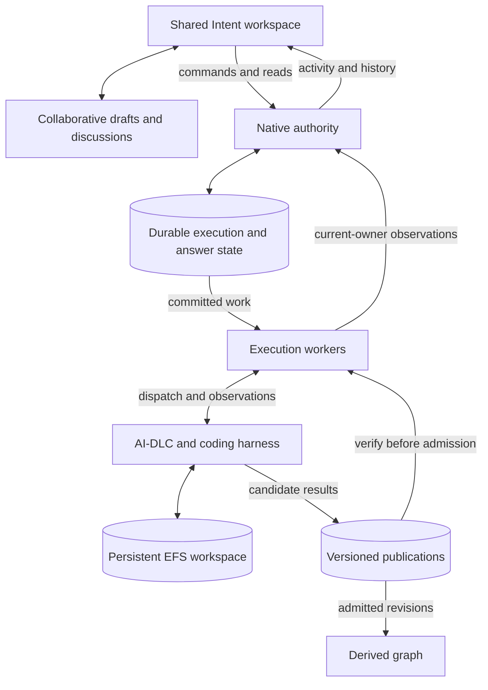

# Native execution

Native execution brings an AI-DLC methodology package into the shared Intent
workspace. A coding harness runs the methodology in a dedicated workspace while
project members review results, discuss proposals, answer questions and follow
progress together.

AI-DLC decides the workflow steps and required human gates. The platform manages
access, execution, accepted answers, published results and collaboration. Native
and the [platform execution backend](execution.md) share the Intent experience;
each backend retains its own execution commands.

!!! note "Feature status"

    Native execution is under development. Shared interaction, publications,
    history and workspace recovery are implemented, but the complete deployed
    journey is not yet qualified. Verified workflow completion and platform Git
    delivery are unfinished. The single checklist at the end of this page tracks
    the work needed for an integrated release.

## Working with a native intent

A native intent starts with a request, a methodology package and one connected
application repository. The methodology source and application repository serve
different purposes: the package supplies the development process; the application
repository supplies the code to work on.

In the current creation flow, a project owner configures a workflow source in
**Space settings → Agent**, imports a package, and makes it available for native
draft creation. A member selects the package and harness, enters the request and
prepares the workspace. Preparing a workspace does not start agent work. The
saved request can be corrected before **Start**.

Kiro is temporarily unavailable for new native executions while AI-DLC input
and authentication qualification is pending. Creation shows the disabled Kiro choice
and its reason, and a prepared Kiro draft cannot Start through either the
application or a direct API request. Claude Code, Codex and OpenCode remain
selectable for development. Existing Kiro configuration and history remain
readable; other platform Kiro behavior is unchanged.

Start captures the request revision, package, application source commit, harness,
model selection, credential scope and execution image. Later project settings
changes do not silently change that execution. Credential rotation within the
captured scope is supported; changing the source of credentials requires a new
configuration.

The shared Intent workspace provides the current response and questions, activity,
discussions, files, graph navigation and revision history. Native intents also
appear in the project, dashboard and sidebar. Integrating source selection into
the normal **New intent** entry remains part of the completion checklist.

## Questions, decisions and collaboration

When AI-DLC needs input, it publishes its response and, where supported, a
structured question form. Members can edit the answer together before submitting
it. Available questions from the current workflow step can appear together;
summary confirmations and required approvals remain separate interactions.
Grouping is a presentation choice. AI-DLC's interaction-mode question remains
unless the member has already expressed a preference in their retained request
or answers; platform instructions are not evidence of a human selection.

The platform records an accepted answer against the exact question and revision
that the member saw. Competing or stale submissions cannot replace it. A retry
of an uncertain submission checks the same request instead of creating another
answer. Accepted answers remain part of the intent's history.

Answer acceptance, delivery to the agent and application of a workflow decision
are separate observations. A successful submission does not by itself establish
that AI-DLC applied an approval or completed a stage. Missing delivery information
is shown as uncertain or unavailable.

If a structured form cannot be captured, the response remains available for
inspection and an eligible turn can accept a written reply. The platform does not
invent missing options, answer questions automatically or advance a human gate.
Current forms support up to 32 questions and 16 options per question, with written
answers where required. Unsupported forms must remain explicit rather than lose
questions or choices.

Shared answer drafts use the platform's real-time collaboration service. Accepted
answers are durable separately from those drafts. Unsubmitted native drafts are
not guaranteed to survive a collaboration-server restart or expiry after all
members disconnect.

Members can discuss a published revision and request Quorum assistance. Quorum
provides advice through the discussion service. Its response does not submit an
answer or approve the native workflow. See [Discussions](../using-the-platform/discussions.md)
and [Real-time collaboration](../using-the-platform/real-time-collaboration.md).

## Files, history and traceability

The running workspace contains mutable project files, generated dependencies and
unfinished edits. At a completed turn boundary, native publishes a verified
revision of its eligible files and response. Each publication identifies exact
file bytes and belongs to the current execution and turn.

Members can inspect current and earlier publications, compare public source
files, download individual files and request a ZIP of a published revision.
Another authorized member can reopen that revision independently of runtime
availability. Files in published revisions are read-only; editing or applying
changes through the platform is not currently supported.

A publication or ZIP contains the admitted public file inventory. It is not a
complete backup of the live workspace or necessarily a complete Git tree.
Unpublished edits and generated dependencies can remain on EFS without appearing
in a download. File modes, excluded entries, submodules and other repository
features need an explicit delivery contract before native can publish code back
to a Git provider.

The graph derives sections, items and relationships from published content and
links them to the exact source revision. It can be rebuilt from publications.
File locations and authored workflow markers do not establish execution progress,
approval or completion. A graph projection problem does not prevent access to
otherwise authorized published files or replies; membership verification still
has to succeed.

## Completion and delivery

Workflow completion must follow the pinned methodology's effective plan,
required checks, review outcomes and human gates. Native does not add a blanket
final approval beyond the selected workflow's requirements.

The current feature records published results and member selections, but it does
not yet verify that the effective plan and required outcomes were applied to the
final result. Completion is therefore shown as **not verified**. An agent stopping,
a successful CLI exit, a published review document or an accepted approval answer
is not sufficient evidence of workflow completion.

Native Git delivery is not implemented. Source checkout, file comparison and
result download do not create commits, branches or pull requests. The remaining
work must bind the deliverable bytes, required workflow evidence, authorized
member and destination, then confirm the provider's result. Tracker updates and
merge handling also need an explicit policy. See the shared
[Git integration guide](../using-the-platform/git-integration.md) for the platform
backend's existing behavior; it does not automatically apply to native intents.

## Persistent workspace recovery

**EFS is the recovery foundation for new native executions.** The project
workspace survives loss of the runtime process or coding session. It retains
workflow files, generated dependencies and unfinished edits so AI-DLC can
reconcile its own work in a fresh session.

Ordinary turns in the new workspace mode do not capture or export private CLI
recovery snapshots. Public result publication remains necessary for inspection,
history and delivery. Removing private restore machinery does not remove those
publications or their integrity checks.

When session recovery is needed, the platform must confirm that the previous
process has stopped before admitting another writer. The member then confirms
**Resume in a fresh session**. Native opens the same surviving workspace with a
fresh CLI session and invokes AI-DLC's supported resume entrypoint. AI-DLC checks
its workflow records and incomplete work, then continues or asks for input.

**AI-DLC 2.11.1 recovery starts after workflow creation.** The initial scope or
plan-selection offer has no active workflow and is outside recovery coverage.
After session loss at that point, the application shows **Intake recovery is
unavailable** and does not offer fresh-session resume. Published proposals and
accepted answers remain readable. Native does not route a later resume message
through the earlier offer's answer command or turn it into plan consent.

Eligibility comes from the surviving workspace's active pointers, matching
committed intent registry entry and initialized workflow state. It is checked
when loss is observed and again before a fresh CLI starts. The last publication
alone is insufficient: a workflow may have been created during an interrupted
turn after that publication. Missing, incomplete or ambiguous workflow records
make recovery unavailable; this structural observation does not establish
approval, completion or permission to skip AI-DLC's reconciliation.

Resume confirmation does not approve a workflow gate or replay an earlier answer.
Previously delivered, uncertain and undelivered answers remain distinct. The
member reviews any retained answer against the recovered question and submits
it anew if appropriate. Native must not replace unfinished workspace content with
an older publication.

This recovery model depends on the original EFS workspace being available and
correctly bound to the intent. A missing, replaced or unreadable workspace must
produce an explicit unavailable result. EFS deletion, corruption and disaster
recovery are outside session-resume coverage; backup and retention policy are
separate operational concerns.

**Simplification target:** use this one recovery model and remove private exact
session restore. This remains a pre-release feature; earlier native development
formats are not a supported compatibility contract. Removal follows proof of the
complete EFS resume journey and does not change the platform backend's contracts.

## Responsibilities and data flow

| Responsibility                                          | Owner                                                      |
| ------------------------------------------------------- | ---------------------------------------------------------- |
| Methodology steps, workflow records and required gates  | The pinned AI-DLC engine and coding harness                |
| Access, accepted commands and answers, execution state  | The platform's native authority                            |
| Dispatch, status observation, cancellation and recovery | Native workers operating under current execution ownership |
| Mutable project files and unfinished work               | The EFS workspace with one admitted writer                 |
| Published revisions and accepted-answer history         | Durable platform records and versioned object storage      |
| File relationships and graph navigation                 | A rebuildable projection of admitted publications          |
| Shared drafts and presence                              | The collaboration service                                  |
| Discussion assistance                                   | The discussion service and advisory Quorum execution       |

DynamoDB execution state is authoritative for native control. Workers cannot
replace accepted commands or answers based on local runtime state. Conditional
writes and writer ownership prevent duplicate or stale work from becoming the
current execution. The runtime has no direct native control-table or graph-write
permission.

Application WebSocket notifications indicate that durable activity is available;
authorized reads provide the content. Cursor-based replay and polling repair
missed notifications. Collaborative document synchronization is a separate
transport and does not accept execution commands.

### Package integrity

A workflow package is imported from an authorized source and pinned to verified
release bytes, materialization and object versions. Importing a package does not
grant continuing access to its source or to the application repository. Start
rechecks the relevant permissions and captures the selected configuration.

Package storage is restricted to its publishing worker. Its protection includes
conditional object creation, versioning, copy/delete restrictions, multipart
upload behavior and lifecycle policy. A source adapter or package version label
alone does not establish that the installer, methodology protocol and harness
combination is qualified.

Application repository credentials belong to trusted platform operations. They
are supplied for the authorized checkout and removed before methodology and
harness commands run. Files, diagnostics and download paths still require
explicit credential exclusions and current member access.

## Support matrix and settings

The current implementation runs serial turns against one application repository.
CLI availability, package import and local adapter tests do not establish a
qualified deployed combination. Release support must name the tested package,
harness, model, provider and image.

### Selected release contract

The initial serial release targets **AI-DLC 2.11.1**, **all four harnesses** and
**all three application repository providers** below. These scope decisions were
confirmed on 2026-10-26. Each advertised combination must pass qualification
before release; Kiro is a required row even while its qualification is blocked.
The temporary native Kiro admission restriction was approved on 2026-10-27.
Full Kiro instruction-channel, input and authentication qualification belongs
to NE-18 and must pass before this restriction is removed for release.

| Scope              | Initial release requirement                                                                                                                                                                                                                                       |
| ------------------ | ----------------------------------------------------------------------------------------------------------------------------------------------------------------------------------------------------------------------------------------------------------------- |
| Methodology        | AI-DLC 2.11.1, imported from the authorized methodology source and pinned to verified package bytes and materialization. Other versions and forks require their own qualification before being advertised.                                                        |
| Claude Code        | AWS Bedrock with the resolved project/platform model selection captured at Start.                                                                                                                                                                                 |
| Codex              | AWS Bedrock with the resolved OpenAI model selection captured at Start.                                                                                                                                                                                           |
| OpenCode           | AWS Bedrock with the resolved model selection captured at Start.                                                                                                                                                                                                  |
| Kiro               | Kiro's managed provider with the captured supported model selector. Its actual workflow and EFS resume journey must be qualified before release.                                                                                                                  |
| Application source | GitHub.com, GitLab.com and Bitbucket Cloud; one connected repository per execution, with its exact source commit captured.                                                                                                                                        |
| Inputs             | Written requests, attachments and tracker imports. Attachments and tracker imports are release requirements implemented under NE-09; current native requests accept the written prompt and repository/package content.                                            |
| Settings and tools | Existing model selection and credential-scope resolution, plus repository/package instructions and tools in the dedicated native runtime. Platform-managed environments, custom MCP server selections and uploaded custom rules are outside this initial release. |
| Advanced features  | Graph enrichment, optional debug archives, artifact edit/apply, Quorum edits, parallel units, per-unit delivery, multiple repositories and cross-engine migration are outside this release.                                                                       |

The first application acceptance path is **AI-DLC 2.11.1 → Claude Code → GitHub**,
using the existing dev configuration. Record the actual resolved Bedrock model,
credential source, region, harness version, package/materialization identifiers,
application commit and immutable execution-image digest before qualification.
Use that combination first for the recovery proof in NE-02 and the complete
journey in NE-19. Those records identify the tested combination; a settings
default or model placeholder is not evidence of which model executed it.

Every additional release row must likewise identify its model/provider selection
and execution image. Qualification of one model does not qualify every model
accepted by that harness. An unset or automatic selector must be recorded as
provider routing, not described as an immutable underlying model version.
The other harness/provider rows remain required until their evidence is complete;
passing the first path does not remove them from the release scope.

The shared native settings notice appears during draft creation and in the
Intent configuration view. It describes this target and the current input limits
without enabling unfinished input paths or claiming deployed qualification.
The normal **New intent** backend/default decision remains part of NE-08.

### Current implementation

| Area                        | Current behavior and limit                                                                                                                                                                                                                                                                                                    |
| --------------------------- | ----------------------------------------------------------------------------------------------------------------------------------------------------------------------------------------------------------------------------------------------------------------------------------------------------------------------------- |
| Coding harnesses            | Claude Code, Codex and OpenCode remain selectable for development. Kiro is visibly temporarily unavailable for new native executions, with authoritative Start rejection and an explicit runtime guard. All four harnesses still require release qualification; Kiro's full input and authentication path remains NE-18 work. |
| Methodology sources         | Import adapters cover GitHub.com, GitLab.com and Bitbucket Cloud with their supported source bindings. Installer and provenance constraints require separate qualification; importing from a provider is not a claim of full workflow support.                                                                                |
| Application source          | Exactly one connected GitHub, GitLab or Bitbucket repository. Source resolution captures the default branch and exact commit. CodeCommit, multiple repositories, submodule and LFS materialization are not supported by this path.                                                                                            |
| Package and harness         | Selected for the native draft and pinned for execution. Repository and package instructions remain part of the workspace.                                                                                                                                                                                                     |
| Models                      | Start captures the resolved project/platform model selection. An unset selection or automatic routing is not an immutable provider-model version.                                                                                                                                                                             |
| Credentials                 | The starting member's effective credential scope is captured. A responding member does not replace it. Rotation within that scope is allowed; revocation does not silently fall back to another scope.                                                                                                                        |
| Environments and tools      | Native uses its dedicated runtime. Platform-managed environments, custom MCP server selections and uploaded custom rules do not currently apply. Repository/package configuration can still supply instructions and tools.                                                                                                    |
| Platform execution controls | Agent-tier assignments, v2 stage scheduling, platform sensors, parallelism, rewind/recompose and per-unit PR strategies do not control native methodology execution.                                                                                                                                                          |
| Optional features           | Native graph enrichment and debug archive capture are off. Platform preferences do not enable them for native runs.                                                                                                                                                                                                           |

The Intent configuration view shows captured settings rather than current defaults.
Unsupported settings need to remain visible as limitations wherever users choose
or inspect native execution. The selected package determines its methodology
agents and reviewers; the platform should not duplicate that workflow model.

Artifact edit/apply, Quorum edits, parallel units, per-unit delivery,
multi-repository execution and cross-engine migration are outside the serial
integration target. Optional enrichment and debug archives also remain outside
that target unless explicitly selected for release. Their absence must not be
presented as an implemented capability or become an implicit release blocker.

## Recovery and operation

Cancellation requests stop the current execution; a requested stop and a
confirmed stop are different states. Recovery requires confirmation that the
previous writer has stopped. Status refresh, elapsed time or a missing response
cannot establish that fact. Published revisions and accepted decisions are
independent of whether a process is currently running.

Operators can close admission for new work while keeping services available for
current runs. Deploy matching frontend, authority, worker and runtime contracts
together. The transition to EFS-only recovery can discard compatibility with
native development runs; it must preserve the existing platform backend and the
integrity of newly accepted native work.

Repair workers rediscover committed work after missed notifications. Operational
acceptance must establish repair delay at the intended scale, usable alerts and
an incident owner. Normal member actions should be diagnosable through activity,
status, history and explicit error messages rather than private runtime logs.

Archive, replacement-run and resource-cleanup behavior is not yet defined.
Stopping a runtime is separate from deleting its workspace or publications, and
the UI currently prevents deletion of a space containing native intents. These
lifecycle actions need clear permissions, retention and user-visible outcomes.

For shared deployment and validation procedures, see [Setup](../getting-started/setup.md)
and [Testing](../development/testing.md). The checklist below distinguishes an
implemented capability from proof that it works through the deployed user path.

### First-path EFS resume qualification

NE-02 uses separate fresh qualification intents in the existing dev-enabled space,
with AI-DLC 2.11.1, Claude Code and a connected GitHub application repository.
Deploy the same candidate's frontend, authority, workers and runtime before
testing. Record the candidate commit and deployed versions, exact Bedrock model,
credential source, region, immutable runtime-image digest, harness version,
package/materialization identifiers and application source commit. Verify these
against the accepted execution configuration before exercising recovery; a
Terraform default or mutable image tag is insufficient.

1. Start through the application, select a plan as a real member, and verify that
   AI-DLC has created its workflow before reaching a real workflow question.
   The initial scope/plan-selection offer is not a recoverable boundary for
   2.11.1. Record the created workflow, interaction and publication identifiers
   and any accepted answer's delivery status. Let the runtime remain idle beyond its 900-second session timeout,
   then submit the next real member answer through the application. Ordinary
   application reads do not detect expiry or keep the runtime alive. The next
   dispatch must detect the lost session before sending that answer to the
   harness, retain its acceptance and expose recovery through normal status reads.
2. In a separate intent, interrupt its runtime during an active tool after it has
   created unfinished edits and dependency links. Preserve its EFS workspace.
   Ordinary intent cancellation is a terminal user command and does not substitute
   for unexpected runtime loss in this scenario.
3. For both cases, require confirmed predecessor stop and a member's **Resume in
   a fresh session** action through the browser. Trace the accepted public request
   to the authority, worker and runtime. Confirm the same workspace identity and
   a different CLI session identity, with no concurrent predecessor writer.
4. Verify AI-DLC reconciles the surviving edits and dependencies, runs the relevant
   build/tests, admits a new publication and reaches its next real question.
   Previously accepted answers must retain their delivery classification and
   history; recovery itself must not replay an answer or approve a gate. For the
   expired waiting session, inspect the original revision's
   `answer.resumeRetention.delivery: "undelivered"`, unchanged acceptance and
   member, and absent delivery time/resulting publication. The current interaction's
   generic delivery status alone cannot establish this history. Capture evidence
   that the turn used no private recovery capture, export, import or restore.
5. Separately lose a session at the initial plan-selection offer. Confirm that the
   browser explains that intake recovery is unavailable, the recovery API refuses
   the action, and no fresh CLI starts. Its proposal and any accepted answer must
   remain in history, without plan consent or automatic answer replay.
6. Exercise missing and incorrectly bound workspaces using isolated qualification
   resources. The browser must show that resume is unavailable, with no replacement
   workspace, model turn or admitted publication. Preserve existing dev workspaces
   and earlier failed intents. Start these faults from a created workflow so the
   intake restriction does not mask a workspace-binding failure.

**Local readiness, 2026-10-26:** the frontend recovery service and authenticated
API wrapper now run against the real public router, execution API and authority
store in regression tests. A lost response preserves the confirmation and command
identities and produces one authority transaction; denied membership produces no
dispatch or state change. A further process-loss regression reproduced an
acknowledged fresh-session resume becoming terminally failed if its runtime died
before publication. The worker now recognizes the current resume episode, turn
and writer as in-flight work and uses the existing fenced, confirmed-stop recovery
path. The real HTTP/executor fixture reaches a third writer generation while
preserving unfinished work and accepted-answer history without replay. All 1,398
native-runtime-control tests pass, including stale ownership, cancellation and
unconfirmed-stop cases. Fixture authentication, persistence and inert subprocesses
do not establish deployed browser, harness or EFS qualification.

The operator fixture is `scripts/native-recovery-qualification.mjs`. Its local
`barrier-command` action prints a bounded, foreground Bash command for Claude to
run after real implementation edits and dependency installation. The operator
`stop` action verifies that this command is an active Claude child before stopping
the exact accepted runtime session. Capture changed-file and dependency-link
hashes before stopping, compare the changes with the preceding publication, and
use `inspect --marker-sha256` after the resumed run publishes to compare retained
evidence. An old marker alone does not prove an active interrupted tool.

The `missing-project` and `wrong-project` actions require an isolated intent at a
recoverable boundary with a confirmed predecessor stop. They preserve the
original project in a nonce-scoped quarantine and stop their diagnostic session
before returning; they do not modify authority records or delete EFS data. All
operator actions require explicit account, region, resource and writer identities,
and a separately authorized operator profile. `solution-read` is rejected.
The 27 focused helper tests and all 300 release-script tests pass; these checks
do not establish live fault qualification.

**Dev qualification preparation, 2026-10-26:** deployment of `010ce5d5` and
the subsequent `fbda6296` worker correction was confirmed. The frontend entry
asset and deployed API, authority and execution-worker archives match their local
deployment artifacts byte for byte; the worker correction keeps the same runtime
image. The signed-in application imported the selected package, prepared a fresh
qualification intent and accepted Start through the public API. The accepted
execution matches the package, model and image pins recorded before Start:

| Pin                     | Recorded value                                                              |
| ----------------------- | --------------------------------------------------------------------------- |
| Region                  | `us-east-1`                                                                 |
| Harness                 | Claude Code `2.1.296`, verified in the exact image with networking disabled |
| Effective model setting | `global.anthropic.claude-sonnet-5-5`, from the space override               |
| Credential source       | Platform Bedrock credentials, captured by the accepted Start                |
| Runtime image digest    | `sha256:ef179ee0335bffe0184b376abc9768306f4602952b26dc8c9ca7ca6c552068b9`   |
| AI-DLC release          | `v2.11.1`                                                                   |
| Methodology commit      | `895a35d86d20336d9b7bc4aedc9440e4a12c83ab`                                  |
| Package identity        | `sha256:577eced0d4425aba7cd4fdaec100315363e104d28fa47f1aec141aac606dfb56`   |
| Materialization         | `sha256:be88b2f8c1240dfb86ad4a75e9d3104931f65c35d789b572127028b0631d0386`   |
| Application repository  | `JWThewes/flappy-bird` on GitHub                                            |
| Application commit      | `d99d2511c43f07ff2451e7e13f5a8f45b16dfce2`                                  |
| Application branch      | `ai-dlc/initial-game-1776942523258--task-project-scaffold`                  |

The accepted execution captures the space's model selection, which differs from
the platform fallback. Its runtime uses the prepared EFS access point and a
dedicated execution endpoint. The initial AI-DLC scope/plan-selection offer was
published before the waiting-session expiry test. After more than 900 seconds of inactivity, a
browser reply was accepted and the worker detected the lost session before
dispatching it. The application exposed a confirmed predecessor stop and accepted
the member's explicit fresh-session confirmation. Writer generation 2 reused the
same execution, configuration and EFS binding, used a different CLI session, and
admitted publication 2. History retained the original answer as undelivered with
its identity, text, author and acceptance time unchanged, and no delivery time,
resulting publication or approval. The observed recovery used no private checkpoint
capture or restore.

This is partial proof: publication 2 reported `next does not take --on-instruction
where` from the pinned workflow's resume command and contained no workflow
question. The pinned engine reads the complete AI-DLC user message, including the
previously appended platform guidance; even clean CLI arguments reproduced the
failure. Moving guidance outside that message exposed the independent intake
limit: an exact resume returns **No workflow state found** before an active intent
exists. The selected release therefore limits recovery to created workflows.
The offered question's request-answer route is not a supported fallback: a later
resume message can satisfy that route's input check and produce a workflow-create
instruction without a plan choice.

The two publications preserved the complete file inventory and application
source; five engine hook-health timestamps changed. Publication admission and
these retention checks do not qualify workflow recovery. Platform transport
guidance must use a separate harness instruction channel while the resume user
message remains the literal supported entrypoint. The interrupted-tool case is
prepared but not started: the pinned application commit contains an empty Phaser
scene, so its implementation/build/test fixture needs a source-baseline decision.
The missing/wrong-workspace cases also remain unqualified. NE-02 stays open.

**Recovery candidate, 2026-10-27:** the local candidate requires a created workflow
observed in the surviving EFS workspace, including its active pointers, committed
intent registry and initialized state. It checks this state before fresh-session
admission and again immediately before the CLI starts. Current workspace state
can establish creation after an older intake publication; publication alone
cannot establish recovery eligibility. Missing or unrecognized state leaves
recovery unavailable. Accepted answers, delivery classifications and immutable
publications remain intact, including interrupted-resume and lost-acknowledgement
paths.

The AI-DLC user request and resume entrypoint now remain literal. Platform
transport guidance uses the harness instruction channel and supplies no human
answer, interaction-mode selection or workflow consent. The earlier exact-image,
network-disabled Claude hook check used literal `/aidlc --resume` with zero model
tokens; it remains an offline hook check, not live recovery proof.

The approved temporary Kiro restriction uses native capability/status responses,
the existing creation/configuration UI, and the authenticated Start authority.
It rejects a new Kiro Start before configuration capture or dispatch, including
direct requests and forged availability overrides. Already admitted
configurations and readable work are preserved, and the runtime retains
`native_execution_transport_kiro_unqualified`. This does not qualify Kiro or
remove it from the four-harness release requirement.

Local validation of this candidate on Node **24.21.0**:

| Check                                                                                        | Result                                                                       |
| -------------------------------------------------------------------------------------------- | ---------------------------------------------------------------------------- |
| `npm test -- --maxWorkers=4`                                                                 | **11,544 passed, 10 skipped**; 390 files passed                              |
| `npx vitest run --project=native-runtime-control --maxWorkers=4`                             | **1,437 passed** across 52 controller files                                  |
| Seven focused recovery suites through `vitest.native-foundation.config.js`                   | **284 passed**, including runtime, authority and fence                       |
| `npm --prefix frontend test -- --maxWorkers=4`                                               | **2,104 passed** across 150 files                                            |
| Five focused native creation, interaction, execution and service suites                      | **417 passed**                                                               |
| `npm --prefix frontend run build`; `npm run build -w native-runtime-control`                 | Frontend and all eight controller bundles built                              |
| `npm run architecture:check`; `npm run dep:check`                                            | 413 production modules, zero violations; zero errors, 17 dependency warnings |
| `npm run lint -- --ignore-pattern '.worktrees/**'`; `npm run secretlint -- '!.worktrees/**'` | Zero lint errors, 82 warnings; secret scan passed                            |
| `npm run format:check -- . '!.worktrees/**'`; `git diff --check`                             | Passed                                                                       |
| `uv sync --group docs --locked --offline`; `uv run --no-sync zensical build`                 | Passed using a local evidence-directory UV cache                             |

These suites overlap; their counts are separate results, not an aggregate.
The full backend suite used local Docker test services and inert test credentials.
The first backend run found two capability-response assertions that needed the
new field; both were corrected before the successful full rerun. The architecture
check also prompted local extraction of recovery-result and record validation,
followed by the successful controller/full reruns. The frontend build retains its
bundle-size advisory. No deployed browser journey, newly built runtime image,
credentialed provider call or live recovery fault was exercised in this stage.
The earlier source-hash comparison matched all 31 recorded candidate files at
stage entry; earlier passes remain historical evidence. Exact commands, source
hashes and local logs are recorded under
`.native-evidence/ne02-2026-10-27-candidate/`.

Deploy this candidate's frontend, API/authority, workers **and a newly built
runtime image** before the next proof. `scripts/deploy-terraform.sh` builds the
source-derived AgentCore image and wires its digest into native services;
`scripts/deploy-frontend.sh` then builds and uploads the frontend. Generate a
fresh candidate-specific plan with `--phase plan --plan-file`, review it, and
apply that same `--plan-file` path with `--phase apply --skip-seed`. Reusing an old
image or deploying only backend archives cannot validate the transport and
pre-spawn recovery corrections.

Live acceptance remains pending for created-workflow waiting-session expiry,
interruption during an active tool with retained edits/dependencies and real
build/tests, the next genuine workflow question, visible intake rejection,
missing/wrong EFS workspace rejection, and exact deployed/configuration/image
alignment. The application fixture choice is still pending separately and does
not block this local candidate. Do not start NE-03 until the actual NE-02 live
proof passes.

## Integration and simplification checklist

This is the single work list for completing the serial native feature. Each item
includes its completion condition. Existing capabilities are described above;
only their remaining integration, simplification or qualification appears here.
Work starts with the EFS path and removal of obsolete recovery support, then
closes the product journey and release acceptance. No item requires compatibility
with previous native development executions.

- [x] **NE-01 — Define the release support contract.** Name the supported packages,
      harness/model combinations, application providers, inputs and settings for
      the serial journey. Select one complete combination for the first end-to-end
      acceptance, then qualify every combination advertised for release. **Done
      when:** creation, configuration and documentation agree on what is supported;
      optional and advanced features have an explicit scope rather than an open-ended
      prerequisite for release. **Completed 2026-10-26:** the selected contract above
      records all four harnesses, all three application providers, required attachment
      and tracker inputs, and the first acceptance path. Creation and configuration
      share the same notice about current support and release requirements. The 206 focused creation,
      configuration and Intent tests, frontend build, lint, formatting and secret
      checks pass. Deployed qualification remains open in the items below.
- [ ] **NE-02 — Prove EFS resume through the actual application.** Deploy the matching
      runtime, recovery API, worker and UI corrections and exercise browser → public REST API →
      authority → worker → runtime. Cover waiting-session expiry after workflow creation and an interrupted
      tool, confirmed predecessor stop, member confirmation, the same EFS workspace,
      a fresh CLI session, unfinished edits, dependency links, build/test and the
      next real workflow question. **Done when:** a new publication is admitted
      without private recovery operations or automatic answer replay; intake,
      unavailable workflow state, and a missing or wrong workspace block resume visibly.
- [ ] **NE-03 — Delete the exact native snapshot/restore stack.** After NE-02, remove
      private CLI checkpoint capture, export/import, upload/download and exact
      filesystem/database restore; remove legacy native commands, mode fallbacks,
      decoders, compatibility manifests/branches and obsolete qualification
      fixtures. Remove native-only private-checkpoint permissions and packaging
      dependencies that no longer have a caller. Do not refactor the old restore
      planner or build a migration path for development runs. **Done when:** one
      EFS recovery path remains, no runtime turn depends on a private snapshot,
      publication/history/export still work, and shared platform behavior is intact.
- [ ] **NE-04 — Simplify runtime turn ownership.** Give preparation, harness execution,
      publication and cancellation an explicit per-turn context. Separate interaction
      decoding from execution coordination and remove state made redundant by
      NE-03. **Done when:** start, reply and resume use the same clear phase
      boundaries without duplicated mutable state; cancellation and durable
      acceptance-before-spawn remain covered.
- [ ] **NE-05 — Simplify controller transitions and observation failures.** Make status
      reads, activity catch-up, lost ownership and uncertain dispatch produce explicit
      outcomes under the existing execution authority. Remove the obsolete execution
      `projected()` mutation and move its fixtures to the actual projection owner.
      **Done when:** transient reads cannot cause replay or unnecessary recovery,
      stale workers cannot commit, and projection remains independent of dispatch.
- [ ] **NE-06 — Consolidate the public command contract.** Replace concentrated route
      classification with simple route definitions and align frontend requests,
      API validation and runtime command shapes. Keep validation at each trust
      boundary. **Done when:** tests send real frontend-shaped Start, reply, cancel
      and resume requests through the public router, including invalid fields,
      access denial, duplicates and lost responses; no retired native protocol is
      needed to pass them.
- [ ] **NE-07 — Simplify harness output and workflow question adapters.** Select a
      decoder for each harness and a supported methodology interaction contract.
      Remove obsolete parser state and question-format fallbacks; keep AI-DLC as
      the owner of stages, plans and gates. **Done when:** current-step grouped
      questions, scope/compose offers, approval and written replies render exact
      choices for every supported combination, with explicit degraded behavior
      for unsupported output and no wrapper-created workflow engine.
- [ ] **NE-08 — Complete normal intent creation.** Integrate native into the normal
      **New intent** entry, including the backend/default choice, verified package
      selection and application source. Reuse the shared creation and configuration
      components and remove obsolete pilot instructions. **Done when:** a member can
      create, correct and start a native request without discovering a separate
      settings-only path, and competing or uncertain requests keep one identity.
- [ ] **NE-09 — Integrate supported inputs, settings and tools.** Implement the selected
      attachment and tracker-import scope and source selection; capture the inputs and
      effective configuration at Start. Connect supported environment/tool settings
      through their existing owners, and explain intentionally unsupported settings
      consistently. **Done when:** displayed options match actual runtime behavior,
      later edits cannot retarget admitted work, and attachment/source credentials
      and access checks follow the existing platform boundaries. **Selected scope:**
      attachments and tracker imports are required; platform-managed environments,
      custom MCP server selections and uploaded custom rules are excluded from the
      initial release.
- [ ] **NE-10 — Align public file handling and usable results.** Resolve the mismatch
      for credential-shaped files such as `.env` and `.npmrc`, retaining safe templates
      without exposing secrets. Use one explicit public-file policy across capture,
      admission, file views, comparisons, graph extraction and downloads. **Done
      when:** text/binary/empty files and exclusions behave consistently, public
      archives remain obtainable after runtime stop, and a download clearly states
      which workspace content it contains.
- [ ] **NE-11 — Implement verified workflow completion.** Connect evidence of the
      pinned effective plan, applied human decisions and required checks/reviews to
      the exact final result. Resolve the methodology/isolation dependency instead
      of treating mutable harness files or prose as independent approval evidence.
      **Done when:** the UI can report complete, failed or not verified from actual
      outcomes; stopped turns and accepted selections cannot imply success. Follow
      the workflow's own gates without adding blanket final approval.
- [ ] **NE-12 — Implement native Git delivery and tracker policy.** Admit a complete
      Git tree or an exact change set against the pinned source, including modes,
      deletions and excluded-entry rules. Use existing provider/credential owners
      for authorized delivery, stable commit/branch/PR identities and reconciliation
      after lost acknowledgements. Define who publishes, draft/ready behavior,
      review/merge observation and tracker updates. **Done when:** a member can
      deliver the reviewed result and see its confirmed remote identity/status;
      provider failures cannot retarget results, replay an uncertain write or
      block unrelated history access.
- [ ] **NE-13 — Finish shared history, status and traceability integration.** Reuse
      the implemented revision history, decision records, comparisons and graph
      links throughout the shared Intent shell and project/dashboard/sidebar views.
      Keep question/recovery actions prominent and apply native capability guards
      to platform actions. **Done when:** two members can reopen the same revision,
      inspect its decisions and files, navigate from graph items to exact sources,
      and see consistent status without mistaking a stopped turn for completion.
- [ ] **NE-14 — Simplify frontend reads and state acceptance.** Coalesce overlapping
      detail loads and reuse revision/access/session checks. Remove per-item
      discovery detail reads where a protected execution summary or shared request
      can supply the same state. **Done when:** navigation, refresh and polling
      avoid duplicate requests while preserving shared drafts, uncertain submissions,
      current status and isolation across account/project/intent changes.
- [ ] **NE-15 — Reduce activity notification work and complete observability.** Send
      one high-watermark invalidation per committed output batch, retaining durable
      cursor replay and polling. Show acceptance, dispatch, useful output, waiting,
      publication, reviewer/advisory outcomes and recovery failures with honest
      usage/timing attribution. **Done when:** multi-page reconnect, missed hints,
      backpressure and partial reads retain complete accessible history, and normal
      diagnosis does not require private transcripts.
- [ ] **NE-16 — Measure and reduce startup and post-turn latency.** Measure preparation,
      installation, acceptance-to-dispatch, first useful output, harness/tools time
      and publication-to-display separately. Reuse verified installed assets and
      remove duplicate verification/read work where the current trust boundary
      permits it. **Done when:** repeatable cold/warm measurements for the release
      combinations meet agreed responsiveness targets without skipping workflow
      steps, checks, required questions or publication integrity.
- [ ] **NE-17 — Complete cancellation, abandoned work and resource lifecycle.** Define
      archive/restore, replacement intent, space deletion, workspace retention and
      cleanup permissions. A replacement must use an explicit source and fresh
      authorization, with no automatic replay of earlier answers. **Done when:**
      users can stop, inspect, export and close abandoned work; stop confirmation,
      hiding an item and deleting data are distinct; cleanup releases only eligible
      resources and the documented EFS-loss behavior is clear.
- [ ] **NE-18 — Make local qualification exercise the supported product boundaries.**
      Consolidate the reusable runner around installed harnesses, current engine
      commands, public API requests and EFS resume. Remove legacy restore-only
      suites and fix fixture assumptions about paths, permissions and external
      prerequisites. Complete Kiro's instruction-channel, input and authentication
      qualification before removing its temporary native unavailability or claiming
      its full journey. All four harnesses remain release requirements.
      **Done when:** each advertised row reports repeatable pass/fail/blocked
      evidence; missing prerequisites cannot silently become cloud calls or a
      successful qualification, and scripted output is distinguished from a real
      installed workflow.
- [ ] **NE-19 — Qualify the complete two-member journey.** Run create → start → question
      → implementation → required checks/gates → verified completion → downloadable
      result and Git delivery with separate authenticated browser profiles. Include
      competing answers, change requests, historical discussions, Quorum failure/retry,
      reconnect, logout/login, account switching, token expiry and revocation.
      **Done when:** the deployed result and accepted decisions refer to the same
      revisions and users, stale callbacks cannot cross scopes, and advice never
      becomes an accepted answer.
- [ ] **NE-20 — Qualify deployed execution and storage boundaries.** Verify effective
      authority/worker permissions, cross-project runtime/EFS isolation, source
      access changes, image revocation, current-writer admission, publication/package
      overwrite/copy/delete restrictions and multipart/lifecycle behavior. Include
      positive controls, cancellation races and missing acknowledgements. **Done
      when:** the actual role and network paths enforce the contract on the release
      candidate, with no private restore permissions or compatibility paths needed.
- [ ] **NE-21 — Complete operational repair and rollout readiness.** Measure repair
      sweeps and revocation lookup at the intended history size and concurrency;
      exercise expired/lost notifications and queue recovery. Assign incident
      ownership and connect actionable alarms. Deploy matching contracts and verify
      admission shutdown without disabling current-run reads or cancellation.
      **Done when:** agreed repair and response bounds are demonstrated, failures
      reach the intended operator, and the release procedure preserves the selected
      EFS recovery model and existing platform functionality.
- [ ] **NE-22 — Publish the integrated feature and remove development-only scaffolding.**
      Confirm the preceding release items against the same candidate, remove unused
      native paths and obsolete compatibility/probe assets, and update capability
      declarations and architecture checks to the simplified implementation. Add
      this page to documentation navigation, remove its draft exclusion and update
      the linked creation/recovery/settings guides. **Done when:** published guidance
      matches the shipped behavior, supported combinations and recovery limits, and
      the work list accurately records completed release work and any explicitly
      deferred follow-ups.
