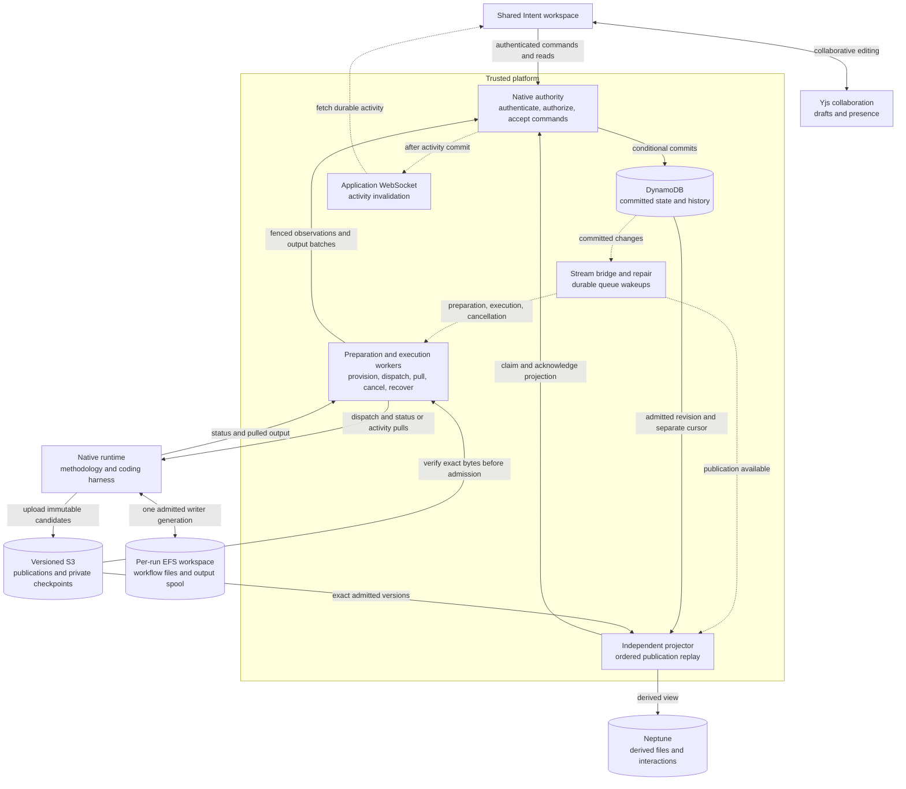

# Native execution

!!! warning "Working draft"

    This page describes the implemented architecture and tracks remaining work.
    It is excluded from the documentation site until the publication checklist
    in [Open work](#open-work) is complete. Local tests do not establish live
    end-to-end qualification.

Native execution runs a pinned AI-DLC methodology package through a coding
harness in a dedicated workspace. The native engine decides which methodology
step comes next, produces workflow files, and asks for human decisions. The
platform owns trusted admission, access checks, accepted answers, execution
supervision, and the collaborative experience.

Native and the platform backend coexist. The [platform execution model](execution.md)
uses the v2 orchestrator to schedule stages and gates. Native execution does not
use that scheduler or turn its publications into platform stages. Both backends
use the shared Intent shell, activity panel, discussions, and graph navigation,
with backend-specific commands. Native is the direction for new methodology
execution; supported v2 security, recovery, replay, and integration remain
maintained. Existing executions are not migrated between engines automatically.

## Responsibilities and data flow

Solid arrows below carry requests or data. Dashed arrows are asynchronous
notifications or reconciliation. DynamoDB records committed control state;
Neptune's native content is a derived view.



Membership checks use the existing project membership authority in Neptune;
that access dependency is omitted from the diagram for readability. A graph
write outage can delay projection without blocking the next turn, but an
inability to verify membership still prevents authorized work.

| Responsibility                                                            | Owner                                                                | Boundary                                                                                                |
| ------------------------------------------------------------------------- | -------------------------------------------------------------------- | ------------------------------------------------------------------------------------------------------- |
| Methodology and live workflow files                                       | Native engine, harness, and tools in the admitted runtime generation | Decide workflow steps; cannot accept platform commands or human answers                                 |
| Preparation, execution, answers, publication history, output, and cursors | Native authority (`native-runtime-control`)                          | Sole native control-state mutation boundary; conditional writes enforce identity, lease, and generation |
| Resource preparation and turn supervision                                 | Preparation and execution workers                                    | Perform effects and submit observations through restricted authority operations                         |
| Publication admission                                                     | Authority, using supervisor-verified evidence                        | Bind immutable bytes to the current run, pins, turn, and writer                                         |
| Native graph content                                                      | Independent publication projector                                    | Rebuildable, ordered projection; never schedules execution                                              |
| Shared drafts and human decisions                                         | Yjs for drafts; authenticated command authority for acceptance       | Editing a draft is separate from submitting an immutable answer                                         |
| Discussion assistance                                                     | Discussion service, with advisory Quorum results                     | Conditionally accept the current request and attempt; cannot answer or approve the native workflow      |

The authority exposes separate IAM-restricted caller interfaces for commands,
preparation, execution, and projection. Caller identity comes from the Lambda
invocation, not a field supplied by a worker. HTTP commands independently verify
the signed-in identity and project access. Reconciliation workers cannot write
the native control table directly or impersonate another caller class.

## From request to running workspace

1. **Select the project and package.** A workflow source is a read-only methodology
   source, separate from the application's code repository. An authorized source
   binding and completed, verified package import identify the package bytes.
   The member selects a harness and creates a native draft. Title-only drafts
   remain supported; members can add or revise and save the prompt before Start.
2. **Prepare the workspace.** The preparation worker provisions the run's
   dedicated runtime, role, and EFS access point. It verifies the actual resource
   identities and mounted filesystem before reporting readiness. Preparation
   does not start a model turn.
3. **Accept Start.** The authenticated command validates membership, the ready
   draft, application repository access, and credentials. It records immutable
   configuration: package and archive versions, the saved prompt revision, harness/model,
   credential binding, and execution image. The source branch and resolved
   commit are captured before dispatch. Preparation and execution images have
   separate pins; starting a prepared draft records the execution image explicitly.
4. **Dispatch from committed state.** A DynamoDB stream bridges committed changes
   to work queues. Periodic repair rediscovers pending work if a notification is
   lost. Workers reload protected state and claim a lease before acting;
   duplicate messages do not create another logical command. The supervisor
   dispatches the runtime, which prepares the pinned source checkout.

The current path uses one application repository and serial turns. Native
installation and project files live on per-run EFS paths; active harness homes
and databases use local disk. Recovery exports preserve the required session
state. A missing EFS mount must fail rather than silently use a local directory.
The runtime has no native control-table or Neptune write access.

### Package integrity

The package worker verifies and publishes versioned package bytes before a run
can use them. Package storage restricts publishing to the dedicated worker and
conditional object creation, rejects copies and deletion, and guards multipart
initiation using object-creation context as well as the conditional header.
Versioning alone is insufficient: lifecycle expiry, policy administration, and
incomplete uploads must also be considered when qualifying storage.

Package-import jobs have their own protected claims and retry lifecycle, separate
from execution-command wakeups. Source credentials and application credentials
retain distinct bindings. The platform must recheck access rather than treating
a previously imported package or prepared workspace as continuing authorization.

## Publications, activity, and human interaction

### Files and checkpoints

The native runtime owns mutable workflow files. At a quiescent turn boundary it
uploads candidate publications and private recovery checkpoints to versioned S3
storage. The supervisor verifies their exact versions, hashes, inventories,
session identity, and pinned context. The authority admits the publication only
for the current lease and writer generation, recording immutable history and
the committed head in DynamoDB.

Publications contain readable work products and the presented interaction.
Private checkpoints also carry the state needed to restore the same harness
conversation; they are not public artifacts. Required publications, answers, and
recovery state are independent of optional debug archives and their retention.
A published proposal is evidence of what was shown, not permission to perform
the actions it proposes.

### Activity and reconnect

Harness output passes through the shared output normalizer and native redaction
boundary, then into a private EFS spool. The supervisor polls runtime status and
pulls activity batches. The authority commits events and the ingestion cursor
together under the current execution ownership. The next pull acknowledges the
persisted cursor, allowing the runtime to discard acknowledged spool segments.
Backpressure preserves unacknowledged output.

After persistence, content-free application WebSocket notifications tell the
Intent activity adapter to fetch durable history. Paginated REST reads and
polling support replay and reconnect. The runtime does not stream directly to
the browser. Activity describes work; it cannot accept answers or advance the
methodology. Buffer and transport limits are not automatic model-turn time,
token, or spending cutoffs.

The authority also writes a small public `EVENT#<execution revision>` ledger in
the **same transaction** as meaningful execution transitions. It records Start
and reply acceptance, queued/attempted/confirmed dispatch, admitted publication,
waiting, recovery phases, failures, and requested/confirmed cancellation.
Heartbeats and leases add no timeline noise. Event rows do not schedule work;
the existing execution, answer, publication, and ownership records remain
authoritative. A failed or stale transaction cannot leave a successful event.
The dependency inventory retains these rows as readable history.

The existing `/outputs` read accepts an optional independent `afterEvent` cursor
alongside `afterSeq`. Its additive `events` and `nextEventAfter` fields populate
the shared Timeline while `OUTPUT` and `OUTPUT_CURSOR` keep their existing
ordering. Each stream pages 64 rows; reconnect and two-second polling catch
lost notifications. Read failures visibly mark incomplete history and preserve
the last confirmed cursor. Resource/action denials clear the scoped history
without treating their status codes as project-wide access revocation.
Account/project/intent changes detach subscriptions and reject late pages.
Old output-only responses remain readable; old lifecycle history is not
reconstructed. Historical reply delivery is `unknown` when the retained delivery
pointer no longer identifies that answer. Acceptance never implies approval.

New runtime captures add bounded usage/timing summaries through the unchanged
`activity-v1` lifecycle format and the existing redaction boundary. Codex turn,
Claude result, and OpenCode step usage callbacks report observed numeric
counters with the pinned harness/model; missing counters remain unavailable.
The shared `model-pricing.js` helper supplies an **input/output cost estimate**
only when both counters and a canonical price exist. It is not a total bill:
cache, credits, infrastructure, aggregate costs and individual reviewer usage
are not priced by this view. Kiro ACP has no captured reliable usage signal here.
Controller timestamps report acceptance-to-dispatch and dispatch-to-publication
when those exact boundaries exist; runtime capture wall time includes harness
preparation and tools. None is presented as model-only inference latency.

Quorum's existing discussion status shows running, advisory completion or
failure, with its existing guarded retry. Internal harness reviewer activity is
visible only to the extent supplied by sanitized normalizer output; there is no
invented reviewer verdict or workflow success. Incident actions remain Refresh
activity/status, Cancel execution, eligible Recover session, and discussion
retry. `DELIVERY_UNCERTAIN` cannot enable replay. These changes add no archive,
private transcript/checkpoint read, control route, IAM permission or pricing
table. Existing retained images continue without the new usage summaries;
controller/frontend updates add lifecycle visibility without repinning runs.
Deploy the controller and frontend together (controller first); old controllers
reject the new cursor parameter. Existing clients that request only `afterSeq`
still receive their original output DTO. The `unknown` historical reply delivery
value requires the updated frontend decoder.

Yjs is a separate collaboration transport for revision-scoped drafts and
presence. Its document synchronization is neither the execution event log nor
the accepted-answer ledger. See [Real-time collaboration](../using-the-platform/real-time-collaboration.md)
and [Yjs operations](../development/yjs-operations.md) for the shared transport
and persistence model.

### Questions, decisions, and Quorum

A supported native interaction presents the exact assistant response and, when
available, structured questions or approval choices. Members can collaborate
on free text or structured selections. Submission names the presented
interaction, content digest, and request identity. The authority rechecks
membership and atomically records one immutable accepted answer with the next
execution command. Stale or competing submissions cannot replace it.

The supervisor delivers that answer to the same pinned native conversation.
The engine interprets it and decides the next methodology step. Acceptance,
delivery, and an engine-applied decision are different events; a successful
submission alone does not prove a workflow approval was applied.

Published revisions can be discussed through the existing discussion service.
Quorum contributes advice. Its completion is accepted by the discussion owner
only for the stored request and current attempt while that message remains
eligible. Quorum output and collaborative drafts never become accepted workflow
answers automatically.

## Graph projection and enrichment

The independent projector reads admitted publication history in sequence,
verifies the referenced S3 bytes, rechecks authorization, and updates Neptune.
The graph read API rebuilds the same view from the protected current publication;
Neptune never determines file access. Alongside generic files, the presented
interaction and legacy questions, `native-trace-v1` adds H2–H6 sections and
content-declared items through the shared artifact extraction registry. Headings
inside fenced examples are ignored. Registered YAML blocks must meet the
registry's field shapes; malformed blocks retain generic sections. A filename
alone never selects a semantic artifact type.

The established record paths under `aidlc/spaces/<space>/intents/<record>/` and
legacy `aidlc-docs/` identify **phase and stage locations**, including separate
construction units. `LOCATED_IN` links describe that layout, not a stage invocation
or its progress. Unknown layouts remain generic. Explicit `covers`, `persona`,
`depends_on` and story-map fields create item relationships only when their target
is unique within the same publication and record scope, with compatible unit
scope. Ambiguous references remain unlinked. Runtime graphs, checkmarks, authored
decision status and discussion advice confer no approval, completion or scheduling
authority. Authored item fields are namespaced separately from execution status.

Every derived node carries project/execution identity, package ID, immutable
publication ID/sequence, file ID/hash, the existing `fileId:sha256` revision
identity, source path and extraction contract. Sections identify line ranges;
items identify their complete YAML block and item slug/order. Locations name the
record-layout contract and an exact supporting file. IDs include publication and
scope, so identical bytes in different revisions cannot share derived ownership.
Retries reuse IDs; conditional writes and endpoint checks fence newer publications
and foreign owners. Superseded structure is disconnected from current intent/file
heads while old nodes and exact publication history remain retained. The frontend
checks revision provenance against the current inventory and opens the source file
from a derived node in both native presentations.

Extraction reads only already admitted public Markdown/plain-text work products.
It applies the existing public exclusions and private-recovery credential-path
classifier without changing historical raw-file visibility. Private checkpoints,
harness databases, runtime-state JSON and debug archives are not extraction inputs.
The inline/context 3 MiB bound applies to each extracted file and to aggregate
extraction reads per publication, in deterministic path order. The existing
1,000-file and 1 MiB manifest bounds also bound derived node count and serialized
structure. YAML nesting/node limits and rejection of aliases prevent expansion.
An over-budget document contributes no partial structure; per-file `byte_limit`,
`structure_limit`, `incompatible` or `generic` status explains the fallback.
Relationship-budget exhaustion omits that relationship pass explicitly. Raw files
remain canonical and readable through their existing transport limits.

Projection owns its lease, retry and cursor independently of admission and turn
dispatch. Cursor projection version 2 rebuilds an older completed projection's
current immutable head; periodic repair discovers it without rewriting execution
pins or replaying old publications over a newer graph. Integrity/ownership failures
retry without acknowledgement; unknown content formats do not block the cursor.
Graph transport/validation errors are isolated in the UI while file/reply access
continues; access denials still clear protected content. Deploy the controller,
authority/projector bundles and frontend together. No runtime protocol, retained
publication schema, route or IAM change is required.

Native enrichment remains explicitly **off**, with no model calls or mutable
settings lookup. The platform backend's Admin `derive-enrichment=off|llm` setting
is captured on its own execution META and forwarded to its derive-time CLI
summary pipeline; native configuration does not capture it. A future native
opt-in still needs a decision on capture timing (draft or Start), whose pinned
CLI/model/credential pays for it, and whether enrichment runs per publication or
on demand. That optional decision does not gate deterministic extraction.

## Platform Git delivery boundary

**Contract audit, 2026-10-14:** native Git delivery is not implemented or
qualified. Source checkout, admitted public results and v2 delivery provide
reusable boundaries, but do not establish permission to publish a native result.
Viewing, discussing or exporting a revision creates no Git work.

`execution-config` captures one application provider/repository and binding
revision. `execution-source` resolves its branch and exact commit before dispatch;
the protected `EXECUTION` record retains them. The native API resolves
`intentId` to that execution within the project and rechecks current membership
and project identity. `native-artifact-revision` resolves named admitted
publications and exact versioned file bytes independently of the current
runtime, graph and latest remote branch.

These publications and their source baselines contain **public file subsets**,
not Git trees. The snapshot preserves binary, empty, BOM and CRLF bytes, but its
manifest omits executable modes and Git object identity. Capture excludes Git,
harness and private control paths; symlinks and submodules are unsupported.
Source checkout also rejects LFS materialization. A missing public file can
describe a public comparison, not authorize deletion of an excluded repository
entry. A complete result ZIP means the admitted public inventory, not a
complete runnable repository. Neither a live workspace, private checkpoint nor
a mutable remote checkout can supply missing delivery bytes by implication.

`RESULT` rows are independent export jobs, `EVENT` rows are observations, and
accepted question answers authorize the next native command. None records
authoritative check/review outcomes or engine application of a decision.
The decided completion policy follows the exact pinned AI-DLC workflow and
selected plan: enforce its defined human gates, with no blanket extra final
approval or platform-defined mandatory checks/reviews. Completion remains
`not_verified` because effective plan/application/outcome evidence is unavailable.
Protected selections can establish a member's choice for an exact proposal;
they cannot approve later bytes or prove engine application. Authored review
files, stopped turns, checkmarks, assistant prose, graph edges and advisory
Quorum results do not change this.

The dedicated `execution-credentials` facade rechecks the protected run,
attempt/epoch, image, source-binding revision, starter/delegator membership and
connection generation. It requests `requiredAccess: read` through shared
`source-control-credentials`. GitHub App read tokens request read permissions;
OAuth tokens retain their underlying provider scopes, so operation isolation
must not be mistaken for provider-enforced downscoping. The trusted preparation
path injects the credential only for the exact-commit fetch, removes it before
checkout/package/harness commands, disables helpers/hooks and global config,
and restricts transport. This is source-read authority, not delivery-write
authority. The runtime-callable legacy broker authorizes v2 `META` records; it
cannot be borrowed by a native delivery worker. No credential grant is widened.

The shared `git-providers` registry remains the provider owner. Its current
`createPullRequest` methods also contain platform construction-branch checks,
cleanup and, for GitHub/GitLab, base-retargeting behavior. They are not a native
delivery transaction. Their status DTOs expose PR identity, branch/head and
draft/open/closed/merged observations, not exact-byte review approvals. Provider
errors can return no status; absence must not erase a previously confirmed fact.
The v2 `record-pr` graph writer and tracker reconciler are projections/effects
of v2 execution, not native authority. In particular, v2 `git-engine.pushBranch`
intentionally allows `pushed: true, verified: false` after failed or mismatched
remote confirmation. That compatibility behavior is unchanged and insufficient
to confirm native delivery.

Native configuration has no admitted tracker-source/delivery policy or tracker
sync owner. The existing v2 issue comments and merge-triggered GitHub/GitLab
closure do not apply automatically. Native performs no delivery-related tracker
mutation; whether the pilot should have no integration, explicit links/comments,
or merge-triggered updates is an unanswered product choice.

## Recovery, compatibility, and operation

Cancellation has a separate queue and consumer capacity. Acceptance invalidates
ordinary execution ownership; the supervisor closes the protected runtime fence
before requesting session stop. Cancellation does not admit another writer.
Already committed history remains readable, and projection may finish an
already admitted revision.

Recovery requires a verified checkpoint and positive confirmation that the
predecessor session stopped before a new writer generation is admitted. It
restores the same conversation with its pinned dependencies and accepted-answer
history. An ambiguous delivery is reported for review rather than blindly
replaying a possibly executed turn. Unknown schemas and unsupported recovery
formats fail closed; silently starting a fresh conversation is not recovery.

### Support matrix and settings

**Repository contract, checked locally on 2026-10-14.** “Admitted” below means
the existing validators permit the configuration after authorization and byte
verification. It does not mean a model, fork, or deployed combination has passed
the full native lifecycle. No broad live support claim is established here.
These tables describe existing owners, not a second capability registry.

The runtime currently supplies `<repository>/.github/workflows/release.yml` to
the installer. The separate preflight verifier knows the preview workflow name,
but that does not establish production preview or non-GitHub installer support.
No workflow identity or trust policy was changed to broaden the matrix.

| Boundary                   | Implemented/admitted contract                                                                                                                                                                                                                                                                                                                                                          | Compatibility and qualification limit                                                                                                                                                                                                                                                                                                                                                                                                              |
| -------------------------- | -------------------------------------------------------------------------------------------------------------------------------------------------------------------------------------------------------------------------------------------------------------------------------------------------------------------------------------------------------------------------------------- | -------------------------------------------------------------------------------------------------------------------------------------------------------------------------------------------------------------------------------------------------------------------------------------------------------------------------------------------------------------------------------------------------------------------------------------------------- |
| Methodology release        | `native-release-manifest`, `native-runtime-package`, `native-package-pin` and `native-package-trust` require schema 1, exact `v<version>` tag/40-hex commit, checksums, all four projections, and Linux ARM64 assets. Stable source ref is the tag; the existing `-preview.YYYYMMDD.N` protocol uses `refs/heads/main`. Package, materialization and S3 object versions are immutable. | This release format is not a declaration of workflow protocol compatibility. Other tags, archive layouts, schemas, targets and arbitrary release URLs are unsupported.                                                                                                                                                                                                                                                                             |
| Forks and provenance       | Matching owner-selected forks need the same release, projection, installation and interaction contracts; the repository name is not recognition authority. Package import/admission pins proof bytes but does not claim signature verification; the trusted runtime runs the pinned installer's provenance checks before any harness turn.                                             | Shared `owner-selected-source-v1` preflight permits explicitly absent proofs and requires a trusted verifier for present proofs; that optional preflight is not wired into the production package worker/Start. Its implemented verifier is GitHub-specific. Actual installer acceptance, including unsigned packages, previews and other providers, still needs qualification. No named fork has current live qualification; policy is unchanged. |
| Current production readers | Controller row 1, generation-v1 transport, publications 1 **and 2**, interactions 1/2, pending-input 1, recovery 1. Schema-2 publications include the protected source baseline.                                                                                                                                                                                                       | Unknown schemas are not coerced. Unsupported interaction capture keeps exact readable assistant text and free-text reply; it cannot fabricate choices or approval.                                                                                                                                                                                                                                                                                 |
| Retained transports        | `architecture/native-compatibility.json`: `legacy-native` has publication 1/interaction 1; `retained-native` has publication 1/interactions 1/2/recovery 1. Exact retained router fixtures remain unchanged.                                                                                                                                                                           | The publication-1 tuples intentionally describe old images, not all current readers. Source comparison is unavailable without a captured baseline. Restore requires the original image/session/checkpoint; no migration or replacement conversation.                                                                                                                                                                                               |

| Harness and image-build pin | Model/auth configuration and invocation                                                                                                                                                                                                                                                                          | Local recovery adapter and limits                                                                                                                                        |
| --------------------------- | ---------------------------------------------------------------------------------------------------------------------------------------------------------------------------------------------------------------------------------------------------------------------------------------------------------------- | ------------------------------------------------------------------------------------------------------------------------------------------------------------------------ |
| Claude Code **2.1.257**     | Bedrock bearer key; bare Bedrock ID, shared alias resolution when applicable; `-p --output-format stream-json --verbose --permission-mode bypassPermissions`, optional `--model`, explicit `--resume`. Package hooks/instructions remain loaded; SessionEnd timeout is adjusted by the existing runtime adapter. | `claude-project-jsonl-v1`: selected session, dependent subagent/tool/task/memory files. Unsupported or missing dependencies fail recovery.                               |
| Codex **0.145.0**           | Bedrock bearer key; configured exact `openai.*` ID; `exec --json`, `-m`, `model_provider="amazon-bedrock"`, existing hook/approval bypass and four-thread bound. Platform question tools are disabled in favor of native turn publication.                                                                       | `codex-rollout-jsonl-v1`: selected rollout; `exec resume <id>`. No `--last`, fresh thread or fork is substituted.                                                        |
| Kiro **2.19.2**             | Kiro API key and Kiro model namespace, never a Bedrock alias; ACP protocol 1, **v2 agent engine**, `aidlc` agent and existing tool trust. Explicit models must match session new/load reports.                                                                                                                   | `kiro-v2-session-pair-v1`: JSON/JSONL pair; ACP `session/load` verifies prior user and assistant hashes before another prompt. v1/v3 engines are not native adapters.    |
| OpenCode **1.17.20**        | Bedrock bearer key; `amazon-bedrock/<model>` selection; `run --format json --auto`, explicit `--model` and `--session`. Auto-update is disabled.                                                                                                                                                                 | `opencode-export-json-v1`: `export/import --pure` to preserve one session. Revert, parent/subtask, snapshot/patch and task/todo dependencies are explicitly unsupported. |

The Dockerfile and `native/session-recovery-files.js` own these CLI pins.
`cli-models`, `tier-models`, `model-resolver` and the CLI auth drivers own syntax
and resolution. No live provider/model catalog was fetched. Selection uses the
project flat per-CLI map over the global map, then the legacy fallback row;
Claude/OpenCode also use the existing controller environment/alias fallback.
There is no native platform agent tier. Platform judgment/balanced/templated and
Quorum rows do not select this workflow's model; package-internal agents and
reviewers follow the pinned package's own configuration.

An explicit resolved model string is captured at Start and passed unchanged
through subsequent dispatch and recovery (OpenCode adds its provider prefix
when necessary). An unset model remains `null`: the pinned image/package selects
the harness default, **not an immutable underlying provider model**. Kiro `auto`
also denotes routing, not an exact model version. The UI states this limit.
Existing lenient model-map parsing and best-effort global SSM fallback are
unchanged; malformed entries or an unavailable global read may leave the harness
default. An exact model/region/account combination still needs authorized live
qualification. This item does not change that selection policy.

| Source use           | Implemented provider/auth combinations                                                                                                                                                                                                            | Explicit limits                                                                                                                                                                                                                                       |
| -------------------- | ------------------------------------------------------------------------------------------------------------------------------------------------------------------------------------------------------------------------------------------------- | ----------------------------------------------------------------------------------------------------------------------------------------------------------------------------------------------------------------------------------------------------- |
| Methodology package  | GitHub.com public/OAuth/App; GitLab.com public/OAuth; Bitbucket Cloud public/OAuth. `workflow-source-bindings`, release catalog and bounded source transport own access and exact asset routes.                                                   | Read-only source binding, current owner/admin delegation checks, separate application binding; no CodeCommit, self-hosted host, arbitrary URL or tracker-as-package source. These are import adapters; installer/provenance limits above still apply. |
| Application checkout | Exactly one linked repository: GitHub OAuth/App, GitLab OAuth or Bitbucket OAuth, through existing source bindings and provider adapters. Default branch and exact 40/64-hex commit are resolved by two bounded read-only routes before dispatch. | No public/anonymous application binding, CodeCommit, multiple repositories, branch-picker override, Git delivery, submodule or LFS materialization. Credentials are restricted to trusted checkout; harnesses receive no Git credential.              |

| User-facing setting/owner                  | Native capture and runtime behavior                                                                                                                                                                                                                                                                                                                                                                                                                                                                   |
| ------------------------------------------ | ----------------------------------------------------------------------------------------------------------------------------------------------------------------------------------------------------------------------------------------------------------------------------------------------------------------------------------------------------------------------------------------------------------------------------------------------------------------------------------------------------- |
| Package/harness, saved request             | Native creation selects the imported package and harness independently of the project's default CLI. Start validates the protected ready draft and saved prompt revision; package/source/archive/image pins and `configurationSha256` are recorded atomically with execution admission. Edited or competing drafts cannot retarget it.                                                                                                                                                                |
| Project/Admin model maps                   | `execution-config.js` reads only model maps and credential metadata, then rereads the project and source binding. A project model-map edit during resolution now fails with reload required. Start retries reuse the admitted row without resolving new settings. Reads across Neptune/SSM are not a distributed transaction; a change after the final read does not rewrite the captured values.                                                                                                     |
| Credentials and payer                      | The starting member's effective **personal > space > platform** key scope is pinned, separately for Bedrock or Kiro. Subsequent credential renewal reads only that binding; rotation at the same scope is allowed, clearing/revocation fails without fallback. A replying member does not become the payer. The API exposes scope only, not user/secret references or billing identity. IAM/STS, external gateways and other platform authentication mechanisms are not native configuration options. |
| Managed environment/runtime target         | Native uses the protected per-run runtime binding and dedicated execution image/version/endpoint. The shared platform runtime-target resolver deliberately rejects native META. Project environment assignments, tool selections and environment verification do not apply. Recovery preserves the original target/image; no mutable default-runtime fallback.                                                                                                                                        |
| MCP and rules/instructions                 | Installer uses `config --harness … --mcp none`; native does not fetch Admin/project custom MCP, MCP secrets or S3-uploaded custom rules, and does not install platform graph-write MCP. Repository/package instructions, hooks and configuration remain native workspace inputs and survive eligible checkpoints. `--mcp none` is not a sandbox that removes arbitrary repository-defined tools or package configuration.                                                                             |
| Enrichment, debug, other platform controls | Native enrichment and optional archive capture remain off even if platform preferences are enabled. Numeric flight recording is independent. Platform workflow/block/agent assignments, stage sensors, parallelism, PR strategy, rewind and verification scheduling do not control native execution. Quorum discussion assistance remains an independent advisory path with its own settings. Attachment/tracker creation scope remains undecided.                                                    |

Creation offers the settings explanation before submission. Both native
presentations use the shared configuration dialog, showing the captured model,
credential scope and image digest without loading current settings. Additive
`execution.credentialSource` and `execution.imageDigest` are derived from the
validated protected row; old APIs display explicit unavailable metadata.
No new field is added to immutable configuration, hashes, commands or retained
row decoders.

Structured questions use the exact version-1 rendered spec, not plan names or
generated prose as authority. The existing four-question/16-option bound covers
the scripted twelve-option example (`compose`, `bugfix`, `classic`, `enterprise`,
`express`, `feature`, `infra`, `mvp`, `poc`, `refactor`, `security-patch`, `workshop`).
It is not proof that every package called 2.11.0 implements those plans.
New captures classify a marked stage as approval only when a complete visible
spec satisfies the existing gate labels and optional-label grammar. Missing,
unknown or incompatible specs yield no structured choices; labels are neither
invented nor silently dropped/reordered. Existing stored interactions still use
their original decoder and digest, including old synthesized gate displays.
Only the protected current interaction and an authenticated accepted answer
authorize response delivery; a displayed approval label is not an applied receipt.

**Evidence and deployment.** In an already-local Linux ARM64 image
`sha256:04d277b05d891422263e368cdf315564e29c556411adf464016b2328e247e47d`,
all four `--version` and native-argument `--help` checks passed with
`--network none`, isolated homes and no credentials. The retained public
`awslabs/aidlc-workflows` v2.9.0 bytes at
`22f5d1b15a064c9ae80046e5b1761d5877e2f69f` revalidated as package
`sha256:0399ab50fa7ed00eae5a246159fdb1d594c8fd4946c6aeb72452d9d6e2770ce0`
(materialization pin in `native/probe-package.json`:
`sha256:eed746ebdc9078b8bf9217cebaad743e8f90eded8b299da8b96c99eb81bf9368`).
Real offline `aidlc use` failed for all four isolated harness setups with
“no valid Sigstore verifiers could be initialized”; configuration and hook
execution were therefore **not** qualified by that attempt. Signature policy was
not bypassed. Scripted initialization/plan/gate/resume, checkpoint codecs and
retained-router tests are separate evidence from these real CLI checks.

Local validation used Node **24.21.0** with
`NODE_OPTIONS=--no-experimental-webstorage`. Focused backend checks passed 157;
focused frontend checks passed 251. The full frontend passed **1,823** tests
and its production build. The Docker-backed shared/AgentCore/native-control/
agents run passed 7,551 tests, skipped three existing real-Bun tests and failed
one current scripted interaction fixture that relied on synthesized gate labels.
That fixture now publishes its spec and visible labels; the correction passed
70 runtime/interaction checks, and the final API/configuration/interaction slice
passed 92 including competing Starts with different model snapshots.
`npm run test:release` passed **232** tests (including the five architecture
script tests); native wiring passed **21**. Lint, formatting, secretlint,
dependency, architecture and SDK checks passed, and all eight native-control
bundles built. Existing lint/dependency/Smithy-range and bundle-size warnings
remain. Node 22 and host Bun were unavailable. These checks include retained
decode, cold recovery, denied credentials, package mismatch and frontend
identity/access races; they do not establish deployed behavior.

Deploy the compatible controller/API before the frontend for captured scope/image
visibility. A new runtime image is needed for stricter question capture; already
admitted images remain pinned and keep their original behavior. Bundle the
existing shared helper with the runtime; no route, IAM, Terraform, storage schema
or dependency change is needed. Preserve the publication-reader deployment order
documented under obtainable results. Live pinned-model, package/fork installation,
deployed identity/access, IAM and old-image cold-restore qualification remain open.

### Admission shutdown and upgrades

To stop **new executions**, set `native_execution_admission_enabled=false`.
`enable_native_execution` is the backward-compatible admission default when the
explicit setting is unset. To stop **new drafts**, also set
`enable_native_preparation=false`. Keep `native_services_enabled=true` so
existing drafts, reads, replies, cancellation, recovery, and projection continue.
Resident services default to enabled and have infrastructure cost even with
admission closed.

Deploy compatible controller packages, authority interfaces, IAM, streams, and
queues together. Preserve supported images and CLI bytes, package archives,
source/configuration pins, credentials, runtime targets, and publication,
answer, and checkpoint decoders. An application upgrade from N−1 can still
contain runs created much earlier; release age does not determine their lifetime.
Legacy row schema 1 and retained runtime transports remain supported without
rewriting existing pins or inventing missing publication history.

The repository's `architecture/native-compatibility.json` records supported
contracts and exact-byte fixture provenance. Before any dependency removal,
close admission and obtain a current protected inventory with
`scripts/native-dependencies.mjs`. Unknown records stay protected. Full service
teardown is guarded by the empty-dependency preflight; used installations retain
resident services and history. Resource retirement requires verified stop or
explicit migration/revocation evidence. There is no automatic cross-engine
migration or history-deletion policy.

### Repair and diagnostics

The stream bridge sends hints for committed work and reports partial stream
failures. A five-minute schedule runs a consistent, paginated repair scan even
when stream records or queue messages have expired. Execution, cancellation,
and projection queues retain their existing 14-day retention and have no
receive-count cutoff. Preparation retains its 14-day queue/DLQ and receive
count 100. Package dispatch/worker queues and their separate protected table
have an independent repair host; disabling package imports also disables its
schedule and missing-sweep alarm.

**Repair ownership and continuation (locally qualified 2026-10-14).**
`lambda/shared/native-repair-scan.js` writes only the separate
`native-repair` table. Its `runtime` and `packages` records bind schema version 1
to the exact source table, a cursor containing only source primary keys, an
opaque revision/owner, lease expiry, cycle failure count, cycle start and last
successful completion. Each host has Get/Put permission only for its own scope.
The wakeup role retains read-only control-table access; package repair can read
jobs and send pointers but has no job mutation, source credential, graph,
archive publication, or worker invocation permission. The execution authority
and package worker remain the protected-state owners.

A conditional revision write claims the cursor. Concurrent schedules/revocation
batches observe a live lease and return `busy`; they cannot overwrite progress.
Defaults are 100 evaluated rows per Scan, four concurrent rows, at most 1,000
pages and a 240-second work budget, leaving time before the 900-second Lambda
limit. Each acknowledged batch saves its last processed key; an entirely
filtered page saves DynamoDB's continuation key. There is no new work index.
The 1 MiB service page limit still applies. An invocation yields `continued`
and releases only acknowledged progress. A crash, rejected write or lost write
acknowledgement leaves a 960-second lease; a later schedule takes it over by
revision CAS. An old owner cannot checkpoint or release a successor's cursor.
A batch interrupted before checkpoint may send duplicate hints; downstream
owners reload state and retain command/attempt/lease fencing. There is no
claim of exactly-once transport.

Row failures are logged by primary key, counted, and advanced past so one bad
record or send cannot starve the tail. They are retried on the next complete
sweep. A sweep containing any failed row never reports `repaired: true` or emits
a successful `ScanCompleted`. Scan/checkpoint errors throw. SDK operations use
one attempt, a two-second connection limit and five-second request limit, with
an invocation abort signal. Hard Lambda timeouts also count as Lambda Errors.
An unavailable service has no promised recovery deadline. Even after a crash,
lease expiry and the next schedule add delay; the lease alone is not an SLO.

Runtime key/scope checks reject foreign scheduling records. RESULT, OUTPUT,
EVENT, publication history and irrelevant rows contribute scan cost but cannot
schedule commands. Revocation absence is shared only within one scan page for
notification discovery. Authorization still re-reads absence on every call.
A revocation arriving after that page is discovered in a later sweep, including
quiet waits; one sweep covers all image digests and a stream burst shares one
sweep per invocation. A failed revocation lookup does not suppress an already
pending cancellation hint, but fails that sweep. Cancellation, execution and
projection sends for a row settle independently (up to 12 concurrent sends at
the four-row default). The separate cancellation Lambda retains reserved
concurrency two.

| Lost work or failure                                                                             | Automatic repair and remaining operator responsibility                                                                                                                                                                                                                                                                                                              |
| ------------------------------------------------------------------------------------------------ | ------------------------------------------------------------------------------------------------------------------------------------------------------------------------------------------------------------------------------------------------------------------------------------------------------------------------------------------------------------------- |
| Initial runtime notification, stream age-out, exhausted stream retry                             | Stream partial retries and periodic scan rediscover authoritative pending preparation, execution, cancellation and current publication hints. No command is authorized by scan data.                                                                                                                                                                                |
| Partial/unacknowledged SQS send, queue retention, preparation DLQ                                | Repeated sweeps resend eligible work. Consumers reload/claim through the authority; delivery failure does not delete durable work. Inspect DLQ contents and repair logs; a terminal preparation failure is not revived.                                                                                                                                             |
| Worker timeout/expired execution or projection lease                                             | Queue retry or repair reaches the existing owner. Its lease, runtime observation and recovery rules decide what is safe. `RECOVERY_REQUIRED`/uncertain command delivery still requires the supported explicit recovery action; repair does not replay uncertain model commands.                                                                                     |
| Quiet wait plus expired/racing image-revocation event                                            | Every sweep checks pinned digests for nonterminal executions. Downstream revocation checks fence authorization; cancellation remains separate.                                                                                                                                                                                                                      |
| Package QUEUED stream loss, 23-hour dispatch cutoff, four-day worker queue retention, worker DLQ | The five-minute package scan reloads each eligible candidate through `createNativePackageJobs.get`. It sends only schema/project/job pointers for current QUEUED or expired RUNNING jobs. The unchanged worker claims by CAS and checks current source access. No raw stream/DLQ body is treated as authority.                                                      |
| Lost package attempt, archive receipt or lease                                                   | Existing candidate/release/source/materialization/archive identity remains pinned. The worker recovers the recorded candidate/receipt instead of selecting latest again. Live leases are skipped; expired attempts retain the configured attempt budget. Exhaustion and permanent denial remain terminal FAILED. Retained job/archive dependencies are not deleted. |
| Terminal package failure or malformed protected record                                           | No automatic resurrection. Inspect current job/error, source access, attempts and DLQ evidence through authorized operations. This change adds no terminal-retry API or redrive authorization.                                                                                                                                                                      |
| Lost asynchronous RESULT invocation or result lease                                              | Unchanged explicit user rebuild; result rows are not execution scheduling authority and repair does not regenerate them.                                                                                                                                                                                                                                            |

**Alarm configuration.** Root `native_operations` is passed to both native-run
and package modules, using the existing repository convention of opt-in
`alarm_actions` lists. Defaults are `alarm_actions = []`, `incident_owner = ""`
and `full_scan_alarm_seconds = 1800`. The last value is a diagnostic window,
not an agreed repair-delay target. Root output
`native_operations_configuration` reports these values and whether destination
and owner references are configured. No topic, subscription, person, team,
notification send or escalation policy is created or selected by this change.
Without configuration the alarms remain visible but send no notifications;
owner-bearing descriptions say `UNASSIGNED`.

Routes cover wakeup Errors (including timeout), Throttles, IteratorAge, all four
runtime queue ages, preparation DLQ, failed repair rows and absent successful
full sweeps. Package routes cover dispatch/worker DLQs, queue age, worker
throttles, worker/repair Lambda errors, repair row errors and absent successful
sweeps. Log metric filters also expose stream partial failures and package
worker retries/terminal failures, which do not necessarily increment Lambda
Errors. `NativeRepair` scan metrics are scoped by source table and repair
scope; retry-filter metric names include deployment identity. Package missing
sweeps are not alarmed while imports are disabled. Existing thresholds remain;
new failure alarms trigger on a nonzero count and a missing/zero successful
sweep breaches the configurable diagnostic window.

An authorized operator must supply the existing destination ARN(s) and incident
ownership reference. For an SNS action, its topic policy/subscription and any
customer-managed KMS key must permit CloudWatch alarm delivery; the repair
Lambda does not need SNS publishing or alert-key access. This change adds no
SNS/KMS policy grants. The checkpoint table uses AWS-owned DynamoDB encryption,
matching the existing native control/package tables, and is excluded from
shared runtime table grants. Mocked tests prove configuration/IAM JSON only;
effective deployed permissions and delivery still need qualification.

Triage a failed/stalled sweep using `native_repair_scan`,
`native_repair_row_failed`, `native_wakeup_retry` and
`native_package_worker_retry`/`native_package_worker_terminal_failure` logs,
then inspect the scoped checkpoint, current authoritative row and applicable
DLQ. Restore capacity, permissions, queue/graph/source availability as indicated;
let the lease expire and the schedule resume. Do not edit execution state,
advance a checkpoint by hand, delete mandatory work or replay raw stream bodies.
A row-failure alarm may coexist with successful tail progress. DLQ alarms still
require inspection after a job has recovered; this change does not purge them.

**Exact local evidence.** The pre-fix injected-timeout reproduction made three
scans of 20 active rows: 15 sends reached only the first five identities and the
other 15 were never reached. The package host rejected scheduled events and had
no table repair path. The saved baseline source/output and all local logs are
under ignored `.native-evidence/repair-capacity-20261014/`; no deployed state was
consulted or changed.

The committed probe is `scripts/native-repair-probe.mjs`, restricted to loopback
DynamoDB Local, at most 50,000 runtime rows and 200 package jobs, and injected
SQS acknowledgements. The final 12,000-row example has 240 active, 240 quiet,
240 terminal executions, 120 preparations, 9,600 history/output/result rows,
and 1,560 irrelevant rows. Non-work payloads are 2,048 bytes each; two pinned
image digests are shared. The 1,000-row example uses the same proportions.
Package datasets have 200 or 20 jobs, equally split between queued, expired
lease, live lease and terminal denied. These are declared examples, not an
approved customer scale or representative production distribution.

Node **24.21.0**, `NODE_OPTIONS=--no-experimental-webstorage`, DynamoDB Local
image `sha256:ff89bd48ff32cd8d9be5fee8873b65b8854dc408f1afe881be6eb00247bc0dab`:

| Runtime rows | Row concurrency | Added latency per SDK/send operation | Budget ms | Runtime elapsed ms / invocations | Runtime pages / evaluated rows | Runtime sends / distinct hints | Package elapsed ms / invocations / distinct hints |
| ------------ | --------------- | ------------------------------------ | --------- | -------------------------------- | ------------------------------ | ------------------------------ | ------------------------------------------------- |
| 12,000       | 1               | 0 ms                                 | 240,000   | 1,474 / 1                        | 121 / 12,000                   | 360 / 360                      | 189 / 1 / 100                                     |
| 12,000       | 4               | 0 ms                                 | 240,000   | 973 / 1                          | 121 / 12,000                   | 360 / 360                      | 76 / 1 / 100                                      |
| 12,000       | 4               | 5 ms                                 | 240,000   | 6,436 / 1                        | 121 / 12,000                   | 360 / 360                      | 855 / 1 / 100                                     |
| 1,000        | 1               | 5 ms                                 | 240,000   | 1,102 / 1                        | 11 / 1,000                     | 30 / 30                        | 318 / 1 / 10                                      |
| 1,000        | 4               | 5 ms                                 | 240,000   | 510 / 1                          | 11 / 1,000                     | 30 / 30                        | 119 / 1 / 10                                      |
| 1,000        | 4               | 5 ms                                 | 100       | 668 / 6                          | 12 / 1,156                     | 32 / 30                        | 180 / 2 / 10                                      |

The final 12,000-row/concurrency-four scan made 121 Scans, 212 Gets (211
revocation lookups plus the checkpoint read), 379 checkpoint Puts and 360
sends. DynamoDB Local returned 5,971 scan capacity units, 212 Get units and
379 Put units. The old per-row algorithm would do 480 revocation lookups on
this dataset; the new page cache did 211, without an authorization cache.
Concurrency one required 963 checkpoint Puts. The 200-job/concurrency-four
repair made three Scans, 151 Gets, 43 Puts and 100 sends; Local returned 22,
151 and 43 respective capacity units. It reread 150 nonterminal jobs and skipped
all live leases and terminal failures. The 100 ms run deliberately reread
partial pages and duplicated two runtime/two package hints, reached the entire
tail, and reported success only at complete sweep boundaries.

These elapsed times include actual local service/SDK overhead plus the declared
injected wall-clock delay. They exclude five-minute schedule waits, AWS service
latency/throttling, real SQS polling, provider work and consumption/billing in
AWS. They are single bounded observations, not percentiles or throughput limits.
All six final profiles completed with maximum outstanding measured operations
no greater than the selected row concurrency. Histories still consume full scan
capacity despite server-side filtering. Large tables/many unique images can
require multiple scheduled slices; no index or production scaling policy was
invented from these examples.

Reproduce the examples with the local image above on loopback port 18764, then:

```sh
export PATH=/Users/jwthewes/.nvm/versions/node/v24.21.0/bin:$PATH
export NODE_OPTIONS=--no-experimental-webstorage
node scripts/native-repair-probe.mjs --rows=12000 --concurrency=4
node scripts/native-repair-probe.mjs --rows=12000 --concurrency=1
node scripts/native-repair-probe.mjs --rows=12000 --concurrency=4 --latency-ms=5
node scripts/native-repair-probe.mjs --rows=1000 --concurrency=1 --latency-ms=5
node scripts/native-repair-probe.mjs --rows=1000 --concurrency=4 --latency-ms=5
node scripts/native-repair-probe.mjs --rows=1000 --concurrency=4 --latency-ms=5 --budget-ms=100
```

The probe creates uniquely named disposable tables and removes only those tables
in `finally`; all retained application data remains untouched. Local regression
coverage additionally crosses a real 1 MiB page boundary and tests deadline
continuation, poison/unacknowledged sends, concurrent claims, stale owners,
throttled scans/lookups, lost checkpoint acknowledgements, quiet-wait revocation
races, scope mismatch, stale package scan data, immutable receipt recovery,
duplicate delivery and exhausted attempts. Local validation and remaining live
qualification are recorded in the repair backlog entry below. Commands used
from the project root (Node/PATH settings above) were:

```sh
npx vitest run --project=native-runtime-control --project=native-package-worker --project=shared --maxWorkers=4
npx vitest run --config vitest.native-foundation.config.js lambda/native-runtime-control/test/architecture-contract.test.js lambda/native-runtime-control/test/runtime-images.test.js lambda/native-package-worker/test --maxWorkers=4
npm run test:release
npm run test:native-wiring
node --test scripts/test/native-architecture.test.mjs
npm run lint
npm run format:check
npm run secretlint
npm run dep:check
npm run architecture:check
npm run sdk:check
npm run build -w native-runtime-control
npm run build -w native-package-worker
npm run build:repair -w native-package-worker
terraform -chdir=terraform fmt -check -recursive
```

The final ten repair regressions also ran with
`DYNAMODB_LOCAL_ENDPOINT=http://127.0.0.1:18764 npx vitest run --config /tmp/native-repair-vitest.config.mjs`;
that focused config and the output are saved with the local evidence. Terraform
was copied to an isolated temporary directory, with source dependencies linked
back and only a temporary `backend "local" {}` override added, following CI.
Both installed Terraform 1.16.5 and CI-pinned 1.15.0 passed. The latter was
downloaded only into `/tmp` and checked against its official SHA256 manifest.
The commands there were `terraform init -backend=false -lockfile=readonly`,
`terraform validate -no-tests` and
`terraform test -filter=tests/native-architecture.tftest.hcl -filter=tests/native-package-repair.tftest.hcl`.
The first sandbox attempts were blocked by local sockets/provider plugin startup;
permitted local reruns passed. Registry initialization downloaded modules only.
No backend state or AWS data source was contacted; tests used mock providers and
overrode Lambda packaging. Only this working document was changed among docs.

For projection lag, preserve immutable objects and restore membership and graph
access so ordered replay can continue. Do not edit execution state or advance
the cursor manually. Diagnostics and optional debug retention must not delete
the evidence needed to resume or inspect a run.

Platform administrators can save optional debug archive preferences through
`/agents/settings`. They default to off and seven days; retention accepts positive
whole days and remains saved while archiving is off. Capture and expiry are not
connected to these preferences yet. The settings card describes snapshots and
conversation archives, but does not define their exact contents, retrieval
permissions, or when preference changes affect existing runs or archives.

Separately, the runtime starts a numeric flight recorder independently of those
preferences. It keeps up to 120 resource samples in a per-run EFS ring and logs
up to 60 samples from the previous boot. Replayed samples contain only numeric
fields and fixed process categories, not file or conversation content. Controller
diagnostics also allowlist metadata. Neither diagnostic path defines an optional
archive contract. Required publications, immutable history, accepted answers,
private recovery checkpoints, EFS workspaces, and session restore dependencies
remain outside optional archive expiry.

### Local runtime stability investigation (14 October 2026)

**Historical loss remains unexplained.** The retained October 12 readiness/backend
reviews led back to the old checkout's `native-delivery-status.md` and numeric
probe receipts. App-session reading was unavailable; no deployed logs or
credentials were read. The recovered evidence separates three observations:

- **October 7 t3g loss:** the status record names intent
  `f1d3504c-82ce-4312-b85d-c5bee417ead1`, AI-DLC 2.9.0, Codex 0.145.0 and
  `agents.max_threads=4`. Its serving VM's last reported sample was at 09:46:46,
  18 minutes 30 seconds after boot: 702 MB used, 7.3 GB free, four processes,
  zero kernel/cgroup OOM kills. Earlier sampled concurrency reached 12 processes
  and 2.5 GB. The record reports 424 status responses from 09:47:18, then a
  prewarmed successor returning `existing_owner` at 09:48:11. The controller
  preserved `DELIVERY_UNCERTAIN` and stopped the successor. The retained t3g
  deployment receipt names runtime 126 and image index
  `sha256:3b12b9556f3735f875561526d7671ead821f2824acbf66edf97c5042c350b76d`.
  These are historical recorded observations, not a recovered raw incident
  trace: exact turn start/duration, failed-process exit/signal, last unsampled
  resource burst and predecessor descendant cleanup remain unknown. No OOM
  diagnosis follows from the lost connection or missing SIGTERM line.
- **Reviewer waits:** the October 6–7 status narrative reports an approximately
  15-minute empty product-lead review, a later wait over 30 minutes, temporary
  service errors and two reported timeouts. It names reviewer model
  `openai.gpt-5.6-terra` versus conductor `openai.gpt-5.6-sol`. Per-reviewer
  invocation IDs, protected outcomes, exit status and resource traces were not
  recovered. Later completion does not resolve those failures.
- **Local hook pressure:** retained t3f logs record five 2.9.0 hook processes
  adding 1,270 MB anonymous memory in 399 ms; forty added 5,068 MB in 884 ms.
  This establishes a short-burst risk, not the cause of the t3g loss. The t3l
  flight receipt hash still matches
  `ed68906bcbf416ee51807e098a69456659e08aeb48a225c133e7b9566abb27ff`:
  four 7 GB container probes, two with 12,373/19,921 ms sample gaps and two
  successful burst captures at 6,084/6,329 MB and 42/45 processes. The receipt
  records no OOM kills. Neither the later 50-minute 2.9 survivor nor the reported
  43-minute 2.11 survivor closes the loss.

**Reproduced and corrected here:** an unresolved flight-recorder `writeFile` or
`rename` kept the sampling guard held indefinitely. Both injected regressions
produced one sample instead of five before correction. Sampling now updates the
bounded ring and telemetry windows independently of the existing single guarded
write. It starts no overlapping writes, adds no retry/restart or diagnostic
archive, and changes no execution authority. An unavailable mount still prevents
durable replay of newer samples; this correction cannot diagnose the old loss.
Linux probes held each operation while a real subprocess ran for 4.2 seconds:
four resource samples continued, the command exited cleanly, and persistence
resumed after release.

**Local qualification boundary:** the retained network-disabled Linux ARM64 image
was `sha256:04d277b05d891422263e368cdf315564e29c556411adf464016b2328e247e47d`
(October 7; Node 24.19.0). The current runtime/supervisor source and correction
were bundled locally and mounted read-only into that image. Its original runner,
executor and recorder bytes are older; this is not a newly built production
image or a deployment. Installed CLI and retained 2.9.0 package pins are listed
under [support matrix and settings](#support-matrix-and-settings). The inspected
offline installation receipt still fails Sigstore verifier initialization for
all four harnesses; no verification bypass or real model invocation was used.

The one-off probe reused `executionFixture`, the production HTTP router,
executor/command runner, supervisor, activity store, immutable publication and
interaction codecs, and numeric flight/resource samplers. Models, package
installation, mount inspection, AWS storage, authorization and stop-provider
ports were scripted/injected. Four reviewer-like processes each spawned one
nested descendant and held 16 MiB per process. Output alternated with 20-second
quiet periods; five-second status/health polls crossed the 120-second lease
interval. Each long run injected one malformed status response and one
1.2-second delayed response, preserving one dispatch and session identity.
These are scripted transport/process checks, not model/reviewer semantics.
The container used `tini`, two CPUs, 1 GiB memory with no extra swap, 128 tasks
and no network. The qualification bundle SHA-256 was
`e78a02509289dfb7f26f65acc48ec3e9cc96f11aa609f8d58af11aa04ed72f1c`.
The supervisor and runtime ran in the same Node process; these resource numbers
include the in-memory storage fixture and are not deployed runtime sizing.

| Initial scripted run | Duration   | Resource samples | Peak sampled cgroup / Node RSS | Peak processes / lag | Observed stdout bytes / persisted activity events |
| -------------------- | ---------- | ---------------- | ------------------------------ | -------------------- | ------------------------------------------------- |
| 1                    | 181,902 ms | 180              | 351 / 133 MiB                  | 11 / 7 ms            | 8,474,758 / 3,851                                 |
| 2                    | 181,954 ms | 180              | 365 / 148 MiB                  | 11 / 7 ms            | 8,417,480 / 3,825                                 |
| 3                    | 181,976 ms | 180              | 373 / 155 MiB                  | 11 / 7 ms            | 8,449,953 / 3,838                                 |

All three made 36 status/health polls, retained only a 2,048-byte private stdout
prefix while draining the full stream, returned exit 0 without a timeout or
spawn error, and reached `AWAITING_USER`. Each recorded nine started fixture
PIDs and zero remaining after cleanup; kernel and cgroup OOM counters did not
increase. Runtime/supervisor parent-error and cancellation cases also passed:
5,034/5,043 ms, exit 23 / SIGKILL, `FAILED` / `CANCELLED`, one stop and zero
remaining fixture PIDs each. These failure outcomes were not reported as
successful work or retried turns.

Self-review strengthened the fixture to propagate unexpected descendant
exit/error to its parent and assert all nine PIDs alive at every active poll.
Two further three-minute runs passed **35 liveness checks each**, 36 polls,
180 numeric samples, one dispatch, the same injected read failures, exit 0 and
zero remaining PIDs. Their durations were **181,937 / 181,971 ms**; sampled
cgroup peaks **356 / 376 MiB**, Node RSS **130 / 152 MiB**, process peaks 11
and lag maxima 7 ms. Each drained 8,450,525 stdout bytes and persisted 3,840
activity events, with no OOM-counter increase. Parent-error/cancellation repeats
passed at 5,043/5,053 ms with the same expected failure statuses and cleanup.
This stronger bundle was
`sha256:a9bee013202bf417f8c850fec2fed7e382ca4cbab209213ad487dde6d075c42e`.
Across both series, all five sustained runs passed their declared assertions;
the first three did not include periodic descendant liveness assertions.

Probe setup failures were retained as failures: an incorrect bundle entry point,
missing injected mount-check identity, invalid/interleaved scripted terminal
output and constructor-name matching in the fake storage adapter were corrected
before qualification. An initial 64-task container allowed fewer than nine
fixtures to start. A bounded reproduction recorded six PID files, Node's
`uv_thread_create` startup assertion and three `pids.events` limit hits.
The subsequent 128-task runs require all nine PID files and their disappearance;
no production limit or timeout was relaxed.

The command-only Linux matrix passed parent exit, exit 23, timeout, abort,
abort while stdout persistence was blocked, and rejected persistence. Durations
were 342, 346, 1,508, 541, 539 and 334 ms respectively; all three owned PIDs
disappeared in each case. Timeout and abort produced SIGKILL; observer rejection
reported `IO_ERROR`. Its 35 samples peaked at 57 MiB cgroup usage, five processes
and 7 ms lag, with no OOM-counter increase. No unrelated process was signalled.

**Validation:** host Node 24.21.0 with
`NODE_OPTIONS=--no-experimental-webstorage`; `vitest run --config
vitest.native-foundation.config.js` passed 62 focused recorder/resource/runner
checks and 301 executor/router/status/recovery/interaction checks.
`vitest run --project=agentcore --project=native-runtime-control --maxWorkers=4`
passed 3,799, skipped three Bun-dependent tests (140 files; 127.15 seconds).
The initial socket-restricted focused run passed 238 and failed 63 with 18
errors; the Docker-restricted broad attempt ran no tests. Neither is a pass;
the permitted reruns above supply the evidence. `npm run test:release` passed
232, `test:native-wiring` 21, and `node --test
scripts/test/native-architecture.test.mjs` five. Lint, format, secretlint,
dependency, architecture, SDK and `release:check` checks passed; the native
runtime-server module bundle built. Existing lint/dependency/Smithy-range,
CodeDefender log-access and bundle-size warnings remain. Node 22 and host Bun
were unavailable. Frontend and Terraform were not changed. Installed versions
were checked without network: Claude 2.1.257, Codex 0.145.0, Kiro 2.19.2,
OpenCode 1.17.20 (OpenCode required its normal Bun PATH and isolated home).
The fix commit's normal hooks passed another 172 affected tests with
`VITEST_MAX_WORKERS=4`; root and frontend production audits reported zero
vulnerabilities. No hook was bypassed.

Runtime stability remains open for representative real-package/model runs,
long reviewer-heavy workload durations, retained-image cold recovery and a
trace explaining or bounding the historical loss. The existing accepted-command,
lost-ack, cancellation, publication, writer-generation and independent activity
cursor contracts remain unchanged. Already admitted images retain their original
recorder behavior; the diagnostic correction requires a new image for new
admissions and does not repin existing runs.

### Trust and qualification limits

One writer generation does not mean its tools are isolated from one another.
Same-UID harnesses and tools share filesystem authority. Local approval markers
are not independent protected approval; any platform effect that depends on a
human decision must verify the immutable accepted answer and exact presented
context at its trusted boundary. Native currently has no platform Git-delivery
capability. Supported v2 Git effects retain their engine-owned checks.

Quorum's result-only interface is a code boundary: its shared platform runtime
still has permissions required by v2. It is not runtime-wide IAM isolation from
the discussion graph.

Local protocol, ownership, and retained-byte tests establish bounded contracts.
They do not qualify deployed IAM, actual old-image CLI restoration, model
behavior, or the complete user journey. Use the [testing guide](../development/testing.md),
[setup guide](../getting-started/setup.md), and
[authentication guidance](../getting-started/enterprise-sso.md) for shared
procedures. Release qualification must record exact pins and exercise real
upgrade, recovery, authorization, and delivery behavior in an authorized
isolated deployment.

## Open work

This is the temporary native working backlog. **Capability** means missing
product behavior, **issue** means a gap confirmed in current source, and
**verification** means evidence still needed. Complete the serial pilot's
release criteria before widening support; later capabilities are separate scope.

### Complete the serial product journey

- [ ] **Capability — shared Intent presentation and creation.** Reuse the central
      workspace header, configuration, work-product views, and normal creation entry.
      Put the current question or recovery action first; remove obsolete pilot copy
      and permanent unavailable-action controls. Define supported attachments, tracker
      input, and source selection. Done when two members can create and navigate a
      native intent with consistent status in project, dashboard, and sidebar views.
      **Completed — presentation:** native uses the shared workspace header,
      configuration dialog layout, and work-products card. Current questions precede
      the original request; recovery precedes published content. Unsupported action
      placeholders are removed, while prompt editing before Start, pinned requests,
      accepted answers, and functional safeguards remain. Project, dashboard, sidebar,
      and breadcrumbs share execution-aware status labels; stopped turns are not
      workflow completion. The existing listing cache uses protected detail reads
      for ready entries, with four concurrent reads per project and revision guards.
      Individual status read failures keep authorized list entries navigable, with
      unavailable or outdated status labels and retry; access denials still clear
      protected entries.
      **Remaining:** decide the normal creation entry's backend/default and attachment
      versus tracker input scope, integrate creation and supported source selection,
      resolve the separate file-policy decision, and qualify navigation and status
      with two live members. Local regressions do not establish that qualification.
- [ ] **Capability — completion and obtainable results.** Define verified workflow
      completion separately from a stopped turn, with required checks and review
      outcomes tied to exact result bytes. Provide result archive, binary download,
      and source diff. Done when another member can inspect the tested result after
      the runtime stops, including failed or uncertain verification.
      **Implemented locally (2026-10-14):** Current Files and named History revisions
      offer binary downloads and complete ZIP archives. Protected `results` POST/GET
      requests name project, execution, publication ID/sequence, a retry identity,
      and, for individual files, file ID/hash. The shared revision owner resolves
      admitted versions; neither the runtime nor its graph projection supplies read
      authority. Current membership/entity checks run before and after reads and
      signing. The existing membership service must remain available; its failure
      does not grant access. A later publication, cancellation, runtime outage or
      image-admission change cannot retarget these reads. Another current member
      can reopen the same revision link and obtain its bytes.
      **Transport and provenance:** The authority owns separate `RESULT#` rows with
      conditional claims and a fifteen-minute lease. An asynchronous result Lambda
      reads one verified file at a time, writes a bounded temporary ZIP, uploads it
      with SHA-256, and only then commits its exact S3 version. It never runs project
      scripts or changes execution/publication/recovery state. Generation does not
      run in publication admission or reply dispatch. The transport covers admitted
      limits of 1,000 files, 32 MiB per file and 256 MiB total; ZIP output is capped
      at 260 MiB, with 512 MiB memory/disk and an 840-second operation deadline within
      a 900-second Lambda. Runtime capture retains its existing 16 MiB per-file and
      64 MiB aggregate limits. Archives place exact paths under `files/` and include
      a public checksum/provenance manifest; executable modes are not in the
      publication contract. Missing/corrupt/short/interrupted source reads do not
      produce complete results. Duplicate and stale builders are fenced; losing
      output versions are removed only after a confirmed lost claim. Uncertain
      ready-write acknowledgement preserves the version that may be referenced.
      Missing derived archives can be explicitly rebuilt without changing history.
      Generated objects live under `native-results/v1/`, separate from required
      publications, private checkpoints and optional debug captures. No retention,
      TTL, decommissioning or mandatory-data deletion policy is added.
      **Download boundary:** Before signing, the authority checks the generated
      object's exact version, length and S3 SHA-256. URLs are GET-only bearer
      capabilities for that object version, valid for five minutes, with attachment
      disposition and no-store caching. Issued URLs are usable by their holders
      until expiry even after membership changes; new issuance requires current
      access. Transfers started before expiry may finish afterward. Client
      identity/access/revision guards discard late callbacks and
      expired URLs. Portable ZIP path collisions/unsafe names are rejected, with
      individual eligible downloads still available. Existing excluded or
      credential-shaped paths make an archive explicitly unavailable as a whole;
      this does not expand historical `.env`/`.npmrc` visibility or rewrite history.
      **Source comparison:** New trusted checkout preparation captures the public
      file inventory before any package/model command, at the verified pinned
      commit. A schema-2 publication references those immutable original bytes.
      First admission checks the baseline; later publications must retain the same
      reference, including through cold recovery. Oversized or credential-shaped
      baselines record an explicit unavailable reason without blocking execution.
      Schema-1 retained publications remain readable and report no retained
      baseline; no mutable remote fetch or first-result substitution is used.
      Comparisons cover added/changed/deleted/identical public files. Exact text
      comparisons retain BOM/CRLF and the existing 3 MiB limit; binary, invalid UTF-8
      and larger files show metadata with unavailable text comparisons. Absence
      outside this complete public inventory does not establish deletion.
      **Completion policy decided (2026-10-14):** follow the exact pinned AI-DLC
      workflow and its supported selected plan, including defined human gates.
      There is no additional mandatory final human approval and no new platform
      check/review requirement. Unknown requirements are not “approval unnecessary.”
      **Implemented evidence inspection:** the authenticated named-publication
      GET with `evidence=1` joins the existing immutable publication/interaction
      and protected response/answer owners. It reports a canonical structured
      member gate selection only when the stored selection and exact answer
      text agree with the admitted full visible question specification.
      This records actor, command, interaction/content hash, sequence, epoch
      and whether membership attribution was retained, within the exact
      project/execution/attempt/package/configuration/publication identity.
      Approve, Request Changes, Accept as-is and supported Add-stage selections
      remain choices for that presented proposal, never applied approvals.
      Free-text answers and legacy missing selections are not classified.
      Transport delivery/uncertainty remains separate. No adjacent publication,
      later changed bytes, retry, cancellation or cold reader inherits approval.
      Reads recheck current access, return private/no-store responses, and need
      neither runtime liveness, current image admission nor graph access.
      The shared current/history/inspection UI shows this evidence independently
      of files/results/replies and discards callbacks after identity/access changes.
      **Definition support:** `aidlc-2.9-content-v1` recognizes only the Codex
      materialization of package
      `sha256:0399ab50fa7ed00eae5a246159fdb1d594c8fd4946c6aeb72452d9d6e2770ce0`,
      source commit `22f5d1b15a064c9ae80046e5b1761d5877e2f69f`, whose local
      runtime archive SHA-256 is
      `e66e864ac4c29f30024c32cab579eea3e0142a303596d2192b1c88b4ad69b25b`.
      The content catalogue records checksums for the engine, library, stage
      protocol, stage graph, scope grid and eleven scope definitions. All were
      compared with exact archive members. The UI previews those unamended
      defaults: three initialization stages have no human gate; other included
      stages declare gates; skipped stages do not contribute; conditional
      inclusion is distinct from gating. Express declares no reviewers
      (`review_cap: none`), not an absence of human stage gates. Declared sensors
      and review caps are shown without inventing a universal final review.
      Construction autonomy/skeleton ceremony, review/ceremony overrides and
      supported composed/amended plans require effective engine application
      evidence. Previewing a definition neither selects nor applies it.
      No complete gate-free workflow is qualified by this profile. Other
      package hashes/harness materializations, including forks or version labels
      alone, are unsupported;
      local 2.11 logs do not supply verified package bytes for another profile.
      **Technical evidence gap, not an open approval-policy choice:** the pinned
      engine keeps effective plan/amendments, review/sensor outcomes and
      approval/application/terminal state (including its local signing material)
      in the same-UID agent-writable workspace. Its report command accepts
      conductor-reported outcomes. A parser or local signature cannot turn those
      into protected independent receipts. The current native transport cannot
      attest applied plan identity, required outcome execution, applied human
      decision, or terminal workflow completion against exact result bytes.
      A supported engine boundary must emit protected application/outcome
      receipts tied to package/configuration/effective plan, stage/gate,
      generation/accepted command and immutable result identity. No such
      receipt is fabricated, migrated or inferred here. Results report
      `not_verified`; effective requirements stay `unknown`, and check/review/
      application/terminal outcomes stay `not_recorded`. Failed/rejected or stale
      agent-authored reports remain inspectable with explicitly unverified
      applicability; no successful platform test run verifies a user's workflow.
      No scheduler, script runner, extra approval button or dispatch authority
      is added. This item remains open for that technical contract and deployed
      qualification.
      **Deployment/compatibility:** Deploy all publication readers (authority,
      projection and discussion/Quorum bundles), result worker/alias/IAM/routes,
      then frontend and the new admitted runtime image. Readers accept schemas 1/2;
      old pinned runtimes keep producing schema 1. Retained executions are not
      repinned or migrated. Older schema-1-only reader deployments cannot read new
      schema-2 publications. Local checks do not establish deployed IAM, browser
      downloads, retained-image recovery or two-member live qualification.
      The additive completion read requires the updated API before the frontend;
      older APIs reject the new query and the view reports evidence unavailable.
      New archive provenance names the decided policy and unknown requirements;
      existing immutable archives remain unchanged and are not completion proof.
      No runtime writer/schema, IAM grant, durable reference or recovery identity
      changes for this evidence integration; existing response records are read,
      never rewritten. Retained missing facts stay unavailable.
      **Validation:** Node 24.21.0 with
      `NODE_OPTIONS=--no-experimental-webstorage`: the native-control, AgentCore,
      shared and discussion suites passed 7,435 tests with three existing Bun
      skips using `--maxWorkers=4`; this resolved process-start/timing failures
      from the earlier unconstrained run. Subsequent normal commit-hook runs
      reproduced an existing descendant-fixture startup timeout; its allowance
      was raised from 200 ms to two seconds, retaining all timeout/exit and cleanup
      assertions; all 36 focused command-runner tests passed. All 41 final focused
      result tests passed, covering local HTTP/S3
      transport, DynamoDB CAS, admitted size limits, byte fidelity,
      corrupted/missing versions, aborts, retry/cleanup and source admission.
      All 1,815 frontend tests and the frontend build passed. Lint, formatting,
      secret scanning, SDK alignment, dependency/ownership checks, 21 wiring
      tests, five architecture tests and 232 release tests passed. All eight
      native-control and both discussion bundles built; the runtime entry bundled
      for Node 22. Isolated local-backend Terraform init/validate and the mocked
      native IAM test passed. Node 22 execution and live deployment were not run.
      **Completion integration validation:** Node 24.21.0, with the same
      `NODE_OPTIONS`: 4,969 native-control/shared/discussion tests passed at four
      workers; the final harness/query/result checks passed 91 tests, including
      DynamoDB Local competing-member/lost-acknowledgement history. All 1,885
      frontend tests and the production build passed. Lint, format, secretlint,
      SDK/dependency/architecture checks, 22 wiring tests and all 233 release
      tests (including architecture/reference tests) passed; eight native-control
      and two discussion bundles built. Existing lint/dependency/SDK and bundle
      size warnings remain. Node 22 and Bun were unavailable; no real model,
      provider, AWS or live/deployed qualification was performed. No Terraform or
      runtime producer changed in this integration.
- [ ] **Capability — platform Git delivery.** Add an authorized, idempotent
      intent-level delivery contract with engine-held credentials, reviewed-byte
      identity, remote confirmation, and review/merge outcomes. Define tracker
      integration explicitly. Done when the selected provider's delivery lifecycle
      is qualified; per-unit pull requests are not required for the serial pilot.
      **Blocked on an input and policy contract (2026-10-14):** see
      [Platform Git delivery boundary](#platform-git-delivery-boundary).
      Current publication/source/result schemas do not supply a deliverable Git
      tree or authoritative review receipt. No disabled API, new record framework,
      delivery control, automatic draft publication or inferred approval was added.
      **Concrete choices requested, unanswered:**
      (1) a complete admitted Git tree with modes/deletions, or an admitted change
      set against the pinned commit that preserves every untouched base entry;
      either needs trusted capture/admission and an explicit policy for excluded
      entries, links, submodules and LFS, without copying credentials/private state;
      (2) explicit publication by a current owner/admin, by any current member, or
      automatic publication after authoritative gates;
      (3) select GitHub, GitLab or Bitbucket and an authorized binding/repository,
      captured source branch versus another explicit base, reserved head branch
      per intent versus reviewed revision, and draft versus ready PR;
      (4) observe provider-managed merges versus separately authorize platform
      merge; and (5) no tracker integration, explicit links/comments, or
      merge-triggered updates with separately admitted tracker identity/access.
      None is selected by this implementation. Workflow completion now follows
      the pinned AI-DLC workflow/selected plan and its defined human gates,
      without a blanket final approval. Selecting a publication mode would not
      create the missing protected effective-plan/application/outcome receipts.
      **Required next contract:** bind project/intent/execution, pinned source and
      package/configuration, admitted result/tree and review evidence, current
      actor/access, destination and retry identity. Any delivery state must have
      an explicit authority owner, transactional claim/CAS/lease rules, reference
      inventory and reconciliation of lost acknowledgements. An expired lease
      cannot authorize replay of a possibly completed remote write. Reconcile
      deterministic commit/branch/PR identities; reject foreign existing work
      and branch takeover without force-pushing. Distinguish exact remote head,
      mismatch, unavailable confirmation and accepted-write/unknown outcome.
      Keep admission, next-turn dispatch and accessible native history independent
      of delivery/provider failures; review/merge observations must name the
      exact provider object and head. These are requirements, not implemented
      scheduling or delivery state.
      **Independent correction:** the shared Bitbucket adapter now preserves
      existing `providerId`, `headSha`, `targetSha` and observed `draft` fields
      when a draft creation receives HTTP 409 and recovers an existing PR.
      Its other success paths already supplied these facts. Missing hashes stay
      null, a ready remote PR stays ready, and non-draft response shape is
      unchanged. This selects no native provider or publication policy.
      Five loopback HTTP regressions cover the recovered facts, repeat lookup
      without a second POST, and a lost creation acknowledgement followed by an
      explicit lookup retry. The last case assumes the stored PR is visible;
      it does not prove safety under delayed provider visibility, foreign
      branches/PRs or concurrent native member requests.
      **Local validation:** Node 24.21.0 with
      `NODE_OPTIONS=--no-experimental-webstorage`: 455 focused provider,
      credential, provenance and real local Git tests passed, followed by 29
      source-control/retained-protocol/architecture tests. The new HTTP tests first
      reproduced three failures, then all five passed with the correction.
      All 233 release tests, 22 native wiring tests, lint, formatting, secret
      scanning, dependency/ownership and SDK checks passed (existing lint,
      dependency and SDK warnings remain). All eight native-control bundles and
      the Bitbucket connector built; the runtime entry bundled for Node 22 with
      external dependencies. Release metadata is valid. The initial sandbox
      Docker denial was resolved by running the authorized local fixtures with
      Docker access. Node 22/Bun execution, frontend/browser and live qualification
      were not run.
      **Compatibility and qualification:** no native schema, source/publication
      pin, runtime image, credential/IAM, Terraform or frontend change. Rebuilding
      existing consumers includes the shared adapter fix; deployment is not
      performed and does not activate native delivery. The selected provider's
      full lifecycle, exact-byte review gates, current/revoked membership,
      branch ownership, ambiguous writes, remote review/merge and tracker behavior
      still require implementation and authorized qualification. No live provider,
      model, AWS, PR or tracker operation was performed.
- [ ] **Capability — decision and revision history.** Expose earlier publications,
      comparisons, shareable file/revision links, and correlated accepted, delivered,
      applied, rejected, or uncertain answer outcomes. Done when a member can reopen
      the exact proposal, discussion, decision, and resulting revision.
      **Member-facing implementation complete locally (2026-10-14):** both native
      presentations now expose paginated immutable publication history, exact
      assistant proposals and structured questions, accepted human answers with
      immutable actor/time/context, revision/file/discussion permalinks, and
      added/changed/deleted/identical file comparisons. Complete text comparisons
      reuse the existing diff primitive and 3 MiB inline limit; binary, unsupported
      text and larger files are explicitly unavailable for text comparison, with no
      partial diff or new download transport. Unknown text formats remain readable.
      Links retain publication ID/sequence and file ID/hash across refresh and browser
      navigation. Historical views cannot dispatch answers; Current retains exact
      current-interaction authority. Missing, tampered or inaccessible targets fail
      safely without substituting newer files or discussions. Identical file hashes
      in different publications have distinct discussion anchors.
      **Ownership and compatibility:** the shared `native-artifact-revision` owner
      resolves protected head or immutable `PUBLICATION#` receipts, verifies scope,
      binding, attempt, epoch, package and hashes, and reads exact S3 object versions.
      History has no runtime, model, projection or mutable image-policy dependency.
      Existing authenticated publication/interaction/file GET resources accept strict
      historical query identities; reads recheck current membership and execution
      identity after I/O. No route or IAM expansion is required. The execution store
      atomically adds immutable `ANSWER#` delivery, uncertainty and resulting-publication
      observations alongside its existing CAS/lifecycle transaction. These are trusted
      transport/admission facts, not engine application or workflow approval.
      Accepted `RESPONSE#` receipts, existing schemas, replay, pins and dispatch remain
      unchanged. Retained heads remain readable when older history is missing; missing
      sequence ranges and admission times are explicit. No storage keys, private
      checkpoints or credentials enter DTOs; existing public-file eligibility and the
      unresolved credential-shaped public-file policy are unchanged. Deploy compatible
      native controller/authority and discussion bundles before the frontend; no
      runtime image or data migration is needed.
      **Validation:** Node 24.21.0 with
      `NODE_OPTIONS=--no-experimental-webstorage`. Focused resolver/history/HTTP/discussion
      tests passed 57, including real DynamoDB and Gremlin slices; the final complete
      native-control/discussion rerun passed 1,330. The broader shared/native/discussion/
      AgentCore/intents run passed 7,830 tests with three existing Bun-dependent skips
      and one new 35-publication integration timeout at the default five seconds.
      That test now has an explicit 30-second budget and passes; an existing
      DynamoDB test also hit five seconds during concurrent build load, then passed
      in the complete 1,330-test rerun without changing its timeout. Frontend tests
      passed 1,789 and the production build passed. Coverage includes exact bytes,
      retained gaps, paging across concurrent publications, answer races and lost
      acknowledgements, denied/revoked access, discussion revision isolation,
      direct links/back-forward, late callbacks and historical/current action isolation.
      Lint, format, secret and dependency checks, native architecture checks (including
      five architecture regressions), 21 native wiring tests, 232 release tests and
      release metadata checks passed. All seven native Lambda bundles and both
      discussion bundles built successfully; existing lint/dependency and frontend
      bundle-size warnings remain.
      **Recorded-evidence limits:** older answers without immutable transport or
      resulting-publication observations report unknown/not recorded; neither adjacent
      publications nor lifecycle text establish causality. Engine-applied, rejected,
      superseded and verified approval/completion receipts are not established by the
      current protocol and are not invented. An authoritative future engine decision
      receipt would need exact accepted-command and publication lineage before those
      outcomes could be displayed as established facts.
      **Remaining qualification:** deploy and verify both presentations with two
      authenticated members, real immutable S3 versions and IAM, stopped/recovered
      retained runs, refresh/back-forward links, concurrent membership revocation,
      and observation continuity across a compatible deployment. No deployment,
      AWS mutation or real model call was performed; local tests do not establish
      this live qualification.
- [ ] **Capability — native traceability.** Integrate deterministic section/item
      extraction and meaningful phase/stage relationships from admitted content.
      Define optional enrichment settings and provenance explicitly. Done when
      rebuildable native traceability is useful without delaying raw-file visibility,
      publication admission, or next-turn dispatch; unknown formats stay readable.
      **Deterministic implementation complete locally (2026-10-13):** shared
      content-declared sections/items, scoped item relationships and record-layout
      phase/stage links; immutable publication/file/source provenance; replay-safe
      projection and versioned cursor rebuild; exact-revision frontend validation,
      source-file navigation and isolated graph failures. Unknown/incompatible/
      over-budget content remains readable through existing file transports.
      Credential-path classification is reused only to prevent derived-content
      expansion; the separate historical public-file policy is unchanged.
      **Validation:** Node 24.21.0 with
      `NODE_OPTIONS=--no-experimental-webstorage`; focused graph/controller tests
      passed 59. The Docker-backed shared/AgentCore/native-control/intents suites
      passed 7,693 tests; three existing real-Bun sensor tests were skipped because
      Bun is absent. The final dedicated string-ID Gremlin suite passed six tests,
      including partial writes/lost acknowledgement, stale projectors, deletion
      and replacement by plain text, identical bytes across revisions/scopes and
      foreign ownership. Frontend tests passed 1,743 and the production build passed.
      Release tests passed 232 (including five architecture regressions), native
      wiring passed 21, and lint, format, secretlint, dependency and architecture
      checks passed. All seven native controller Lambda bundles built with the
      declared YAML dependency; release archive paths and runtime shared-file
      inclusion were checked. Existing lint/dependency and bundle-size warnings
      remain. Docker/loopback escalation was required; Node 22 is not installed.
      **Remaining decisions/evidence:** native enrichment stays off; specify opt-in
      capture timing, pinned payer/CLI/model/credential and per-publication versus
      on-demand timing before enabling it. Qualify authenticated navigation in both
      native presentations, actual S3-version/Neptune/IAM behavior, quiet-run cursor
      rebuild across deployment, revocation and graph-outage continuation with a
      current pinned runtime/package, and projection capacity at the documented
      limits. Local fixtures do not establish those deployed outcomes. No push,
      deployment, AWS mutation or real model call was performed.

### Resolve known issues and recovery gaps

- [ ] **Issue — publication/recovery file policy mismatch.** Public file selection
      and private checkpoint exclusions disagree for credential-shaped paths such as
      `.env` and `.npmrc`. Align the public subset and preserve safe templates. Done
      when capture → checkpoint → admission tests agree on exact inventories and
      credential files cannot become public artifacts.
- [x] **Issue — rejected or incomplete drafts.** **Accepted behavior — prompt correction:**
      retain title-only drafts and allow prompt editing before Start, including
      existing incomplete drafts. Start pins the accepted saved prompt; admitted
      executions cannot be retargeted by editing. Title-only and prompt-only
      creation remain supported. Both native presentations now offer Add/Edit,
      Save, and explicit reload after a conflict. Unsaved text survives refreshes;
      ambiguous saves retry the same identity and body. Protected transactions
      compare the saved revision and exclude admitted executions, fencing both
      edit/edit and edit/Start races. Start requires a nonblank saved prompt and
      the revision the member saw. Immutable save receipts confirm retries,
      including after later edits or Start; the original creation request and
      fingerprint stay unchanged. Retained drafts decode as revision zero.
      Deploy the updated authority/controller and prompt route before the frontend;
      older APIs expose read-only prompts, and older Start clients must refresh
      using an updated client after a draft has been edited. No data migration
      or model dispatch is caused by editing.
      **Completed — rejection repair:** the API marks draft input/size rejection
      before dependencies or persistence. Only that explicit rejection, with no
      earlier uncertain attempt, unlocks correction; resubmission keeps the same ID.
      Generic validation errors can originate from committed-row reads and do not
      unlock the form. Conflicts, failed or unreadable responses, and later rejection
      after uncertainty retain the original identity and body. Known rejection
      clears the recovery URL; a reload with an unresolved ID only refreshes status,
      never recreates a request from missing fields, even after a 404.
      Duplicate submissions and late route/account/session callbacks are fenced.
      The additive error marker needs the updated API to enable repair; older APIs
      retain conservative retry behavior. Local verification on Node 24.21.0:
      273 focused frontend tests, 463 focused backend tests, the 70-test listing
      suite, all 1,570 frontend tests, and all 5,749 native foundation tests passed.
      Frontend build, lint, formatting, secret scanning, dependency and architecture
      checks, wiring (21 tests), architecture regressions (5 tests), and Terraform
      formatting/validation passed. Four initial list-summary expectations were
      corrected to retain the existing summary shape. Terraform initialization
      required registry access and isolated local backend data. Lint, dependency,
      build, and Terraform deprecation warnings remain; no deployed AWS or model
      qualification was performed.
- [x] **Issue — legacy waiting-state refresh.** Detail polling now includes
      `WAITING_FOR_INPUT` after projection catches up, alongside current waits.
      Another member's cancellation appears without a manual reload. Existing
      revision and legacy timestamp guards reject older detail and command replies;
      terminal runs stop polling once projection completes. Deterministic regressions
      cover cancellation, response ordering, and run/project/account/expiry/unmount
      cleanup in the native page and shared workspace. Local verification on Node
      24.21.0: 79 focused tests and all 1,506 frontend tests passed; frontend build,
      lint, formatting, and secret scanning passed (lint/build warnings remain).
      An unchanged interaction test failed intermittently with
      duplicate draft text in one focused run, then passed alone and in the full suite.
      These checks do not establish live two-member or deployed qualification.
- [x] **Issue — transient reads during restoration.** The recovery supervisor
      retries unreadable restore acknowledgements and status reports through the
      existing short queue and conditional lease release. It retains the recovery
      ID, writer generation, checkpoint/session identity, pinned configuration, and
      accepted answer. Repeated restore requests observe the same admitted restore;
      they do not replay a model turn. Structured runtime rejections, checkpoint
      failures, identity mismatches, and lost ownership remain explicit. Confirmed
      stop, cancellation, and membership/image revocation checks remain in force.
      Deterministic regressions cover unreadable → ready, repeated unreadable reads,
      duplicate/concurrent work and restore requests, stale owners, and resumed
      answer delivery once through the real local runtime and checkpoint codecs.
      Local verification on Node 24.21.0: 137 focused tests and all 5,720 native
      foundation tests passed; wiring (21 tests), architecture regressions (5 tests),
      architecture checks, lint, formatting, secret scanning, and dependency checks
      passed. Two broader runs across `native-runtime-control`, `agentcore`, `shared`,
      and `intents` each passed 7,609 tests with 3 skipped and one failure: an unchanged
      authentication inventory test timed out at five seconds, then an unchanged
      source-transport deadline assertion failed on retry. Both suites passed in
      isolation (13 and 162 tests). An intervening Docker port-binding failure ran no
      tests. Lint and dependency warnings remain. Docker/loopback access was required;
      Node 22 was not locally available. These checks do not establish deployed AWS,
      pinned CLI/model, or live release qualification.
- [ ] **Capability — uncertain and abandoned work.** Provide inspect/export and
      safe new-run choices with lineage after confirmed stop; define archive and
      reference-aware cleanup for drafts and terminal runs. Done when members have a
      remedy for `DELIVERY_UNCERTAIN` without duplicating effects or deleting resumable
      dependencies and readable history.
      **Implemented — inspection and stop evidence:** both native presentations share
      `Inspect work and export` in revision navigation (`nativeInspect=1`). It shows
      the saved request (immutable after Start), retained stop evidence, and the last
      admitted publication through the existing exact revision/history owner. The
      proposal, published choices, accepted actor/answer, delivery and uncertainty
      timestamps, resulting-publication links, file downloads, source comparison,
      and result archive use the existing protected readers and result jobs. This
      view has no answer form and never starts or recovers a run. A pending command's
      sequence is not the publication sequence. Old APIs without that metadata
      require selecting an exact history entry; missing named history never falls
      back to current bytes. Private sessions/checkpoints are not exported, and a
      public-file inventory is not a complete runnable replacement workspace.
      **Stop boundary:** an exact positive provider Stop acknowledgement after
      writer fencing can now be recorded as `EXECUTION.stopConfirmation`, in the
      same conditional transaction as `RECOVERY_REQUIRED`, `FAILED` or `CANCELLED`.
      The execution observer supplies the acknowledged session; the authority binds
      it to the current protected target/session, writer generation and timestamp.
      Its public `stopStatus` contains only `confirmed`/`pending`/`unconfirmed` and
      the confirmation timestamp. A prior generation's receipt is not confirmation
      for its successor. Missing targets, disappearance, failed health reads,
      cancellation acceptance and legacy terminal rows do not manufacture evidence.
      The existing terminal cancellation path may finish without a positive provider
      acknowledgement; its UI now says cancellation handling finished and leaves
      stop unconfirmed. Newly written cancellation EVENT summaries likewise do
      not claim stop confirmation. Older immutable summaries remain readable but
      are not stop receipts; inspection uses the protected evidence field.
      Existing cancellation is also discoverable for `STOPPED`
      and `FAILED` rows lacking confirmation. Already-cancelled legacy rows are
      retained without a new proof-repair command.
      A lost stop acknowledgement retains the current owner and retry identity;
      cancellation transport retries now release that cancellation owner's lease
      for the existing short retry. Cancellation races, late publication/worker
      callbacks, immutable answers and `DELIVERY_UNCERTAIN` replay refusal retain
      their existing fences. A confirmed stop does not undo or establish the
      absence of external effects, verify completion, or authorize another run.
      **Remaining product decisions — no new-run action:** native draft creation
      pins the imported package/harness; Start captures current admitted
      source/configuration and credentials. It has no established parent-run source
      policy or lineage acceptance operation. Decide whether a replacement uses
      the exact original source commit, a separately specified complete source, or
      another explicitly defined baseline; a partial public result cannot silently
      overlay it. Define prompt/package/harness/settings carry-over and who may
      request replacement after proven stop. The original-source option, editable
      copied prompt, exact package and fresh Start authorization/settings were
      raised for decision, not selected. Until decided, there is no replacement
      draft, lineage record, automatic Start, mutable-latest package selection,
      checkpoint/session clone, or accepted-answer replay. A future action must
      accept parent execution/publication/decision provenance and a fresh retry ID
      atomically with current access and the parent's stop boundary, including
      competing members and ambiguous replies. This item remains open.
      **Archive and cleanup — actions remain off:** hiding an item is distinct from
      stopping a runtime or deleting data. Permission to archive/restore, discovery
      of archived work, retention and deletion scope remain undecided. No archive
      flag, list filtering, TTL, expiry or user-data deletion is introduced.
      `native-dependencies` remains a read-only support/decommission inventory:
      prepared/failed preparations, recoverable work and unknown rows stay
      conservative, while whole-service removal requires no protected records or
      readable history. Its executable classification is not per-run deletion
      authority or stop proof. A stop receipt does not remove publication, answer,
      prompt, EVENT/output, source, checkpoint, package/archive, runtime/image or
      decoder dependencies. Any future cleanup must inventory all retained
      references, preserve member-readable history and resumability, and define
      the exact deletion policy first. No reference inventory semantics or
      dependency lifecycle is changed here.
      **Compatibility and deployment:** schema 1 accepts optional `stopConfirmation`;
      retained rows without it remain readable and unconfirmed. The existing
      execution observation operations accept optional `stoppedSessionId`; HTTP
      clients cannot submit proof. `publicationSequence` and `stopStatus` are
      additive public DTOs, decoded conservatively by the frontend. There are no
      new routes, tables, IAM permissions, dependencies or runtime-image changes;
      configuration/source/package pins and independent EVENT/output cursors are
      unchanged. Deploy all store readers (authority aliases and execution
      credentials) before the supervisor writes receipts, then the frontend.
      Old workers may omit proof; old frontends ignore the new public fields.
      An old strict authority reader cannot decode newly recorded receipts: keep
      compatible readers when rolling back a worker/frontend, without deleting
      receipts or rewriting retained runs. The predecessor-only checkpoint-loss
      boundary remains conservative when no current-generation receipt exists.
      **Local verification (2026-10-14, Node 24.21.0):** 305 focused backend tests
      passed, including real DynamoDB conditional cancellation/stop writes, lost
      acknowledgements, duplicate cancellation and late observers. The six-project
      shared/native/package run had 8,184 passes, three skips and one unchanged
      `native-source-transport` deadline failure; the final targeted run of all
      native-control tests plus that source suite passed 1,449 tests. Full frontend
      verification passed 1,845 tests; inspection tests cover exact export routing,
      uncertain answer receipts, absent legacy proof, missing revisions, denied
      access and late session/project/execution/unmount callbacks. Two initial
      terminal-action expectations were updated for the newly exposed cancellation
      action, with explicit request-routing regressions. All 233 release checks
      (including six architecture/reference-inventory tests), 22 native wiring
      tests, frontend typecheck/build, eight native-control bundles, lint,
      format, secretlint, dependency, architecture and SDK checks passed. Existing
      lint/dependency/Smithy-range, bundle-size and sandbox CodeDefender log warnings
      remain. Node 22 and host Bun were unavailable. No Terraform change was needed.
      No AWS mutation, real provider/model call, browser/live two-member exercise
      or deployed qualification was performed. Deployed acknowledgement/fence,
      identity/access, retained-image and reader-rollout qualification remain open.

### Qualify shared use and operations

- [ ] **Verification — collaborative decisions and identity.** Test two-member
      structured choices, revision/change-request/approval cycles, stale submissions,
      logout/login, account switching, revocation, token expiry, and late callbacks.
      Include old artifact discussions and Quorum success/failure/retry. Done when
      drafts, connections, and accepted actions remain identity- and revision-scoped
      across reconnect, and advisory output cannot accept an answer.
      **Local verification complete after review corrections (2026-10-13):**
      sign-out, expiry and replacement invalidate the session before further
      authenticated work. Pending token grants
      cannot repopulate another login's cache; API requests cannot send an old answer
      with newly resolved credentials. Application channels detach on navigation or
      access loss. Yjs disconnects and rejects late callbacks, including checkpoint
      acknowledgements during final-save retirement, without deleting a peer's draft.
      Discussions discard stale loads, roles, pending messages and Quorum results
      across account, project, thread and access changes, including project-disabled
      denials. A reply retry retains the exact submitted choice while collaborators
      edit; a revised question gets a fresh draft.
      Review exposed two discussion regressions, now corrected: failed resolution
      saves retain the summary and selected outcome and display the failure;
      failed Reopen displays an error and permits retry. Discussion action or
      resource 403/404 responses no longer imply project-wide access loss.
      Existing protected discussion-list and membership reads distinguish missing
      anchors/messages and lost moderation roles from denied scope or membership.
      Unknown execution ownership detaches only that discussion scope; confirmed
      membership loss clears project data. Delayed checks and status failures
      cannot affect a replacement thread, project or identity. Restored membership
      can reopen discussions through the existing protected native listing retry.
      Platform intent and read-only sprint discussions retain their contracts.
      Deterministic slices cover two members in the shared Intent shell, real
      signed-scope Yjs connections and expiry, graph-backed membership and historical
      discussions, and Quorum failure/retry/stale completion. The actual native
      runtime, supervisor, authority store and immutable codecs run a scripted
      subprocess through change request, revision and approval, including a lost
      acknowledgement and competing submissions. Acceptance, delivery and the
      fixture's applied decision are checked separately; advice never writes a
      native answer or command. Publication storage and model ports remain fakes;
      an additional DynamoDB Local slice verifies the actual SDK transaction,
      immutable receipt and command, losing member, retry and revocation.
      **Evidence:** Node 24.21.0 with `NODE_OPTIONS=--no-experimental-webstorage`;
      the review regressions first reproduced as two failures. After correction,
      68 focused frontend tests and all 1,713 frontend tests (130 files), build,
      lint, formatting and secretlint passed. Backend contracts did not change in
      the correction. Earlier validation passed 3,956 native-runtime-control/discussions/Yjs/
      AgentCore tests, a 5,442-test shared/native/realtime/backend run, and 27 serial
      checks including the DynamoDB Local slice.
      Three unrelated real-Bun sensor tests were skipped because Bun was
      unavailable. Earlier dependency and architecture checks,
      21 native wiring tests and five architecture script tests passed; lint,
      dependency and bundle-size warnings remain. Docker access required the
      permitted sandbox escalation.
      **Deployed qualification remains open:** use an authorized isolated deployment
      with exact frontend/API/Yjs/runtime/package pins, two separate authenticated
      browser profiles and configured harness/Quorum credentials. Verify actual
      Cognito logout/login and account switching, membership removal through token
      renewal, reconnect with pending choices and old discussions, and real-model
      revision/approval plus Quorum success/failure/retry. Local scripted decisions
      do not establish those browser, deployment, IAM or model outcomes. No AWS
      mutation, deployment or real model call was performed.
- [ ] **Capability and verification — activity and observability.** Add useful
      lifecycle history, reviewer progress/failures, incident actions, and cost/latency
      attribution. Verify pagination beyond one batch, reconnect gaps, redaction
      across chunks, backpressure, and stale writers. Done when operators can trace
      acceptance through dispatch and publication without relying on private logs
      for normal member actions.
      **Implemented locally:** transactional lifecycle Timeline; explicit acceptance,
      dispatch, publication and cancellation facts; observed usage and partial cost/
      timing attribution; advisory Quorum outcomes and existing incident actions.
      Output and lifecycle cursors remain independent; retained history is not
      invented. **Checks:** multi-page replay, 325 events drained across supervisor
      wakeups, lost ACK/notification and partial-read handling, multi-segment spool
      pressure, split redaction, stale writers/cancellation, and scoped identity/
      access/token changes. **Validation (Node 24.21.0,
      `NODE_OPTIONS=--no-experimental-webstorage`):** full frontend 1,727 passed
      and build passed; Docker native-runtime-control 1,176 passed (including
      real DynamoDB transactions); latest activity-store recheck 22 passed;
      focused runtime/parser checks 110 passed. The broader AgentCore/shared/
      discussion/control run passed 7,317 tests; its one new-test actor-fixture
      failure was corrected and covered by the passing control recheck. Three
      existing Bun-dependent sensor tests were skipped, not credited as passes.
      Release tests 232, native wiring 21 and architecture tests 5 passed.
      Lint, format, secretlint, dependency and architecture checks passed
      (lint/dependency warnings remain); native Lambda bundles built successfully.
      **Still unqualified:** deployed member/API/WebSocket/IAM behavior and a
      current pinned-image run for each harness, including retained-image replay,
      real reviewer progress/failure, reported usage accuracy and observed timing.
      Per-reviewer usage, complete billing and engine-applied decision evidence
      are unavailable from the current public signals. No live model call,
      deployment or AWS mutation was performed; this item remains open for that
      evidence.
- [ ] **Verification — runtime stability.** Revisit historically reported mid-turn
      runtime losses and reviewer timeouts on the current package/image. Done when
      repeated representative long and reviewer-heavy runs report durations,
      concurrency, resource use, failures, and descendant cleanup; a later successful
      run alone does not close an unexplained loss.
      **Local investigation (2026-10-14):** [recovered evidence and bounded
      qualification](#local-runtime-stability-investigation-14-october-2026)
      separate historical loss, reviewer reports and hook-pressure receipts.
      A reproduced stalled-recorder-write defect is corrected; it is not a
      demonstrated cause of runtime death. Scripted Linux checks and current
      source validation do not close the outstanding real-package/live evidence.
- [ ] **Capability and verification — support matrix and settings.** State which
      package/protocol, harness, model, source provider, and settings combinations
      are supported. Qualify Claude Code, Codex, Kiro, and OpenCode before advertising
      broad support, including current structured plan choices and supported forks.
      Done when unsupported managed-environment, MCP, rules, or other settings are
      explicit and supported configuration remains pinned.
      **Implemented locally (2026-10-14):** [matrix and settings](#support-matrix-and-settings)
      distinguish admission, installed CLI pins, scripted evidence and live limits.
      Shared creation/configuration copy identifies unsupported settings and
      unpinned harness defaults; protected status exposes captured key scope and
      image without secret references. Project model edits during Start resolution
      require reload; subsequent changes cannot retarget an admitted run. New
      structured gate capture requires the complete visible supported spec, while
      old interactions/configuration hashes and retained bytes remain unchanged.
      **Still open:** real pinned-model/deployed qualification for all four
      harnesses, current package/forks, and same-session cold recovery. The local
      offline package attempt was blocked by Sigstore trust initialization, not
      credited as a successful installation. No model/provider call, deployment
      or AWS mutation was performed. Existing product decisions listed elsewhere
      in this backlog remain unchanged.
- [ ] **Verification — live lifecycle and upgrade.** Complete one useful task from
      source selection through decisions, implementation, tests, final review, and
      obtainable result. Start with the oldest supported retained image, park,
      upgrade the controller, renew credentials, cold-restore, and consume an accepted
      answer once. Exercise cancellation, duplicates, missing acknowledgements,
      stale generations, tampered checkpoints, membership/image revocation, and
      admission shutdown with existing work. Done when exact pins and outcomes are
      recorded for the release candidate.
- [ ] **Verification — deployed boundaries and storage.** Qualify effective IAM,
      authority caller separation, cross-project runtime/EFS isolation, source-access
      changes, and publication/checkpoint permissions. Verify package worker-only
      writes, overwrite/copy/delete denials, lifecycle configuration, and multipart
      behavior with positive controls and clean inventories. Done when actual role
      and network paths pass; unsupported API errors are not counted as denials.
- [ ] **Verification — repair capacity and alerting.** Measure full repair scans,
      revocation lookup cost, queue recovery, and package-import repair at intended
      table size and concurrency. Attach alarm destinations and assign incident
      ownership. Done when missed notifications are repaired within an agreed bound
      and timeouts or dead-letter work are actionable.
      **Locally implemented, production qualification open (2026-10-14):**
      resumable fenced scans, page-scoped revocation lookup sharing, separate
      package-job repair, configurable alert destinations/owner references and
      local capacity/failure evidence are recorded under **Repair and diagnostics**.
      No agreed table/history scale, concurrent workload, maximum repair delay,
      actual destination or incident owner is established; the question remains
      pending. Deploy the checkpoint table, scoped policies, controller/package
      repair bundles, environment wiring and alarms together. Retained execution,
      command, package and archive schemas/pins are unchanged. Existing defaults
      keep notification actions empty and package readiness gates intact.
      **Validation:** affected native-control/package-worker/shared backend suites
      passed 5,027 tests (159 files) on Node 24, including nine real-DynamoDB repair
      cases; final targeted tests passed 244 plus ten real-DynamoDB repair cases.
      All 232 release
      tests and 22 native wiring checks passed. Isolated local-backend Terraform
      init/validate and four mocked routing/owner/readiness scenarios passed
      with both Terraform 1.16.5 and CI-pinned 1.15.0;
      validation retains existing provider deprecation warnings. All eight native
      controller bundles plus package worker and package repair built. The final
      lint, format, secret, dependency, architecture and SDK checks passed; five
      architecture release tests passed separately. Dependency checking retains
      14 existing warnings (zero errors); bundles retain esbuild size warnings.
      The first normal commit hook (four workers) passed 9,902 tests, failed five
      in untouched native preparation/v2 Git fixtures, and skipped three. An
      isolated rerun passed 35 of 36: all original failing cases passed, while a
      different v2 gate wait failed. These are timing-sensitive failures with
      no established cause; they are not counted as green validation. The normal
      hook then passed with one worker: 9,907 passed and three skipped in 344
      files, preserving every assertion and timeout. Implementation commit:
      `acafa022d9cc26cb623680ee0a80d73f33a0255e`. The complete hook logs, including
      the failed attempt, are retained in the local evidence directory. Both
      dependency audits reported zero vulnerabilities. SDK alignment passed
      with the existing unsynchronized Smithy warning in `lambda/agents`;
      tflint and semgrep/opengrep were unavailable and their optional hook steps
      did not run. No unrelated Git fixture or production timeout was changed.
      Node 22 and Bun are not installed here; no frontend
      change/test/build, deployment, AWS mutation, real model/provider execution,
      alert send or subscription was performed. Live alarm delivery/effective IAM,
      stream/Pipes/SQS expiry/redrive, ARM64 Lambda capacity, agreed latency bound
      and an accepted incident owner are still required before checking this item.
- [ ] **Capability — optional debug archive lifecycle.** Wire capture and expiry
      to the existing off-by-default preferences. Done when enabled retention is
      enforced without affecting mandatory publications, history, or recovery.
      **Open decisions:** define exact archive contents, who can retrieve them
      (AWS operators, application administrators, or project members), and whether
      retention is fixed at capture, pinned at Start, or changed retroactively.
      The settings owner (`lambda/agents/index.js`) persists preferences only;
      the independent numeric recorder (`lambda/agentcore/native/flight-recorder.js`)
      and sanitized controller diagnostics do not establish a snapshot/conversation
      archive inventory. No optional archive writer, read route, storage prefix,
      or expiry owner is wired. The native storage policies retain publications
      and private recovery versions without expiry and give the control table no TTL.
      No capture or deletion behavior was added pending these decisions.
      Local verification on Node 24.21.0: 92 existing settings, recorder,
      diagnostics, and runtime-policy tests, 21 native wiring tests, and three
      storage-retention release tests passed. The first focused run passed 84
      tests and failed eight because sandbox loopback access was denied; all 92
      passed with local socket access. These checks verify existing safeguards,
      not an implemented archive lifecycle or deployed IAM behavior.

### Deliberately later

- [ ] **Scope decision — advanced collaboration and execution.** Define separate
      contracts before adding artifact edit/apply, Quorum edits, parallel units,
      per-unit delivery, rewind/recompose, multi-repository work, or cross-engine
      migration. These are not serial-pilot release blockers and do not inherit
      v2 behavior merely by sharing the Intent page.

### Publish this page

- [ ] Remove this **Open work** section and the **Working draft** admonition once
      release criteria are satisfied. Remove this page from `extra.draft_docs` in
      `zensical.toml`, add `concepts/native-execution.md` under **How it works**, and
      run `uv run python scripts/build-docs.py`. Verify navigation, links, Mermaid rendering, and search
      inclusion before publication. Until then, link here only from repository
      contributor/configuration references, not published pages.
