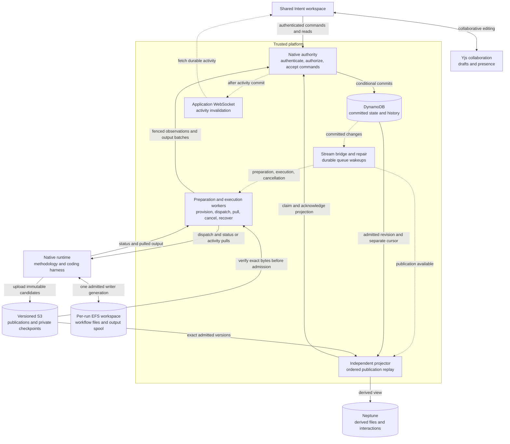

# Native execution

!!! warning "Working draft"

    This page describes the implemented architecture and tracks remaining work.
    It is excluded from the documentation site until the publication checklist
    in [Open work](#open-work) is complete. Local tests do not establish live
    end-to-end qualification.

Native execution runs a pinned AI-DLC methodology package through a coding
harness in a dedicated workspace. The native engine decides which methodology
step comes next, produces workflow files, and asks for human decisions. The
platform owns trusted admission, access checks, accepted answers, execution
supervision, and the collaborative experience.

Native and the platform backend coexist. The [platform execution model](execution.md)
uses the v2 orchestrator to schedule stages and gates. Native execution does not
use that scheduler or turn its publications into platform stages. Both backends
use the shared Intent shell, activity panel, discussions, and graph navigation,
with backend-specific commands. Native is the direction for new methodology
execution; supported v2 security, recovery, replay, and integration remain
maintained. Existing executions are not migrated between engines automatically.

## Responsibilities and data flow

Solid arrows below carry requests or data. Dashed arrows are asynchronous
notifications or reconciliation. DynamoDB records committed control state;
Neptune's native content is a derived view.

Membership checks use the existing project membership authority in Neptune;
that access dependency is omitted from the diagram for readability. A graph
write outage can delay projection without blocking the next turn, but an
inability to verify membership still prevents authorized work.

| Responsibility                                                            | Owner                                                                | Boundary                                                                                                |
| ------------------------------------------------------------------------- | -------------------------------------------------------------------- | ------------------------------------------------------------------------------------------------------- |
| Methodology and live workflow files                                       | Native engine, harness, and tools in the admitted runtime generation | Decide workflow steps; cannot accept platform commands or human answers                                 |
| Preparation, execution, answers, publication history, output, and cursors | Native authority (`native-runtime-control`)                          | Sole native control-state mutation boundary; conditional writes enforce identity, lease, and generation |
| Resource preparation and turn supervision                                 | Preparation and execution workers                                    | Perform effects and submit observations through restricted authority operations                         |
| Publication admission                                                     | Authority, using supervisor-verified evidence                        | Bind immutable bytes to the current run, pins, turn, and writer                                         |
| Native graph content                                                      | Independent publication projector                                    | Rebuildable, ordered projection; never schedules execution                                              |
| Shared drafts and human decisions                                         | Yjs for drafts; authenticated command authority for acceptance       | Editing a draft is separate from submitting an immutable answer                                         |
| Discussion assistance                                                     | Discussion service, with advisory Quorum results                     | Conditionally accept the current request and attempt; cannot answer or approve the native workflow      |

The authority exposes separate IAM-restricted caller interfaces for commands,
preparation, execution, and projection. Caller identity comes from the Lambda
invocation, not a field supplied by a worker. HTTP commands independently verify
the signed-in identity and project access. Reconciliation workers cannot write
the native control table directly or impersonate another caller class.

## From request to running workspace

1. **Select the project and package.** A workflow source is a read-only methodology
   source, separate from the application's code repository. An authorized source
   binding and completed, verified package import identify the package bytes.
   The member selects a harness and creates a native draft. Title-only drafts
   remain supported; members can add or revise and save the prompt before Start.
2. **Prepare the workspace.** The preparation worker provisions the run's
   dedicated runtime, role, and EFS access point. It verifies the actual resource
   identities and mounted filesystem before reporting readiness. Preparation
   does not start a model turn.
3. **Accept Start.** The authenticated command validates membership, the ready
   draft, application repository access, and credentials. It records immutable
   configuration: package and archive versions, the saved prompt revision, harness/model,
   credential binding, and execution image. The source branch and resolved
   commit are captured before dispatch. Preparation and execution images have
   separate pins; starting a prepared draft records the execution image explicitly.
4. **Dispatch from committed state.** A DynamoDB stream bridges committed changes
   to work queues. Periodic repair rediscovers pending work if a notification is
   lost. Workers reload protected state and claim a lease before acting;
   duplicate messages do not create another logical command. The supervisor
   dispatches the runtime, which prepares the pinned source checkout.

The current path uses one application repository and serial turns. Native
installation and project files live on per-run EFS paths; active harness homes
and databases use local disk. Recovery exports preserve the required session
state. A missing EFS mount must fail rather than silently use a local directory.
The runtime has no native control-table or Neptune write access.

### Package integrity

The package worker verifies and publishes versioned package bytes before a run
can use them. Package storage restricts publishing to the dedicated worker and
conditional object creation, rejects copies and deletion, and guards multipart
initiation using object-creation context as well as the conditional header.
Versioning alone is insufficient: lifecycle expiry, policy administration, and
incomplete uploads must also be considered when qualifying storage.

Package-import jobs have their own protected claims and retry lifecycle, separate
from execution-command wakeups. Source credentials and application credentials
retain distinct bindings. The platform must recheck access rather than treating
a previously imported package or prepared workspace as continuing authorization.

## Publications, activity, and human interaction

### Files and checkpoints

The native runtime owns mutable workflow files. At a quiescent turn boundary it
uploads candidate publications and private recovery checkpoints to versioned S3
storage. The supervisor verifies their exact versions, hashes, inventories,
session identity, and pinned context. The authority admits the publication only
for the current lease and writer generation, recording immutable history and
the committed head in DynamoDB.

Publications contain readable work products and the presented interaction.
Private checkpoints also carry the state needed to restore the same harness
conversation; they are not public artifacts. Required publications, answers, and
recovery state are independent of optional debug archives and their retention.
A published proposal is evidence of what was shown, not permission to perform
the actions it proposes.

### Activity and reconnect

Harness output passes through the shared output normalizer and native redaction
boundary, then into a private EFS spool. The supervisor polls runtime status and
pulls activity batches. The authority commits events and the ingestion cursor
together under the current execution ownership. The next pull acknowledges the
persisted cursor, allowing the runtime to discard acknowledged spool segments.
Backpressure preserves unacknowledged output.

After persistence, content-free application WebSocket notifications tell the
Intent activity adapter to fetch durable history. Paginated REST reads and
polling support replay and reconnect. The runtime does not stream directly to
the browser. Activity describes work; it cannot accept answers or advance the
methodology. Buffer and transport limits are not automatic model-turn time,
token, or spending cutoffs.

Yjs is a separate collaboration transport for revision-scoped drafts and
presence. Its document synchronization is neither the execution event log nor
the accepted-answer ledger. See [Real-time collaboration](../using-the-platform/real-time-collaboration.md)
and [Yjs operations](../development/yjs-operations.md) for the shared transport
and persistence model.

### Questions, decisions, and Quorum

A supported native interaction presents the exact assistant response and, when
available, structured questions or approval choices. Members can collaborate
on free text or structured selections. Submission names the presented
interaction, content digest, and request identity. The authority rechecks
membership and atomically records one immutable accepted answer with the next
execution command. Stale or competing submissions cannot replace it.

The supervisor delivers that answer to the same pinned native conversation.
The engine interprets it and decides the next methodology step. Acceptance,
delivery, and an engine-applied decision are different events; a successful
submission alone does not prove a workflow approval was applied.

Published revisions can be discussed through the existing discussion service.
Quorum contributes advice. Its completion is accepted by the discussion owner
only for the stored request and current attempt while that message remains
eligible. Quorum output and collaborative drafts never become accepted workflow
answers automatically.

## Graph projection and enrichment

The independent projector reads admitted publication history in sequence,
verifies the referenced S3 bytes, rechecks authorization, and updates Neptune.
Today it projects the native intent, generic file artifacts, the presented
interaction, and legacy file questions with containment and relationship edges.
It uses revision predicates to prevent stale work from overwriting newer views.
Its lease and cursor are separate from execution admission; the UI can report
projection lag while committed files remain readable.

This deterministic projection is different from the platform backend's richer
artifact derivation. That pipeline extracts sections, typed items, citations,
and traceability, and can optionally use model-based enrichment. Native
publication projection does not call that pipeline or consume its enrichment
setting. Native semantic extraction and optional enrichment are integration work
still to do. The workflow's own internal graph files also do not replace the
platform's knowledge graph or control execution scheduling.

## Recovery, compatibility, and operation

Cancellation has a separate queue and consumer capacity. Acceptance invalidates
ordinary execution ownership; the supervisor closes the protected runtime fence
before requesting session stop. Cancellation does not admit another writer.
Already committed history remains readable, and projection may finish an
already admitted revision.

Recovery requires a verified checkpoint and positive confirmation that the
predecessor session stopped before a new writer generation is admitted. It
restores the same conversation with its pinned dependencies and accepted-answer
history. An ambiguous delivery is reported for review rather than blindly
replaying a possibly executed turn. Unknown schemas and unsupported recovery
formats fail closed; silently starting a fresh conversation is not recovery.

### Admission shutdown and upgrades

To stop **new executions**, set `native_execution_admission_enabled=false`.
`enable_native_execution` is the backward-compatible admission default when the
explicit setting is unset. To stop **new drafts**, also set
`enable_native_preparation=false`. Keep `native_services_enabled=true` so
existing drafts, reads, replies, cancellation, recovery, and projection continue.
Resident services default to enabled and have infrastructure cost even with
admission closed.

Deploy compatible controller packages, authority interfaces, IAM, streams, and
queues together. Preserve supported images and CLI bytes, package archives,
source/configuration pins, credentials, runtime targets, and publication,
answer, and checkpoint decoders. An application upgrade from N−1 can still
contain runs created much earlier; release age does not determine their lifetime.
Legacy row schema 1 and retained runtime transports remain supported without
rewriting existing pins or inventing missing publication history.

The repository's `architecture/native-compatibility.json` records supported
contracts and exact-byte fixture provenance. Before any dependency removal,
close admission and obtain a current protected inventory with
`scripts/native-dependencies.mjs`. Unknown records stay protected. Full service
teardown is guarded by the empty-dependency preflight; used installations retain
resident services and history. Resource retirement requires verified stop or
explicit migration/revocation evidence. There is no automatic cross-engine
migration or history-deletion policy.

### Repair and diagnostics

The stream bridge retries failed batches. A five-minute paginated repair scan
rediscovers preparation, execution, cancellation, projection, and revoked-image
work, including quiet waiting executions. Execution, cancellation, and projection
queues have no receive-count cutoff; preparation retains its existing dead-letter
queue. Operators must monitor wakeup failures, stream iterator age, queue age,
and projection retries, connect alarms to alerting, and qualify repair capacity.
Package-import queue failures also need their own monitoring and reconciliation.

For projection lag, preserve immutable objects and restore membership and graph
access so ordered replay can continue. Do not edit execution state or advance
the cursor manually. Diagnostics and optional debug retention must not delete
the evidence needed to resume or inspect a run.

### Trust and qualification limits

One writer generation does not mean its tools are isolated from one another.
Same-UID harnesses and tools share filesystem authority. Local approval markers
are not independent protected approval; any platform effect that depends on a
human decision must verify the immutable accepted answer and exact presented
context at its trusted boundary. Native currently has no platform Git-delivery
capability. Supported v2 Git effects retain their engine-owned checks.

Quorum's result-only interface is a code boundary: its shared platform runtime
still has permissions required by v2. It is not runtime-wide IAM isolation from
the discussion graph.

Local protocol, ownership, and retained-byte tests establish bounded contracts.
They do not qualify deployed IAM, actual old-image CLI restoration, model
behavior, or the complete user journey. Use the [testing guide](../development/testing.md),
[setup guide](../getting-started/setup.md), and
[authentication guidance](../getting-started/enterprise-sso.md) for shared
procedures. Release qualification must record exact pins and exercise real
upgrade, recovery, authorization, and delivery behavior in an authorized
isolated deployment.

## Open work

This is the temporary native working backlog. **Capability** means missing
product behavior, **issue** means a gap confirmed in current source, and
**verification** means evidence still needed. Complete the serial pilot's
release criteria before widening support; later capabilities are separate scope.

### Complete the serial product journey

- [ ] **Capability — shared Intent presentation and creation.** Reuse the central
      workspace header, configuration, work-product views, and normal creation entry.
      Put the current question or recovery action first; remove obsolete pilot copy
      and permanent unavailable-action controls. Define supported attachments, tracker
      input, and source selection. Done when two members can create and navigate a
      native intent with consistent status in project, dashboard, and sidebar views.
- [ ] **Capability — completion and obtainable results.** Define verified workflow
      completion separately from a stopped turn, with required checks and review
      outcomes tied to exact result bytes. Provide result archive, binary download,
      and source diff. Done when another member can inspect the tested result after
      the runtime stops, including failed or uncertain verification.
- [ ] **Capability — platform Git delivery.** Add an authorized, idempotent
      intent-level delivery contract with engine-held credentials, reviewed-byte
      identity, remote confirmation, and review/merge outcomes. Define tracker
      integration explicitly. Done when the selected provider's delivery lifecycle
      is qualified; per-unit pull requests are not required for the serial pilot.
- [ ] **Capability — decision and revision history.** Expose earlier publications,
      comparisons, shareable file/revision links, and correlated accepted, delivered,
      applied, rejected, or uncertain answer outcomes. Done when a member can reopen
      the exact proposal, discussion, decision, and resulting revision.
- [ ] **Capability — native traceability.** Integrate deterministic section/item
      extraction and meaningful phase/stage relationships from admitted content.
      Define optional enrichment settings and provenance explicitly. Done when
      rebuildable native traceability is useful without delaying raw-file visibility,
      publication admission, or next-turn dispatch; unknown formats stay readable.

### Resolve known issues and recovery gaps

- [ ] **Issue — publication/recovery file policy mismatch.** Public file selection
      and private checkpoint exclusions disagree for credential-shaped paths such as
      `.env` and `.npmrc`. Align the public subset and preserve safe templates. Done
      when capture → checkpoint → admission tests agree on exact inventories and
      credential files cannot become public artifacts.
- [x] **Issue — rejected or incomplete drafts.** **Accepted behavior — prompt correction:**
      retain title-only drafts and allow prompt editing before Start, including
      existing incomplete drafts. Start pins the accepted saved prompt; admitted
      executions cannot be retargeted by editing. Title-only and prompt-only
      creation remain supported. Both native presentations now offer Add/Edit,
      Save, and explicit reload after a conflict. Unsaved text survives refreshes;
      ambiguous saves retry the same identity and body. Protected transactions
      compare the saved revision and exclude admitted executions, fencing both
      edit/edit and edit/Start races. Start requires a nonblank saved prompt and
      the revision the member saw. Immutable save receipts confirm retries,
      including after later edits or Start; the original creation request and
      fingerprint stay unchanged. Retained drafts decode as revision zero.
      Deploy the updated authority/controller and prompt route before the frontend;
      older APIs expose read-only prompts, and older Start clients must refresh
      using an updated client after a draft has been edited. No data migration
      or model dispatch is caused by editing.
      **Completed — rejection repair:** the API marks draft input/size rejection
      before dependencies or persistence. Only that explicit rejection, with no
      earlier uncertain attempt, unlocks correction; resubmission keeps the same ID.
      Generic validation errors can originate from committed-row reads and do not
      unlock the form. Conflicts, failed or unreadable responses, and later rejection
      after uncertainty retain the original identity and body. Known rejection
      clears the recovery URL; a reload with an unresolved ID only refreshes status,
      never recreates a request from missing fields, even after a 404.
      Duplicate submissions and late route/account/session callbacks are fenced.
      The additive error marker needs the updated API to enable repair; older APIs
      retain conservative retry behavior. Local verification on Node 24.21.0:
      273 focused frontend tests, 463 focused backend tests, the 70-test listing
      suite, all 1,570 frontend tests, and all 5,749 native foundation tests passed.
      Frontend build, lint, formatting, secret scanning, dependency and architecture
      checks, wiring (21 tests), architecture regressions (5 tests), and Terraform
      formatting/validation passed. Four initial list-summary expectations were
      corrected to retain the existing summary shape. Terraform initialization
      required registry access and isolated local backend data. Lint, dependency,
      build, and Terraform deprecation warnings remain; no deployed AWS or model
      qualification was performed.
- [x] **Issue — legacy waiting-state refresh.** Detail polling now includes
      `WAITING_FOR_INPUT` after projection catches up, alongside current waits.
      Another member's cancellation appears without a manual reload. Existing
      revision and legacy timestamp guards reject older detail and command replies;
      terminal runs stop polling once projection completes. Deterministic regressions
      cover cancellation, response ordering, and run/project/account/expiry/unmount
      cleanup in the native page and shared workspace. Local verification on Node
      24.21.0: 79 focused tests and all 1,506 frontend tests passed; frontend build,
      lint, formatting, and secret scanning passed (lint/build warnings remain).
      An unchanged interaction test failed intermittently with
      duplicate draft text in one focused run, then passed alone and in the full suite.
      These checks do not establish live two-member or deployed qualification.
- [x] **Issue — transient reads during restoration.** The recovery supervisor
      retries unreadable restore acknowledgements and status reports through the
      existing short queue and conditional lease release. It retains the recovery
      ID, writer generation, checkpoint/session identity, pinned configuration, and
      accepted answer. Repeated restore requests observe the same admitted restore;
      they do not replay a model turn. Structured runtime rejections, checkpoint
      failures, identity mismatches, and lost ownership remain explicit. Confirmed
      stop, cancellation, and membership/image revocation checks remain in force.
      Deterministic regressions cover unreadable → ready, repeated unreadable reads,
      duplicate/concurrent work and restore requests, stale owners, and resumed
      answer delivery once through the real local runtime and checkpoint codecs.
      Local verification on Node 24.21.0: 137 focused tests and all 5,720 native
      foundation tests passed; wiring (21 tests), architecture regressions (5 tests),
      architecture checks, lint, formatting, secret scanning, and dependency checks
      passed. Two broader runs across `native-runtime-control`, `agentcore`, `shared`,
      and `intents` each passed 7,609 tests with 3 skipped and one failure: an unchanged
      authentication inventory test timed out at five seconds, then an unchanged
      source-transport deadline assertion failed on retry. Both suites passed in
      isolation (13 and 162 tests). An intervening Docker port-binding failure ran no
      tests. Lint and dependency warnings remain. Docker/loopback access was required;
      Node 22 was not locally available. These checks do not establish deployed AWS,
      pinned CLI/model, or live release qualification.
- [ ] **Capability — uncertain and abandoned work.** Provide inspect/export and
      safe new-run choices with lineage after confirmed stop; define archive and
      reference-aware cleanup for drafts and terminal runs. Done when members have a
      remedy for `DELIVERY_UNCERTAIN` without duplicating effects or deleting resumable
      dependencies and readable history.

### Qualify shared use and operations

- [ ] **Verification — collaborative decisions and identity.** Test two-member
      structured choices, revision/change-request/approval cycles, stale submissions,
      logout/login, account switching, revocation, token expiry, and late callbacks.
      Include old artifact discussions and Quorum success/failure/retry. Done when
      drafts, connections, and accepted actions remain identity- and revision-scoped
      across reconnect, and advisory output cannot accept an answer.
- [ ] **Capability and verification — activity and observability.** Add useful
      lifecycle history, reviewer progress/failures, incident actions, and cost/latency
      attribution. Verify pagination beyond one batch, reconnect gaps, redaction
      across chunks, backpressure, and stale writers. Done when operators can trace
      acceptance through dispatch and publication without relying on private logs
      for normal member actions.
- [ ] **Verification — runtime stability.** Revisit historically reported mid-turn
      runtime losses and reviewer timeouts on the current package/image. Done when
      repeated representative long and reviewer-heavy runs report durations,
      concurrency, resource use, failures, and descendant cleanup; a later successful
      run alone does not close an unexplained loss.
- [ ] **Capability and verification — support matrix and settings.** State which
      package/protocol, harness, model, source provider, and settings combinations
      are supported. Qualify Claude Code, Codex, Kiro, and OpenCode before advertising
      broad support, including current structured plan choices and supported forks.
      Done when unsupported managed-environment, MCP, rules, or other settings are
      explicit and supported configuration remains pinned.
- [ ] **Verification — live lifecycle and upgrade.** Complete one useful task from
      source selection through decisions, implementation, tests, final review, and
      obtainable result. Start with the oldest supported retained image, park,
      upgrade the controller, renew credentials, cold-restore, and consume an accepted
      answer once. Exercise cancellation, duplicates, missing acknowledgements,
      stale generations, tampered checkpoints, membership/image revocation, and
      admission shutdown with existing work. Done when exact pins and outcomes are
      recorded for the release candidate.
- [ ] **Verification — deployed boundaries and storage.** Qualify effective IAM,
      authority caller separation, cross-project runtime/EFS isolation, source-access
      changes, and publication/checkpoint permissions. Verify package worker-only
      writes, overwrite/copy/delete denials, lifecycle configuration, and multipart
      behavior with positive controls and clean inventories. Done when actual role
      and network paths pass; unsupported API errors are not counted as denials.
- [ ] **Verification — repair capacity and alerting.** Measure full repair scans,
      revocation lookup cost, queue recovery, and package-import repair at intended
      table size and concurrency. Attach alarm destinations and assign incident
      ownership. Done when missed notifications are repaired within an agreed bound
      and timeouts or dead-letter work are actionable.
- [ ] **Capability — optional debug archive lifecycle.** Wire capture and expiry
      to the existing off-by-default preferences. Done when enabled retention is
      enforced without affecting mandatory publications, history, or recovery.

### Deliberately later

- [ ] **Scope decision — advanced collaboration and execution.** Define separate
      contracts before adding artifact edit/apply, Quorum edits, parallel units,
      per-unit delivery, rewind/recompose, multi-repository work, or cross-engine
      migration. These are not serial-pilot release blockers and do not inherit
      v2 behavior merely by sharing the Intent page.

### Publish this page

- [ ] Remove this **Open work** section and the **Working draft** admonition once
      release criteria are satisfied. Remove this page from `extra.draft_docs` in
      `zensical.toml`, add `concepts/native-execution.md` under **How it works**, and
      run `uv run python scripts/build-docs.py`. Verify navigation, links, Mermaid rendering, and search
      inclusion before publication. Until then, link here only from repository
      contributor/configuration references, not published pages.
