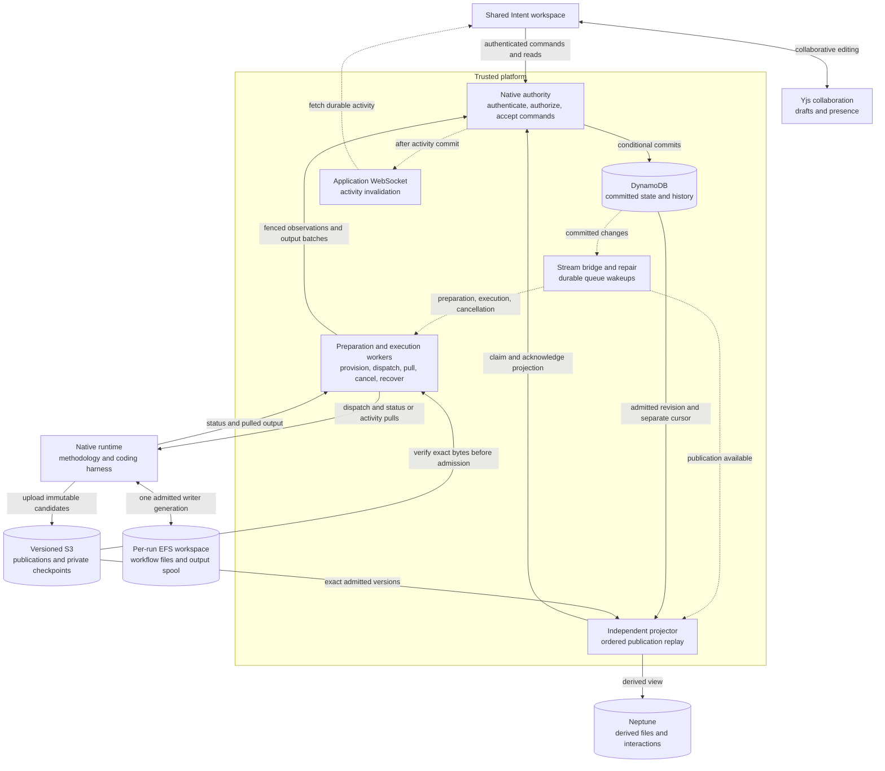

# Native execution

!!! warning "Working draft"

    This page describes the implemented architecture and tracks remaining work.
    It is excluded from the documentation site until the publication checklist
    in [Open work](#open-work) is complete. Local tests do not establish live
    end-to-end qualification.

Native execution runs a pinned AI-DLC methodology package through a coding
harness in a dedicated workspace. The native engine decides which methodology
step comes next, produces workflow files, and asks for human decisions. The
platform owns trusted admission, access checks, accepted answers, execution
supervision, and the collaborative experience.

Native and the platform backend coexist. The [platform execution model](execution.md)
uses the v2 orchestrator to schedule stages and gates. Native execution does not
use that scheduler or turn its publications into platform stages. Both backends
use the shared Intent shell, activity panel, discussions, and graph navigation,
with backend-specific commands. Native is the direction for new methodology
execution; supported v2 security, recovery, replay, and integration remain
maintained. Existing executions are not migrated between engines automatically.

## Responsibilities and data flow

Solid arrows below carry requests or data. Dashed arrows are asynchronous
notifications or reconciliation. DynamoDB records committed control state;
Neptune's native content is a derived view.



Membership checks use the existing project membership authority in Neptune;
that access dependency is omitted from the diagram for readability. A graph
write outage can delay projection without blocking the next turn, but an
inability to verify membership still prevents authorized work.

| Responsibility                                                            | Owner                                                                | Boundary                                                                                                |
| ------------------------------------------------------------------------- | -------------------------------------------------------------------- | ------------------------------------------------------------------------------------------------------- |
| Methodology and live workflow files                                       | Native engine, harness, and tools in the admitted runtime generation | Decide workflow steps; cannot accept platform commands or human answers                                 |
| Preparation, execution, answers, publication history, output, and cursors | Native authority (`native-runtime-control`)                          | Sole native control-state mutation boundary; conditional writes enforce identity, lease, and generation |
| Resource preparation and turn supervision                                 | Preparation and execution workers                                    | Perform effects and submit observations through restricted authority operations                         |
| Publication admission                                                     | Authority, using supervisor-verified evidence                        | Bind immutable bytes to the current run, pins, turn, and writer                                         |
| Native graph content                                                      | Independent publication projector                                    | Rebuildable, ordered projection; never schedules execution                                              |
| Shared drafts and human decisions                                         | Yjs for drafts; authenticated command authority for acceptance       | Editing a draft is separate from submitting an immutable answer                                         |
| Discussion assistance                                                     | Discussion service, with advisory Quorum results                     | Conditionally accept the current request and attempt; cannot answer or approve the native workflow      |

The authority exposes separate IAM-restricted caller interfaces for commands,
preparation, execution, and projection. Caller identity comes from the Lambda
invocation, not a field supplied by a worker. HTTP commands independently verify
the signed-in identity and project access. Reconciliation workers cannot write
the native control table directly or impersonate another caller class.

## From request to running workspace

1. **Select the project and package.** A workflow source is a read-only methodology
   source, separate from the application's code repository. An authorized source
   binding and completed, verified package import identify the package bytes.
   The member selects a harness and creates a native draft. Title-only drafts
   remain supported; members can add or revise and save the prompt before Start.
2. **Prepare the workspace.** The preparation worker provisions the run's
   dedicated runtime, role, and EFS access point. It verifies the actual resource
   identities and mounted filesystem before reporting readiness. Preparation
   does not start a model turn.
3. **Accept Start.** The authenticated command validates membership, the ready
   draft, application repository access, and credentials. It records immutable
   configuration: package and archive versions, the saved prompt revision, harness/model,
   credential binding, and execution image. The source branch and resolved
   commit are captured before dispatch. Preparation and execution images have
   separate pins; starting a prepared draft records the execution image explicitly.
4. **Dispatch from committed state.** A DynamoDB stream bridges committed changes
   to work queues. Periodic repair rediscovers pending work if a notification is
   lost. Workers reload protected state and claim a lease before acting;
   duplicate messages do not create another logical command. The supervisor
   dispatches the runtime, which prepares the pinned source checkout.

The current path uses one application repository and serial turns. Native
installation and project files live on per-run EFS paths; active harness homes
and databases use local disk. Recovery exports preserve the required session
state. A missing EFS mount must fail rather than silently use a local directory.
The runtime has no native control-table or Neptune write access.

### Package integrity

The package worker verifies and publishes versioned package bytes before a run
can use them. Package storage restricts publishing to the dedicated worker and
conditional object creation, rejects copies and deletion, and guards multipart
initiation using object-creation context as well as the conditional header.
Versioning alone is insufficient: lifecycle expiry, policy administration, and
incomplete uploads must also be considered when qualifying storage.

Package-import jobs have their own protected claims and retry lifecycle, separate
from execution-command wakeups. Source credentials and application credentials
retain distinct bindings. The platform must recheck access rather than treating
a previously imported package or prepared workspace as continuing authorization.

## Publications, activity, and human interaction

### Files and checkpoints

The native runtime owns mutable workflow files. At a quiescent turn boundary it
uploads candidate publications and private recovery checkpoints to versioned S3
storage. The supervisor verifies their exact versions, hashes, inventories,
session identity, and pinned context. The authority admits the publication only
for the current lease and writer generation, recording immutable history and
the committed head in DynamoDB.

Publications contain readable work products and the presented interaction.
Private checkpoints also carry the state needed to restore the same harness
conversation; they are not public artifacts. Required publications, answers, and
recovery state are independent of optional debug archives and their retention.
A published proposal is evidence of what was shown, not permission to perform
the actions it proposes.

### Activity and reconnect

Harness output passes through the shared output normalizer and native redaction
boundary, then into a private EFS spool. The supervisor polls runtime status and
pulls activity batches. The authority commits events and the ingestion cursor
together under the current execution ownership. The next pull acknowledges the
persisted cursor, allowing the runtime to discard acknowledged spool segments.
Backpressure preserves unacknowledged output.

After persistence, content-free application WebSocket notifications tell the
Intent activity adapter to fetch durable history. Paginated REST reads and
polling support replay and reconnect. The runtime does not stream directly to
the browser. Activity describes work; it cannot accept answers or advance the
methodology. Buffer and transport limits are not automatic model-turn time,
token, or spending cutoffs.

The authority also writes a small public `EVENT#<execution revision>` ledger in
the **same transaction** as meaningful execution transitions. It records Start
and reply acceptance, queued/attempted/confirmed dispatch, admitted publication,
waiting, recovery phases, failures, and requested/confirmed cancellation.
Heartbeats and leases add no timeline noise. Event rows do not schedule work;
the existing execution, answer, publication, and ownership records remain
authoritative. A failed or stale transaction cannot leave a successful event.
The dependency inventory retains these rows as readable history.

The existing `/outputs` read accepts an optional independent `afterEvent` cursor
alongside `afterSeq`. Its additive `events` and `nextEventAfter` fields populate
the shared Timeline while `OUTPUT` and `OUTPUT_CURSOR` keep their existing
ordering. Each stream pages 64 rows; reconnect and two-second polling catch
lost notifications. Read failures visibly mark incomplete history and preserve
the last confirmed cursor. Resource/action denials clear the scoped history
without treating their status codes as project-wide access revocation.
Account/project/intent changes detach subscriptions and reject late pages.
Old output-only responses remain readable; old lifecycle history is not
reconstructed. Historical reply delivery is `unknown` when the retained delivery
pointer no longer identifies that answer. Acceptance never implies approval.

New runtime captures add bounded usage/timing summaries through the unchanged
`activity-v1` lifecycle format and the existing redaction boundary. Codex turn,
Claude result, and OpenCode step usage callbacks report observed numeric
counters with the pinned harness/model; missing counters remain unavailable.
The shared `model-pricing.js` helper supplies an **input/output cost estimate**
only when both counters and a canonical price exist. It is not a total bill:
cache, credits, infrastructure, aggregate costs and individual reviewer usage
are not priced by this view. Kiro ACP has no captured reliable usage signal here.
Controller timestamps report acceptance-to-dispatch and dispatch-to-publication
when those exact boundaries exist; runtime capture wall time includes harness
preparation and tools. None is presented as model-only inference latency.

Quorum's existing discussion status shows running, advisory completion or
failure, with its existing guarded retry. Internal harness reviewer activity is
visible only to the extent supplied by sanitized normalizer output; there is no
invented reviewer verdict or workflow success. Incident actions remain Refresh
activity/status, Cancel execution, eligible Recover session, and discussion
retry. `DELIVERY_UNCERTAIN` cannot enable replay. These changes add no archive,
private transcript/checkpoint read, control route, IAM permission or pricing
table. Existing retained images continue without the new usage summaries;
controller/frontend updates add lifecycle visibility without repinning runs.
Deploy the controller and frontend together (controller first); old controllers
reject the new cursor parameter. Existing clients that request only `afterSeq`
still receive their original output DTO. The `unknown` historical reply delivery
value requires the updated frontend decoder.

Yjs is a separate collaboration transport for revision-scoped drafts and
presence. Its document synchronization is neither the execution event log nor
the accepted-answer ledger. See [Real-time collaboration](../using-the-platform/real-time-collaboration.md)
and [Yjs operations](../development/yjs-operations.md) for the shared transport
and persistence model.

### Questions, decisions, and Quorum

A supported native interaction presents the exact assistant response and, when
available, structured questions or approval choices. Members can collaborate
on free text or structured selections. Submission names the presented
interaction, content digest, and request identity. The authority rechecks
membership and atomically records one immutable accepted answer with the next
execution command. Stale or competing submissions cannot replace it.

The native UI presents all unanswered questions already available at one
workflow step in one collaborative form. New runtime instructions declare
guided in-app interaction using the pinned methodology's explicit-preference
protocol, avoiding an extra guide/file/chat question where that protocol is
supported. The native renderer accepts version 2 question specs: up to 32
questions, each with 2–16 choices or no choices for a written answer. Every
prompt and option must occur in the rendered response; the admitted
interaction digest covers the entire definition. Version 1 remains readable
with its original four-question and choice-only constraints. Missing,
inconsistent or oversized specs fall back to the assistant response and free
text, without truncating or inventing questions. The reserved spec stays
bounded to 64 KiB; answer limits remain 4,000 characters per written field and
16 KiB for the canonical complete reply.

Required summary confirmations and stage approvals stay separate human
interactions. A form is display data from the current turn, not permission to
skip stages or proof that a model correctly followed every methodology
instruction. The platform does not infer questions from English prose or
automatically submit mode answers to an already admitted run. Unsent drafts
use the existing revision-scoped Yjs transport; native drafts survive
connected-peer reload/reconnect, not server restart or expiry of the last
client's 60-second grace period. Accepted replies remain durable and readable
independently of drafts.

The supervisor delivers that answer to the same pinned native conversation.
The engine interprets it and decides the next methodology step. Acceptance,
delivery, and an engine-applied decision are different events; a successful
submission alone does not prove a workflow approval was applied.

Published revisions can be discussed through the existing discussion service.
Quorum contributes advice. Its completion is accepted by the discussion owner
only for the stored request and current attempt while that message remains
eligible. Quorum output and collaborative drafts never become accepted workflow
answers automatically.

## Graph projection and enrichment

The independent projector reads admitted publication history in sequence,
verifies the referenced S3 bytes, rechecks authorization, and updates Neptune.
The graph read API rebuilds the same view from the protected current publication;
Neptune never determines file access. Alongside generic files, the presented
interaction and legacy questions, `native-trace-v1` adds H2–H6 sections and
content-declared items through the shared artifact extraction registry. Headings
inside fenced examples are ignored. Registered YAML blocks must meet the
registry's field shapes; malformed blocks retain generic sections. A filename
alone never selects a semantic artifact type.

The established record paths under `aidlc/spaces/<space>/intents/<record>/` and
legacy `aidlc-docs/` identify **phase and stage locations**, including separate
construction units. `LOCATED_IN` links describe that layout, not a stage invocation
or its progress. Unknown layouts remain generic. Explicit `covers`, `persona`,
`depends_on` and story-map fields create item relationships only when their target
is unique within the same publication and record scope, with compatible unit
scope. Ambiguous references remain unlinked. Runtime graphs, checkmarks, authored
decision status and discussion advice confer no approval, completion or scheduling
authority. Authored item fields are namespaced separately from execution status.

Every derived node carries project/execution identity, package ID, immutable
publication ID/sequence, file ID/hash, the existing `fileId:sha256` revision
identity, source path and extraction contract. Sections identify line ranges;
items identify their complete YAML block and item slug/order. Locations name the
record-layout contract and an exact supporting file. IDs include publication and
scope, so identical bytes in different revisions cannot share derived ownership.
Retries reuse IDs; conditional writes and endpoint checks fence newer publications
and foreign owners. Superseded structure is disconnected from current intent/file
heads while old nodes and exact publication history remain retained. The frontend
checks revision provenance against the current inventory and opens the source file
from a derived node in both native presentations.

Extraction reads only already admitted public Markdown/plain-text work products.
It applies the existing public exclusions and private-recovery credential-path
classifier without changing historical raw-file visibility. Private checkpoints,
harness databases, runtime-state JSON and debug archives are not extraction inputs.
The inline/context 3 MiB bound applies to each extracted file and to aggregate
extraction reads per publication, in deterministic path order. The existing
1,000-file and 1 MiB manifest bounds also bound derived node count and serialized
structure. YAML nesting/node limits and rejection of aliases prevent expansion.
An over-budget document contributes no partial structure; per-file `byte_limit`,
`structure_limit`, `incompatible` or `generic` status explains the fallback.
Relationship-budget exhaustion omits that relationship pass explicitly. Raw files
remain canonical and readable through their existing transport limits.

Projection owns its lease, retry and cursor independently of admission and turn
dispatch. Cursor projection version 2 rebuilds an older completed projection's
current immutable head; periodic repair discovers it without rewriting execution
pins or replaying old publications over a newer graph. Integrity/ownership failures
retry without acknowledgement; unknown content formats do not block the cursor.
Graph transport/validation errors are isolated in the UI while file/reply access
continues; access denials still clear protected content. Deploy the controller,
authority/projector bundles and frontend together. No runtime protocol, retained
publication schema, route or IAM change is required.

Native enrichment remains explicitly **off**, with no model calls or mutable
settings lookup. The platform backend's Admin `derive-enrichment=off|llm` setting
is captured on its own execution META and forwarded to its derive-time CLI
summary pipeline; native configuration does not capture it. A future native
opt-in still needs a decision on capture timing (draft or Start), whose pinned
CLI/model/credential pays for it, and whether enrichment runs per publication or
on demand. That optional decision does not gate deterministic extraction.

## Platform Git delivery boundary

**Contract audit, 2026-10-14:** native Git delivery is not implemented or
qualified. Source checkout, admitted public results and v2 delivery provide
reusable boundaries, but do not establish permission to publish a native result.
Viewing, discussing or exporting a revision creates no Git work.

`execution-config` captures one application provider/repository and binding
revision. `execution-source` resolves its branch and exact commit before dispatch;
the protected `EXECUTION` record retains them. The native API resolves
`intentId` to that execution within the project and rechecks current membership
and project identity. `native-artifact-revision` resolves named admitted
publications and exact versioned file bytes independently of the current
runtime, graph and latest remote branch.

These publications and their source baselines contain **public file subsets**,
not Git trees. The snapshot preserves binary, empty, BOM and CRLF bytes, but its
manifest omits executable modes and Git object identity. Capture excludes Git,
harness and private control paths; symlinks and submodules are unsupported.
Source checkout also rejects LFS materialization. A missing public file can
describe a public comparison, not authorize deletion of an excluded repository
entry. A complete result ZIP means the admitted public inventory, not a
complete runnable repository. Neither a live workspace, private checkpoint nor
a mutable remote checkout can supply missing delivery bytes by implication.

`RESULT` rows are independent export jobs, `EVENT` rows are observations, and
accepted question answers authorize the next native command. None records
authoritative check/review outcomes or engine application of a decision.
The decided completion policy follows the exact pinned AI-DLC workflow and
selected plan: enforce its defined human gates, with no blanket extra final
approval or platform-defined mandatory checks/reviews. Completion remains
`not_verified` because effective plan/application/outcome evidence is unavailable.
Protected selections can establish a member's choice for an exact proposal;
they cannot approve later bytes or prove engine application. Authored review
files, stopped turns, checkmarks, assistant prose, graph edges and advisory
Quorum results do not change this.

The dedicated `execution-credentials` facade rechecks the protected run,
attempt/epoch, image, source-binding revision, starter/delegator membership and
connection generation. It requests `requiredAccess: read` through shared
`source-control-credentials`. GitHub App read tokens request read permissions;
OAuth tokens retain their underlying provider scopes, so operation isolation
must not be mistaken for provider-enforced downscoping. The trusted preparation
path injects the credential only for the exact-commit fetch, removes it before
checkout/package/harness commands, disables helpers/hooks and global config,
and restricts transport. This is source-read authority, not delivery-write
authority. The runtime-callable legacy broker authorizes v2 `META` records; it
cannot be borrowed by a native delivery worker. No credential grant is widened.

The shared `git-providers` registry remains the provider owner. Its current
`createPullRequest` methods also contain platform construction-branch checks,
cleanup and, for GitHub/GitLab, base-retargeting behavior. They are not a native
delivery transaction. Their status DTOs expose PR identity, branch/head and
draft/open/closed/merged observations, not exact-byte review approvals. Provider
errors can return no status; absence must not erase a previously confirmed fact.
The v2 `record-pr` graph writer and tracker reconciler are projections/effects
of v2 execution, not native authority. In particular, v2 `git-engine.pushBranch`
intentionally allows `pushed: true, verified: false` after failed or mismatched
remote confirmation. That compatibility behavior is unchanged and insufficient
to confirm native delivery.

Native configuration has no admitted tracker-source/delivery policy or tracker
sync owner. The existing v2 issue comments and merge-triggered GitHub/GitLab
closure do not apply automatically. Native performs no delivery-related tracker
mutation; whether the pilot should have no integration, explicit links/comments,
or merge-triggered updates is an unanswered product choice.

## Recovery, compatibility, and operation

Cancellation has a separate queue and consumer capacity. Acceptance invalidates
ordinary execution ownership; the supervisor closes the protected runtime fence
before requesting session stop. Cancellation does not admit another writer.
Already committed history remains readable, and projection may finish an
already admitted revision.

Recovery requires a verified checkpoint and positive confirmation that the
predecessor session stopped before a new writer generation is admitted. It
restores the same conversation with its pinned dependencies and accepted-answer
history. An ambiguous delivery is reported for review rather than blindly
replaying a possibly executed turn. Unknown schemas and unsupported recovery
formats fail closed; silently starting a fresh conversation is not recovery.

### Support matrix and settings

**Repository contract, checked locally on 2026-10-14.** “Admitted” below means
the existing validators permit the configuration after authorization and byte
verification. It does not mean a model, fork, or deployed combination has passed
the full native lifecycle. No broad live support claim is established here.
These tables describe existing owners, not a second capability registry.

The runtime currently supplies `<repository>/.github/workflows/release.yml` to
the installer. The separate preflight verifier knows the preview workflow name,
but that does not establish production preview or non-GitHub installer support.
No workflow identity or trust policy was changed to broaden the matrix.

| Boundary                   | Implemented/admitted contract                                                                                                                                                                                                                                                                                                                                                          | Compatibility and qualification limit                                                                                                                                                                                                                                                                                                                                                                                                              |
| -------------------------- | -------------------------------------------------------------------------------------------------------------------------------------------------------------------------------------------------------------------------------------------------------------------------------------------------------------------------------------------------------------------------------------- | -------------------------------------------------------------------------------------------------------------------------------------------------------------------------------------------------------------------------------------------------------------------------------------------------------------------------------------------------------------------------------------------------------------------------------------------------- |
| Methodology release        | `native-release-manifest`, `native-runtime-package`, `native-package-pin` and `native-package-trust` require schema 1, exact `v<version>` tag/40-hex commit, checksums, all four projections, and Linux ARM64 assets. Stable source ref is the tag; the existing `-preview.YYYYMMDD.N` protocol uses `refs/heads/main`. Package, materialization and S3 object versions are immutable. | This release format is not a declaration of workflow protocol compatibility. Other tags, archive layouts, schemas, targets and arbitrary release URLs are unsupported.                                                                                                                                                                                                                                                                             |
| Forks and provenance       | Matching owner-selected forks need the same release, projection, installation and interaction contracts; the repository name is not recognition authority. Package import/admission pins proof bytes but does not claim signature verification; the trusted runtime runs the pinned installer's provenance checks before any harness turn.                                             | Shared `owner-selected-source-v1` preflight permits explicitly absent proofs and requires a trusted verifier for present proofs; that optional preflight is not wired into the production package worker/Start. Its implemented verifier is GitHub-specific. Actual installer acceptance, including unsigned packages, previews and other providers, still needs qualification. No named fork has current live qualification; policy is unchanged. |
| Current production readers | Controller row 1, generation-v1 transport, publications 1 **and 2**, interactions 1/2, pending-input 1, recovery 1. Schema-2 publications include the protected source baseline.                                                                                                                                                                                                       | Unknown schemas are not coerced. Unsupported interaction capture keeps exact readable assistant text and free-text reply; it cannot fabricate choices or approval.                                                                                                                                                                                                                                                                                 |
| Retained transports        | `architecture/native-compatibility.json`: `legacy-native` has publication 1/interaction 1; `retained-native` has publication 1/interactions 1/2/recovery 1. Exact retained router fixtures remain unchanged.                                                                                                                                                                           | The publication-1 tuples intentionally describe old images, not all current readers. Source comparison is unavailable without a captured baseline. Restore requires the original image/session/checkpoint; no migration or replacement conversation.                                                                                                                                                                                               |

| Harness and image-build pin | Model/auth configuration and invocation                                                                                                                                                                                                                                                                          | Local recovery adapter and limits                                                                                                                                        |
| --------------------------- | ---------------------------------------------------------------------------------------------------------------------------------------------------------------------------------------------------------------------------------------------------------------------------------------------------------------- | ------------------------------------------------------------------------------------------------------------------------------------------------------------------------ |
| Claude Code **2.1.257**     | Bedrock bearer key; bare Bedrock ID, shared alias resolution when applicable; `-p --output-format stream-json --verbose --permission-mode bypassPermissions`, optional `--model`, explicit `--resume`. Package hooks/instructions remain loaded; SessionEnd timeout is adjusted by the existing runtime adapter. | `claude-project-jsonl-v1`: selected session, dependent subagent/tool/task/memory files. Unsupported or missing dependencies fail recovery.                               |
| Codex **0.145.0**           | Bedrock bearer key; configured exact `openai.*` ID; `exec --json`, `-m`, `model_provider="amazon-bedrock"`, existing hook/approval bypass and four-thread bound. Platform question tools are disabled in favor of native turn publication.                                                                       | `codex-rollout-jsonl-v1`: selected rollout; `exec resume <id>`. No `--last`, fresh thread or fork is substituted.                                                        |
| Kiro **2.19.2**             | Kiro API key and Kiro model namespace, never a Bedrock alias; ACP protocol 1, **v2 agent engine**, `aidlc` agent and existing tool trust. Explicit models must match session new/load reports.                                                                                                                   | `kiro-v2-session-pair-v1`: JSON/JSONL pair; ACP `session/load` verifies prior user and assistant hashes before another prompt. v1/v3 engines are not native adapters.    |
| OpenCode **1.17.20**        | Bedrock bearer key; `amazon-bedrock/<model>` selection; `run --format json --auto`, explicit `--model` and `--session`. Auto-update is disabled.                                                                                                                                                                 | `opencode-export-json-v1`: `export/import --pure` to preserve one session. Revert, parent/subtask, snapshot/patch and task/todo dependencies are explicitly unsupported. |

The Dockerfile and `native/session-recovery-files.js` own these CLI pins.
`cli-models`, `tier-models`, `model-resolver` and the CLI auth drivers own syntax
and resolution. No live provider/model catalog was fetched. Selection uses the
project flat per-CLI map over the global map, then the legacy fallback row;
Claude/OpenCode also use the existing controller environment/alias fallback.
There is no native platform agent tier. Platform judgment/balanced/templated and
Quorum rows do not select this workflow's model; package-internal agents and
reviewers follow the pinned package's own configuration.

An explicit resolved model string is captured at Start and passed unchanged
through subsequent dispatch and recovery (OpenCode adds its provider prefix
when necessary). An unset model remains `null`: the pinned image/package selects
the harness default, **not an immutable underlying provider model**. Kiro `auto`
also denotes routing, not an exact model version. The UI states this limit.
Existing lenient model-map parsing and best-effort global SSM fallback are
unchanged; malformed entries or an unavailable global read may leave the harness
default. An exact model/region/account combination still needs authorized live
qualification. This item does not change that selection policy.

| Source use           | Implemented provider/auth combinations                                                                                                                                                                                                            | Explicit limits                                                                                                                                                                                                                                       |
| -------------------- | ------------------------------------------------------------------------------------------------------------------------------------------------------------------------------------------------------------------------------------------------- | ----------------------------------------------------------------------------------------------------------------------------------------------------------------------------------------------------------------------------------------------------- |
| Methodology package  | GitHub.com public/OAuth/App; GitLab.com public/OAuth; Bitbucket Cloud public/OAuth. `workflow-source-bindings`, release catalog and bounded source transport own access and exact asset routes.                                                   | Read-only source binding, current owner/admin delegation checks, separate application binding; no CodeCommit, self-hosted host, arbitrary URL or tracker-as-package source. These are import adapters; installer/provenance limits above still apply. |
| Application checkout | Exactly one linked repository: GitHub OAuth/App, GitLab OAuth or Bitbucket OAuth, through existing source bindings and provider adapters. Default branch and exact 40/64-hex commit are resolved by two bounded read-only routes before dispatch. | No public/anonymous application binding, CodeCommit, multiple repositories, branch-picker override, Git delivery, submodule or LFS materialization. Credentials are restricted to trusted checkout; harnesses receive no Git credential.              |

| User-facing setting/owner                  | Native capture and runtime behavior                                                                                                                                                                                                                                                                                                                                                                                                                                                                   |
| ------------------------------------------ | ----------------------------------------------------------------------------------------------------------------------------------------------------------------------------------------------------------------------------------------------------------------------------------------------------------------------------------------------------------------------------------------------------------------------------------------------------------------------------------------------------- |
| Package/harness, saved request             | Native creation selects the imported package and harness independently of the project's default CLI. Start validates the protected ready draft and saved prompt revision; package/source/archive/image pins and `configurationSha256` are recorded atomically with execution admission. Edited or competing drafts cannot retarget it.                                                                                                                                                                |
| Project/Admin model maps                   | `execution-config.js` reads only model maps and credential metadata, then rereads the project and source binding. A project model-map edit during resolution now fails with reload required. Start retries reuse the admitted row without resolving new settings. Reads across Neptune/SSM are not a distributed transaction; a change after the final read does not rewrite the captured values.                                                                                                     |
| Credentials and payer                      | The starting member's effective **personal > space > platform** key scope is pinned, separately for Bedrock or Kiro. Subsequent credential renewal reads only that binding; rotation at the same scope is allowed, clearing/revocation fails without fallback. A replying member does not become the payer. The API exposes scope only, not user/secret references or billing identity. IAM/STS, external gateways and other platform authentication mechanisms are not native configuration options. |
| Managed environment/runtime target         | Native uses the protected per-run runtime binding and dedicated execution image/version/endpoint. The shared platform runtime-target resolver deliberately rejects native META. Project environment assignments, tool selections and environment verification do not apply. Recovery preserves the original target/image; no mutable default-runtime fallback.                                                                                                                                        |
| MCP and rules/instructions                 | Installer uses `config --harness … --mcp none`; native does not fetch Admin/project custom MCP, MCP secrets or S3-uploaded custom rules, and does not install platform graph-write MCP. Repository/package instructions, hooks and configuration remain native workspace inputs and survive eligible checkpoints. `--mcp none` is not a sandbox that removes arbitrary repository-defined tools or package configuration.                                                                             |
| Enrichment, debug, other platform controls | Native enrichment and optional archive capture remain off even if platform preferences are enabled. Numeric flight recording is independent. Platform workflow/block/agent assignments, stage sensors, parallelism, PR strategy, rewind and verification scheduling do not control native execution. Quorum discussion assistance remains an independent advisory path with its own settings. Attachment/tracker creation scope remains undecided.                                                    |

Creation offers the settings explanation before submission. Both native
presentations use the shared configuration dialog, showing the captured model,
credential scope and image digest without loading current settings. Additive
`execution.credentialSource` and `execution.imageDigest` are derived from the
validated protected row; old APIs display explicit unavailable metadata.
No new field is added to immutable configuration, hashes, commands or retained
row decoders.

Structured questions use the exact version-1 rendered spec, not plan names or
generated prose as authority. The existing four-question/16-option bound covers
the scripted twelve-option example (`compose`, `bugfix`, `classic`, `enterprise`,
`express`, `feature`, `infra`, `mvp`, `poc`, `refactor`, `security-patch`, `workshop`).
It is not proof that every package called 2.11.0 implements those plans.
New captures classify a marked stage as approval only when a complete visible
spec satisfies the existing gate labels and optional-label grammar. Missing,
unknown or incompatible specs yield no structured choices; labels are neither
invented nor silently dropped/reordered. Existing stored interactions still use
their original decoder and digest, including old synthesized gate displays.
Only the protected current interaction and an authenticated accepted answer
authorize response delivery; a displayed approval label is not an applied receipt.

**Evidence and deployment.** In an already-local Linux ARM64 image
`sha256:04d277b05d891422263e368cdf315564e29c556411adf464016b2328e247e47d`,
all four `--version` and native-argument `--help` checks passed with
`--network none`, isolated homes and no credentials. The retained public
`awslabs/aidlc-workflows` v2.9.0 bytes at
`22f5d1b15a064c9ae80046e5b1761d5877e2f69f` revalidated as package
`sha256:0399ab50fa7ed00eae5a246159fdb1d594c8fd4946c6aeb72452d9d6e2770ce0`
(materialization pin in `native/probe-package.json`:
`sha256:eed746ebdc9078b8bf9217cebaad743e8f90eded8b299da8b96c99eb81bf9368`).
Real offline `aidlc use` failed for all four isolated harness setups with
“no valid Sigstore verifiers could be initialized”; configuration and hook
execution were therefore **not** qualified by that attempt. Signature policy was
not bypassed. Scripted initialization/plan/gate/resume, checkpoint codecs and
retained-router tests are separate evidence from these real CLI checks.

Local validation used Node **24.21.0** with
`NODE_OPTIONS=--no-experimental-webstorage`. Focused backend checks passed 157;
focused frontend checks passed 251. The full frontend passed **1,823** tests
and its production build. The Docker-backed shared/AgentCore/native-control/
agents run passed 7,551 tests, skipped three existing real-Bun tests and failed
one current scripted interaction fixture that relied on synthesized gate labels.
That fixture now publishes its spec and visible labels; the correction passed
70 runtime/interaction checks, and the final API/configuration/interaction slice
passed 92 including competing Starts with different model snapshots.
`npm run test:release` passed **232** tests (including the five architecture
script tests); native wiring passed **21**. Lint, formatting, secretlint,
dependency, architecture and SDK checks passed, and all eight native-control
bundles built. Existing lint/dependency/Smithy-range and bundle-size warnings
remain. Node 22 and host Bun were unavailable. These checks include retained
decode, cold recovery, denied credentials, package mismatch and frontend
identity/access races; they do not establish deployed behavior.

Deploy the compatible controller/API before the frontend for captured scope/image
visibility. A new runtime image is needed for stricter question capture; already
admitted images remain pinned and keep their original behavior. Bundle the
existing shared helper with the runtime; no route, IAM, Terraform, storage schema
or dependency change is needed. Preserve the publication-reader deployment order
documented under obtainable results. Live pinned-model, package/fork installation,
deployed identity/access, IAM and old-image cold-restore qualification remain open.

### Admission shutdown and upgrades

To stop **new executions**, set `native_execution_admission_enabled=false`.
`enable_native_execution` is the backward-compatible admission default when the
explicit setting is unset. To stop **new drafts**, also set
`enable_native_preparation=false`. Keep `native_services_enabled=true` so
existing drafts, reads, replies, cancellation, recovery, and projection continue.
Resident services default to enabled and have infrastructure cost even with
admission closed.

Deploy compatible controller packages, authority interfaces, IAM, streams, and
queues together. Preserve supported images and CLI bytes, package archives,
source/configuration pins, credentials, runtime targets, and publication,
answer, and checkpoint decoders. An application upgrade from N−1 can still
contain runs created much earlier; release age does not determine their lifetime.
Legacy row schema 1 and retained runtime transports remain supported without
rewriting existing pins or inventing missing publication history.

The repository's `architecture/native-compatibility.json` records supported
contracts and exact-byte fixture provenance. Before any dependency removal,
close admission and obtain a current protected inventory with
`scripts/native-dependencies.mjs`. Unknown records stay protected. Full service
teardown is guarded by the empty-dependency preflight; used installations retain
resident services and history. Resource retirement requires verified stop or
explicit migration/revocation evidence. There is no automatic cross-engine
migration or history-deletion policy.

The deployment plan guard permits replacements of the Lambda module's local
package helpers (`terraform_data.package_filename_for_hash`,
`null_resource.archive`, and `local_file.archive_plan`) during code upgrades.
Storage and resident service replacements remain protected; deleting a helper
without recreating it still requires the decommission preflight. Use
`scripts/deploy-terraform.sh <environment> --phase apply` to inspect and apply
the saved plan from the Terraform directory. Running Terraform directly from
the repository root uses the wrong dependency lock context and relative file
paths, even when the saved plan path is absolute.

### Repair and diagnostics

The stream bridge sends hints for committed work and reports partial stream
failures. A five-minute schedule runs a consistent, paginated repair scan even
when stream records or queue messages have expired. Execution, cancellation,
and projection queues retain their existing 14-day retention and have no
receive-count cutoff. Preparation retains its 14-day queue/DLQ and receive
count 100. Package dispatch/worker queues and their separate protected table
have an independent repair host; disabling package imports also disables its
schedule and missing-sweep alarm.

**Repair ownership and continuation (locally qualified 2026-10-14).**
`lambda/shared/native-repair-scan.js` writes only the separate
`native-repair` table. Its `runtime` and `packages` records bind schema version 1
to the exact source table, a cursor containing only source primary keys, an
opaque revision/owner, lease expiry, cycle failure count, cycle start and last
successful completion. Each host has Get/Put permission only for its own scope.
The wakeup role retains read-only control-table access; package repair can read
jobs and send pointers but has no job mutation, source credential, graph,
archive publication, or worker invocation permission. The execution authority
and package worker remain the protected-state owners.

A conditional revision write claims the cursor. Concurrent schedules/revocation
batches observe a live lease and return `busy`; they cannot overwrite progress.
Defaults are 100 evaluated rows per Scan, four concurrent rows, at most 1,000
pages and a 240-second work budget, leaving time before the 900-second Lambda
limit. Each acknowledged batch saves its last processed key; an entirely
filtered page saves DynamoDB's continuation key. There is no new work index.
The 1 MiB service page limit still applies. An invocation yields `continued`
and releases only acknowledged progress. A crash, rejected write or lost write
acknowledgement leaves a 960-second lease; a later schedule takes it over by
revision CAS. An old owner cannot checkpoint or release a successor's cursor.
A batch interrupted before checkpoint may send duplicate hints; downstream
owners reload state and retain command/attempt/lease fencing. There is no
claim of exactly-once transport.

Row failures are logged by primary key, counted, and advanced past so one bad
record or send cannot starve the tail. They are retried on the next complete
sweep. A sweep containing any failed row never reports `repaired: true` or emits
a successful `ScanCompleted`. Scan/checkpoint errors throw. SDK operations use
one attempt, a two-second connection limit and five-second request limit, with
an invocation abort signal. Hard Lambda timeouts also count as Lambda Errors.
An unavailable service has no promised recovery deadline. Even after a crash,
lease expiry and the next schedule add delay; the lease alone is not an SLO.

Runtime key/scope checks reject foreign scheduling records. RESULT, OUTPUT,
EVENT, publication history and irrelevant rows contribute scan cost but cannot
schedule commands. Revocation absence is shared only within one scan page for
notification discovery. Authorization still re-reads absence on every call.
A revocation arriving after that page is discovered in a later sweep, including
quiet waits; one sweep covers all image digests and a stream burst shares one
sweep per invocation. A failed revocation lookup does not suppress an already
pending cancellation hint, but fails that sweep. Cancellation, execution and
projection sends for a row settle independently (up to 12 concurrent sends at
the four-row default). The separate cancellation Lambda retains reserved
concurrency two.

| Lost work or failure                                                                             | Automatic repair and remaining operator responsibility                                                                                                                                                                                                                                                                                                              |
| ------------------------------------------------------------------------------------------------ | ------------------------------------------------------------------------------------------------------------------------------------------------------------------------------------------------------------------------------------------------------------------------------------------------------------------------------------------------------------------- |
| Initial runtime notification, stream age-out, exhausted stream retry                             | Stream partial retries and periodic scan rediscover authoritative pending preparation, execution, cancellation and current publication hints. No command is authorized by scan data.                                                                                                                                                                                |
| Partial/unacknowledged SQS send, queue retention, preparation DLQ                                | Repeated sweeps resend eligible work. Consumers reload/claim through the authority; delivery failure does not delete durable work. Inspect DLQ contents and repair logs; a terminal preparation failure is not revived.                                                                                                                                             |
| Worker timeout/expired execution or projection lease                                             | Queue retry or repair reaches the existing owner. Its lease, runtime observation and recovery rules decide what is safe. `RECOVERY_REQUIRED`/uncertain command delivery still requires the supported explicit recovery action; repair does not replay uncertain model commands.                                                                                     |
| Quiet wait plus expired/racing image-revocation event                                            | Every sweep checks pinned digests for nonterminal executions. Downstream revocation checks fence authorization; cancellation remains separate.                                                                                                                                                                                                                      |
| Package QUEUED stream loss, 23-hour dispatch cutoff, four-day worker queue retention, worker DLQ | The five-minute package scan reloads each eligible candidate through `createNativePackageJobs.get`. It sends only schema/project/job pointers for current QUEUED or expired RUNNING jobs. The unchanged worker claims by CAS and checks current source access. No raw stream/DLQ body is treated as authority.                                                      |
| Lost package attempt, archive receipt or lease                                                   | Existing candidate/release/source/materialization/archive identity remains pinned. The worker recovers the recorded candidate/receipt instead of selecting latest again. Live leases are skipped; expired attempts retain the configured attempt budget. Exhaustion and permanent denial remain terminal FAILED. Retained job/archive dependencies are not deleted. |
| Terminal package failure or malformed protected record                                           | No automatic resurrection. Inspect current job/error, source access, attempts and DLQ evidence through authorized operations. This change adds no terminal-retry API or redrive authorization.                                                                                                                                                                      |
| Lost asynchronous RESULT invocation or result lease                                              | Unchanged explicit user rebuild; result rows are not execution scheduling authority and repair does not regenerate them.                                                                                                                                                                                                                                            |

**Alarm configuration.** Root `native_operations` is passed to both native-run
and package modules, using the existing repository convention of opt-in
`alarm_actions` lists. Defaults are `alarm_actions = []`, `incident_owner = ""`
and `full_scan_alarm_seconds = 1800`. The last value is a diagnostic window,
not an agreed repair-delay target. Root output
`native_operations_configuration` reports these values and whether destination
and owner references are configured. No topic, subscription, person, team,
notification send or escalation policy is created or selected by this change.
Without configuration the alarms remain visible but send no notifications;
owner-bearing descriptions say `UNASSIGNED`.

Routes cover wakeup Errors (including timeout), Throttles, IteratorAge, all four
runtime queue ages, preparation DLQ, failed repair rows and absent successful
full sweeps. Package routes cover dispatch/worker DLQs, queue age, worker
throttles, worker/repair Lambda errors, repair row errors and absent successful
sweeps. Log metric filters also expose stream partial failures and package
worker retries/terminal failures, which do not necessarily increment Lambda
Errors. `NativeRepair` scan metrics are scoped by source table and repair
scope; retry-filter metric names include deployment identity. Package missing
sweeps are not alarmed while imports are disabled. Existing thresholds remain;
new failure alarms trigger on a nonzero count and a missing/zero successful
sweep breaches the configurable diagnostic window.

An authorized operator must supply the existing destination ARN(s) and incident
ownership reference. For an SNS action, its topic policy/subscription and any
customer-managed KMS key must permit CloudWatch alarm delivery; the repair
Lambda does not need SNS publishing or alert-key access. This change adds no
SNS/KMS policy grants. The checkpoint table uses AWS-owned DynamoDB encryption,
matching the existing native control/package tables, and is excluded from
shared runtime table grants. Mocked tests prove configuration/IAM JSON only;
effective deployed permissions and delivery still need qualification.

Triage a failed/stalled sweep using `native_repair_scan`,
`native_repair_row_failed`, `native_wakeup_retry` and
`native_package_worker_retry`/`native_package_worker_terminal_failure` logs,
then inspect the scoped checkpoint, current authoritative row and applicable
DLQ. Restore capacity, permissions, queue/graph/source availability as indicated;
let the lease expire and the schedule resume. Do not edit execution state,
advance a checkpoint by hand, delete mandatory work or replay raw stream bodies.
A row-failure alarm may coexist with successful tail progress. DLQ alarms still
require inspection after a job has recovered; this change does not purge them.

**Exact local evidence.** The pre-fix injected-timeout reproduction made three
scans of 20 active rows: 15 sends reached only the first five identities and the
other 15 were never reached. The package host rejected scheduled events and had
no table repair path. The saved baseline source/output and all local logs are
under ignored `.native-evidence/repair-capacity-20261014/`; no deployed state was
consulted or changed.

The committed probe is `scripts/native-repair-probe.mjs`, restricted to loopback
DynamoDB Local, at most 50,000 runtime rows and 200 package jobs, and injected
SQS acknowledgements. The final 12,000-row example has 240 active, 240 quiet,
240 terminal executions, 120 preparations, 9,600 history/output/result rows,
and 1,560 irrelevant rows. Non-work payloads are 2,048 bytes each; two pinned
image digests are shared. The 1,000-row example uses the same proportions.
Package datasets have 200 or 20 jobs, equally split between queued, expired
lease, live lease and terminal denied. These are declared examples, not an
approved customer scale or representative production distribution.

Node **24.21.0**, `NODE_OPTIONS=--no-experimental-webstorage`, DynamoDB Local
image `sha256:ff89bd48ff32cd8d9be5fee8873b65b8854dc408f1afe881be6eb00247bc0dab`:

| Runtime rows | Row concurrency | Added latency per SDK/send operation | Budget ms | Runtime elapsed ms / invocations | Runtime pages / evaluated rows | Runtime sends / distinct hints | Package elapsed ms / invocations / distinct hints |
| ------------ | --------------- | ------------------------------------ | --------- | -------------------------------- | ------------------------------ | ------------------------------ | ------------------------------------------------- |
| 12,000       | 1               | 0 ms                                 | 240,000   | 1,474 / 1                        | 121 / 12,000                   | 360 / 360                      | 189 / 1 / 100                                     |
| 12,000       | 4               | 0 ms                                 | 240,000   | 973 / 1                          | 121 / 12,000                   | 360 / 360                      | 76 / 1 / 100                                      |
| 12,000       | 4               | 5 ms                                 | 240,000   | 6,436 / 1                        | 121 / 12,000                   | 360 / 360                      | 855 / 1 / 100                                     |
| 1,000        | 1               | 5 ms                                 | 240,000   | 1,102 / 1                        | 11 / 1,000                     | 30 / 30                        | 318 / 1 / 10                                      |
| 1,000        | 4               | 5 ms                                 | 240,000   | 510 / 1                          | 11 / 1,000                     | 30 / 30                        | 119 / 1 / 10                                      |
| 1,000        | 4               | 5 ms                                 | 100       | 668 / 6                          | 12 / 1,156                     | 32 / 30                        | 180 / 2 / 10                                      |

The final 12,000-row/concurrency-four scan made 121 Scans, 212 Gets (211
revocation lookups plus the checkpoint read), 379 checkpoint Puts and 360
sends. DynamoDB Local returned 5,971 scan capacity units, 212 Get units and
379 Put units. The old per-row algorithm would do 480 revocation lookups on
this dataset; the new page cache did 211, without an authorization cache.
Concurrency one required 963 checkpoint Puts. The 200-job/concurrency-four
repair made three Scans, 151 Gets, 43 Puts and 100 sends; Local returned 22,
151 and 43 respective capacity units. It reread 150 nonterminal jobs and skipped
all live leases and terminal failures. The 100 ms run deliberately reread
partial pages and duplicated two runtime/two package hints, reached the entire
tail, and reported success only at complete sweep boundaries.

These elapsed times include actual local service/SDK overhead plus the declared
injected wall-clock delay. They exclude five-minute schedule waits, AWS service
latency/throttling, real SQS polling, provider work and consumption/billing in
AWS. They are single bounded observations, not percentiles or throughput limits.
All six final profiles completed with maximum outstanding measured operations
no greater than the selected row concurrency. Histories still consume full scan
capacity despite server-side filtering. Large tables/many unique images can
require multiple scheduled slices; no index or production scaling policy was
invented from these examples.

Reproduce the examples with the local image above on loopback port 18764, then:

```sh
export PATH=/Users/jwthewes/.nvm/versions/node/v24.21.0/bin:$PATH
export NODE_OPTIONS=--no-experimental-webstorage
node scripts/native-repair-probe.mjs --rows=12000 --concurrency=4
node scripts/native-repair-probe.mjs --rows=12000 --concurrency=1
node scripts/native-repair-probe.mjs --rows=12000 --concurrency=4 --latency-ms=5
node scripts/native-repair-probe.mjs --rows=1000 --concurrency=1 --latency-ms=5
node scripts/native-repair-probe.mjs --rows=1000 --concurrency=4 --latency-ms=5
node scripts/native-repair-probe.mjs --rows=1000 --concurrency=4 --latency-ms=5 --budget-ms=100
```

The probe creates uniquely named disposable tables and removes only those tables
in `finally`; all retained application data remains untouched. Local regression
coverage additionally crosses a real 1 MiB page boundary and tests deadline
continuation, poison/unacknowledged sends, concurrent claims, stale owners,
throttled scans/lookups, lost checkpoint acknowledgements, quiet-wait revocation
races, scope mismatch, stale package scan data, immutable receipt recovery,
duplicate delivery and exhausted attempts. Local validation and remaining live
qualification are recorded in the repair backlog entry below. Commands used
from the project root (Node/PATH settings above) were:

```sh
npx vitest run --project=native-runtime-control --project=native-package-worker --project=shared --maxWorkers=4
npx vitest run --config vitest.native-foundation.config.js lambda/native-runtime-control/test/architecture-contract.test.js lambda/native-runtime-control/test/runtime-images.test.js lambda/native-package-worker/test --maxWorkers=4
npm run test:release
npm run test:native-wiring
node --test scripts/test/native-architecture.test.mjs
npm run lint
npm run format:check
npm run secretlint
npm run dep:check
npm run architecture:check
npm run sdk:check
npm run build -w native-runtime-control
npm run build -w native-package-worker
npm run build:repair -w native-package-worker
terraform -chdir=terraform fmt -check -recursive
```

The final ten repair regressions also ran with
`DYNAMODB_LOCAL_ENDPOINT=http://127.0.0.1:18764 npx vitest run --config /tmp/native-repair-vitest.config.mjs`;
that focused config and the output are saved with the local evidence. Terraform
was copied to an isolated temporary directory, with source dependencies linked
back and only a temporary `backend "local" {}` override added, following CI.
Both installed Terraform 1.16.5 and CI-pinned 1.15.0 passed. The latter was
downloaded only into `/tmp` and checked against its official SHA256 manifest.
The commands there were `terraform init -backend=false -lockfile=readonly`,
`terraform validate -no-tests` and
`terraform test -filter=tests/native-architecture.tftest.hcl -filter=tests/native-package-repair.tftest.hcl`.
The first sandbox attempts were blocked by local sockets/provider plugin startup;
permitted local reruns passed. Registry initialization downloaded modules only.
No backend state or AWS data source was contacted; tests used mock providers and
overrode Lambda packaging. Only this working document was changed among docs.

For projection lag, preserve immutable objects and restore membership and graph
access so ordered replay can continue. Do not edit execution state or advance
the cursor manually. Diagnostics and optional debug retention must not delete
the evidence needed to resume or inspect a run.

Platform administrators can save optional debug archive preferences through
`/agents/settings`. They default to off and seven days; retention accepts positive
whole days and remains saved while archiving is off. Capture and expiry are not
connected to these preferences yet. The settings card describes snapshots and
conversation archives, but does not define their exact contents, retrieval
permissions, or when preference changes affect existing runs or archives.

Separately, the runtime starts a numeric flight recorder independently of those
preferences. It keeps up to 120 resource samples in a per-run EFS ring and logs
up to 60 samples from the previous boot. Replayed samples contain only numeric
fields and fixed process categories, not file or conversation content. Controller
diagnostics also allowlist metadata. Neither diagnostic path defines an optional
archive contract. Required publications, immutable history, accepted answers,
private recovery checkpoints, EFS workspaces, and session restore dependencies
remain outside optional archive expiry.

### Local runtime stability investigation (14 October 2026)

**Historical loss remains unexplained.** The retained October 12 readiness/backend
reviews led back to the old checkout's `native-delivery-status.md` and numeric
probe receipts. App-session reading was unavailable; no deployed logs or
credentials were read. The recovered evidence separates three observations:

- **October 7 t3g loss:** the status record names intent
  `f1d3504c-82ce-4312-b85d-c5bee417ead1`, AI-DLC 2.9.0, Codex 0.145.0 and
  `agents.max_threads=4`. Its serving VM's last reported sample was at 09:46:46,
  18 minutes 30 seconds after boot: 702 MB used, 7.3 GB free, four processes,
  zero kernel/cgroup OOM kills. Earlier sampled concurrency reached 12 processes
  and 2.5 GB. The record reports 424 status responses from 09:47:18, then a
  prewarmed successor returning `existing_owner` at 09:48:11. The controller
  preserved `DELIVERY_UNCERTAIN` and stopped the successor. The retained t3g
  deployment receipt names runtime 126 and image index
  `sha256:3b12b9556f3735f875561526d7671ead821f2824acbf66edf97c5042c350b76d`.
  These are historical recorded observations, not a recovered raw incident
  trace: exact turn start/duration, failed-process exit/signal, last unsampled
  resource burst and predecessor descendant cleanup remain unknown. No OOM
  diagnosis follows from the lost connection or missing SIGTERM line.
- **Reviewer waits:** the October 6–7 status narrative reports an approximately
  15-minute empty product-lead review, a later wait over 30 minutes, temporary
  service errors and two reported timeouts. It names reviewer model
  `openai.gpt-5.6-terra` versus conductor `openai.gpt-5.6-sol`. Per-reviewer
  invocation IDs, protected outcomes, exit status and resource traces were not
  recovered. Later completion does not resolve those failures.
- **Local hook pressure:** retained t3f logs record five 2.9.0 hook processes
  adding 1,270 MB anonymous memory in 399 ms; forty added 5,068 MB in 884 ms.
  This establishes a short-burst risk, not the cause of the t3g loss. The t3l
  flight receipt hash still matches
  `ed68906bcbf416ee51807e098a69456659e08aeb48a225c133e7b9566abb27ff`:
  four 7 GB container probes, two with 12,373/19,921 ms sample gaps and two
  successful burst captures at 6,084/6,329 MB and 42/45 processes. The receipt
  records no OOM kills. Neither the later 50-minute 2.9 survivor nor the reported
  43-minute 2.11 survivor closes the loss.

**Reproduced and corrected here:** an unresolved flight-recorder `writeFile` or
`rename` kept the sampling guard held indefinitely. Both injected regressions
produced one sample instead of five before correction. Sampling now updates the
bounded ring and telemetry windows independently of the existing single guarded
write. It starts no overlapping writes, adds no retry/restart or diagnostic
archive, and changes no execution authority. An unavailable mount still prevents
durable replay of newer samples; this correction cannot diagnose the old loss.
Linux probes held each operation while a real subprocess ran for 4.2 seconds:
four resource samples continued, the command exited cleanly, and persistence
resumed after release.

**Local qualification boundary:** the retained network-disabled Linux ARM64 image
was `sha256:04d277b05d891422263e368cdf315564e29c556411adf464016b2328e247e47d`
(October 7; Node 24.19.0). The current runtime/supervisor source and correction
were bundled locally and mounted read-only into that image. Its original runner,
executor and recorder bytes are older; this is not a newly built production
image or a deployment. Installed CLI and retained 2.9.0 package pins are listed
under [support matrix and settings](#support-matrix-and-settings). The inspected
offline installation receipt still fails Sigstore verifier initialization for
all four harnesses; no verification bypass or real model invocation was used.

The one-off probe reused `executionFixture`, the production HTTP router,
executor/command runner, supervisor, activity store, immutable publication and
interaction codecs, and numeric flight/resource samplers. Models, package
installation, mount inspection, AWS storage, authorization and stop-provider
ports were scripted/injected. Four reviewer-like processes each spawned one
nested descendant and held 16 MiB per process. Output alternated with 20-second
quiet periods; five-second status/health polls crossed the 120-second lease
interval. Each long run injected one malformed status response and one
1.2-second delayed response, preserving one dispatch and session identity.
These are scripted transport/process checks, not model/reviewer semantics.
The container used `tini`, two CPUs, 1 GiB memory with no extra swap, 128 tasks
and no network. The qualification bundle SHA-256 was
`e78a02509289dfb7f26f65acc48ec3e9cc96f11aa609f8d58af11aa04ed72f1c`.
The supervisor and runtime ran in the same Node process; these resource numbers
include the in-memory storage fixture and are not deployed runtime sizing.

| Initial scripted run | Duration   | Resource samples | Peak sampled cgroup / Node RSS | Peak processes / lag | Observed stdout bytes / persisted activity events |
| -------------------- | ---------- | ---------------- | ------------------------------ | -------------------- | ------------------------------------------------- |
| 1                    | 181,902 ms | 180              | 351 / 133 MiB                  | 11 / 7 ms            | 8,474,758 / 3,851                                 |
| 2                    | 181,954 ms | 180              | 365 / 148 MiB                  | 11 / 7 ms            | 8,417,480 / 3,825                                 |
| 3                    | 181,976 ms | 180              | 373 / 155 MiB                  | 11 / 7 ms            | 8,449,953 / 3,838                                 |

All three made 36 status/health polls, retained only a 2,048-byte private stdout
prefix while draining the full stream, returned exit 0 without a timeout or
spawn error, and reached `AWAITING_USER`. Each recorded nine started fixture
PIDs and zero remaining after cleanup; kernel and cgroup OOM counters did not
increase. Runtime/supervisor parent-error and cancellation cases also passed:
5,034/5,043 ms, exit 23 / SIGKILL, `FAILED` / `CANCELLED`, one stop and zero
remaining fixture PIDs each. These failure outcomes were not reported as
successful work or retried turns.

Self-review strengthened the fixture to propagate unexpected descendant
exit/error to its parent and assert all nine PIDs alive at every active poll.
Two further three-minute runs passed **35 liveness checks each**, 36 polls,
180 numeric samples, one dispatch, the same injected read failures, exit 0 and
zero remaining PIDs. Their durations were **181,937 / 181,971 ms**; sampled
cgroup peaks **356 / 376 MiB**, Node RSS **130 / 152 MiB**, process peaks 11
and lag maxima 7 ms. Each drained 8,450,525 stdout bytes and persisted 3,840
activity events, with no OOM-counter increase. Parent-error/cancellation repeats
passed at 5,043/5,053 ms with the same expected failure statuses and cleanup.
This stronger bundle was
`sha256:a9bee013202bf417f8c850fec2fed7e382ca4cbab209213ad487dde6d075c42e`.
Across both series, all five sustained runs passed their declared assertions;
the first three did not include periodic descendant liveness assertions.

Probe setup failures were retained as failures: an incorrect bundle entry point,
missing injected mount-check identity, invalid/interleaved scripted terminal
output and constructor-name matching in the fake storage adapter were corrected
before qualification. An initial 64-task container allowed fewer than nine
fixtures to start. A bounded reproduction recorded six PID files, Node's
`uv_thread_create` startup assertion and three `pids.events` limit hits.
The subsequent 128-task runs require all nine PID files and their disappearance;
no production limit or timeout was relaxed.

The command-only Linux matrix passed parent exit, exit 23, timeout, abort,
abort while stdout persistence was blocked, and rejected persistence. Durations
were 342, 346, 1,508, 541, 539 and 334 ms respectively; all three owned PIDs
disappeared in each case. Timeout and abort produced SIGKILL; observer rejection
reported `IO_ERROR`. Its 35 samples peaked at 57 MiB cgroup usage, five processes
and 7 ms lag, with no OOM-counter increase. No unrelated process was signalled.

**Validation:** host Node 24.21.0 with
`NODE_OPTIONS=--no-experimental-webstorage`; `vitest run --config
vitest.native-foundation.config.js` passed 62 focused recorder/resource/runner
checks and 301 executor/router/status/recovery/interaction checks.
`vitest run --project=agentcore --project=native-runtime-control --maxWorkers=4`
passed 3,799, skipped three Bun-dependent tests (140 files; 127.15 seconds).
The initial socket-restricted focused run passed 238 and failed 63 with 18
errors; the Docker-restricted broad attempt ran no tests. Neither is a pass;
the permitted reruns above supply the evidence. `npm run test:release` passed
232, `test:native-wiring` 21, and `node --test
scripts/test/native-architecture.test.mjs` five. Lint, format, secretlint,
dependency, architecture, SDK and `release:check` checks passed; the native
runtime-server module bundle built. Existing lint/dependency/Smithy-range,
CodeDefender log-access and bundle-size warnings remain. Node 22 and host Bun
were unavailable. Frontend and Terraform were not changed. Installed versions
were checked without network: Claude 2.1.257, Codex 0.145.0, Kiro 2.19.2,
OpenCode 1.17.20 (OpenCode required its normal Bun PATH and isolated home).
The fix commit's normal hooks passed another 172 affected tests with
`VITEST_MAX_WORKERS=4`; root and frontend production audits reported zero
vulnerabilities. No hook was bypassed.

Runtime stability remains open for representative real-package/model runs,
long reviewer-heavy workload durations, retained-image cold recovery and a
trace explaining or bounding the historical loss. The existing accepted-command,
lost-ack, cancellation, publication, writer-generation and independent activity
cursor contracts remain unchanged. Already admitted images retain their original
recorder behavior; the diagnostic correction requires a new image for new
admissions and does not repin existing runs.

### Claude checkpoint capture correction (15 October 2026)

**Proven native defects:** the existing Claude recovery adapter rejected the
`subagents/agent-<id>.meta.json` file written beside a subagent transcript by the
pinned Claude Code 2.1.257 binary. Separately, the controller diagnostic mapper
and sink omitted every `native_recovery_*` and `native_snapshot_*` code, and
terminal reconciliation replaced the runtime's failure identity with
`native_execution_failed` in authority state.

The local retained incident image is
`sha256:7d392590e9a0cbcfb817c6b8246eef77bfd09b84de3cb6031fa42bb7d7bf834f`.
Static inspection of its installed binary confirmed the paired metadata
producer; neither Claude nor a model was run. Before these changes, its
`executor.js`, `session-recovery-files.js` and `command-runner.js` matched the
checkout at `fcd7386ea7ee38b2252b23ebac114bb66a6cf40e` byte-for-byte. Their SHA-256
values were, respectively:

```text
e32c73fb7b6d9121b692c483be96bf7a76d7632db6be9b7f1e1e38cc36406363
7ae39cf101b76df7c5815cbcac03c94d31de863a50a4d0d08d42d0cc38247b09
cd286864c7d66cc17cf0f65209b9fdd5749c4b3dc280903f65c396a353aad79d
```

**Correction:** private recovery capture and restore accept a recognized agent
metadata filename only inside the selected Claude session's subagent tree, with
a paired transcript and valid JSON containing an `agentType` string. Exact
bytes, hashes, ownership, hardlink/symlink checks, credential exclusions and
mutation detection still apply. Other unknown sidecars still fail closed. No
CLI version, dependency, harness-format pin or public file-exclusion policy
changed. Existing runtime limits remain 20,000 files, 40,000 entries, 64 MiB per
file, 256 MiB total and depth 64; this change does not add a retry or relax a
limit. Capture honors cancellation and detects late writes; a complete
wall-clock capture deadline is not established by this work.

The shared closed failure registry now supplies the executor, both controller
diagnostic boundaries and authority validation. Error getters, arbitrary
namespace-shaped codes, messages, paths and content are not admitted as failure
identities. Known causes survive in runtime status, controller logs, the
transactional lifecycle event and API `failureCode`; restore wrappers retain a
separate sanitized `recoveryFailureCode` in diagnostic reports. Legacy generic
failures remain readable. The UI explains recognized capture categories and
continues to show the exact safe code and retained publication.
Content-free lifecycle boundaries now distinguish interaction upload, private
capture and checkpoint upload. Terminal logging cannot block status persistence.

**Historical incident remains qualified:** intent
`855edbee-e42d-4bd6-b01c-b7767bc77109` in project
`22371643-2db5-42a4-a571-e47fc35745f5` used Sonnet 5 / AI-DLC 2.11.0 and the image
above. Attempt `8f78b388-7437-4a04-b64a-444f311d729c`, runtime session
`7878eba8-7af5-47b4-8f1c-5efe05ee45ce`, Claude session
`9922f4e6-facd-41e7-86e0-3205e836cb17`: both CLI turns completed, publication and
checkpoint 1 were admitted, and the accepted answer was delivered. On
2026-10-14 at 13:35:43–44 UTC turn 2 uploaded files and its interaction, then
failed before `checkpointUploadStarted`; stop was confirmed at 13:35:46.300 UTC.
The last investigated authority state was `FAILED`, revision 1194, turn 2,
writer 1, with no second checkpoint/admission or recoverable episode. Agent
activity makes the reproduced sidecar defect plausible, but the old controller
discarded the actual code. This is **not proof** that this exact sidecar caused
that run's rejection, nor evidence for the previous Opus model mismatch.
Do not replay its delivered answer or present checkpoint 1 as a safe retry.

**Regression evidence:** initially six tests failed: the second Claude capture
returned `native_recovery_home_path_invalid`, and five known recovery/snapshot
causes became `unknown`. With the old terminal mapping temporarily restored,
both delivered-answer journey cases failed because authority stored
`native_execution_failed` instead of the capture cause. They pass with the fix.
The production executor, command runner, supervisor, store, API, immutable
publication/interaction/checkpoint validators and fence are composed with real
local subprocesses and files. AWS, initialization and model responses are inert
ports. Five journeys cover three successful turns/two replies on the same
session, second-turn capture rejection, third-turn snapshot rejection,
cancellation before admission, and unconfirmed external stop. They verify
retained checkpoint/file bytes, failure persistence/history/API, exact answer
delivery, no admission of incomplete work, no replay and no unsafe recovery.
Adapter regressions reject malformed/orphan/unknown/credential-bearing metadata,
late writes, oversized files, symlinks and changed hashes.

An additional network-disabled Linux ARM64 check used the retained image's
original adapter and a locally bundled corrected adapter on synthetic tmpfs
files. First capture passed; the old second capture rejected the paired
metadata; corrected second capture and exact transcript/metadata restore passed.
This is filesystem compatibility evidence, not a real CLI/model/package
journey or EFS qualification. Two initial container setup attempts failed on
module resolution; the self-contained bundle resolved those setup errors.

**Checks:** focused native suites: 173 passed, none skipped; frontend execution
page: 71 passed; full frontend: 1,900 passed in 139 files. The affected
`native-runtime-control`, `agentcore` and `shared` backend run (including
DynamoDB Local and Gremlin) passed 7,420 tests, skipped three Bun-dependent
sensor tests, and timed out in five real-Git fixture tests. Rerunning their
three files serially with the original timeouts passed all 62 tests
(`code-traceability`, `native-execution-prepare`, `resolve-conflict`).
Architecture: 380 production modules, zero violations; architecture regression
tests: six passed; native wiring: 22 passed. Dependency analysis: zero errors,
14 existing warnings. Root lint, frontend typecheck/build, all eight native
Lambda bundles and changed-file formatting passed; existing lint/dependency/
bundle-size warnings remain. The local commit also runs the repository's
lint-staged/secretlint, dependency, advisory audit, frontend typecheck and
changed-file Vitest hooks.
The first sandboxed focused run could not open eight local loopback test
sockets (`listen EPERM`); the permitted unsandboxed run passed those tests.
No live AWS read, cloud mutation, model call, push or deployment was performed
in this implementation session.

Reproduction/check commands (local only):

```bash
npx vitest run --config vitest.native-foundation.config.js \
  lambda/native-runtime-control/test/checkpoint-journey.test.js \
  lambda/native-runtime-control/test/execution-diagnostics.test.js \
  lambda/agentcore/test/native-executor.test.js \
  lambda/agentcore/test/native-session-recovery-files.test.js
npx vitest run --project native-runtime-control --project agentcore --project shared
npx vitest run --project agentcore --maxWorkers=1 \
  test/code-traceability.test.js test/native-execution-prepare.test.js \
  test/resolve-conflict.test.js
(cd frontend && NODE_OPTIONS=--no-experimental-webstorage npx vitest run)
npm run architecture:check
node --test scripts/test/native-architecture.test.mjs
npm run test:native-wiring
npm run dep:check
npm run lint
npm run build --workspace=native-runtime-control
npm --prefix frontend run build
```

**Release and fresh-intent smoke test (not executed):** after separate
deployment/model authorization, the release operator reviews the saved plan
and uses the normal deployment credentials and existing environment config.
These commands are not authorized under this session's `solution-read` profile.
Do not change this investigation's AWS identity or CLI pins to run them.

```bash
AIDLC_SKIP_NPM_CI=1 ./scripts/deploy-terraform.sh dev --phase plan \
  --plan-file /tmp/native-capture-dev.tfplan --skip-seed
# Review the saved plan and its exact runtime image + native Lambda changes.
./scripts/deploy-terraform.sh dev --phase apply \
  --plan-file /tmp/native-capture-dev.tfplan --skip-seed
./scripts/deploy-frontend.sh dev
```

The apply script also performs its existing authentication inventory
initialization; `--skip-seed` suppresses workflow reseeding, not that step.
Deploy the authority, execution worker, runtime image and frontend together.
New admissions must pin the new image; existing failed runs keep their old pin.

1. In selected space `22371643-2db5-42a4-a571-e47fc35745f5`, use workflow package
   import to create a **fresh** native intent with the already selected trusted
   AI-DLC package, Claude and Sonnet 5. Record its actual admitted package ID,
   materialization, model, image digest, attempt/session and writer identities.
2. Request: “First ask which small code change to explore. After my first answer,
   use one short Explore subagent, save a plan in this workspace and ask me to
   confirm its scope. After my second answer, implement it and run local tests.
   Do not publish changes outside this workspace.” Verify question/publication/
   checkpoint 1 before replying; activity text alone is insufficient.
3. Reply once with a bounded change. Require the subagent-bearing second turn to
   reach `interactionUploadCompleted`, `checkpointCaptureCompleted`,
   `checkpointUploadCompleted`, then admitted publication/checkpoint 2. Confirm
   the second question is visible. Refresh/reconnect and verify the same question,
   accepted-answer delivery state and separate output/lifecycle cursors.
4. Reply once to confirm the plan. Require publication/checkpoint 3 and the next
   question or result. Inspect published history 1 and 2: exact old content must
   remain readable, with no replay on refresh. Record test results as reported
   work; a stopped turn does not prove workflow completion.
5. Exercise cancellation only while the fresh run's UI offers it; retain the
   latest admitted revision and verify durable stop confirmation. Recovery is a
   separate check only if the UI/authority actually exposes an eligible
   `RECOVERY_REQUIRED` episode with `canRecover: true`; otherwise mark live
   recovery unexercised. Do not induce a cloud failure or recover the old intent.

**Minimal remaining historical diagnostic:** only the stopped run's existing
`/mnt/native/.native-control/first-turn/status.json` could establish its original
safe code without replay. No authorized existing mount is available in this
checkout. Earlier automatic approval review rejected broad S3 interaction,
publication-file and checkpoint body downloads; those reads were not repeated.
The following prepared single-file read is for an operator who already has an
authorized read-only mount of that exact run and this checkout. It emits only
a closed code and two numeric fields after checking all incident identities.
It does not authorize creating a mount/host/runtime or reading CLI files.

```bash
NATIVE_DIAGNOSTIC_MOUNT=/already-authorized/exact-run-mount node --input-type=module <<'JS'
import { open, realpath } from 'node:fs/promises';
import { constants } from 'node:fs';
import { nativeRuntimeFailureCode } from './lambda/shared/native-execution-failure.js';
const root = await realpath(process.env.NATIVE_DIAGNOSTIC_MOUNT);
const path = `${root}/.native-control/first-turn/status.json`;
if (await realpath(path) !== path) throw Error('Unexpected link');
const handle = await open(path, constants.O_RDONLY | constants.O_NOFOLLOW);
try {
  const stat = await handle.stat();
  if (!stat.isFile() || stat.size < 1 || stat.size > 32768) throw Error('Invalid status size');
  const bytes = Buffer.alloc(stat.size);
  const read = await handle.read(bytes, 0, bytes.length, 0);
  if (read.bytesRead !== bytes.length) throw Error('Incomplete status read');
  const row = JSON.parse(bytes.toString('utf8'));
  const expected = {
    projectId: '22371643-2db5-42a4-a571-e47fc35745f5',
    executionId: '855edbee-e42d-4bd6-b01c-b7767bc77109',
    attemptId: '8f78b388-7437-4a04-b64a-444f311d729c',
    runtimeSessionId: '7878eba8-7af5-47b4-8f1c-5efe05ee45ce',
  };
  if (!Object.entries(expected).every(([key, value]) => row[key] === value))
    throw Error('Wrong run');
  const numeric = value => Number.isSafeInteger(value) && value >= 0 ? value : null;
  console.log(JSON.stringify({
    code: nativeRuntimeFailureCode(row),
    sequence: numeric(row.sequence), updatedAt: numeric(row.updatedAt),
  }));
} finally { await handle.close(); }
JS
```

### Trust and qualification limits

One writer generation does not mean its tools are isolated from one another.
Same-UID harnesses and tools share filesystem authority. Local approval markers
are not independent protected approval; any platform effect that depends on a
human decision must verify the immutable accepted answer and exact presented
context at its trusted boundary. Native currently has no platform Git-delivery
capability. Supported v2 Git effects retain their engine-owned checks.

Quorum's result-only interface is a code boundary: its shared platform runtime
still has permissions required by v2. It is not runtime-wide IAM isolation from
the discussion graph.

Local protocol, ownership, and retained-byte tests establish bounded contracts.
They do not qualify deployed IAM, actual old-image CLI restoration, model
behavior, or the complete user journey. Use the [testing guide](../development/testing.md),
[setup guide](../getting-started/setup.md), and
[authentication guidance](../getting-started/enterprise-sso.md) for shared
procedures. Release qualification must record exact pins and exercise real
upgrade, recovery, authorization, and delivery behavior in an authorized
isolated deployment.

## Runtime latency optimization — 2026-10-15

**Speed is an active acceptance item, not deferred UI work.** This backend pass
starts at `004d871`; it preserves the stabilization contract below. These
measurements predate the combined frontend integration and architecture findings
recorded under **Output-adapter incident and combined integration** below. No
model, reasoning, reviewer, human-gate, CLI/dependency, credential or authority
policy was changed.

### Critical path and attribution

Read-only `solution-read`/`us-east-1` queries reverified STS account `746558295630`,
role `ReadOnly/jwthewes-Isengard`, the two exact execution keys already documented
below, and bounded original runtime log streams. The 3ea1b0d3 window was
07:14–07:40 UTC (68 numeric lifecycle records); d26495a3 was 11:02–11:22 UTC
(29 records). Consistent reads still show `AWAITING_USER` revision 1337/turn 4
and `FAILED` revision 682/turn 2 respectively. Server-projected OUTPUT queries
returned only keys, turn/sequence, timestamps and display-type categories:
62 and 35 records, fully paginated. No transcript, source, checkpoint or private
S3 body was read. Lifecycle and OUTPUT cursors remain independent.

3ea1b0d3 still pins image `8c6bb210…`, Sonnet 5 and AI-DLC 2.11.0; d26495a3
pins image `19ab158c…`, Claude 2.1.296, Sonnet 5.5 and the same package
`sha256:9fdb284f4601d3c8c2d828abda2b9b98f3ecaca149870da3a11dbc2ee24805b1`.
`GetAgentRuntime` again returned version 2 / image `19ab158c…`. READY is resource
availability, not successful execution. The execution worker now reports code hash
`nLHw/MvCwXzwZ+hS4xrftda1JvOeSuy7TK1FT6r100g=`, last modified
**12:49:15 UTC**, after the incident. Its current source commit was not established;
do not ascribe these historical timings to that worker or this local candidate.

The complete non-overlapping 3ea1b0d3 table remains in the next section. Its
important boundaries, plus the later initial start, are:

| Phase (seconds)                                                        | 3ea start |       3ea replies 2 / 3 / 4 | d264 start |
| ---------------------------------------------------------------------- | --------: | --------------------------: | ---------: |
| Acceptance → runtime acceptance, including queue/availability/dispatch |    63.318 |       3.208 / 4.130 / 2.242 |     52.058 |
| Preparation, including verified package and checkout on initial start  |     8.467 |       0.052 / 0.055 / 0.096 |      7.345 |
| Installation/configuration/initial verification                        |   190.306 |                   0 / 0 / 0 |    194.885 |
| CLI process, including workflow/tools/hooks/subagents/API              |   111.794 | 443.956 / 110.511 / 229.435 |     72.050 |
| Files and interaction upload                                           |     0.710 |       1.250 / 1.439 / 1.840 |      0.698 |
| Exact private capture                                                  |     1.813 |       1.545 / 1.543 / 1.660 |      1.835 |
| Private checkpoint upload                                              |    18.684 |    37.609 / 36.955 / 34.666 |      4.485 |
| Upload → authority admission, including polling and verification       |     7.190 |       9.167 / 8.435 / 8.795 |      8.313 |
| Unattributed arithmetic remainder                                      |     0.452 |       0.437 / 0.495 / 0.503 |      0.402 |
| Acceptance → admitted publication (not browser paint)                  |   402.734 | 497.224 / 163.563 / 279.237 |    342.071 |

The later d264 reply was delivered in **4.466 s**, ran the CLI for **287.431 s**,
then failed at optional-form intake 168 ms after CLI completion. It has no
answer-to-next-question measurement. Installation was not repeated. Native's
five-second queue poll is one possible contributor to the post-upload tail,
not an explanation for minutes inside the CLI. Queue residence, runtime startup,
verification and notification were not individually measured by the old image.
WebSocket delivery and browser paint remain unmeasured.

Raw first-output timing is misleading as a user-feedback metric. 3ea's first
useful captured message/tool/edit appeared **20.077 / 43.082 / 38.188 / 38.732 s**
after CLI launch, versus approximately 1.8–2.1 s for its first raw frame.
d264's useful offsets were **44.320 / 31.729 s**. Its second turn contained
17 tool events, three edits and three messages; 3ea turn 2 contained 19 tools,
five edits and four messages. These are captured activity categories, not exact
tool-start counts, reviewer identities or notification times. Largest gaps
between useful events were 44.755 s for 3ea turn 2 and 26.564 s for d264 turn 2.
They do not prove inactivity. **CLI elapsed is not model-only inference time.**

### Implemented backend improvements

- Public-file upload and exact-version verification now use at most **four**
  transfers, matching the existing private-checkpoint bound. Every started
  transfer drains after failure; no manifest is committed for an incomplete
  upload. Input bytes/metadata are copied before the first await.
- Verification validates the full manifest **once**, rather than revalidating
  and cloning all N entries for each of N files. Each exact version is still read
  and hashed. Verification streams into hashes without collecting four source
  bodies; member file downloads continue returning exact bytes. No protected
  read is cached, no unchanged file is assumed valid, and request counts do not
  decrease by omitting verification.
- Existing numeric lifecycle telemetry now separates package installation,
  project pinning, harness configuration, initialization verification, before/
  after workspace snapshots, publication/interaction/checkpoint verification and
  atomic admission. Snapshot/upload boundaries include bounded file/byte counts.
  `firstUsefulOutput` means a normalized public activity event, not browser paint.
  Claude `harnessUsageObserved` records only bounded optional `durationMs`,
  `durationApiMs`, `numTurns` from the CLI's own usage-bearing result. Reported API
  durations are not authoritative billing/inference time and must not be added
  to enclosing CLI elapsed or blindly summed across overlapping query scopes.
- Runtime phase notices travel through existing `activity-v1` OUTPUT records:
  “Installing verified workflow package”, “Pinning workflow to this workspace”,
  “Configuring native harness”, “Verifying workflow installation”, “Inspecting
  workspace”, “Checking completed workspace”, “Saving workflow
  files”, “Saving response and form”, “Capturing exact recovery checkpoint”,
  “Saving recovery checkpoint”, and “Checkpoint uploaded; awaiting publication
  verification”. They do not create an answerable form or assert admission.

**UI integration:** there is no new public API/schema requirement. Consume the
existing `kind: lifecycle`, `display.type: system`, `display.title` and capture
timestamp as informational progress; do not parse English titles as authority.
The added detailed boundaries/counts are operator lifecycle/status telemetry,
not a new scheduling channel. UI elapsed time may be shown without inventing
percent completion; only the existing admitted interaction unlocks a reply.

### Repeatable local probes

`npm run benchmark:native-publication` runs the production publication owner
with 16/128/512 files of 4 KiB and 0/5 ms synthetic object delays. Five samples
per case; arithmetic means below, not a claimed p95 or live AWS speedup.
Before measurements used `004d871`, after measurements use this candidate:

| Files | Injected delay per object | Upload before → after (ms) | Verify before → after (ms) |
| ----- | ------------------------: | -------------------------: | -------------------------: |
| 16    |                      5 ms |                    97 → 29 |                   101 → 30 |
| 128   |                      5 ms |                  747 → 187 |                  822 → 189 |
| 512   |                      5 ms |                2,916 → 732 |                3,712 → 734 |
| 512   |                      0 ms |                      6 → 7 |                    582 → 6 |

For the 512-file delayed case, before/after verification ranges were
3,637–3,868 / 729–738 ms. Each sample still makes exactly N+1 PUTs and N+1 GETs;
delayed peak request count changes from one to four. Existing limits remain
1,000 files, 32 MiB/file, 256 MiB/inventory, 1 MiB/manifest. Verification retains
only stream chunks/digests rather than full source files. Publication still owns
a bounded copy of its upload input. No timing threshold depends on a fast host:
regressions assert concurrency, exact bytes, failure draining and atomicity.

The existing network-disabled installed-Claude smoke now also emits numeric
installation phases, loopback request arrival offsets and JSON byte counts,
parent-query/API samples and capture counts/times. No request content is emitted.
The final run used Claude **2.1.296**, attested AI-DLC **2.11.0**, three turns,
the actual Agent tool/cwd change, 12 typed scope choices and exact restore:
installation/pin/configuration **1.854 / 0.395 / 0.173 s**; CLI turns
**1.981 / 2.493 / 1.079 s**; capture **128 / 121 / 116 ms**, 341/343/343 files
and approximately 10.2–10.4 MB. Single samples, local tmpfs, inert loopback
responses, no provider calls. The fixture did not reproduce a 190-second
installation and cannot attribute that gap to EFS or a particular command.
The new deployed phase boundaries are needed to establish that cause.
The public runtime archive contains 2,523 files / 71.5 MB, so filesystem
materialization is a concrete candidate to measure. The offline fixture also
supplies public trust roots explicitly; production verification can use a
different trust-root bootstrap path. Neither EFS metadata latency nor network
bootstrap is established as the historical cause. This pass does not cache or
skip signature/trust verification to make installation appear faster.

Parent loopback requests were 164–169 KB: approximately 27.9 KB system JSON,
74.2 KB / 24 tool definitions and 62–67 KB messages; the subagent request was
48 KB. The current native first-turn instruction for a short fixture request is
3,372 bytes. JSON bytes are not token counts. Removing that instruction alone
would not remove most context and would break the question/authority contract.
Pinned Claude settings register five pre-Bash hooks and two post-Bash hooks,
plus session/prompt/stop hooks; their guards and workflow work are not optional
performance noise. The intake fixture often takes their no-active-workflow
paths. It does not qualify the cost of active-stage reviewers or all hook bodies.

The historical ECR digest was no longer locally cached; an attempted automatic
pull failed with an expired registry token. No reauthentication/profile change
was attempted. The probe instead used cached ARM64 image
`aidlc-agentcore@sha256:0160d0651416335f172bf1f8f3523d59ac3db867120cf983be70a34a8161201e`
with the candidate adapter mounted read-only. That cache has the same installed
Claude pin but lacks `gh`; the exact **2.101.0** verifier already pinned in the
repository Dockerfile was downloaded from its public release, checksum
`b57e8063f18862647c9d22727c32e9da1b963f8bf9db648fe123a6975695640f` verified,
and mounted read-only at `/usr/local/bin/gh`. Signature/ref/issuer verification
remained active. A derived-image build failed because its builder could not
resolve the local image; the direct read-only mount avoided that dependency.
No production image was built or deployed. Qualification now uses `--pull never`
so a missing image is explicit instead of implicitly contacting a registry.

Reproduce with the normal `npm run test:native-qualification`, plus the installed
smoke command in the stabilization section. When using the above cache, add
`--mount type=bind,src=/tmp/native-opt-image-fixture/gh,dst=/usr/local/bin/gh,readonly`
to that Docker command. The verifier prerequisite is the existing Dockerfile's
pinned binary, not a bypass or dependency upgrade.

### Prioritized speed work and acceptance

The following table records the 2026-10-15 assessment. Current task status and
remaining acceptance criteria are maintained under
[Stabilize and optimize native execution](#stabilize-and-optimize-native-execution).

| Priority / symptom                           | Evidence and action / owner                                                                                         | Expected impact and validation                                                                                                                                                                 | State                                           |
| -------------------------------------------- | ------------------------------------------------------------------------------------------------------------------- | ---------------------------------------------------------------------------------------------------------------------------------------------------------------------------------------------- | ----------------------------------------------- |
| P1: question reply takes minutes             | 111–444 s inside CLI/workflow; runtime adds query/API and useful-output observations, UI shows honest elapsed phase | Attribution before changing quality; collect every serial boundary and identify useful-output gaps on one fresh authorized run                                                                 | Runtime/UI integrated; live verification needed |
| P1: post-turn verification scales poorly     | Quadratic manifest validation and serial public I/O; backend uses one validation and four streaming transfers       | Local 512-file verification 3.71 → 0.73 s at synthetic 5 ms I/O; likely seconds, not minutes, saved on larger live publications (estimate)                                                     | Implemented and locally measured                |
| P1: 190–195 s first-install wait             | Split install/pin/configuration/verification now; retain exact package trust                                        | Attribute at least 95% of install interval before selecting an optimization. If EFS extraction dominates, evaluate an exact pinned read-only image/cache projection with recovery tests        | Instrumentation done; actual cause unmeasured   |
| P1: long interval without useful feedback    | First useful activity 20–44 s despite raw frame at ~2 s; fixed preparation/save notices use existing output channel | Under healthy local transport each phase notice precedes its work; live target: show accepted state immediately and current phase within one existing poll cycle plus measured transport delay | Runtime/UI integrated; live qualification open  |
| P2: remaining 7–9 s upload-to-admission tail | Five-second polling plus exact verification/authority; new boundaries split these                                   | Measure verification versus poll/notification before changing cadence. Do not shorten safety deadlines or add another scheduler                                                                | Diagnostics done; cadence unchanged             |
| P2: repeated context/tools/hooks             | 164–169 KB inert request, many live completed tools; inspect active-stage attribution next                          | No model/reasoning/reviewer/context reduction without separately approved paired quality/latency experiment                                                                                    | Decision/evidence needed                        |
| P2: avoidable extra question turns           | Typed asks and grouped current-step forms already qualified                                                         | One accepted complete form → one continuation; no mode-selection repair turn or replay                                                                                                         | Preserved by composed journey                   |
| P3: immutable upload reuse                   | Content-addressed private objects already reconcile exact bytes; public history pins versions                       | Investigate only if upload remains dominant; cache must not replace owner/access or hash verification                                                                                          | Deferred by measured priority                   |

Architecturally, serial turns, exact checkpointing and atomic admission are
necessary correctness boundaries, not evidence of a minutes-long scheduler
defect. The unnecessary serial public I/O and quadratic validation were concrete
local choices worth changing. Splitting large functions alone cannot shorten
the observed CLI/workflow intervals. The subsequent combined-integration section
records the independent decomposition audit; this pass adds no scheduler, cache
service or alternate authority.
There is no evidence yet supporting a model switch or lower reasoning as the
default. A separately authorized comparison may measure those tradeoffs.

### Validation and qualification limits

All host checks used Node 24.21.0. The installed fixture uses the cached image's
Node 24.19.0. Final candidate results:

| Command / boundary                                                | Result                                                                                                                                                                                                         |
| ----------------------------------------------------------------- | -------------------------------------------------------------------------------------------------------------------------------------------------------------------------------------------------------------- |
| `npm run test:native-qualification`                               | 926 backend tests; 286 UI/service tests; one WebSocket scenario (32 deliberately filtered cases); six architecture regressions; 22 wiring checks; 391 production modules with zero architecture violations     |
| Separate network-disabled installed-Claude smoke described above  | Three same-session turns, Agent/cwd metadata, exact restore and 12 typed choices passed; zero external provider calls                                                                                          |
| Focused publication suite                                         | 41 passed, including bounded concurrency, byte mutation, failure draining and non-Error rejection                                                                                                              |
| `npm test -- --maxWorkers=2`                                      | 10,352 passed, five failed, three skipped; 357 files passed, three failed, one skipped                                                                                                                         |
| Normal implementation commit hook, `VITEST_MAX_WORKERS=1`         | 10,357 passed, three skipped; 360 files passed, one skipped; 620.22 seconds. Staged lint/format/secrets, SDK/dependency checks and both production dependency audits passed; audits found zero vulnerabilities |
| Isolated preparation rerun                                        | All 33 passed, including the three cases that timed out in the full run                                                                                                                                        |
| Isolated root-config Git integration rerun                        | Both previously failing cases passed; 73 unrelated cases deliberately filtered                                                                                                                                 |
| `npm run test:release`                                            | 248 passed, zero failed/skipped                                                                                                                                                                                |
| Lint, format, secretlint, dependency, SDK and architecture checks | Passed; dependency check retains 14 existing warnings and SDK check retains its existing Smithy-major warning                                                                                                  |
| Native runtime-control build                                      | Passed, with existing bundle-size warnings                                                                                                                                                                     |
| `uv run --frozen --group docs zensical build`                     | Passed, no issues                                                                                                                                                                                              |

The full-suite failures remain a qualification caveat: three preparation
symlink/submodule/LFS tests exceeded their five-second limits; Git merge
serialization exceeded 30 seconds; the section-integration forced-conflict test
did not reach its gate before its wait expired. Those paths were unchanged and
all five passed in isolated reruns, but that does not establish the reason for
the full-run failures. The final ordinary commit hook then passed the complete
10,357-test backend selection with one worker; the earlier failed run remains
recorded rather than relabelled. Implementation commit
`b6a59b3c8ca2ff4d0b40414c7e56e50034f776b4` used no hook bypass or timeout changes.
The three full-suite skips require Bun. An initial
isolated Git command selected an excluding configuration and ran no tests;
the root-config rerun above is the actual evidence.

During development, six qualification cases exposed missing optional telemetry
fields in injected ports. The fix allows absent counts without changing required
manifest validators; the final 926-test run includes it. An initial sandboxed
focused run had 191 passes and eight local-listen permission failures; the same
tests passed with host permissions (199 passed). Neither result is evidence of
AWS or model behavior. No frontend source changed; its relevant existing
qualification suites passed, while the UI owner retains responsibility for the
combined frontend build and browser assessment.

The ordinary qualification command explicitly skips its installed-image tier
without the fixture prerequisites; the separate successful Docker command
supplies that evidence here. Other installed harnesses and active-stage model/
reviewer behavior remain unqualified. Parent review and a separately authorized
fresh-run measurement must establish deployed image alignment, first useful
browser feedback, two complete question/reply/checkpoint cycles, phase attribution
and unchanged recovery before any live speed or stability claim.

## Answer latency and grouped forms — 2026-10-15

### Measured deployed evidence

Investigated project `22371643-2db5-42a4-a571-e47fc35745f5`, intent
`3ea1b0d3-6991-430c-9e3c-a787c5d1f9f4`, using only `solution-read` in
`us-east-1` (also `AWS_DEFAULT_REGION=us-east-1`, `AWS_PAGER=""`).
STS verified account `746558295630`,
`arn:aws:sts::746558295630:assumed-role/ReadOnly/jwthewes-Isengard`.
The initial sandbox credential-process attempt failed at the macOS Keychain;
the same profile succeeded with the permitted host read. No fallback identity
or cloud mutation was used.

The consistent target partition query was fully paginated (90 records, then
100 after turn 4 completed). Table:
`collaborative-ai-dlc-native-runs-dev`; partition:
`NATIVE#99fa6f548c8667515e66d8caae44a6b669a6b00241deff43e22544a324a16294`.
The latest checked `EXECUTION` was `AWAITING_USER`, version **1337**, turn **4**,
updated **07:39:01.358 UTC**. `PUBLICATION#0000000000000004` contains 42 files;
publication ID
`584cabbd079c2542803950408064b9b7e050fc9d5715bedeaa9b0aba52c60030`,
interaction ID
`0c54d6d5e60080b96e0bc545b8b586bbcc9bf65eda8b13fce5ac2be81bc2daf2`,
checkpoint ID
`dc1f735ffc6f77e44b6c2252665dba2c670af0d83b2eca8e21a2ad50f1c46f77`.
The latest lifecycle event cursor is **1328**; the independent
`OUTPUT_CURSOR` is **seq/index 62**, writer generation **1**. Turn completion
and publication `STOPPED` do not establish workflow completion or runtime
stop. The waiting run was left untouched.

Live pins: Claude / **`global.anthropic.claude-sonnet-5`**, AI-DLC **2.11.0**,
upstream commit `6a378b53c0a4fe0641ed7d8de8dfff94264d5b6a`,
package `sha256:9fdb284f4601d3c8c2d828abda2b9b98f3ecaca149870da3a11dbc2ee24805b1`,
materialization `sha256:8c277086e76f1b47fabccaa6be4fc3f9b39efa1f9e2ed2cab18517e561caeb24`,
image **`sha256:8c6bb2107cce12f566bf9130fcbe5dbd2ce22eb8dd8aa264663cdc4b19b2e7d3`**.
Attempt `4d042480-19a7-461c-a026-5d6b433fc74f`,
binding `12971c76-4376-4e59-ba44-a16a456e5f6e`,
runtime session `6fd3fb2d-4a84-418f-9240-a4d0c394cce2`,
Claude session `57cbad44-1fe1-49f0-91dc-3a1884b4760a`, epoch/writer **1/1**.
AgentCore runtime
`native_95c1e3000e45e1cfaeba8278e025cded-PnwUioE6z5`, version **2**, was READY;
metadata reports the same image and creation at **07:14:44.946683 UTC**.
The source repository checkout is pinned separately to
`d99d2511c43f07ff2451e7e13f5a8f45b16dfce2`.

All following times are UTC on October 15 (Berlin is UTC+2). Totals end at
durable authority publication, not a measured browser paint.

| Turn | Start/answer accepted | Dispatch attempted | Delivery confirmed | Publication admitted | Total seconds |
| ---- | --------------------- | ------------------ | ------------------ | -------------------- | ------------: |
| 1    | 07:14:27.781          | 07:15:06.002       | 07:15:31.325       | 07:21:10.515         |       402.734 |
| 2    | 07:22:11.465          | 07:22:14.515       | 07:22:14.851       | 07:30:28.689         |       497.224 |
| 3    | 07:30:52.715          | 07:30:56.641       | 07:30:57.010       | 07:33:36.278         |       163.563 |
| 4    | 07:34:13.836          | 07:34:15.875       | 07:34:16.232       | 07:38:53.073         |       279.237 |

The corresponding acceptance/dispatch/delivery/publication `EVENT#` revision
numbers are `1/28/29/460`, `476/478/479/960`, `972/974/975/1094`,
and `1102/1104/1105/1328` (zero-pad each to 16 digits).

| Turn | Accepted → runtime accepted | Prepare | Install | CLI/model/tools | Files + interaction upload | Capture | Checkpoint upload | Upload → admission | Other |   Total |
| ---- | --------------------------: | ------: | ------: | --------------: | -------------------------: | ------: | ----------------: | -----------------: | ----: | ------: |
| 1    |                      63.318 |   8.467 | 190.306 |         111.794 |                      0.710 |   1.813 |            18.684 |              7.190 | 0.452 | 402.734 |
| 2    |                       3.208 |   0.052 |       0 |         443.956 |                      1.250 |   1.545 |            37.609 |              9.167 | 0.437 | 497.224 |
| 3    |                       4.130 |   0.055 |       0 |         110.511 |                      1.439 |   1.543 |            36.955 |              8.435 | 0.495 | 163.563 |
| 4    |                       2.242 |   0.096 |       0 |         229.435 |                      1.840 |   1.660 |            34.666 |              8.795 | 0.503 | 279.237 |

All durations are seconds. “Other” is the arithmetic remainder between
observed boundaries, not an attributed activity. First output after CLI
launch: **1.778 / 1.840 / 1.816 / 2.068 s**, included in CLI time above.
Continuation setup is already reused. Initial installation explains 190 s
of turn 1, but cannot explain reply latency. Queue/wakeup delay is not
separately instrumented; acceptance-to-dispatch is only **3.050 / 3.926 /
2.039 s** for replies. CLI/model/tool elapsed dominates, particularly
**444/497 s** on turn 2. These measurements cannot split model inference
from tools/hooks, infer token throughput, or establish cost.

Numeric lifecycle evidence came from the exact log group:

```text
/aws/bedrock-agentcore/runtimes/native_95c1e3000e45e1cfaeba8278e025cded-PnwUioE6z5-exec_be25ae5035970d89d758d7a3af0e6a82
2026/10/15/[runtime-logs]fa848276-78c7-427b-b49c-158e40cd52ba
```

Queries used bounded windows, filter `"native.lifecycle"` and complete
pagination. `harnessLaunched → harnessCompleted` on turn 2 is
`1792048934958 → 1792049378914`; `checkpointUploadStarted →
checkpointUploadCompleted` is `1792049381913 → 1792049419522`.
Turn 4's corresponding pairs are `1792049656479 → 1792049885914` and
`1792049889612 → 1792049924278`. Both interaction-upload and capture-stage
boundaries were emitted, proving the new diagnostics are deployed. Resource
metadata alone does not prove an image's source commit equals local HEAD
`2d916bc4a782a92f461896b8bb7d881e134ec39f`; no such equivalence is claimed.

Worker log group `/aws/lambda/collaborative-ai-dlc-native-runs-dev-execution`
corroborates dispatch starts at **07:22:14.614**, **07:30:56.743** and
**07:34:15.977**. Streams:
`2026/10/15/[$LATEST]e09e8a38c71c447ea453658443df1214` (turns 2/4) and
`2026/10/15/[$LATEST]6aa8fbe09a1e42859fa67692dedf5a27` (turns 1/3).
An exact-intent authority log lookup around the first answer found no
correlatable records; authority code does not emit per-command identity
logs. Durable transactional lifecycle records establish acceptance/admission;
no Lambda request ID or separate queue timestamp is inferred.

Only the selected published `pendingInput` definitions for revisions **2
and 3** were read from their exact S3 versions, size/hash verified, projected
in memory, with conversation fields discarded. Revision 2 offered Guide me /
file / chat. Revision 3 contained **all four** current workflow questions,
including a multi-select with five options. The observed run did not lose
those four questions: its avoidable interaction was the earlier mode choice.
No source archive, checkpoint body, private CLI file, broad conversation or
EFS mount was read. No read permission denials occurred after resolving the
local Keychain sandbox limitation. Frontend notification, refresh and paint
latency remain unmeasured.

### Native changes and local proof

The exact pinned public `core/aidlc-common/protocols/stage-protocol.md`,
`harness/claude/skills/aidlc/question-rendering.md` and
`core/tools/aidlc-log.ts` were inspected at commit `6a378b5…`.
The protocol reuses `answer_mode`, supports a preference already stated in
the request through `--on-instruction`, and requires separate summary
confirmation only when the ceremony enables it. The Claude terminal annex
limits its picker to four questions/four choices; native uses its own
already-existing spec-file renderer, not that terminal picker. The log tool
rejects delegated checkpoint/approval records. Native now declares the
chosen guided-form preference in the initial transport instruction, tells
the adapter to copy all currently available definitions, and preserves those
human boundaries. It does not match English mode-question prose or submit
synthetic protected answers.

`native-pending-input.js` and its frontend mirror support bounded version 2
forms, including written-only questions. The stabilization pass below supersedes
the earlier prose-duplication check: explicit bounded form data is the display
source, not corroboration for assistant prose. Legacy v1/v2 interaction hashes
remain byte-compatible; degraded presentation uses the new v3 envelope. All fields are required;
the frontend validates the complete answer's byte budget before sending.
`QuestionEditor` uses one native form, waits for Yjs synchronization and
guards duplicate submit events. Existing revision-specific collaboration,
membership/session checks, immutable request IDs and uncertain-ack retry
remain in place. A retry resends the frozen original answer set even if a
collaborator has subsequently changed a draft.

`native-recovery-checkpoint.js` now uploads at most **four files concurrently**.
It still copies/checks every input, preserves canonical inventory order and
exact version/hash receipts, reconciles uncertain writes, drains started
uploads on failure, and publishes the manifest only after complete success.
Controller verification, capture budgets, cancellation/fencing and
checkpoint admission are unchanged. The previous serial loop was a measured
secondary cost (35–38 s per reply); no live speedup or fourfold improvement is
claimed from the local concurrency change.

Fail-before/pass-after evidence: the new upload tests observed only one
started upload where four were required on the old implementation; the
six-question mixed-form capture returned `null` on the old implementation.
Production-composed Claude subprocess journeys now cover six mixed questions
→ one protected answer → separate summary confirmation → separate unanswered
stage approval, on one native session with admitted checkpoints throughout.
An additional journey fails capture after the grouped answer and retains the
previous admitted publication/checkpoint. Duplicate replies, a lost runtime
acknowledgement, competing members, incomplete forms, cancellation and
unconfirmed stop remain covered. Browser-component tests use actual Yjs
documents with a local relay: shared edits, reload, next-interaction isolation,
complete validation and frozen-request retry. The scripted methodology/model
ports do not establish real model compliance with the new instructions.

Validation on Node 24.21.0:

- Focused runtime/controller/storage suites: **352 passed, 0 failed**.
- Affected broader backend suites (`native-runtime-control`, `agentcore`,
  `shared`, four workers, local Docker graph/DynamoDB): **7,430 passed,
  0 failed, 3 skipped** across 255 passing files and one skipped file.
  The three skipped script-sensor tests require Bun, absent locally.
- Full frontend suite: **1,905 passed, 0 failed** across 140 files.
- Frontend typecheck and production build, eight native-control bundles,
  architecture check (**380 modules, 0 violations**), architecture tests
  (**6 passed**), native wiring (**22 passed**), lint and dependency checks
  passed. Dependency checks retain **14 warnings, 0 errors**; existing
  lint and bundle/chunk-size warnings remain.
- The first typecheck caught two test-only TypeScript annotations; both were
  corrected and typecheck passed. No unrelated test failure was suppressed.

Re-run the affected checks without live providers:

```bash
npx vitest run --config vitest.native-foundation.config.js --maxWorkers=4 \
  lambda/shared/test/native-pending-input.test.js \
  lambda/shared/test/native-recovery-checkpoint.test.js \
  lambda/shared/test/native-interaction.test.js \
  lambda/agentcore/test/native-pending-question.test.js \
  lambda/agentcore/test/native-executor.test.js \
  lambda/native-runtime-control/test/checkpoint-journey.test.js \
  lambda/native-runtime-control/test/interaction-loop.test.js
npx vitest run --project native-runtime-control --project agentcore --project shared --maxWorkers=4
(cd frontend && NODE_OPTIONS=--no-experimental-webstorage npx vitest run --maxWorkers=4)
npm run architecture:check
node --test scripts/test/native-architecture.test.mjs
npm run test:native-wiring
npm run typecheck:frontend
npm run lint
npm run dep:check
npm run build --workspace=native-runtime-control
npm --prefix frontend run build
```

No real provider/model call, CLI upgrade, deployment or push was performed.

### Fresh-run verification after review and deployment

Controller/frontend decoding must ship before any new image emits version 2
pending inputs. Runtime images stay pinned: this active run's existing
configuration and accepted replies are never rewritten. New initial transport
instructions and faster checkpoint uploads require a fresh admission on the
new image. Updated frontend/controller readers continue to support the active
run's existing version 1 interactions.

With separate deployment authorization and the existing deployment
credentials/configuration (not this investigation's `solution-read` session):

```bash
AIDLC_SKIP_NPM_CI=1 ./scripts/deploy-terraform.sh dev --phase plan \
  --plan-file /tmp/native-forms-dev.tfplan --skip-seed
# Review image, native authority/worker and decoder changes in the saved plan.
./scripts/deploy-terraform.sh dev --phase apply \
  --plan-file /tmp/native-forms-dev.tfplan --skip-seed
./scripts/deploy-frontend.sh dev
```

The existing apply path includes authentication inventory initialization;
`--skip-seed` only suppresses workflow reseeding. Keep new-run admission closed
during the rollout window until all consumers are ready. Do not repin the
active test run or alter CLI/dependency pins.

1. In the selected space, import the already trusted AI-DLC 2.11.0 package and
   create a fresh Claude/Sonnet 5 native intent. Record exact package/image,
   attempt/session/writer pins. Request a small feature with several genuine
   decisions at requirements time; explicitly keep required workflow approvals.
2. Require no guide/file/chat mode-selection turn. Compare the current
   published question definitions with the one form: all currently available
   questions/options must appear, including written-only answers where offered.
   Do not prescribe invented questions just to hit a test count.
3. With two members, fill complementary fields. Verify incomplete submission
   is disabled, reload/reconnect retains the current shared draft, and one
   submission produces one durable accepted reply and one continuation.
   Record UTC acceptance, dispatch, first output, CLI completion, capture,
   upload and admission; also capture browser receipt/paint timestamps.
4. Answer the next required confirmation/question once. Require the next
   admitted question/result and checkpoint on the same session. Review old
   history revisions and accepted answers after refresh; do not autoapprove
   gates or interpret publication `STOPPED` as workflow completion.
5. Exercise cancellation only when offered on the **fresh** run; verify stop
   evidence and retained history. Exercise recovery only if authority exposes
   an eligible episode with `canRecover: true`. Otherwise mark it unexercised.
   Leave intents `3ea1b0d3…` and failed `855edbee…` as evidence; never replay an
   answer or treat the old failed checkpoint as a safe retry.

## Integration with main — 2026-10-15

Merged `origin/main` at `860cdc60fe05a2c04ea98d008660bd0ce770854a`
into `feat/native-aidlc-execution`, preserving the original native head
`abd94b29a6019fec0979c37376d2ddc626af88e2` and its history, including
`2d916bc` (Claude metadata/capture diagnostics) and `abd94b2` (grouped
questions and bounded parallel checkpoint uploads). The pre-merge backup is
`backup/native-before-main-20261015-abd94b2`. This consumes main's merged
CLI, recovery, compute and composer changes; it is not a separate CLI upgrade.

Seven conflicted files required integration: the AgentCore Dockerfile,
output normalizer and authentication tests; intent routes; shared runtime
target resolution; Quorum edit; and root Terraform wiring. Native backend
guards, protected credential grants and runtime bindings remain alongside
main's canonical session identities, atomic recovery ownership, capacity
provider session cleanup and SDK input shaping. Both native grant tests and
the upstream rotated-key test remain. Native still uses its protected ARM64
microVM runtime; merging Instances support does not enable native Instances.

### Corrections and regression evidence

Main consolidated Codex/OpenCode/Kiro display parsing into one sink. The
mechanical merge dropped native's `retainState: false` at that boundary and
left its consecutive file-read display batch unbounded. The shared sink now
forwards retention settings and flushes at native's existing pending-tool
limit. Native's dedicated Kiro ACP path is unchanged. New Codex and OpenCode
tests exercise visible output/errors without retaining transcript/diagnostic
state and ensure long read-only tool sequences flush before a final message.

The native private recovery adapter's version metadata also needed to follow
the image pins inherited from main:

| Harness     | Inherited image and recovery version |
| ----------- | ------------------------------------ |
| Claude Code | `2.1.296`                            |
| Codex       | `0.162.1`                            |
| OpenCode    | `1.19.0`                             |
| Kiro CLI    | `2.29.1`                             |

The recovery test checks these declarations against the Dockerfile, captures
a fixture session, then attempts a different-version restore. Restore rejects
it with `native_recovery_manifest_invalid` before writing either destination.
There is no cross-version restore fallback. Existing intents/checkpoints keep
their captured image/package pins and their original adapter; this merge does
not repin or replay them. Offline fixture compatibility does not prove every
new CLI's live filesystem/output behavior.

The three new regressions failed on the initial merge (three failures,
80 filtered-out tests), then passed with the corrections. The three native-only
workspaces now use main's AWS SDK range `^3.1106.0`, with matching workspace
lockfile declarations. The wiring guard compares required SDK dependencies
against the root package instead of freezing the previous range.

The shared Dockerfile also previously installed native's ARM64-only GitHub
signature verifier unconditionally. With main's new amd64 build, that would
place a wrong-architecture executable in the platform image. Its installation
is now limited to ARM64; its version/checksum and native signature checks are
unchanged. An offline test executes the actual Dockerfile shell branch through
inert download/extract/install ports: amd64 installed the ARM64 binary before
the correction and now performs no installation, while ARM64 still checks and
installs it. This does not add native support on amd64.

Three functions inherited **unchanged** from this exact main commit exceed
the native architecture baseline: `runStageAttempt` (252),
`createProcessStore/updateExecution` (72) and `handler/executeStage` (23).
Their source bodies were compared with main. Explicit, function-specific
exceptions in `architecture/native-owners.json` cap each at its inherited
score; the baseline and authority checks are unchanged. This avoids rewriting
upstream durable operation order or atomic ownership conditions during a merge.
Further growth still fails the architecture gate.

### Validation

Node 24.21.0; Python 3.12.15 for the documentation build:

- Focused native/parser/recovery suites: **1,247 passed**, 28 files.
  The initial sandbox run passed 1,229 and blocked 18 HTTP-server tests with
  `listen EPERM`; the same command passed all tests with loopback permitted.
- Full backend, including upstream CLI, recovery, Instances/session cleanup
  and native journeys: **10,297 passed, 3 skipped**, 360 passing files and
  one skipped file. The three script-sensor tests require Bun, absent locally.
  Local Docker graph/DynamoDB and subprocess fixtures were used.
  A later full-suite pre-commit repetition hit **12 failures, 10,285 passes,
  3 skips** in two Git-heavy suites (5 s test timeouts and a 10 s gate wait).
  Rerunning those two suites with `--maxWorkers=2` passed **36 tests**.
  Assertions/timeouts were unchanged; the precise source of the timing
  variability is unproven. The full-suite commit retry with
  `VITEST_MAX_WORKERS=2` passed **10,297 tests, 3 skips**.
- Full frontend: **1,917 passed**, 141 files; typecheck/production build passed.
- Release/script suite: **237 passed**. After the final image correction,
  the affected image, retention and runtime-version suites passed **13 tests**,
  including two added architecture branches. No full backend rerun was needed
  for that Dockerfile-only correction.
- Terraform formatting, isolated local-backend init with
  `-backend=false -lockfile=readonly`, `validate -no-tests` and six mock suites
  passed (**23 scenarios**: auth domain, WAF, native authority/package repair,
  Yjs, managed environments). Initial isolated staging lacked two referenced
  root inputs; adding those inputs resolved initialization. Provider startup
  required local sockets outside the sandbox. No deployed plan/state was read.
- Eight native-control bundles, native wiring (**22 tests**), architecture
  (**391 production modules, zero violations**), lint, formatting, secret scan,
  SDK alignment, dependency check and documentation build passed.
  The enabled commit hook's root/frontend production audits found zero
  vulnerabilities.
  Existing lint warnings, **14 dependency warnings**, the Smithy range warning,
  Terraform deprecations and bundle/chunk-size warnings remain non-fatal.
  Optional TFLint and local Semgrep/OpenGrep checks are unavailable because
  those binaries are not installed; no CI SAST or live-provider result is claimed.

Reproducible commands (backend checks require local Docker/loopback):

```bash
npm ci
npm --prefix lambda/yjs-server ci
npm --prefix frontend ci
NODE_OPTIONS=--no-experimental-webstorage npm test -- --maxWorkers=4
NODE_OPTIONS=--no-experimental-webstorage npm --prefix frontend test -- --run --maxWorkers=4
npm run test:release
node --test scripts/test/native-runtime-images.test.mjs \
  scripts/test/terraform-image-retention.test.mjs \
  scripts/test/terraform-agentcore-runtime-version.test.mjs
npm run architecture:check
npm run test:native-wiring
npm run sdk:check
npm run lint
npm run format:check
npm run secretlint
npm run dep:check
npm --prefix lambda/native-runtime-control run build
npm --prefix frontend run build
terraform -chdir=terraform fmt -check -recursive
uv sync --locked --group docs
uv run --locked zensical build
```

For isolated Terraform validation, follow the CI local-backend override/init
procedure and its six filtered `terraform test` commands. The integration used
a temporary tracked-file copy, preserving the checkout's real backend state.
There was no full runtime image build, live CLI/model call, deployed recovery
test or latency qualification. Successful local checks do not establish those.

### Deployment implications

The final fetch found one newer main commit,
`b5d68d5d2f12292d56a21aab917e4d8f9538aa0b` (#535). It was integrated in a
second merge after `c997db2584fa7b0646fd650db04c60efe38fd5de`, without conflicts.
It changes demo CI packaging, its standalone plan inspector, fixtures and
documentation; runtime/frontend code, Terraform configuration and dependency
pins are unchanged. Demo CI now builds nested Lambda package plans and loads
the pre-apply validator from the immutable executing workflow commit. The
combined inspector retains native EFS/image/service-removal guards before the
new local-archive checks. The new deployment fixtures plus native image/storage
retention tests passed **23 tests**. The local deployment commands below are
unchanged. The full release/script suite then passed **248 tests, zero failures
or skips**; lint, formatting, secret scan, architecture and docs build were
rechecked. Backend/frontend and Terraform results above still apply because
none of their source, configuration or dependency files changed in this refresh.

The ARM64 source hash includes the changed Dockerfile and adapter. Native
preparation continues to receive `module.agentcore.image_digest`; it does
not select an amd64 image or a mutable tag. The retained-image build resource
and `removed` block with `destroy = false` survive the merge. Main's optional
amd64 build is wired to the existing `enable_instances_compute` setting and
also retains remote images. Keep that setting at its intended deployment
value; no new capability flag is needed for native.

After review, use a **fresh plan** from this checkout rather than a saved plan
from before the merge:

```bash
./scripts/deploy-terraform.sh dev --phase plan \
  --plan-file /tmp/native-main-dev.tfplan --skip-seed
# Review the image build, retention, native workers and upstream shared changes.
./scripts/deploy-terraform.sh dev --phase apply \
  --plan-file /tmp/native-main-dev.tfplan --skip-seed
./scripts/deploy-frontend.sh dev
```

Use the deployment credentials already configured for that stack, not the
read-only investigation profile. Keep new admission closed until controller,
frontend and runtime changes are available together. Then follow the fresh-run
verification immediately above: two real question/reply rounds, one form for
the current step, required approvals, two-member refresh/reconnect and retained
history. Record the new immutable image/package pins. Cancel/recover only
where the fresh run's authority exposes support. Preserve the existing active
and failed test intents as evidence; never replay their delivered answers.
No push, deployment, AWS action or live model call was performed for this merge.

## Post-merge checkpoint and scope-form incident — 2026-10-15

### Verified deployed evidence

Investigated only space `22371643-2db5-42a4-a571-e47fc35745f5`, intent
`36c84e37-e8ca-4714-9280-15d6ef581596`, with `AWS_PROFILE=solution-read`,
`AWS_REGION=us-east-1`, `AWS_DEFAULT_REGION=us-east-1`, `AWS_PAGER=""` on
all AWS operations. STS identified account `746558295630`, assumed role
`ReadOnly/jwthewes-Isengard`. No cloud mutation, provider/model call, session
replay, EFS mount, private CLI state read or deployment was performed.

The consistent target partition query completed in one page, **49 records**,
including **31 output records**. Table `collaborative-ai-dlc-native-runs-dev`:

```text
pk = NATIVE#8c4e433ae4c6f5cda04e6ec9a897e1f1224d72950a0d93330ee36bd5288bb15d
attempt = 06adfdf9-9e65-4745-a0e2-24211317d928
binding = b499c743-2df0-49f5-a5d0-573ee020525c
runtime session = 60a29f48-e287-431f-a146-ead1010e585b
Claude session = 2040251b-fd2b-4c6c-a3f1-a54b051b04df
```

The authority is **FAILED, revision 698, turn 2, writer 1, epoch 1** with
`native_recovery_session_identity`. `stopConfirmation.confirmedAt` is
**09:11:22.397 UTC**, for that runtime session/writer. The resource's separate
AgentCore `READY` status is not execution success. `OUTPUT_CURSOR` is
`seq=31,index=31,writerGeneration=1`; it is not the lifecycle revision cursor.

Admitted pins:

- Harness `claude`, model **`global.anthropic.claude-sonnet-5-5`**.
- AI-DLC **2.11.0**, `awslabs/aidlc-workflows`, source commit
  `6a378b53c0a4fe0641ed7d8de8dfff94264d5b6a`.
- Package `sha256:9fdb284f4601d3c8c2d828abda2b9b98f3ecaca149870da3a11dbc2ee24805b1`;
  materialization `sha256:8c277086e76f1b47fabccaa6be4fc3f9b39efa1f9e2ed2cab18517e561caeb24`.
- Image **`sha256:cdd4831539710acf53ed8d462a33c3df9591fbbe689f15c7d5bc6f0959b4dad5`**,
  ECR repository `collaborative-ai-dlc-agentcore-dev`, ARM64, built
  **08:43:17.661 UTC**. Installed Claude is **2.1.296**.
- AgentCore runtime `native_d64341373a9acc8fe9dce748c6bf2fed-vP07aT5qWk`,
  version **2**, endpoint `exec_aa98e89f5d6c2ec47b634e3b8bffd9a4`.
  Targeted `GetAgentRuntime` confirms this version/image.
- Configuration SHA `70dbbeeec0562c78dcea30f0547562aa9fe7fd874d7d72f36637be75a7946f3d`.
  Application repository source `d99d2511c43f07ff2451e7e13f5a8f45b16dfce2`
  is distinct from the platform runtime source revision.

The exact local image was inspected offline, bypassing its runtime entrypoint.
Its `native/executor.js`, `native/session-recovery-files.js`, and shared
`native-pending-input.js` match checkout **ad6f206** byte-for-byte. The earlier
capture diagnostics and grouped-form changes are present. Live API, authority,
provisioner and execution Lambda `CodeSha256` values match retained local
Terraform ZIPs; their last modifications were **08:44:51–08:46:18 UTC**.
Their execution-image settings match the admitted digest. Public CloudFront
`index.html` and main asset `index-B-m76Vpm.js` also match the pre-change local
build. Main asset SHA256:
`7f1c5dfcb329c2f9725a76b4b6658dd2825d2caf9084144ee2dff760c192ac0f`.
This verifies those artifacts, not an authenticated browser paint or every
lazy-loaded asset. No deployment mismatch was found in the checked path.

| Event                                 | UTC                         | Evidence                                                    |
| ------------------------------------- | --------------------------- | ----------------------------------------------------------- |
| Start accepted                        | 08:59:16.832                | `EVENT#0000000000000001`                                    |
| Turn 1 delivery confirmed             | 09:00:09.393                | `EVENT#0000000000000033`                                    |
| First form sidecar created            | 09:04:32.032                | `OUTPUT#0000000000000004`, `Created: pending-question.json` |
| Publication/checkpoint 1 admitted     | 09:04:59.607                | `EVENT#0000000000000378`, AWAITING_USER                     |
| Answer accepted                       | 09:05:39.181                | `EVENT#0000000000000394`                                    |
| Answer dispatch / delivery            | 09:05:43.045 / 09:05:43.385 | events 396 / 397 and immutable delivered-answer record      |
| Turn 2 CLI launched / completed       | 09:05:43.479 / 09:11:17.979 | numeric runtime lifecycle                                   |
| Files / interaction uploads completed | 09:11:19.425 / 09:11:19.461 | numeric runtime lifecycle                                   |
| Checkpoint capture started            | 09:11:19.461                | no subsequent capture-completed/upload-started boundary     |
| Runtime failed                        | 09:11:21.203                | `executionFailed`, `native_recovery_session_identity`       |
| FAILED and stop confirmed             | 09:11:22.397                | `EVENT#0000000000000692`, authoritative stop confirmation   |

The answer has request ID `c128def2-0287-4531-b429-def9fcea4a4c`, command ID
`033def0c-49c1-42f1-a524-c4455641ff8a`; no answer content was retrieved.
`ANSWER#9f1d3194e8babcdcabdfe785318ee53b03ad3772c0602acb2eb320620d3bba1b#delivered`
establishes delivery, independently of activity text.

Runtime logs, bounded **08:55–09:13 UTC**, fully paginated (34 lifecycle events):

```text
/aws/bedrock-agentcore/runtimes/native_d64341373a9acc8fe9dce748c6bf2fed-vP07aT5qWk-exec_aa98e89f5d6c2ec47b634e3b8bffd9a4
2026/10/15/[runtime-logs]39e450ec-82fa-4d1e-a423-32e4d15397ca
```

Worker group `/aws/lambda/collaborative-ai-dlc-native-runs-dev-execution`,
streams `2026/10/15/[$LATEST]0e045ddf5aa8492da39de529c5a10be2` and
`2026/10/15/[$LATEST]992cb0af1f25490ab5f26735ea81f33f`, corroborate dispatches
at **08:59:53.995** and **09:05:43.146**. Targeted API/authority/provisioner
intent filters returned no matching records in this window; no per-command
Lambda request ID or separate queue latency is inferred. The flight-recorder
replay filter returned no events; that does not prove a runtime-wide absence
of resource problems. Here the causal boundary is an explicit capture rejection.

Turn 1 took **342.775 s** acceptance to admission, including **195.654 s**
installation, **73.046 s** CLI/tools, **1.544 s** capture and **4.087 s**
checkpoint upload. Turn 2 took **343.216 s** acceptance to terminal failure:
**3.864 s** to dispatch, **334.500 s** CLI/tools, **1.255 s** files/interaction
upload and **1.742 s** capture before rejection. Setup reused the installation.
These are observed intervals, not a split of inference/tool work, a bill, or
frontend latency. This incident does not demonstrate a fourfold live speedup.

### Reproduced native defects and corrections

**Checkpoint contract.** The deployed Claude validator required every recorded
`cwd` to equal the original project root. Static inspection of the installed
public CLI shows its transcript serializer records the current Bash cwd. A
network-disabled container using that exact **2.1.296** executable and an inert
loopback response server reproduced two successful turns on one session:
turn 2 executes `mkdir -p nested && cd nested && pwd`, after which user/tool-result
and assistant rows contain `cwd: <project>/nested`, with unchanged session ID.
The deployed adapter then fails with **the same `native_recovery_session_identity`**.
This is a proven native compatibility bug, not a CLI version upgrade request.

`session-recovery-files.js` now separately verifies the selected session ID and
allows canonical cwd values only for project directories actually present in
the checkpoint's directory inventory. Outside, noncanonical, excluded,
uncaptured and symlinked directories remain unsupported; capture/restore
hashes, file inventory, exact roots, ownership and credential exclusions remain
unchanged. Restore validates before writing. Narrow safe codes
`native_recovery_session_id_mismatch` and `native_recovery_session_cwd_invalid`
pass through both controller diagnostic allowlists, durable failure evidence
and user-facing explanations. Legacy `native_recovery_session_identity` remains
readable.

**Historical qualification:** the live code proves an identity-check rejection,
but its old code combines missing/foreign session ID and cwd mismatch. The
private rejected row was not read. Nested cwd is reproduced using the identical
CLI/image and is a concrete correction; it is not proof of which field that
historical row contained. No IAM, network, timeout, model-mismatch or OOM cause
is established for this run.

**Scope form.** Only the selected 1,451-byte S3 interaction version was read,
size/hash verified, projecting its scope question in memory. Publication 1's
interaction ID is
`9f1d3194e8babcdcabdfe785318ee53b03ad3772c0602acb2eb320620d3bba1b`, S3 version
`oii_eX8YlRKIRZRpj8hyYla3i7.YlYdW` in bucket
`collaborative-ai-dlc-native-runs-dev-pub-49df4ac0`. The versioned key is
`native-executions/v1/ee28fcaa443a25ec4c61a3d60a90ab80176ec9225851a32aca7a803f31fa45b6/06adfdf9-9e65-4745-a0e2-24211317d928/1/interactions/9f1d3194e8babcdcabdfe785318ee53b03ad3772c0602acb2eb320620d3bba1b.json`.

The response explicitly presents a **Plan** heading and twelve labelled choices:
compose, bugfix, classic, enterprise, express, feature, infra, mvp, poc, refactor,
security-patch and workshop. It is not intentionally a written-only question.
But the admitted interaction has **no `pendingInput`**. The frontend correctly
uses its legacy textbox for that shape. A sanitized activity record confirms
`pending-question.json` was written; its private content was withheld, and the
reader deleted it without recording why parsing/validation failed.

The exact public pinned `core/tools/aidlc-orchestrate.ts` was inspected:
`freshWorkOfferDirective`/`composeOfferAskDirective` emit a typed `ask`,
`response_route: next`, `compose_command` and `scope_commands`; those choices
come from the pinned workflow, not platform defaults. The native form still
uses the model's explicit bounded spec and verifies every option label against
the rendered response. No production list of scopes or English-prose option
extractor was added.

A concrete transport regression was reproduced: a valid v2 single-choice spec
under the response's exact **Plan** heading is discarded solely because its
prompt is not duplicated verbatim in the prose. Commit `5584adc` accepted that
single non-gate headed choice when all explicit option labels are present, and
the existing form displays its full prompt/options. Grouped/free-text prompts
and stage gates retain their complete-prompt checks. Missing specs retain
legacy compatibility; malformed, oversized, unsafe, null or unmatched supplied
specs were made fatal as `native_execution_question_spec_invalid` instead of silently
admitting a textbox. No incomplete turn is published to authority. All form
fields also pass the existing known-credential byte boundary before either
public upload, including credentials split across adjacent fields. This covers
prompts and descriptions that the form renders without duplicating in prose.

The original sidecar was not retained in permitted evidence, so its exact
rejection reason remains unknown. Tests establish the supported headed-form
correction and encoded fatal malformed-form behavior as success. That policy was
a regression, superseded by the stabilization pass below; those tests did not
retroactively reconstruct that missing file or rewrite admitted history.

### Regression evidence and recovery

Eight new assertions failed before the changes (76 existing tests passed),
covering the nested-cwd case, narrow rejection identities and headed form.
The four-file initial focused run then passed **98 tests**. The production-
composed journey now includes a twelve-option scope form, protected answer,
second-turn cwd change, publication/checkpoint admission and another question
on the same session; outside cwd, foreign ID and malformed/unmatched forms
exercise later failure. Existing cancellation/unconfirmed-stop, grouped mixed
inputs, explicit approval, duplicate/lost-ack, member, revision and no-replay
cases remain. A rendered native-page test passes the production backend form
builder's result through the real UI and checks all twelve choices and one
exact `classic` answer/request. No fixture contains the user's answers or
private CLI/source content.

The new offline installed-CLI regression is executable from this checkout:

```sh
image='746558295630.dkr.ecr.us-east-1.amazonaws.com/collaborative-ai-dlc-agentcore-dev@sha256:cdd4831539710acf53ed8d462a33c3df9591fbbe689f15c7d5bc6f0959b4dad5'
docker run --rm --network none --read-only --tmpfs /tmp:rw,exec,mode=1777 \
  --user node -v "$PWD:/fixture:ro" --entrypoint node "$image" \
  /fixture/scripts/native-claude-recovery-smoke.mjs
```

Appending `/opt/agentcore/native/session-recovery-files.js` selects the old
image adapter: turn 1 captures, turn 2 completes its CLI result then fails
`native_recovery_session_identity`. Without that argument the corrected
checkout adapter passes **three CLI turns/three captures**, restoring exact
checkpoint bytes before turn 3. The server returns scripted messages only;
there are **zero provider calls**. This exercises actual installed-CLI output,
filesystem and resume behavior, not inference or live workflow semantics.

The earlier suites used handwritten transcript rows whose cwd stayed at the
root, and v2 form fixtures whose prompt text matched exactly. Those tests
qualified neither the installed CLI's cwd changes nor a model's sidecar/prose
agreement. The earlier Opus/model mismatch was confirmed. The metadata-sidecar
defect was independently reproduced, but intent `855edbee` still has an unknown
exact historical capture rejection. Those issues and this cwd adapter bug
concern distinct interfaces; passing many unit tests did not qualify their
composition. Old runtime 424/existing-owner losses remain
unexplained, with no evidence that they caused this capture rejection.

Current publication **1** (`5da3fe63dbb07fe83e30b16d655a193eb225ba29a55dfc667ca55c7c7ac3e0fb`)
retains **19 files** and checkpoint
`72d637b3ecd13c3a81421e9d592dadf084fecbcfffd96b06b66c512adc95b368`.
Turn 2's uploads and activity (including creation of a requirements-question
file) do not constitute publication/checkpoint 2: neither was admitted. The
answer was delivered and `recovery` is absent. `execution-store.recover`
requires a server-issued eligible `RECOVERY_REQUIRED` episode, so this FAILED
run cannot safely retry/restore checkpoint 1. Keep it as evidence.

Validation used host **Node 24.21.0** (the offline image uses Node 24.19.0).
No dependencies were changed. Commands ran from the repository root with the
Node 24 directory first on PATH and `NODE_OPTIONS=--no-experimental-webstorage`.

| Check                                                                                                                                                               | Result                                                                                                                  |
| ------------------------------------------------------------------------------------------------------------------------------------------------------------------- | ----------------------------------------------------------------------------------------------------------------------- |
| `npx vitest run --config vitest.native-foundation.config.js` with the seven executor/output/recovery/question/journey/diagnostic/shared-form files                  | **277 passed**                                                                                                          |
| `VITEST_MAX_WORKERS=2 npm test`                                                                                                                                     | **10,308 passed, 5 timed out, 3 Bun-only skipped**; 358 files passed, 2 failed, 1 skipped                               |
| Serial rerun: `npx vitest run --project=agentcore lambda/agentcore/test/git-engine.test.js lambda/agentcore/test/lane.test.js --maxWorkers=1 --no-file-parallelism` | **87 passed**; all five failures were 30-second timeouts in these unchanged files                                       |
| `VITEST_MAX_WORKERS=2 npm --prefix frontend test`                                                                                                                   | **1,921 passed**, 141 files                                                                                             |
| `npm run test:release`                                                                                                                                              | **248 passed**, no failures/skips                                                                                       |
| `npm run test:native-wiring`                                                                                                                                        | **22 passed**                                                                                                           |
| Exact installed-CLI fixture, old / corrected adapter                                                                                                                | Old exits **1** after successful CLI turn 2; corrected exits **0**, **3 turns/3 captures**, exact restore before turn 3 |
| `npm --prefix frontend run build`, `npm run build -w native-runtime-control`                                                                                        | Passed                                                                                                                  |
| `npm run lint`, `npm run format:check`, `npm run secretlint`, `npm run dep:check`, `npm run architecture:check`, `npm run sdk:check`                                | Passed; architecture: **391 modules, 0 violations**                                                                     |

The full backend run preceded the final form-credential guard. Its affected
native path was rerun in the final 277-test set. The added credential journey
failed before the guard (unsafe form reached AWAITING_USER) and passed after
it, rejecting before uploads and preserving the prior checkpoint. A final
single-case rerun also checks no credential bytes in saved objects/failure
status (**1 passed, 12 intentionally filtered out**).

Qualification limits: the first final-focused attempt passed 269 tests and
hit eight sandbox `listen EPERM` failures; all 277 passed with loopback access.
The full backend run is reported as observed rather than relabelled all-green
by adding reruns. SDK check retains the pre-existing Smithy range warning in
`lambda/agents`; frontend build retains its large-chunk warning. Release tests
printed local CodeDefender log-permission warnings but all 248 passed. No
unrelated timeout, Git test, SDK/CLI pin or retention policy was changed. The
working draft was formatted and its repository links checked; no documentation
publication/navigation change was made.

### Deployment and finite live qualification (not executed)

No CLI/dependency pins changed. The correction requires a newly built ARM64
runtime image **and** the native controllers' additive safe-code support;
frontend deployment adds the specific failure explanations. Existing admitted
runs retain their pins and immutable forms/answers. A deployment does not
repair this FAILED intent or silently update a running image.

The parent/operator, with separately authorized deployment credentials, can
use the checkout's existing deployment commands (none run in this investigation):

```sh
./scripts/deploy-terraform.sh dev --phase plan
# Review the plan, including retained old native image pins, before applying.
./scripts/deploy-terraform.sh dev --phase apply
./scripts/deploy-frontend.sh dev
```

Verify the new Lambda image setting and newly admitted intent digest against
the build, rather than inferring deployment from Git HEAD. Keep intent `36c84e37`
unchanged. In the same selected space create **one fresh test intent**, using
an operator-approved model/package:

1. Include a harmless nested working directory in the test task and exercise
   a Bash cwd change within it. Do not direct access outside the test project.
2. At scope selection, verify every actual offered plan is a labelled choice
   in one form; choose it explicitly. Do not pre-answer other human gates.
3. Answer two workflow question rounds. Check each delivered-answer identity,
   `checkpointCaptureCompleted`, `checkpointUploadCompleted` and the next
   authority-admitted interaction/checkpoint, all on the same native session.
4. Refresh/reconnect and, if available, open a second member tab. Verify exact
   recorded answers/history, shared unsent drafts and no duplicate continuation.
   Keep required summary confirmation and approval as separate human decisions.
5. At the next admitted waiting point, use supported cancellation and verify
   confirmed stop plus retained history. Test recovery only if authority offers
   an eligible recovery episode; never force one or restore an older checkpoint
   after an already-delivered answer.

No broad S3 conversation/source/checkpoint bodies were downloaded and no
previous approval rejection was bypassed. No IAM read denial occurred in the
completed targeted reads. The missing historical row/sidecar cannot be recovered
from these permitted projections. The next diagnostic is this bounded fresh
qualification: any new cwd/ID/form failure now records a distinct safe code in
runtime lifecycle, durable state and UI. A further private retained-state read
would require separate, narrowly reviewed authorization; it is not needed to
apply or test the independently reproduced fixes.

## Native stabilization and form regression — 2026-10-15

This section supersedes the fatal optional-form policy in `5584adc`. Passing
helper tests was not a sufficient serial acceptance criterion. The baseline
below is **offline qualification**, not a claim that deployed native execution
or real-model adherence to the workflow is stable.

### Current incident: verified boundary and limits

Only intent `d26495a3-a178-4881-9707-c739074ce6cf` in space
`22371643-2db5-42a4-a571-e47fc35745f5` was read. All AWS operations used
`solution-read`, `AWS_REGION=us-east-1`, `AWS_DEFAULT_REGION=us-east-1`, and
`AWS_PAGER=""`. STS verified account `746558295630`, assumed role
`ReadOnly/jwthewes-Isengard`. A sandbox Keychain failure was resolved with the
same profile outside the sandbox; no fallback profile was used.

Consistent DynamoDB pagination completed the entire target partition (one
page, 53 records). The table is `collaborative-ai-dlc-native-runs-dev`; the key
is `NATIVE#25ce2b2c9013f1309f37d955c858e39de8e7e30442d9d49ab3efd9b037a83cc7`.
The execution is `FAILED`, revision **682**, turn **2**, writer **1**, epoch **1**.
The separate output cursor is **35**; neither an output cursor nor activity text
is completion/stop authority.

| UTC                       | Evidence                                                                                                                                      |
| ------------------------- | --------------------------------------------------------------------------------------------------------------------------------------------- |
| 11:03:00.573              | `EVENT#0000000000000001`: start accepted.                                                                                                     |
| 11:07:15.124–11:08:27.174 | First CLI invocation: 72.050 s; initial installation took 194.885 s.                                                                          |
| 11:08:27.313–11:08:34.331 | Files/interaction/capture/upload: 7.018 s; capture 1.835 s, checkpoint upload 4.485 s.                                                        |
| 11:08:42.644              | `EVENT#0000000000000382`: publication 1 admitted; awaiting member reply.                                                                      |
| 11:15:10.799              | `EVENT#0000000000000396`: reply accepted.                                                                                                     |
| 11:15:15.265              | `EVENT#0000000000000399` and delivered-answer record: delivery confirmed (4.466 s after acceptance).                                          |
| 11:15:15.397–11:20:02.828 | Second CLI invocation: 287.431 s. Preparation 51 ms; repeated installation 0 ms.                                                              |
| 11:20:02.996              | Runtime `executionFailed`, code `native_execution_question_spec_invalid`, **168 ms after CLI completion**, before publication/capture starts. |
| 11:20:05.389              | `EVENT#0000000000000676`: failure admitted; exact runtime-session stop confirmed.                                                             |

Attempt `4cffb294-9d6e-4db1-998e-f50f57047195`, binding
`3236b54c-2b26-4c18-98e0-9d9e914c6b8d`, runtime session
`3d3c7c23-18dc-4dfe-9a92-275769216c86`, Claude session
`b7b999de-bbbb-4f4c-93bb-3feacf0a89e0`. The reply request is
`740e87db-ab25-41cd-84ba-7bf1d1caf15b`, command
`bde4ddbe-a6de-4090-a2ec-297d6519b39a`.

The exact runtime log group is
`/aws/bedrock-agentcore/runtimes/native_ce28e08af4dd9d687076bae71f9dc649-ugpRd12P22-exec_62f37b9adcf55da8c0b502ccce730f87`, stream
`2026/10/15/[runtime-logs]d062a3c5-5529-4fc8-9e28-8668549cafe7`.
Bounded 11:02–11:22 UTC reads returned 29 lifecycle records in two pages and no
`native.flight.previous` records. Execution-worker group
`/aws/lambda/collaborative-ai-dlc-native-runs-dev-execution` recorded dispatch
in streams `2026/10/15/[$LATEST]2c8731cb1b934455b54f9b575796c437` (first) and
`2026/10/15/[$LATEST]bc1b4a9bc1964bacb0a9d4fa70130849` (reply). Matching
API/authority/provisioner queries yielded no additional incident records;
request IDs were not recorded in the selected lifecycle events.

Publication 1 remains independently retained (`PUBLICATION#0000000000000001`):
17 files, publication `f30b2b1d5cc7cc6b9e8f0f8c121aefaabb01e2c035a8537ac7ee4ae153e247db`,
interaction `f81cf4870f719c0d3350a6a70a4c41a98bb4469ae6238486032170b576899293`,
checkpoint `78357b3b1208bfacf4fff29a3e9d8f476663cff18e74161ad75c497a1f5c8318`.
`ANSWER#<interaction-id>#delivered` is durable. No second publication or
checkpoint was admitted. The publication receipt says `STOPPED` (workflow
wait format not established), while controller admission was `AWAITING_USER`;
these are distinct contracts. There is no eligible recovery episode. **Do not
restore checkpoint 1 or replay the delivered answer as a safe retry.**

Live runtime version **2**, model `global.anthropic.claude-sonnet-5-5`, Claude
**2.1.296**, image
`sha256:19ab158cd91479ea30ff420f25e27cc1b030864e184349dc61d87b2decf22a07`
(ARM64, built 09:56:29.773 UTC). AI-DLC **2.11.0**, source commit
`6a378b53c0a4fe0641ed7d8de8dfff94264d5b6a`, package
`sha256:9fdb284f4601d3c8c2d828abda2b9b98f3ecaca149870da3a11dbc2ee24805b1`.
The execution repository commit `d99d2511c43f07ff2451e7e13f5a8f45b16dfce2`
is the checked-out project source, not the platform build.

`GetAgentRuntime` confirmed the exact pinned image/version. The local copy of
that immutable image has byte-identical `executor.js`, `session-recovery-files.js`
and `native-pending-input.js` to `5584adc`. Live Lambda code SHA-256 values also
match retained local deployment archives: API `7bwBj+AlrTdC/r/O/g1S8PH4QFUpTxTXkNETqwzX8I4=`,
authority `fOPm6G1LqzmvlJphVDvsyT63WzKw+vnbiQNRgiGA0iw=`, execution
`iBGODMxgHIOSU6lfOANaK/RE+dYHliG2we6bVz/STmQ=`. No deployment mismatch was
observed at these boundaries; authenticated browser/frontend bytes were not
independently inspected.

**Verified cause class:** native optional-form handling terminated an otherwise
completed CLI turn before publication. The old code collapses filesystem-safety/read/JSON/schema,
gate classification and prose-matching errors to the same code. This establishes
the failure boundary, not whether that historical rejection was benign. The exact
rejected sidecar/branch remains unknown. Automatic approval review rejected a
selected-question S3 operation because it parsed the private interaction body
before projection; it was not retried or bypassed. No conversation, private CLI
checkpoint or EFS body was fetched. This limitation does not block correcting
the demonstrated fatal-display contract. It would require separately approved,
server-side minimal projection to learn more from retained private content;
there is no claim that the deleted second-turn sidecar still exists.

### Serial contract and finite defect classes

| Boundary / owner                                                 | Source of truth and supported variants                                                                                          | Failure behavior / acceptance evidence                                                                                                                                                                                                         |
| ---------------------------------------------------------------- | ------------------------------------------------------------------------------------------------------------------------------- | ---------------------------------------------------------------------------------------------------------------------------------------------------------------------------------------------------------------------------------------------- |
| Admission: execution configuration, image policy, package loader | Immutable model/harness/image/package/source pins; four advertised harness guards; retained images remain pinned.               | Reject changed identity/pins or revoked image; configuration/image-policy/legacy suites.                                                                                                                                                       |
| Installed CLI/workflow: executor, turn-output, command-runner    | Verified package; owned serial invocation/session; every parent query must finish, process/descendants must stop.               | Output/session/credential failures stay fatal. Same-session Claude notification query loops are accepted only through explicit new `system/init`, bounded to 32 queries and existing byte/message limits. No native retry/model call is added. |
| Question transport: native-pending-input, reserved spec reader   | Optional bounded display JSON; v1/v2 explicit forms and v3 typed AI-DLC intake ask. No options inferred from prose.             | Missing/invalid/oversized display data becomes explicit degraded presentation, not fatal execution loss. Unsafe files/links/known credentials still fail closed.                                                                               |
| Member answer: execution API/store, frontend reply owner         | Exact interaction/content digest, actor membership/session, immutable request identity and complete selection.                  | One accepted reply; frozen lost-ack retry; no replay after delivery; no display metadata can approve or advance the engine.                                                                                                                    |
| Continuation: supervisor/executor                                | Same session and immutable accepted text, fenced writer/turn identities.                                                        | Status reconciliation and supported recovery preserve dispatch uncertainty; do not manufacture a new session/answer.                                                                                                                           |
| Files → interaction → private checkpoint: execution ports        | Verified versioned bytes, exact hashes/session/layout; four concurrent checkpoint workers.                                      | Failure leaves previous admitted work visible; partial public uploads are not completion. v3 degraded condition is hashed into interaction content.                                                                                            |
| Atomic waiting admission: execution lifecycle/store              | Public/interaction/checkpoint receipts verified before atomic publication record.                                               | Lost admission acknowledgement reconciles committed state; no second CLI continuation; stale writer cannot commit.                                                                                                                             |
| UI/history/reconnect/stop/recovery                               | Admitted revision and independent lifecycle/output cursors; explicit stop evidence and server-issued eligible recovery episode. | Render exact choices, preserve recorded answers and degraded notice, never infer stop/completion from activity; unsupported recovery stays unavailable.                                                                                        |

Closed defects in this pass:

1. **Fatal optional display validation:** malformed JSON/schema/size or absent
   data now admits the valid completed turn only after the usual publication,
   checkpoint and authority checks. Its v3 interaction carries a closed
   `presentation: {status:"degraded", reason}`; the UI/history explicitly explain
   the missing form and offer the existing protected reply path. No automatic
   repair turn or silent valid-approval fallback is introduced.
2. **Prose duplication as a false authority check:** explicit bounded labels,
   prompts, headings and descriptions render directly. Normalization and exact
   selection validation remain. A held workflow marker classifies only the
   known gate shape as approval; a summary or fork's differently labelled form
   remains an ordinary choice and does not acquire approval semantics.
3. **Reformatting typed intake choices and reconstructing commands:** the same
   reserved transport now accepts `{version:3, ask:<engine JSON>}` for
   `compose-offer`/`scope-confirm`, using `scope_commands`/`choices` and the
   engine's question. There is no production universal scope list. Commands
   remain private data, never browser labels or native shell execution; the
   harness is instructed to preserve the emitted `--request` command after a
   real member choice. Unknown ask routes/types degrade explicitly.
4. **Discarded diagnostic distinctions:** the existing lifecycle/owner status
   now records only closed reason categories, bounded byte/structural counts
   and SHA-256. The immutable interaction preserves the degraded condition
   after owner cleanup. Invalid raw specs are never uploaded; known credentials
   are checked even in malformed/ignored fields, across adjacent strings, and
   across assistant-text/form fields before publication. Malformed non-string
   headers/descriptions are not coerced into apparently valid display text.
5. **One CLI result incorrectly equated with process completion:** the actual
   installed Claude test with an `Agent` tool produced a task notification,
   successful result, another same-session `system/init`, and another parent
   result. The old parser rejected this as `native_execution_output_terminal`.
   The bounded query-loop reader retains both completed responses and requires
   the last declared query to finish. Changed sessions, duplicate undeclared
   results, failed/incomplete/deferred queries remain rejected. This is a newly
   reproduced local defect, not an asserted historical cause for `d26495a3`.
6. **Fragmented acceptance:** `npm run test:native-qualification` now joins the
   existing production-composed journey, UI/history, compatibility, recovery,
   architecture and wiring suites. The native CI workflow runs this secretless
   tier. An explicit installed tier uses the same network-disabled Claude
   smoke, extended with the genuine attested workflow and subagent behavior.

The earlier cwd/session identity correction, `.meta.json` inventory, exact
restoration, credential exclusions and four-worker upload behavior remain.
The unresolved same-UID protected-completion policy is unchanged:
`not_verified` is still not proof of workflow completion.

### Repeatable qualification and boundaries

Use supported Node 24. The installed tier requires the public AI-DLC 2.11.0
release directory containing `aidlc-linux-arm64`, `aidlc-runtime-2.11.0.tar.gz`,
`version.json`, `checksums.txt`, `aidlc-release.intoto.jsonl`, plus public
`trusted-root.jsonl` from `gh attestation trusted-root`. The script checks the
four asset hashes against this exact incident pin; the genuine installer
verifies the attestation. A fixture-only `gh` wrapper supplies the public roots
via `--custom-trusted-root`; it does not bypass signature/ref/issuer checks.
No host credentials are passed into the container. Release assets and trust
roots must be prepared outside the network-disabled qualification container.

```bash
export PATH=/Users/jwthewes/.nvm/versions/node/v24.21.0/bin:$PATH
npm run test:native-qualification
npm run test:native-qualification --   --image 746558295630.dkr.ecr.us-east-1.amazonaws.com/collaborative-ai-dlc-agentcore-dev@sha256:19ab158cd91479ea30ff420f25e27cc1b030864e184349dc61d87b2decf22a07   --assets /tmp/native-qualification-aidlc-2.11.0
```

The image supplies installed Claude; the checkout supplies the candidate native
adapter. This does **not** claim a new image was built/deployed. Omitting the
installed flags prints `NOT RUN`. CI uses deterministic scripted harness output
and real composed native owners; it does not download an image or require
secrets/models. **Historical scope of this pass:** installed qualification
covered Claude only. Codex/Kiro/OpenCode were not qualified as installed runtimes
by that pass. The current commands, installed matrix and unresolved gaps are in
[the single local qualification task](#stabilize-and-optimize-native-execution).

Acceptance scenarios are finite: typed scope options/one protected answer;
mixed grouped form/complete submission; separate summary and approval; three
same-session CLI turns/cwd/subagent metadata/exact restore; reload/history/lost
ack and independent cursors; malformed/absent/oversized/unmatched display;
unsafe path/credentials/session negatives; partial upload/atomic admission
acknowledgement loss/cancellation and honest retained-checkpoint recovery.
The first turn's genuine pinned engine ask had **12 options**. Installed
checkpoint inventories had **341 / 343 / 343 files**, with exact restore before
turn 3 and **zero external provider calls**. The local provider is inert loopback
SSE. It exercises real CLI/tool/filesystem behavior; it is not evidence that a
real model emits every workflow form correctly. The installed tier exercises
the actual intake engine and normal hooks; summary/approval progression uses
scripted workflow evidence in the separate production-composed journey, not a
claimed end-to-end real-model methodology run.

A prior-turn file is removed before each invocation. The native host cannot
prove a model-written same-turn form is semantically current merely because
its JSON is valid; the transport instructs replacement/removal on step change,
and only explicit engine/state/member authority can advance work. No prose
matching heuristic is reintroduced to pretend to solve this semantic limit.
Human approval policy remains owned by the pinned workflow, not this renderer.

Earlier red
acceptance: **2 failures** for malformed/prose-mismatch journeys (`FAILED`
instead of `AWAITING_USER`), plus **2 failures / 2 passes** for the observed
multi-query parser sequence. The old installed parser also failed the real
network-disabled subagent sequence; the corrected installed run passed all
three captures and exact restore. Initial expanded qualification failed four
obsolete prompt-string assertions; after updating them to the emitted-command
contract it passed **850 backend / 286 UI** checks, **6 architecture regression**
checks and **22 wiring** checks. Those counts describe coverage, not readiness.

The final repeatable command (including `--image` and `--assets`) passed
**855 backend tests / 286 rendered UI/service tests / 1 real native WebSocket
scenario (32 intentionally filtered service tests) / 6 architecture tests /
22 wiring tests**, plus the actual installed three-turn/capture/restore tier.
A further cross-message/form credential regression failed before the combined
byte guard, then correctly stopped before public upload after the guard.
The diagnostic suite verifies both failure-code mapper/sink layers and proves
that presentation telemetry does not evaluate getters or emit raw fields.
The 32-query resource guard has its own negative regression. Automatic review
rejected removing that newly introduced guard; it was retained and tested.

| Additional check                                                    | Actual result                                                                                                                                                                                                                                                                                                                                                                           |
| ------------------------------------------------------------------- | --------------------------------------------------------------------------------------------------------------------------------------------------------------------------------------------------------------------------------------------------------------------------------------------------------------------------------------------------------------------------------------- |
| Full backend, Node 24, `npm test -- --maxWorkers=2`                 | Initial broad run: 10,343 passed, 3 skipped. Subsequent broad run: 10,347 passed, 1 failed, 3 skipped. The unchanged Yjs 1→2→4→2 worker-scaling test returned WebSocket upgrade 404; its isolated service-suite rerun passed all 33 tests. The final normal commit-hook run passed 10,348 tests, with 3 skipped. That later success does not explain or erase the intermittent failure. |
| Full frontend, `VITEST_MAX_WORKERS=2 npm --prefix frontend test`    | 1,923 passed, 141 files.                                                                                                                                                                                                                                                                                                                                                                |
| Frontend build/typecheck; `npm run build -w native-runtime-control` | Passed; existing large bundle/chunk warnings.                                                                                                                                                                                                                                                                                                                                           |
| `npm run test:release`                                              | 248 passed, 0 failed/skipped.                                                                                                                                                                                                                                                                                                                                                           |
| Lint, formatting, secretlint, dependency check, SDK check           | Passed. Formatting initially found one file, corrected before final verification. Dependency check retains 14 high-fan-in warnings; SDK check retains the existing Smithy 4-versus-3 warning; no dependency versions changed.                                                                                                                                                           |
| Architecture and native wiring                                      | 391 production modules, 0 violations; 22 wiring checks passed.                                                                                                                                                                                                                                                                                                                          |

The targeted WebSocket acceptance scenario exercises real signed revision scopes, two-member
editing, denied cross-identity/revision access, token expiry and reconnect. The
full isolated Yjs rerun covers the scaling scenario separately; native changes
do not alter Yjs ownership/routing code.

Implementation commit `475deda` passed the unmodified local hooks, including
frontend typechecking and root/frontend production dependency audits (zero
reported vulnerabilities). Prior native and main-integration commits remain
ancestors. No hook was bypassed.

The three backend skips are the existing Bun-dependent script-sensor integration
cases on the host. The installed workflow tier runs Bun-backed release code in
the image. No failing check was renamed as a pass; obsolete prompt assertions,
the optional-display regressions, the real CLI loop and the cross-field byte
guard were corrected and rerun. No deployment, push, remote execution or model
call was performed. The same-UID completion question and installed qualification
for other harnesses remain outside this pass's proven baseline.

### Finite remaining live qualification (after parent review)

No deployment recommendation is made before review of this whole pass. A
future authorized deployment must ship the new controller reader and frontend
v3 decoder with/before the new runtime image. The ordinary deployment path is
`scripts/deploy-terraform.sh`; no CLI/dependency pins are changed here. Retained
v1/v2 interactions and runtimes remain readable; this does not rewrite their
initial instructions or any accepted answers. `d26495a3` remains failed evidence.

After parent review and separate deployment/model authorization, qualify **one
fresh intent** in the existing selected space, using the normal workflow-import
UI and a bounded disposable request. Collect immutable image/package/harness/
model pins first. The member must select an actual typed plan option, answer a
mixed current-step form together, and then respond to its separate summary
confirmation when the pinned workflow requires one. Inspect at least three
admitted turns/checkpoints, refresh/reconnect before and after one answer, and
verify immutable recorded answers plus independent output/lifecycle cursors.
A required approval must remain visibly waiting until a member explicitly
submits it. Capture acceptance/dispatch/CLI/capture/upload/admission timings
and the bounded `questionPresentation` events for each turn; do not substitute
activity text for admission. If the form degrades, work must remain saved and
waiting with an explicit notice, not `FAILED`.

Cancellation may be exercised on this fresh fixture only after its question and
checkpoint are admitted; require exact session stop evidence. Recovery is tested
only if the API returns an eligible episode; never manufacture runtime loss,
force a stale checkpoint, or replay delivered answers. If the live model does
not export complete current-step display definitions, retain that evidence as a
specific transport-compliance gap rather than changing human policy or claiming
that passing offline tests proves live reliability. This is the single remaining
real-model/deployed qualification boundary, not authorization to execute it here.

## Output-adapter incident and combined integration — 2026-10-15

**Release assessment: offline qualification is evidence for the tested protocol
variants, not a declaration of deployed stability.** Intent `455d6055` failed in
the output adapter before its fourth publication. The retained evidence does not
identify the exact rejected frame. This pass fixes independently reproduced
installed-CLI contract defects, retains the first safe rejection diagnosis, and
integrates the completed progress UI. It does not claim to have recovered the
missing historical output or repaired/replayed this execution.

### Live evidence and preservation

All AWS reads used `solution-read`, `us-east-1` for both region variables and an
empty pager. STS again identified account `746558295630`, role
`ReadOnly/jwthewes-Isengard`. The target is project
`22371643-2db5-42a4-a571-e47fc35745f5`, intent
`455d6055-72a1-4076-a425-4a7adfccae8f`.
Consistent, fully paginated scalar projections of
`collaborative-ai-dlc-native-runs-dev`, partition
`NATIVE#99482e92a0caaa956d8203363d639e1439de1f9945fc67ef62bbe9c0156f6870`,
returned 145 records: 109 OUTPUT, 18 EVENT, five ANSWER, three each PUBLICATION,
RESPONSE and RESPONSE_REQUEST, and four owner/cursor/projection records.
The OUTPUT cursor is **109**, last durable EVENT revision **1816**, and current
EXECUTION revision **1826**. These are different cursors, not lost events.

Authority is **FAILED**, turn 4, writer generation 1, epoch 1, with
`native_execution_output_invalid`. Attempt
`37dc1b34-f656-4934-b9c8-002a84b85c07`, runtime binding
`c94e4fe4-1860-4d3f-8703-7473f76044b1`, runtime session
`8433b065-1713-42f9-bbd2-c18f6e1680e0`, Claude session
`6bf66a99-fa63-4010-a81a-e7b0138f4227`. Stop confirmation matches that writer
and runtime session at **14:57:46.527 UTC**. Last record update was
14:57:55.988 UTC. No recovery offer was recorded. The API requires an eligible
`RECOVERY_REQUIRED` boundary; a retained older checkpoint does not make this
FAILED, delivered-answer state safely retryable.

The last answer was accepted at **14:42:18.274 UTC**, delivered at
**14:42:22.675 UTC**, sequence 4, command
`5a97635d-4cac-43cb-8bd2-4ec3764f3a77`, request
`22e338c5-1944-4926-ba60-3b4fd1d457e8`. It binds interaction
`f6c46cf8185aea8c12fc38ebd17efb1392158e3370a0666bb17e5db728272dba`.
Three publications/checkpoints survive; latest publication
`2d677d61a8dd8cc54ddd6a020cabb80eae391b27a2a06d44fb61640268eda29a`
contains 41 files and checkpoint
`10ea703652a123c1a8da19aab7f0affffc2e1de768a95834f21e0dd0850d9009`.
There is no fourth publication/checkpoint. Publication `STOPPED` describes its
CLI stop, not verified workflow completion. The fourth turn produced activity
and may have changed files, but that work is not an admitted saved revision.
**Do not replay the answer or substitute checkpoint 3 as a safe retry.**

The admitted model is `global.anthropic.claude-sonnet-5-5`, harness Claude,
configuration SHA `f11fca2b4ec27b2f7b61f010ccf5b8b8150666d791e95033bdf546e8295fab9b`.
Its package ID is the attested AI-DLC 2.11.0 package previously qualified here,
`sha256:9fdb284f4601d3c8c2d828abda2b9b98f3ecaca149870da3a11dbc2ee24805b1`.
The execution configuration identifies the package by hash; it does not itself
contain a separate version field. `GetAgentRuntime` version 2 and the execution
pin agree on image
`sha256:6063ed5c8134cc79ff60ecea337eabc157d820142e3671b8fbf6a3c1ab4fc001`,
runtime `native_ceb5916a86930cfc50376c2b63226629-aWb5vI2Brb`. Its preparation
record's version 1 is not the admitted executable version 2.

That exact ARM64 image was already cached locally. Read-only, network-disabled
inspection found Claude **2.1.296** and Node **24.19.0**. SHA-256 comparison of
the installed executor, output adapter, activity owner, pending-input owner and
session-recovery adapter matches stabilization `475deda` / `004d871`.
The output adapter is unchanged between that source and `b6a59b3`, while executor
and activity hashes prove the later optimization is **not** installed in this
image. This is file-level source alignment, not a claim that the entire image
was built from a particular Git HEAD. The user's source checkout commit
`d99d2511c43f07ff2451e7e13f5a8f45b16dfce2` is unrelated runtime-source evidence.
Current controller code hashes:

- Execution worker `collaborative-ai-dlc-native-runs-dev-execution`:
  `nLHw/MvCwXzwZ+hS4xrftda1JvOeSuy7TK1FT6r100g=`, modified 12:49:15 UTC.
- API `collaborative-ai-dlc-native-runs-dev-api`:
  `7bwBj+AlrTdC/r/O/g1S8PH4QFUpTxTXkNETqwzX8I4=`, modified 12:48:21 UTC.

Their source revisions and the deployed frontend revision were not established.
READY runtime metadata does not establish successful native execution.

### Measured critical path and first-failure limitation

UTC runtime log group:
`/aws/bedrock-agentcore/runtimes/native_ceb5916a86930cfc50376c2b63226629-aWb5vI2Brb-exec_6ea0efba7a15991a5098f9b9ec7e105c`;
stream `2026/10/15/[runtime-logs]c9f180fa-83c6-4e47-bfa7-07c4c33c8db8`.
Reads were bounded to 14:04–14:59. Worker correlation used
`/aws/lambda/collaborative-ai-dlc-native-runs-dev-execution`, principally stream
`2026/10/15/[$LATEST]ba8633f7a7764d278c59c6440985879b`
and polling stream `2026/10/15/[$LATEST]9be39602ad82498d8e80f9b9a5a84bde`.
Scope hash `e6af983cddc3c567400ed903fcdc66600979e96e61747c30af7dcca50bbf86be`.
No Lambda request ID was recovered from the scoped projection.

| Boundary                        | Turn 1       | Turn 2       | Turn 3       | Turn 4                 |
| ------------------------------- | ------------ | ------------ | ------------ | ---------------------- |
| Start/reply accepted            | 14:04:59.615 | 14:24:56.568 | 14:36:45.473 | 14:42:18.274           |
| Runtime accepted                | 14:05:51.888 | 14:25:02.717 | 14:36:49.601 | 14:42:22.496           |
| Reply delivered                 | n/a          | 14:25:02.894 | 14:36:49.772 | 14:42:22.675           |
| CLI start                       | 14:09:32.297 | 14:25:03.033 | 14:36:49.928 | 14:42:22.864           |
| CLI process completed           | 14:10:53.363 | 14:30:08.536 | 14:39:18.627 | 14:57:45.563           |
| CLI elapsed, seconds            | 81.066       | 305.503      | 148.699      | 922.699                |
| Exact capture, seconds          | 1.647        | 1.944        | 1.605        | not reached            |
| Checkpoint upload, seconds      | 5.069        | 9.777        | 9.590        | not reached            |
| Authority admission             | 14:11:08.877 | 14:30:30.023 | 14:39:41.195 | none                   |
| Acceptance → admission, seconds | 369.262      | 333.455      | 175.722      | failed after 928.253 s |

First installation consumed **210.437 s** (14:06:01.658–14:09:32.095).
Continuation preparation consumed 52/59/60 ms, with installation absent or
1 ms; repeated installation does not explain reply latency. Successful-turn
files/interaction upload consumed 0.718/1.142/1.404 s; upload-to-admission
tails were 7.957/8.403/9.774 s. Those tails include polling and verification,
not measured browser delay. Table phases are not a sum of nested API durations.
The fourth invocation had first raw output after 1.913 s, then 63 public output
records (27 tool, 19 edit, 11 message, six system). Two usage samples were recorded;
their token/API counters must not be summed as authoritative cost or model time.
The dominant interval is **CLI/workflow/tools/hooks/subagents**, not proven
model-only inference. The earlier synthetic publication speedup remains synthetic.

Decisive safe sequence: `harnessCompleted` and
`executionFailed(native_execution_output_invalid)` at **14:57:45.563**,
worker failed report at **14:57:46.178**, `RUNTIME_TERMINAL` at **14:57:46.240**,
durable failure/stop at **14:57:46.527**. No fourth `questionPresentation`,
publication or capture boundary exists. In the matching executor,
`runNativeCommand` returned past its exit/cleanup gate and `output.finish()`
rejected before form intake. This does **not** establish successful CLI terminal
semantics: the parser keeps an earlier rejection until process completion.
The old catch reduced JSON, text and result rejection to one code.

Server-side metadata predicates found no retained public message containing the
known memory-markup prefixes or `No response requested.` sentinel. Only record
identities/counts were returned. This is not raw-output evidence and does not
rule out a terminal projection that never entered the public activity stream.
The exact historical first rejection remains unknown. No available permitted
read is known to recover a branch that was never retained.

One automatic approval review rejected an initial broad nested-record projection
before it ran because it could contain private response/recovery material.
Explicit scalar projections succeeded instead. Two initially guessed Lambda
names returned ResourceNotFound; corrected names from Terraform succeeded.
No IAM denial, S3 body read, private CLI read, runtime invocation, model call or
cloud mutation occurred. The missing raw historical output is a qualification
limit, not justification to bypass those boundaries.

### Corrected output contract and finite protocol matrix

The pinned installed CLI's public program establishes two terminal projection
rules: it can suppress the exact no-response sentinel to an empty result on a
completed background-notification query, and removes bounded Claude memory tags
from the terminal last-text-block projection. Native incorrectly treated either
as disagreement with otherwise completed assistant output.
Both defects reproduce without provider access, using the **same installed CLI
pin**, inert loopback responses and `--network none`. They are verified native
compatibility defects; neither is asserted as this historical incident's cause.

| Variant / boundary                                                                          | Required behavior and coverage                                                                                                                                                                                                 |
| ------------------------------------------------------------------------------------------- | ------------------------------------------------------------------------------------------------------------------------------------------------------------------------------------------------------------------------------ |
| Plain response; multiple text blocks                                                        | Preserve original assistant blocks; compare terminal result with the supported last-block or retained concatenated projection.                                                                                                 |
| Bounded `cc-memory` / `cc_memory` / `ccmemory` tags and uppercase equivalents               | Compare the exact CLI projection only; keep original bytes and credential checks. Other tags, overlong attributes and truncated/different text remain rejected.                                                                |
| Completed background follow-up with empty result                                            | Require a new same-session parent query, explicit completed/end_turn terminal, and an already completed response in this invocation. Allow no new text or the exact CLI sentinel only. Never substitute a previous checkpoint. |
| First empty query, substantive text with empty result, deferred/failed/incomplete follow-up | Reject; an earlier successful query cannot hide a later failed or unfinished query.                                                                                                                                            |
| Child output and multiple parent queries                                                    | Preserve existing parent identity, same-session fencing, bounded 32-query loop and informational post-result frame rules.                                                                                                      |
| Malformed/duplicate JSON, bad UTF-8, unusable text, shape/size/depth limits                 | Reject with a bounded specific category; continue draining the child stream without replay.                                                                                                                                    |
| Credential-bearing original or projected text, mismatched session, unsafe terminal          | Fail closed. No form degradation, tag normalization or diagnostic path bypasses these checks.                                                                                                                                  |
| Optional form metadata, v1/v2/v3 typed/grouped asks and gates                               | Existing nonfatal display degradation and protected answer/checkpoint admission remain unchanged.                                                                                                                              |

`turn-output.js` now records the first rejection as closed `reason`, `recordType`,
record/query/message counts and text/result byte counts. No raw text, options,
paths, provider error or arbitrary error property is retained. The executor exposes
that projection in its existing runtime report and emits `outputRejected`
immediately; the existing terminal owner-status write persists it. Both controller
mapper and diagnostic sink apply the same closed projection. Specific public
failure categories distinguish JSON, UTF-8, shape, text and result failures. Existing generic/legacy failures remain readable.
Telemetry remains advisory, and a diagnostic callback failure cannot alter the
parser outcome. Publication and checkpoint authority are unchanged.

The production-composed regression starts with an admitted typed scope form,
accepts/delivers a member answer, runs a real subprocess, then invokes production
interaction/publication/checkpoint validation and atomic authority admission.
Against the original adapter, both silent-follow-up and memory-projection
journeys failed where the user should receive the next question. The candidate
admits three turns, retains exact checkpoints, and does not redispatch the answer
on duplicate/lost acknowledgement. A genuine result mismatch still fails before
publication/capture, retains the prior admitted checkpoint and preserves its
safe first-rejection diagnosis through runtime/controller sinks.

Why the earlier baseline missed this: its actual installed Agent/background
scenario always returned nonempty, identical plain terminal text. It qualified
session layout and repeated parent queries, but not the CLI's terminal display
projection or silent follow-up. The expanded existing smoke now makes four
same-session turns: typed offer, background completion plus silent follow-up,
multiple text blocks after exact restore, and memory-markup projection. It still
uses the real installed CLI/attested engine, cwd change, subagent metadata and
capture after each stop; **model answers are scripted, not qualified compliance**.

### UI integration and architecture follow-ups

Frontend commit `faacbba2a7334cf1f8997d3e40a4f96c5eeaa5cf` was cherry-picked as
`e971638`, preserving attribution. It adds immediate sending/acceptance feedback,
separate pending/delivered/unknown/uncertain states, elapsed and stale activity
observations, progress above tabs, current question before the prior response,
concurrent immutable reads, non-overlapping polling and fewer history transforms.
The handoff consumes the existing `kind: lifecycle`, `display.type: system`,
`display.title` and timestamp directly for “Last runtime update”. No new DTO,
schema or scheduler was introduced; titles never authorize answers. Old images
without phase notices keep generic progress. A rendered AppShell regression uses
the **actual backend activity producer**, keeps output/lifecycle cursor arguments
separate, displays checkpoint-saving/verification notices, and keeps an accepted
reply read-only with submission disabled until another interaction is admitted.
Browser paint and deployed WebSocket delay remain unmeasured.

The independent architecture audit measured immutable `004d871`: **88 native
family modules, 29,522 physical lines, 1,980 functions, 20 functions above B20**.
B is `1 + if + ternary + loop + non-default case + catch`, not cognitive
complexity. It found zero production cycles/errors and 14 dependency warnings
(868 modules / 4,068 dependencies). Largest relevant scores include API route
coordinator B67, projection JSON consumer B45, probe turn B40, restore B37,
supervisor B37 and output reducer B35. These quantify review cost, not latency.

The following table records the audit's recommendations at this revision.
Their current implementation order and acceptance criteria live in
[Open work](#stabilize-and-optimize-native-execution).

| Ordered follow-up                                               | Concrete cost / acceptance boundary                                                                                                | State                                                                  |
| --------------------------------------------------------------- | ---------------------------------------------------------------------------------------------------------------------------------- | ---------------------------------------------------------------------- |
| Current-path protocol fixtures                                  | Exercise installed terminal variants before changing reducers; preserve hostile/incomplete cases                                   | Expanded in this pass; live model compliance open                      |
| Batch activity notifications                                    | Current store broadcasts each committed row and re-queries subscribers; preserve durable rows/cursors, notify committed batch once | Measured code-path opportunity; no speculative rewrite                 |
| Coalesce duplicate detail reads                                 | Repeated adapter loads and up to 25 listing detail hydrations; preserve membership/pin checks and freshness                        | Follow-up after notification fixture                                   |
| Route dispatch table; remove genuinely unused projected mutator | API B67 and fixture-only `execution-store.projected` increase maintenance surface                                                  | Follow-up with caller/legacy route tests                               |
| Isolate protocol and restore planning                           | Reducer state and restore planning combine many validated variants                                                                 | Supported variants now explicit; decomposition deferred                |
| Executor/supervisor turn context                                | Shared turn state and nested catch hierarchy obscure first-cause diagnosis                                                         | First output rejection retained now; broader refactor follows evidence |

This is a finite ordered list, not authorization for wholesale architecture
replacement. Exact checkpoints, quiescent writers and atomic waiting-state
admission remain justified. The measured minutes occur primarily inside the CLI;
splitting controllers cannot remove them. Public I/O optimization and UI feedback
are integrated, but their live improvement is still unmeasured.

### Combined validation and limited remaining live acceptance

Host validation uses Node 24.21.0; the installed image uses Node 24.19.0.
The focused parser/journey/diagnostic suites passed **158 tests**. Before-proof
against the original output adapter failed **both** supported projection journeys
(24 deliberately filtered cases); the candidate passes them. The combined native
qualification passed **941 backend tests, 307 UI/service tests, one real local
WebSocket scenario** (32 deliberately filtered cases), **six architecture
regressions and 22 wiring checks**. Architecture checked 391 production modules
with zero violations. The installed tier passed all **four** same-session turns,
exact restore before turn 3 and all 12 typed scope choices. A final rerun added
explicit assertions that silent and memory-projection terminal variants occurred;
all four turns/captures passed again with zero external provider calls.

The first sandboxed qualification attempt passed 887 tests and failed 54 with
local-socket restrictions, including two uncaught `listen EPERM` errors. The
host-permission rerun passed the backend/UI/WebSocket tiers, then correctly
failed the architecture threshold (output reducer B42 > B36). Terminal-result
validation was isolated in a named B11 helper, leaving the reducer at B32 without
relaxing that threshold, and the complete command above then passed. These earlier
failures are retained as evidence, not counted as green runs.

All **248 release tests**, the frontend production build and all eight native
controller bundles passed. Lint, format, secretlint, SDK alignment and dependency
checks passed; dependency checking retains 14 existing warnings and SDK checking
its existing Smithy-major warning. Builds retain existing size warnings.
`uv run --frozen --group docs zensical build` passed after allowing its existing
local cache lock; the first sandbox attempt failed before building. The first
full frontend run (four workers) passed 1,930 tests and failed one history export
button wait; all 30 history tests then passed in isolation with unchanged
assertions/timeouts. The full rerun with two workers passed **1,931 tests in 141
files** (73.63 s).

Implementation commit `e41be7ab221c64810d961a7ddd9f05dcb66629d0` passed the
ordinary hook with `VITEST_MAX_WORKERS=1`: **1,549 affected backend tests in
50 files**, 73.25 s, staged lint/format/secrets, dependency boundaries and frontend
typechecking. Both production dependency audits found zero vulnerabilities.
The subsequent full `npm test -- --maxWorkers=1` passed **10,372 tests**, with
**three skipped** (Bun is unavailable), **360 passing files and one skipped file**,
in **764.06 s**. No assertion, timeout, dependency or hook was bypassed to obtain
these results. Final full lint/format/secret scans passed again. Optional
semgrep/opengrep were unavailable; no SAST result is claimed. Terraform sources
were unchanged; this pass ran the 22 native wiring checks, not a deployment or
new Terraform plan. UI attribution is retained in `e971638460a46e677ca794ebdb95c3257645f43c`.

No deployed browser, real model, AWS mutation, push or deployment was performed.

Reproduce the installed tier with the cached immutable image and previously
attested release directory (no implicit registry pull):

```sh
export PATH=/Users/jwthewes/.nvm/versions/node/v24.21.0/bin:$PATH
npm run test:native-qualification -- \
  --image 746558295630.dkr.ecr.us-east-1.amazonaws.com/collaborative-ai-dlc-agentcore-dev@sha256:6063ed5c8134cc79ff60ecea337eabc157d820142e3671b8fbf6a3c1ab4fc001 \
  --assets /tmp/native-qualification-aidlc-2.11.0
```

After independent parent review, the remaining live qualification is **one fresh,
explicitly authorized intent**, with the failed intent preserved. First verify
the newly built runtime's exact digest/file hashes, controller bundles and
frontend against the reviewed commit; old admitted runs retain their image pins.
In the existing selected space, exercise the typed scope offer with every actual
choice present, mixed grouped current-step questions, two explicit member replies,
a required human gate, and a supported background-agent completion. Observe the
checkpoint and publication after each stop, refresh/reconnect without duplicate
submission, and verify phase notices do not unlock an unadmitted form. Do not
force a workflow gate/subagent where the pinned workflow does not require it.

Collect acceptance/delivery, first useful output, CLI/query/API observations,
capture/upload/verification/admission and browser display timestamps. If output
is rejected, the single necessary evidence projection is the existing
`outputRejected` record plus the matching controller `outputDiagnostic`, identity
and timestamp—not raw conversations/checkpoints. That fresh execution and any
deployment require separate authorization; neither was performed here. A matching
image, complete progression and honest bounded failure evidence are the finite
release criterion, not another aggregate test count or a promise that CLI minutes
have disappeared.

## Open work

This is the temporary native working backlog. **Capability** means missing
product behavior, **issue** means a gap confirmed in current source, and
**verification** means evidence still needed. Complete the serial pilot's
release criteria before widening support; later capabilities are separate scope.

This document is the single tracker for native issues, decisions, implementation
and remaining verification. Earlier incident/audit sections preserve dated
evidence; this **Open work** section owns current task status. The separate
2026-10-15 review report is historical evidence, not another work list. Its
actionable follow-ups were reconciled here on 2026-10-16.

### Stabilize and optimize native execution

The reviewed baseline is `3bb52c7`: bounded publication I/O, single manifest
validation, immediate reply feedback, runtime phase notices and the two installed
Claude terminal-projection corrections are implemented locally. Local checks do
not close the remaining live stability or latency work. Keep each simplification
independently reviewable; preserve the existing authority and checkpoint owners.

- [ ] **Verification — local installed-CLI journeys for all supported harnesses.**
      **Current implementation task, authorized 2026-10-16.** Extend
      `npm run test:native-qualification` to select the native image by immutable
      digest and exercise Claude, Codex, OpenCode and Kiro. Reuse production
      workflow/CLI/process/parser/checkpoint code and existing controller/storage
      test adapters, with small harness-specific provider fixtures. Start with
      start → question → protected answer → next question → checkpoint → exact
      restore → continuation. Cover actual supported tool/background-query and
      terminal variants, interruptions, incomplete output, duplicate delivery and
      first-rejection diagnostics; retain hostile-input and authority checks.
      Done when each harness has an explicit installed pass or a concrete
      unsupported/blocked boundary, no silent skips, and applicable regressions
      fail against the offending implementation. Record image, installed versions,
      package provenance, host/container environment and safe phase timings.
      Keep one runner; do not build a local platform replica, duplicate the
      scheduler/authority model, patch CLI internals to fake support or create
      another test framework. Provider calls and deployment remain separate
      qualification. Claude's four-turn installed baseline is already passing;
      the existing **support matrix and settings** item owns broader live support.

      **Implemented locally, acceptance still open (2026-10-16):**
      `86852aa2820097fb6f7e8e317c1d3c1ac3df6117` adds the installed matrix;
      `721673f0b3c3cc4ca90f64b8862f470a3ada9052` fixes two reproduced OpenCode
      compatibility defects. `bb35a1f2bd5ce480133c0f729fc4dac0c8a813f3` makes
      the real Claude background fixture event-driven and its assertion failures
      content-free. All findings and follow-up work remain in this item.
      The complete selected matrix exits **1 / FAIL**; do not check this task off
      while the cancellation and recovery/workflow gaps below remain.

      ```bash
      export PATH=/Users/jwthewes/.nvm/versions/node/v24.21.0/bin:$PATH
      npm run test:native-qualification -- --cli all \
        --image 746558295630.dkr.ecr.us-east-1.amazonaws.com/collaborative-ai-dlc-agentcore-dev@sha256:70c9fcd3595f2a785cc78d1ca339b3cd9bb6a488d332253512e373b21c895650 \
        --assets /tmp/native-qualification-aidlc-2.11.0
      ```

      Add `--installed-only` to repeat just the Docker cases. `--cli` also accepts
      `claude`, `codex`, `opencode`, `kiro`, or a comma-separated selection.
      Existing `--image … --assets …` syntax retains Claude as its default,
      including its original four-turn baseline plus the new composed and failure
      cases. With no installed inputs, the fast command explicitly prints
      `Installed CLI/workflow tier: NOT RUN`. A selected missing image, binary,
      asset, failed case or blocked case cannot fall back to scripted success.
      Every selected CLI is attempted; FAIL wins over BLOCKED, and a matrix with
      only a blocked gap exits 2. No installed Docker tier was added to CI.

      **Inputs and isolation:** macOS 27.0.1 ARM64, host Node 24.21.0, image Node
      24.19.0; installed pins are checked exactly. The earlier supplied digest
      `sha256:6063ed5c8134cc79ff60ecea337eabc157d820142e3671b8fbf6a3c1ab4fc001`
      was no longer in the local cache. The immutable `70c9fcd…` image above was
      already cached and contains the same four CLI pins. Nothing was pulled,
      rebuilt or upgraded. This is the image's installed binaries with candidate
      production modules mounted from the checkout, **not** an unmodified
      candidate production image. Original release assets stay read-only; the
      shared package helper verifies the four existing SHA-256 pins and supplies
      public trust roots to the genuine installer's signature/ref/issuer checks.
      The CLI/model environments are explicit and use inert values only. Docker
      uses `--pull never --network none --read-only --user node --init`, read-only
      mounts and disposable tmpfs. The host gives each container a unique name
      and removes that container after completion or its ten-minute watchdog.
      Fixture requests are bounded at 4 MiB each and 32 per CLI fixture server;
      successful query counts are also asserted. No production state, private
      S3/EFS body, provider credential, remote run or historical intent was read
      or changed.

      | Actual installed CLI | Passing installed evidence | Remaining selected status/boundary |
      | --- | --- | --- |
      | Claude 2.1.296 | Preserved four-turn attested AI-DLC 2.11.0 baseline: 12 genuine typed choices, Agent/cwd metadata, multiple parent queries with an actually emitted empty silent terminal result, multiple text blocks, memory-markup projection, captures and exact restore. Separate production-composed three-turn journey admits two protected immutable answers, survives lost runtime and admission acknowledgements, rejects duplicate/competing answers, restores before turn 3 and leaves the last question unanswered. Failed/truncated provider streams are rejected. | **FAIL cancellation:** the real tool descendant remains live in state `S` after cancellation and an additional 760 ms observation, while `runNativeCommand` reports `cleanupComplete: true`. |
      | Codex 0.162.1 | Actual Responses transport, ordinary/tool/cwd output, three same-session turns without the workflow package; malformed/failed stream rejection and cancellation with the known descendant gone. Attested workflow installation and the real engine's typed offer run successfully in the composed path. | **FAIL recovery:** default installed `history_mode: paginated` is deliberately rejected by production capture as `native_recovery_session_layout_unsupported`, before admission. Exact restore and protected continuation remain unqualified. No legacy-mode override or history-guard relaxation was introduced. |
      | OpenCode 1.19.0 | Actual compatible-provider transport, separate title query, tools/cwd, three same-session turns, real `export --pure` / `import --pure` / verification and continuation after restore without the workflow package. Failed and truncated primary streams are rejected. The attested workflow's initialization checks pass after the manifest correction. | **FAIL cancellation** with the same live-descendant condition as Claude. **Workflow blocked offline:** launch emits no stdout/stderr and makes zero local provider requests before the unchanged 60 s fixture deadline. Startup logs stop during generated `.opencode` configuration loading; the installed binary starts a background `@opencode-ai/plugin` dependency install there, and the isolated fixture has no populated dependency cache. The exact pending await was not instrumented. Do not count the package-free session test as workflow/typed-answer qualification. |
      | Kiro 2.29.1 | Actual version command and production v2 ACP adapter invocation with inert authentication, bounded termination and confirmed runner process-group cleanup. | **BLOCKED:** no supported deterministic local v2 provider configuration was established. The inert-key invocation produces no terminal report before the 15 s bound. Session creation/authentication phase is not established by that timeout. Undocumented internal mock-response/KAS/test-engine switches were not used; no installed workflow, typed offers, recovery or model result is claimed. |

      **Required follow-up within this task:** qualify cleanup of the real
      Claude/OpenCode tools' separate process groups before trusting the runner's
      all-writers-stopped evidence; qualify Codex paginated-history dependency
      closure before extending recovery; supply and verify an exact offline
      OpenCode dependency closure without altering package hooks/permissions;
      establish a supported Kiro v2 deterministic provider input, or retain its
      explicit local boundary. These are newly exposed existing gaps, not green
      acceptance. The disposable container confines the observed live child;
      container teardown is not proof that the production command runner cleaned
      it up. No broad process-supervision or recovery-format redesign was added
      to this implementation.

      **Verified corrections and old/fixed evidence:** the original OpenCode
      initializer rejected the genuine AI-DLC 2.11 `json-entries` root-contribution
      policy. The installed package now passes initialization with its entry
      digests still validated. The added regression fails against the original
      `2544548` inspector (1 failed / 113 deliberately filtered) and passes after
      correction. Real OpenCode export/import also reordered JSON object keys:
      session ID, directory and parsed messages were equal, while serialization
      differed. Recovery now compares parsed messages with exact values and array
      order; original checkpoint bytes remain immutable. The old implementation
      fails the new key-order case while the three changed-text/message-order/
      part-order rejection cases pass; the corrected 191-test combined
      initialization/recovery suite and real installed round trip pass. No
      accepted record, package pin, credential rule or human gate was rewritten.
      Separately, the pre-`e41be7a` output module mounted read-only into the same
      image fails the actual Claude turn-2 silent/background sequence with
      `native_execution_output_invalid`; the corrected module passes all four
      original turns. This is not a replay or explanation of intent `455d6055`:
      its historical first rejected frame remains unavailable.

      **Finite coverage layers:** one shared Docker selector and installed runner,
      three small provider wire fixtures and a shared attested-package helper;
      the existing Claude scenario keeps its specialized background/projection
      assertions. Production `nativeExecutionInvocation`, command runner,
      initializer, output reducer, package hooks, snapshot and recovery code are
      reused. The composed path uses the real executor, supervisor, execution API,
      receipt/checkpoint/fence owners and existing in-memory DynamoDB/S3 test
      ports; the S3 fixture was extracted from the existing checkpoint journey.
      It does not implement another scheduler or cloud stack. Controller answer
      acceptance/delivery is not an engine completion receipt or model-compliance
      proof. Existing production
      tests retain malformed/incomplete/failed streams, wrong-session and
      credential rejection, nonfatal presentation, immutable answers, lost-ack
      and duplicate guards, recovery and first-rejection persistence. The installed
      truncated-stream case proves a primary query received truncated SSE and
      rejects any subsequent retry; it is not a model/network reliability test.
      The separate CLI-only session tier never claims controller admission.
      The installed exact restores reuse the admitted local writer and original
      paths, not a deployed cold-generation takeover. No raw prompts, assistant
      output, tool arguments or credentials are emitted in fixture reports.

      **Bounded measurements from the final all-CLI run (samples, not SLOs):**
      the shared controller journey's Claude setup took 1,590 ms installation,
      384 ms pinning, 163 ms harness configuration and 10 ms initialization
      verification. Turns took 1,795 / 1,409 / 1,088 ms, with primary request
      counts **2 / 2 / 1**, and first useful activity after launch at
      **1,395 / 1,022 / 682 ms**. Continuations run no installer commands: exactly
      three setup processes total, three top-level CLI launches and two measured
      workspace scans per turn. Requests were 265,227–267,197 bytes (including
      74,198 bytes of tool definitions); captures were 126 / 130 / 135 ms and
      exact restore/verification of 342 files took 621 ms. OpenCode's package-free
      turns took 1,174 / 1,128 / 1,154 ms with **2 / 2 / 1 total requests** (the
      first includes its title query), 30,720–31,263 bytes per primary request,
      and 1,144 ms for import/verification of the 8,711-byte session export.
      Codex's package-free turns took 5,116 / 5,141 / 5,100 ms despite the first
      primary request arriving at 76 / 62 / 68 ms; that repeatable local overhead
      is exposed for attribution, not assigned to provider latency. Its composed
      first turn took 7,119 ms with two requests of 161,867 / 162,566 bytes before
      checkpoint rejection. Do not compare different CLI/prompt scenarios as a
      speed ranking. Same-image Claude old/fixed baseline comparisons preserve
      the scenario and query shape (2 initial requests; 5 on the background/tool
      turn); the demonstrated change is acceptance of the emitted variant, not
      a speedup. These samples do not establish deployed install/network/storage,
      cold-start, model/tool usefulness, browser feedback or end-to-end latency;
      the historical 190–210 s installation and 922.699 s CLI interval remain
      separate evidence.

      **Validation:** final complete command at the code in `86852aa` passed
      **1,213 backend, 307 UI/service, one real localhost WebSocket scenario**
      (32 intentionally filtered tests), six architecture regressions and 22
      wiring checks; 391 production modules, zero architecture violations.
      Its installed matrix then returned FAIL for the explicit cases above.
      `npm run test:release`: **252 passed**; the new four host-command tests
      include a deliberately mocked Docker transport to verify aggregate status
      and container cleanup, not installed CLI evidence. Lint, secretlint,
      dependency and SDK checks and the frontend build passed. Existing lint,
      14 dependency warnings, the existing Smithy range warning and bundle-size
      warnings remain. Normal commit hooks passed 781 affected tests for the
      fixes and 26 for the harness; root/frontend audits reported zero
      vulnerabilities. Full backend/frontend suites, Node 22, live models,
      deployed IAM/runtime and browser qualification were not rerun or claimed.
      The subsequent fixture-only `bb35a1f` change passed two installed four-turn
      runs (one through the default Claude matrix invocation) and the installed
      old-adapter negative comparison; the composed three-turn journey still
      passed and cancellation still failed. That commit's hook found no affected
      Vitest tests; installed runs, lint/secret checks and formatting provide its
      validation rather than a claimed extra unit-test count.

      **Retained development failures/limits:** private-directory/preparation
      fixture mistakes were corrected to the production contracts. One repeat
      of the older Claude fixture let the child finish before the parent response
      and correctly failed the mandatory silent-follow-up assertion. Waiting for
      the terminal frame then hit the existing deadline because the CLI drains
      children before that frame; `bb35a1f` instead releases the actual child
      response after observing the actual parent assistant frame. The same
      terminal/projection assertions and timeouts remain. An earlier continuously
      truncated OpenCode stream exceeded the 32-request fixture budget; sustained
      malformed-stream retry behavior remains unqualified. The checked-in finite
      case explicitly truncates one primary response and returns a non-retryable
      error on a subsequent request, and asserts that the primary truncation
      really occurred. None of these earlier failures is recorded as a pass.

      **Dependent correction — process ownership (2026-10-16):** the parent's
      independent `a8c7732` run reproduced Claude's sleeping tool descendant after
      `cleanupComplete:true`. The original group-only implementation also fails
      both new Linux regressions (normal parent exit and timeout with a detached
      tool); the unrelated fixture process remains alive. This is supported tool
      behavior, not an unsupported/hostile-program reclassification.

      The Linux command runner now starts one short-lived Python command owner,
      using the image's existing Python installation, `PR_SET_CHILD_SUBREAPER`
      and pidfds. The owner starts the actual command with the unchanged explicit
      argv/environment and private status pipe closed in that command. It kills
      only its direct children, adopts their remaining descendants and reaps all
      children before emitting a cleanup receipt. Only this thread reaps those
      children, so an enumerated child cannot have its PID reused before pidfd
      acquisition. There is no UID-wide/process-table scan, group-escape guess,
      external supervisor service or container-teardown success claim. Missing
      kernel support fails before command launch; missing receipt/owner death
      remains incomplete cleanup and poisons the runtime. The existing 750 ms
      deadline, output limits, stdin, observer backpressure and sanitized spawn
      errors remain enforced. This is ordinary trusted-tool ownership, not
      arbitrary hostile-code containment. macOS retains its earlier group-only
      developer behavior; it is not Linux runtime cleanup qualification.

      With candidate owner source mounted on the same cached `70c9fcd…` image:
      all **39 Linux command-runner tests pass**, including owner-loss rejection;
      the old runner fails **2/2** detached-tool regressions. Linux Vitest first
      lacked the macOS checkout's optional Linux binding; the lockfile's exact
      `@rolldown/binding-linux-arm64-gnu@1.1.5` artifact was fetched into disposable
      `/tmp/native-linux-test-binding`, SHA-512 verified, and supplied by read-only
      mount plus `NODE_PATH` (no dependency/pin change). The first Linux run found
      one outdated three-stdio-descriptor assertion; it now also checks the Linux
      owner's private pipe. Actual installed Claude, Codex and OpenCode
      cancellation all pass with `descendantGone:true`. Claude's four-turn
      silent/projection baseline and composed protected-answer/restore journey
      pass; OpenCode's normal tool then bare-session capture/import/continuation
      passes. Codex's workflow capture and OpenCode's workflow startup still
      **FAIL** at this stage, preserving the matrix's exit 1.

      Cost: one owner process per command, no extra CLI/model query, a 10 ms
      wait/reap poll while active and 5 ms during bounded cleanup. The fixture
      now reports owner process counts separately from requested setup/CLI
      commands. These deterministic local samples do not establish provider,
      cold-start, storage/network or deployed-browser performance.
      The combined host qualification passes 1,213 backend tests (three Linux
      ownership tests explicitly skipped on macOS), 307 UI/service tests, the
      real localhost WebSocket case, six architecture and 22 wiring checks;
      391 production modules have zero architecture violations. Lint, formatting,
      secretlint and dependency checks pass with the existing warnings.

- [ ] **Issue — slow first installation.** Historical deployed installation took
      190–210 seconds while the cached local fixture's installation/configuration
      took roughly 2–3 seconds. Use the existing phase observations and matching
      image/package inputs to attribute installation, pinning, configuration,
      extraction and verification; distinguish local filesystem from deployed
      storage. Done when the expensive phase is identified with comparable
      evidence before selecting a cache or image-packaging change. Any candidate
      must preserve exact package trust, immutable pins and cold restoration.
- [ ] **Issue — minutes inside CLI/workflow execution.** The latest failed
      invocation lasted 922.699 seconds; successful reply intervals also took
      minutes. Attribute serial queries, provider/API waits, workflow tools,
      hooks, subagents, repeated work and request/context sizes through existing
      owners. Done when dominant intervals and quiet gaps have evidence, and any
      optimization has a paired same-scenario comparison with unchanged quality
      and human gates. Do not label total CLI time as inference or sum overlapping
      query counters. Model/reasoning changes, reduced reviewer work and an upstream
      typed workflow interface require a separate supported decision.
- [ ] **Verification — feedback and post-turn latency.** Measure acceptance →
      delivery, captured output → browser display, capture/upload, verification →
      atomic admission and next-form display on one aligned candidate. Existing
      7–10 second upload-to-admission tails include polling and verification;
      measure their contributions before changing cadence. Done when immediate
      submission/acceptance feedback, stale/unavailable observations, runtime
      notices and reconnect are verified with timestamps and never unlock an
      unadmitted form. Reuse the existing **live lifecycle and upgrade** and
      **activity and observability** qualification rather than another test run
      tracker. Live speedup from the implemented I/O/UI changes remains open.
- [ ] **Issue — obsolete projection mutation in fixtures.** Recheck callers of
      `lambda/native-runtime-control/execution-store.js`'s `projected()` mutator.
      Move fixtures to the current projection owner, then retire the production-
      uncalled transition. Done when tests exercise the real projection path and
      historical field reads, post-publication lease release and ownership
      behavior remain compatible. Complete this before batching activity hints.
- [ ] **Issue — activity notification fan-out.** The audited activity store awaits
      a broadcast for each committed row and repeats subscriber lookup. Emit one
      content-free high-watermark hint per committed batch through the existing
      notification path. Done when every OUTPUT row is retained, notification
      work is bounded per batch, and cursor/hash reconciliation, denied reads,
      duplicate ingestion and lost-hint replay still pass.
- [ ] **Issue — duplicate detail reads.** Coalesce overlapping loads in
      `frontend/src/contexts/adapters/nativeIntent.ts` and review the up-to-25
      listing detail hydrations in `hooks/useNativeIntents.ts`. Done when a scope
      has one in-flight detail refresh with measured fewer requests, while
      revision ordering, account/session/access generations, uncertain mutations
      and collection-versus-detail authorization remain intact. Follow the
      notification change; retain the existing adapters and service layer.
- [ ] **Issue — concentrated API route classification.** Replace repeated route
      classification in `lambda/native-runtime-control/api.js` with local route
      descriptors feeding existing handlers. Done when duplicate decisions are
      removed and legacy routes, strict path/query validation, pre/post membership
      checks and special rejection DTOs pass. This is a maintainability change;
      no runtime speedup is assumed.
- [ ] **Issue — mutually exclusive harness parser state.** After installed
      contract coverage, select the applicable harness reducer once in
      `lambda/agentcore/native/turn-output.js`. Preserve shared bounded JSON/session
      checks and keep lossy activity rendering separate from terminal authority.
      Done when impossible cross-harness state is removed and multi-query,
      silent/markup projections, terminal agreement, credentials and retained
      protocols pass without raising the existing complexity budget.
- [ ] **Issue — interleaved checkpoint restore planning.** Build one validated
      restore plan in `lambda/agentcore/native/session-recovery-files.js`, reuse
      its indexes and existing format identifiers, and preserve independent
      readback verification. Done when exact bytes, paths, mtimes/modes, hardlinks,
      session ancestry and partial-restore rejection remain covered. Defer this
      higher-risk refactor until the installed recovery journeys pass.
- [ ] **Issue — shared executor turn state.** Consolidate mutable admission and
      terminal state around a per-turn context in the existing executor after
      protocol/restore coverage. Done when duplicated state decisions are removed
      while command-specific fsync → acknowledgement → spawn ordering, poison
      state, cancellation and cold-owner rejection remain unchanged.
- [ ] **Issue — supervisor failure classification.** Give activity catch-up an
      explicit observation outcome and reuse existing lifecycle helpers in
      `lambda/native-runtime-control/execution-worker.js`. Done when backlog,
      transport and ownership failures cannot be confused, while final-output
      draining, status-only retry and exact stop acknowledgement pass. Follow
      the lower-risk fixture, notification and read simplifications.

Immutable upload reuse remains deferred unless measurements show uploads still
dominate. The current content-addressed/versioned receipts and hash/access checks
must remain authoritative. Broader caches, workflow-interface redesign and a
complete local cloud/platform emulator are not part of the active task.

### Complete the serial product journey

- [ ] **Capability — shared Intent presentation and creation.** Reuse the central
      workspace header, configuration, work-product views, and normal creation entry.
      Put the current question or recovery action first; remove obsolete pilot copy
      and permanent unavailable-action controls. Define supported attachments, tracker
      input, and source selection. Done when two members can create and navigate a
      native intent with consistent status in project, dashboard, and sidebar views.
      **Completed — presentation:** native uses the shared workspace header,
      configuration dialog layout, and work-products card. Current questions precede
      the original request; recovery precedes published content. Unsupported action
      placeholders are removed, while prompt editing before Start, pinned requests,
      accepted answers, and functional safeguards remain. Project, dashboard, sidebar,
      and breadcrumbs share execution-aware status labels; stopped turns are not
      workflow completion. The existing listing cache uses protected detail reads
      for ready entries, with four concurrent reads per project and revision guards.
      Individual status read failures keep authorized list entries navigable, with
      unavailable or outdated status labels and retry; access denials still clear
      protected entries.
      **Remaining:** decide the normal creation entry's backend/default and attachment
      versus tracker input scope, integrate creation and supported source selection,
      resolve the separate file-policy decision, and qualify navigation and status
      with two live members. Local regressions do not establish that qualification.
- [ ] **Capability — completion and obtainable results.** Define verified workflow
      completion separately from a stopped turn, with required checks and review
      outcomes tied to exact result bytes. Provide result archive, binary download,
      and source diff. Done when another member can inspect the tested result after
      the runtime stops, including failed or uncertain verification.
      **Implemented locally (2026-10-14):** Current Files and named History revisions
      offer binary downloads and complete ZIP archives. Protected `results` POST/GET
      requests name project, execution, publication ID/sequence, a retry identity,
      and, for individual files, file ID/hash. The shared revision owner resolves
      admitted versions; neither the runtime nor its graph projection supplies read
      authority. Current membership/entity checks run before and after reads and
      signing. The existing membership service must remain available; its failure
      does not grant access. A later publication, cancellation, runtime outage or
      image-admission change cannot retarget these reads. Another current member
      can reopen the same revision link and obtain its bytes.
      **Transport and provenance:** The authority owns separate `RESULT#` rows with
      conditional claims and a fifteen-minute lease. An asynchronous result Lambda
      reads one verified file at a time, writes a bounded temporary ZIP, uploads it
      with SHA-256, and only then commits its exact S3 version. It never runs project
      scripts or changes execution/publication/recovery state. Generation does not
      run in publication admission or reply dispatch. The transport covers admitted
      limits of 1,000 files, 32 MiB per file and 256 MiB total; ZIP output is capped
      at 260 MiB, with 512 MiB memory/disk and an 840-second operation deadline within
      a 900-second Lambda. Runtime capture retains its existing 16 MiB per-file and
      64 MiB aggregate limits. Archives place exact paths under `files/` and include
      a public checksum/provenance manifest; executable modes are not in the
      publication contract. Missing/corrupt/short/interrupted source reads do not
      produce complete results. Duplicate and stale builders are fenced; losing
      output versions are removed only after a confirmed lost claim. Uncertain
      ready-write acknowledgement preserves the version that may be referenced.
      Missing derived archives can be explicitly rebuilt without changing history.
      Generated objects live under `native-results/v1/`, separate from required
      publications, private checkpoints and optional debug captures. No retention,
      TTL, decommissioning or mandatory-data deletion policy is added.
      **Download boundary:** Before signing, the authority checks the generated
      object's exact version, length and S3 SHA-256. URLs are GET-only bearer
      capabilities for that object version, valid for five minutes, with attachment
      disposition and no-store caching. Issued URLs are usable by their holders
      until expiry even after membership changes; new issuance requires current
      access. Transfers started before expiry may finish afterward. Client
      identity/access/revision guards discard late callbacks and
      expired URLs. Portable ZIP path collisions/unsafe names are rejected, with
      individual eligible downloads still available. Existing excluded or
      credential-shaped paths make an archive explicitly unavailable as a whole;
      this does not expand historical `.env`/`.npmrc` visibility or rewrite history.
      **Source comparison:** New trusted checkout preparation captures the public
      file inventory before any package/model command, at the verified pinned
      commit. A schema-2 publication references those immutable original bytes.
      First admission checks the baseline; later publications must retain the same
      reference, including through cold recovery. Oversized or credential-shaped
      baselines record an explicit unavailable reason without blocking execution.
      Schema-1 retained publications remain readable and report no retained
      baseline; no mutable remote fetch or first-result substitution is used.
      Comparisons cover added/changed/deleted/identical public files. Exact text
      comparisons retain BOM/CRLF and the existing 3 MiB limit; binary, invalid UTF-8
      and larger files show metadata with unavailable text comparisons. Absence
      outside this complete public inventory does not establish deletion.
      **Completion policy decided (2026-10-14):** follow the exact pinned AI-DLC
      workflow and its supported selected plan, including defined human gates.
      There is no additional mandatory final human approval and no new platform
      check/review requirement. Unknown requirements are not “approval unnecessary.”
      **Implemented evidence inspection:** the authenticated named-publication
      GET with `evidence=1` joins the existing immutable publication/interaction
      and protected response/answer owners. It reports a canonical structured
      member gate selection only when the stored selection and exact answer
      text agree with the admitted full visible question specification.
      This records actor, command, interaction/content hash, sequence, epoch
      and whether membership attribution was retained, within the exact
      project/execution/attempt/package/configuration/publication identity.
      Approve, Request Changes, Accept as-is and supported Add-stage selections
      remain choices for that presented proposal, never applied approvals.
      Free-text answers and legacy missing selections are not classified.
      Transport delivery/uncertainty remains separate. No adjacent publication,
      later changed bytes, retry, cancellation or cold reader inherits approval.
      Reads recheck current access, return private/no-store responses, and need
      neither runtime liveness, current image admission nor graph access.
      The shared current/history/inspection UI shows this evidence independently
      of files/results/replies and discards callbacks after identity/access changes.
      **Definition support:** `aidlc-2.9-content-v1` recognizes only the Codex
      materialization of package
      `sha256:0399ab50fa7ed00eae5a246159fdb1d594c8fd4946c6aeb72452d9d6e2770ce0`,
      source commit `22f5d1b15a064c9ae80046e5b1761d5877e2f69f`, whose local
      runtime archive SHA-256 is
      `e66e864ac4c29f30024c32cab579eea3e0142a303596d2192b1c88b4ad69b25b`.
      The content catalogue records checksums for the engine, library, stage
      protocol, stage graph, scope grid and eleven scope definitions. All were
      compared with exact archive members. The UI previews those unamended
      defaults: three initialization stages have no human gate; other included
      stages declare gates; skipped stages do not contribute; conditional
      inclusion is distinct from gating. Express declares no reviewers
      (`review_cap: none`), not an absence of human stage gates. Declared sensors
      and review caps are shown without inventing a universal final review.
      Construction autonomy/skeleton ceremony, review/ceremony overrides and
      supported composed/amended plans require effective engine application
      evidence. Previewing a definition neither selects nor applies it.
      No complete gate-free workflow is qualified by this profile. Other
      package hashes/harness materializations, including forks or version labels
      alone, are unsupported;
      local 2.11 logs do not supply verified package bytes for another profile.
      **Protected outcome boundary investigated (2026-10-14):** the available
      pinned package has no complete protected producer that native can connect
      with a small adapter. Its supported hooks enforce useful local protocol
      checks, but the harness can supply their inputs and alter their authority
      files. Calling those hooks from `executor.js`, signing their output, or
      running another collector under the same UID would not close the boundary.
      This is a proven package/isolation dependency, not an approval-policy
      question. No unused receipt store, scheduler or extra approval is added.
      Results remain `not_verified`; effective requirements remain `unknown`;
      check/review/application/terminal outcomes remain `not_recorded`.

      **Exact engine trace:** paths below are archive members under
      `runtime/codex/.codex/`, not a mutable upstream checkout.
      `tools/aidlc-utility.ts` (`handleIntentCreate`, `handleRecompose`) creates
      the scope/configuration and validates forward plan amendments.
      `tools/aidlc-lib.ts:27237` (`nextInScopeStage`, `effectivePlanAction`) gives
      saved EXECUTE/SKIP suffixes and completed/skipped checkboxes precedence over
      scope defaults. Project-type exclusions and conductor-reported conditional
      skips also affect the walk; a skip is not successful execution.
      `tools/aidlc-orchestrate.ts:2911` (`computeGate`) exempts initialization
      and resolves the first Construction skeleton gate from a conductor
      classification of practices prose. `isAutonomousConstructionGate`
      (`aidlc-lib.ts:7703`) separately excludes the first actual Construction
      approval and preserves unit-major per-unit gates from the autonomy grant.
      `resolveReviewClass` applies stage declarations, scope caps and overrides;
      `resolveCeremony` applies saved settings and supported environment overrides.
      Thus a directive's `gate`, a scope name or the stock graph alone is not
      the effective approval/check/review policy.

      `aidlc-orchestrate.ts:8358` (`handleReport`) accepts conductor outcomes,
      validates local evidence and delegates lifecycle transitions to
      `tools/aidlc-state.ts`. `verifyApprovalDecision` checks offered text and
      `humanActedSinceGate`; the latter reads local audit shards.
      `hooks/aidlc-record-human-turn.ts` accepts stdin prompt/session data,
      mints `HUMAN_TURN`, and calls
      `tools/aidlc-testing-posture.ts:1863`
      (`recordPlanApprovalHumanResponse`). Plan Approval challenges bind target,
      intent, attempt floor, plan/instructions/testing-contract fingerprint,
      questions/prompt and session; the matching response is still a local file
      writable by the harness. Summary confirmation additionally uses
      `aidlc-log.ts` decision/answer and `hooks/aidlc-write-audit-log.ts` to stamp
      output ancestry. None authenticates a native accepted command or member.
      Native `execution-lifecycle.js` sends protected `response.commandId` as
      `requestId` and `response.text` as the resumed prompt; `executor.js`
      invokes the harness, not a protected engine decision-application API.

      `tools/aidlc-log.ts:1412` (`handleReview`) binds a declared reviewer request
      to artifact/source fingerprints and imports canonical review bytes plus a
      caller-supplied READY/NOT-READY verdict. It does not launch/authenticate the
      reviewer. `tools/aidlc-sensor.ts` actually spawns sensor commands, but its
      dispatcher exits zero for both passed and failed findings; `passed` can
      also carry `tool-unavailable` or `script-error`. These are distinct from
      an executed successful check. Project tests described in build/test
      artifacts are not thereby proven executed.
      `aidlc-state.ts:4685` (`handleCompleteWorkflow`) owns terminal state/audit
      mutation under the local audit lock. `aidlc-orchestrate.ts:5050` also
      emits terminal `done` from the mutable state walk; other `done` directives
      merely acknowledge a report or utility action. None binds native result
      object versions. Default relaxed Change Control deliberately allows
      reviewed content drift with a notice; strict mode refuses it. A future
      receipt must preserve that allowed decision and the old reviewed-byte
      identity separately, not label the changed bytes as reviewed.

      **Bounded proof:** recovered the preceding results session's fixture at
      `/Users/jwthewes/development/sample-collaborative-ai-dlc-worktrees/mc-orch-b4c0d660dcfa/.native-evidence/pinned-workflow`
      read-only, rehashed the exact archive above, and extracted fresh task-owned
      Codex files. All five public assets in local image
      `aidlc-native-session-recovery-local:8990203953455c85` matched
      `native/probe-package.json`; all sixteen profiled members matched the
      archive/catalogue. Bun 1.4.0 ran the unmodified engine with no network,
      models, providers or guard-bypass flags. Fifty asserted checks covered
      Express, Bugfix and Bugfix with supported strict Change Control:
      missing artifacts/review bytes and absent/consumed human turns refused;
      unattended hooks withheld presence; normal artifact/sensor controls worked;
      caller-invoked human/write hooks then admitted summary confirmation and
      stage approval; conductor-authored canonical review bytes admitted
      `REVIEW_COMPLETED` without a reviewer process. Relaxed drift continued
      with its notice; strict drift refused. Duplicate reports preserved
      state/audit bytes and stale continuations refused. A copied workspace,
      key and still-valid continuation worked in another directory, while a
      changed MAC refused. Supported future recomposition changed the plan and
      rejected a current-stage change. Editing only fixture state produced
      terminal `done` without a `WORKFLOW_COMPLETED` event. These are engine
      protocol controls and demonstrated forgeries, not completed user workflows.

      Ten additional Linux checks used the current bundled native router/command
      runner with an inert injected executor/workspace check, UID 1000,
      `--network none --cap-drop ALL --security-opt no-new-privileges`.
      Despite environment allowlisting, a child read a **dummy** parent variable
      through `/proc`, read a mode-0600 fixture key, replaced a same-owner
      mode-0400 collector module, and called same-scope status/cancel endpoints;
      a foreign scope was rejected. No real credential was read. Source agrees:
      `agentcore/Dockerfile:113` owns application/shared files as `node`;
      `USER node` runs server and children; `command-runner.js` sets no UID or
      namespace boundary. `provisioner.js` forces EFS UID/GID 1000 with a
      mode-0700 per-run root. That isolates runs, not their tools.
      `execution-runtime.js`/`execution.tf` grant the runtime role scoped package
      reads, publication/checkpoint writes and fence reads, not authority-table
      writes or authority invocation. The external authority remains protected;
      the shared runtime role/filesystem cannot distinguish engine from harness.
      Actual managed-runtime `/proc`, metadata credentials, mounts and IAM were
      not qualified by this local image.

      Reproduction scripts/logs are retained in
      `/private/tmp/native-outcome-boundary-20261014/`:
      `engine-proof.mjs` SHA-256
      `38a6fe2a6864cafd6122517b3c659303390735f0f932edfd5bf3f00180717731`
      and `native-proof.mjs` SHA-256
      `0aaf29cb746e2211d6ec9353d9064c5a92dc304a50d743825a55889eb51a1088`.
      These are temporary fixtures, not production imports. The native probe
      ran on the image's Node 24.19.0; host bundling/regressions used Node 24.21.0.
      The retained image's build verification records the pinned signature;
      a fresh credential-free offline `gh attestation verify` attempt failed
      with `no valid Sigstore verifiers could be initialized`. No verifier was
      bypassed or replaced. Exact retained engine bytes were exercised; fresh
      package installation/signature qualification and Node 22 were not.

      **Next dependency and producer/consumer contract:** upstream
      `awslabs/aidlc-workflows` must expose a protected execution adapter at the
      existing orchestrate/state/log/hook seams above. It must keep plan
      selection, amendments, conditional routing, ceremonies, autonomy and
      terminal reduction in AI-DLC. The adapter needs protected state and
      decision/check/reviewer ports, not a generic “sign this report” hook.
      Required new interface semantics are
      `applyProtectedCommand(scope, operationId, expectedHead, command)` and
      `readProtectedOperation(scope, operationId)`; these are proposed upstream
      operations, not existing exports or a second native workflow engine.
      Its host must isolate engine code, state, credentials and commit authority
      from harnesses and check/reviewer subprocesses. Read-only code or a
      different UID alone is insufficient with shared writable state, a
      callable signing endpoint or EFS's forced identity. Choosing and qualifying
      that host boundary is a genuine architecture dependency; it is not
      authorized here as a new service, fork or runtime rewrite.

      The producer must accept an authenticated operation naming native
      project/execution/binding/attempt/session, epoch/writer generation, accepted
      command/turn sequence and expected engine head. Human application must
      consume the exact immutable RESPONSE actor/membership attribution,
      interaction/proposal hash and answer hash, rather than matching prompt text.
      Its content identity must include source/package/materialization,
      configuration and effective-plan revision/hash, including applicable
      practices/overrides and the origin of agent-classified facts. Events must
      name stage/gate/unit/engine attempt and distinguish selected, applied,
      executed, reported and terminal outcomes. Check events must bind the
      actual declared command/tool, input snapshot, exit/signal and result bytes;
      review events must bind the independently dispatched reviewer request,
      invocation identity and exact returned bytes/verdict, without claiming
      review correctness. Allowed drift must retain both scopes and its notice.
      An engine transition, new protected head and immutable operation receipt
      must commit atomically with compare-and-swap/idempotency. A repeated
      operation returns the same receipt; lost ACK is resolved by reading that
      operation, never by rerunning a harness turn. Local locks/audit timestamps,
      caller-provided attempt IDs and unprotected checkpoints cannot supply this.

      Native's existing `authority.js`/`execution-store.js` remains the consumer
      and sole protected record owner: authenticate the isolated producer,
      verify its exact admitted package/configuration and generation/command,
      then bind outcome bytes to the admitted publication manifest and S3 object
      versions. The producer must retain its engine head and frozen input/output
      byte identities. Evidence can join a publication later only through those
      exact identities, never adjacent timestamps or mutable latest.
      Preserve the existing RESPONSE, ANSWER and publication CAS/history owners;
      add neither an alternative scheduler nor automatic delivery-uncertainty
      retries. Optional evidence admission/read failures must not hold up raw
      publication, files, history, result downloads or next-turn dispatch.
      Existing readers are `revision-api.js`, `result-worker.js` through
      `shared/native-completion-evidence.js`, and shared
      `NativeCompletionEvidence` in current/history views. No writer, reader,
      IAM, bundle, reference format or frontend changed in this investigation.

      Acceptance must repeat the positive/refusal controls above and reject
      forged hook/report/reviewer/signing requests, foreign scopes, stale plans,
      old generations and transfer of outcomes/member choices to changed
      input/result bytes, while preserving explicitly allowed relaxed drift.
      Test competing answers, duplicate operations, commit-before-ACK loss,
      cold recovery, cancellation and unsupported producers while raw results
      and next turns remain available. Retained packages/images have no such
      evidence and must stay unavailable; never retrofit or repin old runs.
      Implementing this requires external package scope and an approved isolation
      design, followed by a new verified package/image and additive consumers
      deployed before producer admission. The documentation-only finding itself
      requires no deployment.
      **Boundary validation:** 400 tests passed in eleven focused
      AgentCore/native-control/shared files at four workers on Node 24.21.0 with
      `NODE_OPTIONS=--no-experimental-webstorage`, including real local
      DynamoDB competing-answer/lost-ACK history and retained runtime protocols.
      All 233 release tests and 22 wiring tests passed. Lint, formatting,
      secretlint, SDK alignment, dependency/ownership and release checks passed;
      existing lint/SDK/dependency warnings remain. Production bundles,
      frontend tests/build and Terraform validation were not rerun because
      those areas did not change.
      Local platform tests do not validate any user's workflow or deployed IAM.
      **Deployment/compatibility:** Deploy all publication readers (authority,
      projection and discussion/Quorum bundles), result worker/alias/IAM/routes,
      then frontend and the new admitted runtime image. Readers accept schemas 1/2;
      old pinned runtimes keep producing schema 1. Retained executions are not
      repinned or migrated. Older schema-1-only reader deployments cannot read new
      schema-2 publications. Local checks do not establish deployed IAM, browser
      downloads, retained-image recovery or two-member live qualification.
      The additive completion read requires the updated API before the frontend;
      older APIs reject the new query and the view reports evidence unavailable.
      New archive provenance names the decided policy and unknown requirements;
      existing immutable archives remain unchanged and are not completion proof.
      No runtime writer/schema, IAM grant, durable reference or recovery identity
      changes for this evidence integration; existing response records are read,
      never rewritten. Retained missing facts stay unavailable.
      **Validation:** Node 24.21.0 with
      `NODE_OPTIONS=--no-experimental-webstorage`: the native-control, AgentCore,
      shared and discussion suites passed 7,435 tests with three existing Bun
      skips using `--maxWorkers=4`; this resolved process-start/timing failures
      from the earlier unconstrained run. Subsequent normal commit-hook runs
      reproduced an existing descendant-fixture startup timeout; its allowance
      was raised from 200 ms to two seconds, retaining all timeout/exit and cleanup
      assertions; all 36 focused command-runner tests passed. All 41 final focused
      result tests passed, covering local HTTP/S3
      transport, DynamoDB CAS, admitted size limits, byte fidelity,
      corrupted/missing versions, aborts, retry/cleanup and source admission.
      All 1,815 frontend tests and the frontend build passed. Lint, formatting,
      secret scanning, SDK alignment, dependency/ownership checks, 21 wiring
      tests, five architecture tests and 232 release tests passed. All eight
      native-control and both discussion bundles built; the runtime entry bundled
      for Node 22. Isolated local-backend Terraform init/validate and the mocked
      native IAM test passed. Node 22 execution and live deployment were not run.
      **Completion integration validation:** Node 24.21.0, with the same
      `NODE_OPTIONS`: 4,969 native-control/shared/discussion tests passed at four
      workers; the final harness/query/result checks passed 91 tests, including
      DynamoDB Local competing-member/lost-acknowledgement history. All 1,885
      frontend tests and the production build passed. Lint, format, secretlint,
      SDK/dependency/architecture checks, 22 wiring tests and all 233 release
      tests (including architecture/reference tests) passed; eight native-control
      and two discussion bundles built. Existing lint/dependency/SDK and bundle
      size warnings remain. Node 22 and Bun were unavailable; no real model,
      provider, AWS or live/deployed qualification was performed. No Terraform or
      runtime producer changed in this integration.
      **Review corrections:** completion evidence reads accept all supported
      native harnesses through the existing package harness owner, including
      OpenCode. An unsupported definition still permits protected member-choice
      and delivery evidence; unknown harnesses and foreign scopes remain rejected.
      The Codex-only definition profile is not applied to other harnesses.
      In both native presentations, the shared Overview puts the current
      response/reply, legacy question and original request before optional
      completion evidence, including while that evidence loads or fails.
      Historical/inspection evidence, recovery precedence and action guards
      remain unchanged. These frontend corrections require no backend/schema
      deployment and do not close the protected applied-plan/outcome evidence gap.
      **Correction validation:** the added regressions reproduced four failures
      before the fixes. All 204 focused tests then passed, including OpenCode
      through the real decoder/routed page and question/reply order in both
      presentations. The full frontend suite passed 1,895 tests with
      `--maxWorkers=4`; the production build and lint/format/secretlint/
      dependency/architecture/SDK checks passed on Node 24.21.0 with
      `NODE_OPTIONS=--no-experimental-webstorage`. Existing warnings remain;
      no backend/runtime/deployment qualification is claimed by these UI checks.

- [ ] **Capability — platform Git delivery.** Add an authorized, idempotent
      intent-level delivery contract with engine-held credentials, reviewed-byte
      identity, remote confirmation, and review/merge outcomes. Define tracker
      integration explicitly. Done when the selected provider's delivery lifecycle
      is qualified; per-unit pull requests are not required for the serial pilot.
      **Blocked on an input and policy contract (2026-10-14):** see
      [Platform Git delivery boundary](#platform-git-delivery-boundary).
      Current publication/source/result schemas do not supply a deliverable Git
      tree or authoritative review receipt. No disabled API, new record framework,
      delivery control, automatic draft publication or inferred approval was added.
      **Concrete choices requested, unanswered:**
      (1) a complete admitted Git tree with modes/deletions, or an admitted change
      set against the pinned commit that preserves every untouched base entry;
      either needs trusted capture/admission and an explicit policy for excluded
      entries, links, submodules and LFS, without copying credentials/private state;
      (2) explicit publication by a current owner/admin, by any current member, or
      automatic publication after authoritative gates;
      (3) select GitHub, GitLab or Bitbucket and an authorized binding/repository,
      captured source branch versus another explicit base, reserved head branch
      per intent versus reviewed revision, and draft versus ready PR;
      (4) observe provider-managed merges versus separately authorize platform
      merge; and (5) no tracker integration, explicit links/comments, or
      merge-triggered updates with separately admitted tracker identity/access.
      None is selected by this implementation. Workflow completion now follows
      the pinned AI-DLC workflow/selected plan and its defined human gates,
      without a blanket final approval. Selecting a publication mode would not
      create the missing protected effective-plan/application/outcome receipts.
      **Required next contract:** bind project/intent/execution, pinned source and
      package/configuration, admitted result/tree and review evidence, current
      actor/access, destination and retry identity. Any delivery state must have
      an explicit authority owner, transactional claim/CAS/lease rules, reference
      inventory and reconciliation of lost acknowledgements. An expired lease
      cannot authorize replay of a possibly completed remote write. Reconcile
      deterministic commit/branch/PR identities; reject foreign existing work
      and branch takeover without force-pushing. Distinguish exact remote head,
      mismatch, unavailable confirmation and accepted-write/unknown outcome.
      Keep admission, next-turn dispatch and accessible native history independent
      of delivery/provider failures; review/merge observations must name the
      exact provider object and head. These are requirements, not implemented
      scheduling or delivery state.
      **Independent correction:** the shared Bitbucket adapter now preserves
      existing `providerId`, `headSha`, `targetSha` and observed `draft` fields
      when a draft creation receives HTTP 409 and recovers an existing PR.
      Its other success paths already supplied these facts. Missing hashes stay
      null, a ready remote PR stays ready, and non-draft response shape is
      unchanged. This selects no native provider or publication policy.
      Five loopback HTTP regressions cover the recovered facts, repeat lookup
      without a second POST, and a lost creation acknowledgement followed by an
      explicit lookup retry. The last case assumes the stored PR is visible;
      it does not prove safety under delayed provider visibility, foreign
      branches/PRs or concurrent native member requests.
      **Local validation:** Node 24.21.0 with
      `NODE_OPTIONS=--no-experimental-webstorage`: 455 focused provider,
      credential, provenance and real local Git tests passed, followed by 29
      source-control/retained-protocol/architecture tests. The new HTTP tests first
      reproduced three failures, then all five passed with the correction.
      All 233 release tests, 22 native wiring tests, lint, formatting, secret
      scanning, dependency/ownership and SDK checks passed (existing lint,
      dependency and SDK warnings remain). All eight native-control bundles and
      the Bitbucket connector built; the runtime entry bundled for Node 22 with
      external dependencies. Release metadata is valid. The initial sandbox
      Docker denial was resolved by running the authorized local fixtures with
      Docker access. Node 22/Bun execution, frontend/browser and live qualification
      were not run.
      **Compatibility and qualification:** no native schema, source/publication
      pin, runtime image, credential/IAM, Terraform or frontend change. Rebuilding
      existing consumers includes the shared adapter fix; deployment is not
      performed and does not activate native delivery. The selected provider's
      full lifecycle, exact-byte review gates, current/revoked membership,
      branch ownership, ambiguous writes, remote review/merge and tracker behavior
      still require implementation and authorized qualification. No live provider,
      model, AWS, PR or tracker operation was performed.
- [ ] **Capability — decision and revision history.** Expose earlier publications,
      comparisons, shareable file/revision links, and correlated accepted, delivered,
      applied, rejected, or uncertain answer outcomes. Done when a member can reopen
      the exact proposal, discussion, decision, and resulting revision.
      **Member-facing implementation complete locally (2026-10-14):** both native
      presentations now expose paginated immutable publication history, exact
      assistant proposals and structured questions, accepted human answers with
      immutable actor/time/context, revision/file/discussion permalinks, and
      added/changed/deleted/identical file comparisons. Complete text comparisons
      reuse the existing diff primitive and 3 MiB inline limit; binary, unsupported
      text and larger files are explicitly unavailable for text comparison, with no
      partial diff or new download transport. Unknown text formats remain readable.
      Links retain publication ID/sequence and file ID/hash across refresh and browser
      navigation. Historical views cannot dispatch answers; Current retains exact
      current-interaction authority. Missing, tampered or inaccessible targets fail
      safely without substituting newer files or discussions. Identical file hashes
      in different publications have distinct discussion anchors.
      **Ownership and compatibility:** the shared `native-artifact-revision` owner
      resolves protected head or immutable `PUBLICATION#` receipts, verifies scope,
      binding, attempt, epoch, package and hashes, and reads exact S3 object versions.
      History has no runtime, model, projection or mutable image-policy dependency.
      Existing authenticated publication/interaction/file GET resources accept strict
      historical query identities; reads recheck current membership and execution
      identity after I/O. No route or IAM expansion is required. The execution store
      atomically adds immutable `ANSWER#` delivery, uncertainty and resulting-publication
      observations alongside its existing CAS/lifecycle transaction. These are trusted
      transport/admission facts, not engine application or workflow approval.
      Accepted `RESPONSE#` receipts, existing schemas, replay, pins and dispatch remain
      unchanged. Retained heads remain readable when older history is missing; missing
      sequence ranges and admission times are explicit. No storage keys, private
      checkpoints or credentials enter DTOs; existing public-file eligibility and the
      unresolved credential-shaped public-file policy are unchanged. Deploy compatible
      native controller/authority and discussion bundles before the frontend; no
      runtime image or data migration is needed.
      **Validation:** Node 24.21.0 with
      `NODE_OPTIONS=--no-experimental-webstorage`. Focused resolver/history/HTTP/discussion
      tests passed 57, including real DynamoDB and Gremlin slices; the final complete
      native-control/discussion rerun passed 1,330. The broader shared/native/discussion/
      AgentCore/intents run passed 7,830 tests with three existing Bun-dependent skips
      and one new 35-publication integration timeout at the default five seconds.
      That test now has an explicit 30-second budget and passes; an existing
      DynamoDB test also hit five seconds during concurrent build load, then passed
      in the complete 1,330-test rerun without changing its timeout. Frontend tests
      passed 1,789 and the production build passed. Coverage includes exact bytes,
      retained gaps, paging across concurrent publications, answer races and lost
      acknowledgements, denied/revoked access, discussion revision isolation,
      direct links/back-forward, late callbacks and historical/current action isolation.
      Lint, format, secret and dependency checks, native architecture checks (including
      five architecture regressions), 21 native wiring tests, 232 release tests and
      release metadata checks passed. All seven native Lambda bundles and both
      discussion bundles built successfully; existing lint/dependency and frontend
      bundle-size warnings remain.
      **Recorded-evidence limits:** older answers without immutable transport or
      resulting-publication observations report unknown/not recorded; neither adjacent
      publications nor lifecycle text establish causality. Engine-applied, rejected,
      superseded and verified approval/completion receipts are not established by the
      current protocol and are not invented. An authoritative future engine decision
      receipt would need exact accepted-command and publication lineage before those
      outcomes could be displayed as established facts.
      **Remaining qualification:** deploy and verify both presentations with two
      authenticated members, real immutable S3 versions and IAM, stopped/recovered
      retained runs, refresh/back-forward links, concurrent membership revocation,
      and observation continuity across a compatible deployment. No deployment,
      AWS mutation or real model call was performed; local tests do not establish
      this live qualification.
- [ ] **Capability — native traceability.** Integrate deterministic section/item
      extraction and meaningful phase/stage relationships from admitted content.
      Define optional enrichment settings and provenance explicitly. Done when
      rebuildable native traceability is useful without delaying raw-file visibility,
      publication admission, or next-turn dispatch; unknown formats stay readable.
      **Deterministic implementation complete locally (2026-10-13):** shared
      content-declared sections/items, scoped item relationships and record-layout
      phase/stage links; immutable publication/file/source provenance; replay-safe
      projection and versioned cursor rebuild; exact-revision frontend validation,
      source-file navigation and isolated graph failures. Unknown/incompatible/
      over-budget content remains readable through existing file transports.
      Credential-path classification is reused only to prevent derived-content
      expansion; the separate historical public-file policy is unchanged.
      **Validation:** Node 24.21.0 with
      `NODE_OPTIONS=--no-experimental-webstorage`; focused graph/controller tests
      passed 59. The Docker-backed shared/AgentCore/native-control/intents suites
      passed 7,693 tests; three existing real-Bun sensor tests were skipped because
      Bun is absent. The final dedicated string-ID Gremlin suite passed six tests,
      including partial writes/lost acknowledgement, stale projectors, deletion
      and replacement by plain text, identical bytes across revisions/scopes and
      foreign ownership. Frontend tests passed 1,743 and the production build passed.
      Release tests passed 232 (including five architecture regressions), native
      wiring passed 21, and lint, format, secretlint, dependency and architecture
      checks passed. All seven native controller Lambda bundles built with the
      declared YAML dependency; release archive paths and runtime shared-file
      inclusion were checked. Existing lint/dependency and bundle-size warnings
      remain. Docker/loopback escalation was required; Node 22 is not installed.
      **Remaining decisions/evidence:** native enrichment stays off; specify opt-in
      capture timing, pinned payer/CLI/model/credential and per-publication versus
      on-demand timing before enabling it. Qualify authenticated navigation in both
      native presentations, actual S3-version/Neptune/IAM behavior, quiet-run cursor
      rebuild across deployment, revocation and graph-outage continuation with a
      current pinned runtime/package, and projection capacity at the documented
      limits. Local fixtures do not establish those deployed outcomes. No push,
      deployment, AWS mutation or real model call was performed.

### Resolve known issues and recovery gaps

- [ ] **Issue — publication/recovery file policy mismatch.** Public file selection
      and private checkpoint exclusions disagree for credential-shaped paths such as
      `.env` and `.npmrc`. Align the public subset and preserve safe templates. Done
      when capture → checkpoint → admission tests agree on exact inventories and
      credential files cannot become public artifacts.
- [x] **Issue — rejected or incomplete drafts.** **Accepted behavior — prompt correction:**
      retain title-only drafts and allow prompt editing before Start, including
      existing incomplete drafts. Start pins the accepted saved prompt; admitted
      executions cannot be retargeted by editing. Title-only and prompt-only
      creation remain supported. Both native presentations now offer Add/Edit,
      Save, and explicit reload after a conflict. Unsaved text survives refreshes;
      ambiguous saves retry the same identity and body. Protected transactions
      compare the saved revision and exclude admitted executions, fencing both
      edit/edit and edit/Start races. Start requires a nonblank saved prompt and
      the revision the member saw. Immutable save receipts confirm retries,
      including after later edits or Start; the original creation request and
      fingerprint stay unchanged. Retained drafts decode as revision zero.
      Deploy the updated authority/controller and prompt route before the frontend;
      older APIs expose read-only prompts, and older Start clients must refresh
      using an updated client after a draft has been edited. No data migration
      or model dispatch is caused by editing.
      **Completed — rejection repair:** the API marks draft input/size rejection
      before dependencies or persistence. Only that explicit rejection, with no
      earlier uncertain attempt, unlocks correction; resubmission keeps the same ID.
      Generic validation errors can originate from committed-row reads and do not
      unlock the form. Conflicts, failed or unreadable responses, and later rejection
      after uncertainty retain the original identity and body. Known rejection
      clears the recovery URL; a reload with an unresolved ID only refreshes status,
      never recreates a request from missing fields, even after a 404.
      Duplicate submissions and late route/account/session callbacks are fenced.
      The additive error marker needs the updated API to enable repair; older APIs
      retain conservative retry behavior. Local verification on Node 24.21.0:
      273 focused frontend tests, 463 focused backend tests, the 70-test listing
      suite, all 1,570 frontend tests, and all 5,749 native foundation tests passed.
      Frontend build, lint, formatting, secret scanning, dependency and architecture
      checks, wiring (21 tests), architecture regressions (5 tests), and Terraform
      formatting/validation passed. Four initial list-summary expectations were
      corrected to retain the existing summary shape. Terraform initialization
      required registry access and isolated local backend data. Lint, dependency,
      build, and Terraform deprecation warnings remain; no deployed AWS or model
      qualification was performed.
- [x] **Issue — legacy waiting-state refresh.** Detail polling now includes
      `WAITING_FOR_INPUT` after projection catches up, alongside current waits.
      Another member's cancellation appears without a manual reload. Existing
      revision and legacy timestamp guards reject older detail and command replies;
      terminal runs stop polling once projection completes. Deterministic regressions
      cover cancellation, response ordering, and run/project/account/expiry/unmount
      cleanup in the native page and shared workspace. Local verification on Node
      24.21.0: 79 focused tests and all 1,506 frontend tests passed; frontend build,
      lint, formatting, and secret scanning passed (lint/build warnings remain).
      An unchanged interaction test failed intermittently with
      duplicate draft text in one focused run, then passed alone and in the full suite.
      These checks do not establish live two-member or deployed qualification.
- [x] **Issue — transient reads during restoration.** The recovery supervisor
      retries unreadable restore acknowledgements and status reports through the
      existing short queue and conditional lease release. It retains the recovery
      ID, writer generation, checkpoint/session identity, pinned configuration, and
      accepted answer. Repeated restore requests observe the same admitted restore;
      they do not replay a model turn. Structured runtime rejections, checkpoint
      failures, identity mismatches, and lost ownership remain explicit. Confirmed
      stop, cancellation, and membership/image revocation checks remain in force.
      Deterministic regressions cover unreadable → ready, repeated unreadable reads,
      duplicate/concurrent work and restore requests, stale owners, and resumed
      answer delivery once through the real local runtime and checkpoint codecs.
      Local verification on Node 24.21.0: 137 focused tests and all 5,720 native
      foundation tests passed; wiring (21 tests), architecture regressions (5 tests),
      architecture checks, lint, formatting, secret scanning, and dependency checks
      passed. Two broader runs across `native-runtime-control`, `agentcore`, `shared`,
      and `intents` each passed 7,609 tests with 3 skipped and one failure: an unchanged
      authentication inventory test timed out at five seconds, then an unchanged
      source-transport deadline assertion failed on retry. Both suites passed in
      isolation (13 and 162 tests). An intervening Docker port-binding failure ran no
      tests. Lint and dependency warnings remain. Docker/loopback access was required;
      Node 22 was not locally available. These checks do not establish deployed AWS,
      pinned CLI/model, or live release qualification.
- [ ] **Capability — uncertain and abandoned work.** Provide inspect/export and
      safe new-run choices with lineage after confirmed stop; define archive and
      reference-aware cleanup for drafts and terminal runs. Done when members have a
      remedy for `DELIVERY_UNCERTAIN` without duplicating effects or deleting resumable
      dependencies and readable history.
      **Implemented — inspection and stop evidence:** both native presentations share
      `Inspect work and export` in revision navigation (`nativeInspect=1`). It shows
      the saved request (immutable after Start), retained stop evidence, and the last
      admitted publication through the existing exact revision/history owner. The
      proposal, published choices, accepted actor/answer, delivery and uncertainty
      timestamps, resulting-publication links, file downloads, source comparison,
      and result archive use the existing protected readers and result jobs. This
      view has no answer form and never starts or recovers a run. A pending command's
      sequence is not the publication sequence. Old APIs without that metadata
      require selecting an exact history entry; missing named history never falls
      back to current bytes. Private sessions/checkpoints are not exported, and a
      public-file inventory is not a complete runnable replacement workspace.
      **Stop boundary:** an exact positive provider Stop acknowledgement after
      writer fencing can now be recorded as `EXECUTION.stopConfirmation`, in the
      same conditional transaction as `RECOVERY_REQUIRED`, `FAILED` or `CANCELLED`.
      The execution observer supplies the acknowledged session; the authority binds
      it to the current protected target/session, writer generation and timestamp.
      Its public `stopStatus` contains only `confirmed`/`pending`/`unconfirmed` and
      the confirmation timestamp. A prior generation's receipt is not confirmation
      for its successor. Missing targets, disappearance, failed health reads,
      cancellation acceptance and legacy terminal rows do not manufacture evidence.
      The existing terminal cancellation path may finish without a positive provider
      acknowledgement; its UI now says cancellation handling finished and leaves
      stop unconfirmed. Newly written cancellation EVENT summaries likewise do
      not claim stop confirmation. Older immutable summaries remain readable but
      are not stop receipts; inspection uses the protected evidence field.
      Existing cancellation is also discoverable for `STOPPED`
      and `FAILED` rows lacking confirmation. Already-cancelled legacy rows are
      retained without a new proof-repair command.
      A lost stop acknowledgement retains the current owner and retry identity;
      cancellation transport retries now release that cancellation owner's lease
      for the existing short retry. Cancellation races, late publication/worker
      callbacks, immutable answers and `DELIVERY_UNCERTAIN` replay refusal retain
      their existing fences. A confirmed stop does not undo or establish the
      absence of external effects, verify completion, or authorize another run.
      **Remaining product decisions — no new-run action:** native draft creation
      pins the imported package/harness; Start captures current admitted
      source/configuration and credentials. It has no established parent-run source
      policy or lineage acceptance operation. Decide whether a replacement uses
      the exact original source commit, a separately specified complete source, or
      another explicitly defined baseline; a partial public result cannot silently
      overlay it. Define prompt/package/harness/settings carry-over and who may
      request replacement after proven stop. The original-source option, editable
      copied prompt, exact package and fresh Start authorization/settings were
      raised for decision, not selected. Until decided, there is no replacement
      draft, lineage record, automatic Start, mutable-latest package selection,
      checkpoint/session clone, or accepted-answer replay. A future action must
      accept parent execution/publication/decision provenance and a fresh retry ID
      atomically with current access and the parent's stop boundary, including
      competing members and ambiguous replies. This item remains open.
      **Archive and cleanup — actions remain off:** hiding an item is distinct from
      stopping a runtime or deleting data. Permission to archive/restore, discovery
      of archived work, retention and deletion scope remain undecided. No archive
      flag, list filtering, TTL, expiry or user-data deletion is introduced.
      `native-dependencies` remains a read-only support/decommission inventory:
      prepared/failed preparations, recoverable work and unknown rows stay
      conservative, while whole-service removal requires no protected records or
      readable history. Its executable classification is not per-run deletion
      authority or stop proof. A stop receipt does not remove publication, answer,
      prompt, EVENT/output, source, checkpoint, package/archive, runtime/image or
      decoder dependencies. Any future cleanup must inventory all retained
      references, preserve member-readable history and resumability, and define
      the exact deletion policy first. No reference inventory semantics or
      dependency lifecycle is changed here.
      **Compatibility and deployment:** schema 1 accepts optional `stopConfirmation`;
      retained rows without it remain readable and unconfirmed. The existing
      execution observation operations accept optional `stoppedSessionId`; HTTP
      clients cannot submit proof. `publicationSequence` and `stopStatus` are
      additive public DTOs, decoded conservatively by the frontend. There are no
      new routes, tables, IAM permissions, dependencies or runtime-image changes;
      configuration/source/package pins and independent EVENT/output cursors are
      unchanged. Deploy all store readers (authority aliases and execution
      credentials) before the supervisor writes receipts, then the frontend.
      Old workers may omit proof; old frontends ignore the new public fields.
      An old strict authority reader cannot decode newly recorded receipts: keep
      compatible readers when rolling back a worker/frontend, without deleting
      receipts or rewriting retained runs. The predecessor-only checkpoint-loss
      boundary remains conservative when no current-generation receipt exists.
      **Local verification (2026-10-14, Node 24.21.0):** 305 focused backend tests
      passed, including real DynamoDB conditional cancellation/stop writes, lost
      acknowledgements, duplicate cancellation and late observers. The six-project
      shared/native/package run had 8,184 passes, three skips and one unchanged
      `native-source-transport` deadline failure; the final targeted run of all
      native-control tests plus that source suite passed 1,449 tests. Full frontend
      verification passed 1,845 tests; inspection tests cover exact export routing,
      uncertain answer receipts, absent legacy proof, missing revisions, denied
      access and late session/project/execution/unmount callbacks. Two initial
      terminal-action expectations were updated for the newly exposed cancellation
      action, with explicit request-routing regressions. All 233 release checks
      (including six architecture/reference-inventory tests), 22 native wiring
      tests, frontend typecheck/build, eight native-control bundles, lint,
      format, secretlint, dependency, architecture and SDK checks passed. Existing
      lint/dependency/Smithy-range, bundle-size and sandbox CodeDefender log warnings
      remain. Node 22 and host Bun were unavailable. No Terraform change was needed.
      No AWS mutation, real provider/model call, browser/live two-member exercise
      or deployed qualification was performed. Deployed acknowledgement/fence,
      identity/access, retained-image and reader-rollout qualification remain open.

### Qualify shared use and operations

- [ ] **Verification — collaborative decisions and identity.** Test two-member
      structured choices, revision/change-request/approval cycles, stale submissions,
      logout/login, account switching, revocation, token expiry, and late callbacks.
      Include old artifact discussions and Quorum success/failure/retry. Done when
      drafts, connections, and accepted actions remain identity- and revision-scoped
      across reconnect, and advisory output cannot accept an answer.
      **Local verification complete after review corrections (2026-10-13):**
      sign-out, expiry and replacement invalidate the session before further
      authenticated work. Pending token grants
      cannot repopulate another login's cache; API requests cannot send an old answer
      with newly resolved credentials. Application channels detach on navigation or
      access loss. Yjs disconnects and rejects late callbacks, including checkpoint
      acknowledgements during final-save retirement, without deleting a peer's draft.
      Discussions discard stale loads, roles, pending messages and Quorum results
      across account, project, thread and access changes, including project-disabled
      denials. A reply retry retains the exact submitted choice while collaborators
      edit; a revised question gets a fresh draft.
      Review exposed two discussion regressions, now corrected: failed resolution
      saves retain the summary and selected outcome and display the failure;
      failed Reopen displays an error and permits retry. Discussion action or
      resource 403/404 responses no longer imply project-wide access loss.
      Existing protected discussion-list and membership reads distinguish missing
      anchors/messages and lost moderation roles from denied scope or membership.
      Unknown execution ownership detaches only that discussion scope; confirmed
      membership loss clears project data. Delayed checks and status failures
      cannot affect a replacement thread, project or identity. Restored membership
      can reopen discussions through the existing protected native listing retry.
      Platform intent and read-only sprint discussions retain their contracts.
      Deterministic slices cover two members in the shared Intent shell, real
      signed-scope Yjs connections and expiry, graph-backed membership and historical
      discussions, and Quorum failure/retry/stale completion. The actual native
      runtime, supervisor, authority store and immutable codecs run a scripted
      subprocess through change request, revision and approval, including a lost
      acknowledgement and competing submissions. Acceptance, delivery and the
      fixture's applied decision are checked separately; advice never writes a
      native answer or command. Publication storage and model ports remain fakes;
      an additional DynamoDB Local slice verifies the actual SDK transaction,
      immutable receipt and command, losing member, retry and revocation.
      **Evidence:** Node 24.21.0 with `NODE_OPTIONS=--no-experimental-webstorage`;
      the review regressions first reproduced as two failures. After correction,
      68 focused frontend tests and all 1,713 frontend tests (130 files), build,
      lint, formatting and secretlint passed. Backend contracts did not change in
      the correction. Earlier validation passed 3,956 native-runtime-control/discussions/Yjs/
      AgentCore tests, a 5,442-test shared/native/realtime/backend run, and 27 serial
      checks including the DynamoDB Local slice.
      Three unrelated real-Bun sensor tests were skipped because Bun was
      unavailable. Earlier dependency and architecture checks,
      21 native wiring tests and five architecture script tests passed; lint,
      dependency and bundle-size warnings remain. Docker access required the
      permitted sandbox escalation.
      **Deployed qualification remains open:** use an authorized isolated deployment
      with exact frontend/API/Yjs/runtime/package pins, two separate authenticated
      browser profiles and configured harness/Quorum credentials. Verify actual
      Cognito logout/login and account switching, membership removal through token
      renewal, reconnect with pending choices and old discussions, and real-model
      revision/approval plus Quorum success/failure/retry. Local scripted decisions
      do not establish those browser, deployment, IAM or model outcomes. No AWS
      mutation, deployment or real model call was performed.
- [ ] **Capability and verification — activity and observability.** Add useful
      lifecycle history, reviewer progress/failures, incident actions, and cost/latency
      attribution. Verify pagination beyond one batch, reconnect gaps, redaction
      across chunks, backpressure, and stale writers. Done when operators can trace
      acceptance through dispatch and publication without relying on private logs
      for normal member actions.
      **Implemented locally:** transactional lifecycle Timeline; explicit acceptance,
      dispatch, publication and cancellation facts; observed usage and partial cost/
      timing attribution; advisory Quorum outcomes and existing incident actions.
      Output and lifecycle cursors remain independent; retained history is not
      invented. **Checks:** multi-page replay, 325 events drained across supervisor
      wakeups, lost ACK/notification and partial-read handling, multi-segment spool
      pressure, split redaction, stale writers/cancellation, and scoped identity/
      access/token changes. **Validation (Node 24.21.0,
      `NODE_OPTIONS=--no-experimental-webstorage`):** full frontend 1,727 passed
      and build passed; Docker native-runtime-control 1,176 passed (including
      real DynamoDB transactions); latest activity-store recheck 22 passed;
      focused runtime/parser checks 110 passed. The broader AgentCore/shared/
      discussion/control run passed 7,317 tests; its one new-test actor-fixture
      failure was corrected and covered by the passing control recheck. Three
      existing Bun-dependent sensor tests were skipped, not credited as passes.
      Release tests 232, native wiring 21 and architecture tests 5 passed.
      Lint, format, secretlint, dependency and architecture checks passed
      (lint/dependency warnings remain); native Lambda bundles built successfully.
      **Still unqualified:** deployed member/API/WebSocket/IAM behavior and a
      current pinned-image run for each harness, including retained-image replay,
      real reviewer progress/failure, reported usage accuracy and observed timing.
      Per-reviewer usage, complete billing and engine-applied decision evidence
      are unavailable from the current public signals. No live model call,
      deployment or AWS mutation was performed; this item remains open for that
      evidence.
      **Current update (2026-10-16):** `3bb52c7` includes immediate reply feedback,
      delivery distinctions, elapsed/stale observations and runtime phase notices
      through the existing output owner. The production-producer-to-UI regression
      passed independent qualification. Current latency acceptance and notification
      simplification are tracked under
      [Stabilize and optimize native execution](#stabilize-and-optimize-native-execution);
      deployed browser timing and complete CLI attribution remain open.
- [ ] **Verification — runtime stability.** Revisit historically reported mid-turn
      runtime losses and reviewer timeouts on the current package/image. Done when
      repeated representative long and reviewer-heavy runs report durations,
      concurrency, resource use, failures, and descendant cleanup; a later successful
      run alone does not close an unexplained loss.
      **Local investigation (2026-10-14):** [recovered evidence and bounded
      qualification](#local-runtime-stability-investigation-14-october-2026)
      separate historical loss, reviewer reports and hook-pressure receipts.
      A reproduced stalled-recorder-write defect is corrected; it is not a
      demonstrated cause of runtime death. Scripted Linux checks and current
      source validation do not close the outstanding real-package/live evidence.
      **Current update (2026-10-16):** the
      [output-adapter incident](#output-adapter-incident-and-combined-integration-2026-10-15)
      failed before checkpoint four after 922.699 seconds in the CLI. Its exact
      first rejected frame was not retained; two demonstrated installed-Claude
      defects were fixed and first-rejection diagnostics added in `e41be7a`.
      Independent qualification at `3bb52c7` passed 941 backend and 307 UI/service
      tests, the local WebSocket scenario, architecture/wiring checks and four
      actual installed-Claude turns with exact restore. This does not close the
      historical cause or live stability. The local all-harness task above now
      records the 2026-10-16 installed matrix, two OpenCode corrections and explicit
      cancellation/recovery/provider gaps; the failed run stays untouched.
- [ ] **Capability and verification — support matrix and settings.** State which
      package/protocol, harness, model, source provider, and settings combinations
      are supported. Qualify Claude Code, Codex, Kiro, and OpenCode before advertising
      broad support, including current structured plan choices and supported forks.
      Done when unsupported managed-environment, MCP, rules, or other settings are
      explicit and supported configuration remains pinned.
      **Implemented locally (2026-10-14):** [matrix and settings](#support-matrix-and-settings)
      distinguish admission, installed CLI pins, scripted evidence and live limits.
      Shared creation/configuration copy identifies unsupported settings and
      unpinned harness defaults; protected status exposes captured key scope and
      image without secret references. Project model edits during Start resolution
      require reload; subsequent changes cannot retarget an admitted run. New
      structured gate capture requires the complete visible supported spec, while
      old interactions/configuration hashes and retained bytes remain unchanged.
      **Current update (2026-10-16):** the 2026-10-14 local package attempt was
      blocked by Sigstore trust initialization. Later qualification used the
      attested AI-DLC 2.11.0 package successfully with actual Claude 2.1.296:
      four same-session turns, typed scope choices and exact restore passed at
      `3bb52c7`. The 2026-10-16 installed matrix is recorded in the local
      all-harness task above: Claude protected continuation and OpenCode
      package-free exact restore pass, while cancellation, Codex paginated
      recovery, OpenCode offline workflow startup and Kiro provider input remain
      explicit gaps. Do not count scripted fixtures or CLI-only turns as full
      installed workflow qualification. **Still open:** real pinned-model/deployed
      qualification for all four harnesses, current package/forks, and same-session
      cold recovery. No model/provider call, deployment or AWS mutation was
      performed. Existing product decisions elsewhere in this backlog are unchanged.
- [ ] **Verification — live lifecycle and upgrade.** Complete one useful task from
      source selection through decisions, implementation, tests, final review, and
      obtainable result. Start with the oldest supported retained image, park,
      upgrade the controller, renew credentials, cold-restore, and consume an accepted
      answer once. Exercise cancellation, duplicates, missing acknowledgements,
      stale generations, tampered checkpoints, membership/image revocation, and
      admission shutdown with existing work. Done when exact pins and outcomes are
      recorded for the release candidate.
- [ ] **Verification — deployed boundaries and storage.** Qualify effective IAM,
      authority caller separation, cross-project runtime/EFS isolation, source-access
      changes, and publication/checkpoint permissions. Verify package worker-only
      writes, overwrite/copy/delete denials, lifecycle configuration, and multipart
      behavior with positive controls and clean inventories. Done when actual role
      and network paths pass; unsupported API errors are not counted as denials.
- [ ] **Verification — repair capacity and alerting.** Measure full repair scans,
      revocation lookup cost, queue recovery, and package-import repair at intended
      table size and concurrency. Attach alarm destinations and assign incident
      ownership. Done when missed notifications are repaired within an agreed bound
      and timeouts or dead-letter work are actionable.
      **Locally implemented, production qualification open (2026-10-14):**
      resumable fenced scans, page-scoped revocation lookup sharing, separate
      package-job repair, configurable alert destinations/owner references and
      local capacity/failure evidence are recorded under **Repair and diagnostics**.
      No agreed table/history scale, concurrent workload, maximum repair delay,
      actual destination or incident owner is established; the question remains
      pending. Deploy the checkpoint table, scoped policies, controller/package
      repair bundles, environment wiring and alarms together. Retained execution,
      command, package and archive schemas/pins are unchanged. Existing defaults
      keep notification actions empty and package readiness gates intact.
      **Validation:** affected native-control/package-worker/shared backend suites
      passed 5,027 tests (159 files) on Node 24, including nine real-DynamoDB repair
      cases; final targeted tests passed 244 plus ten real-DynamoDB repair cases.
      All 232 release
      tests and 22 native wiring checks passed. Isolated local-backend Terraform
      init/validate and four mocked routing/owner/readiness scenarios passed
      with both Terraform 1.16.5 and CI-pinned 1.15.0;
      validation retains existing provider deprecation warnings. All eight native
      controller bundles plus package worker and package repair built. The final
      lint, format, secret, dependency, architecture and SDK checks passed; five
      architecture release tests passed separately. Dependency checking retains
      14 existing warnings (zero errors); bundles retain esbuild size warnings.
      The first normal commit hook (four workers) passed 9,902 tests, failed five
      in untouched native preparation/v2 Git fixtures, and skipped three. An
      isolated rerun passed 35 of 36: all original failing cases passed, while a
      different v2 gate wait failed. These are timing-sensitive failures with
      no established cause; they are not counted as green validation. The normal
      hook then passed with one worker: 9,907 passed and three skipped in 344
      files, preserving every assertion and timeout. Implementation commit:
      `acafa022d9cc26cb623680ee0a80d73f33a0255e`. The complete hook logs, including
      the failed attempt, are retained in the local evidence directory. Both
      dependency audits reported zero vulnerabilities. SDK alignment passed
      with the existing unsynchronized Smithy warning in `lambda/agents`;
      tflint and semgrep/opengrep were unavailable and their optional hook steps
      did not run. No unrelated Git fixture or production timeout was changed.
      Node 22 and Bun are not installed here; no frontend
      change/test/build, deployment, AWS mutation, real model/provider execution,
      alert send or subscription was performed. Live alarm delivery/effective IAM,
      stream/Pipes/SQS expiry/redrive, ARM64 Lambda capacity, agreed latency bound
      and an accepted incident owner are still required before checking this item.
- [ ] **Capability — optional debug archive lifecycle.** Wire capture and expiry
      to the existing off-by-default preferences. Done when enabled retention is
      enforced without affecting mandatory publications, history, or recovery.
      **Open decisions:** define exact archive contents, who can retrieve them
      (AWS operators, application administrators, or project members), and whether
      retention is fixed at capture, pinned at Start, or changed retroactively.
      The settings owner (`lambda/agents/index.js`) persists preferences only;
      the independent numeric recorder (`lambda/agentcore/native/flight-recorder.js`)
      and sanitized controller diagnostics do not establish a snapshot/conversation
      archive inventory. No optional archive writer, read route, storage prefix,
      or expiry owner is wired. The native storage policies retain publications
      and private recovery versions without expiry and give the control table no TTL.
      No capture or deletion behavior was added pending these decisions.
      Local verification on Node 24.21.0: 92 existing settings, recorder,
      diagnostics, and runtime-policy tests, 21 native wiring tests, and three
      storage-retention release tests passed. The first focused run passed 84
      tests and failed eight because sandbox loopback access was denied; all 92
      passed with local socket access. These checks verify existing safeguards,
      not an implemented archive lifecycle or deployed IAM behavior.

### Deliberately later

- [ ] **Scope decision — advanced collaboration and execution.** Define separate
      contracts before adding artifact edit/apply, Quorum edits, parallel units,
      per-unit delivery, rewind/recompose, multi-repository work, or cross-engine
      migration. These are not serial-pilot release blockers and do not inherit
      v2 behavior merely by sharing the Intent page.

### Publish this page

- [ ] Remove this **Open work** section and the **Working draft** admonition once
      release criteria are satisfied. Remove this page from `extra.draft_docs` in
      `zensical.toml`, add `concepts/native-execution.md` under **How it works**, and
      run `uv run python scripts/build-docs.py`. Verify navigation, links, Mermaid rendering, and search
      inclusion before publication. Until then, link here only from repository
      contributor/configuration references, not published pages.
