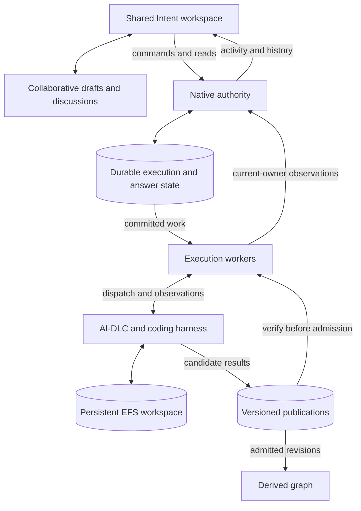

# Native execution

Native execution brings an AI-DLC methodology package into the shared Intent
workspace. A coding harness runs the methodology in a dedicated workspace while
project members review results, discuss proposals, answer questions and follow
progress together.

AI-DLC decides the workflow steps and required human gates. The platform manages
access, execution, accepted answers, published results and collaboration. Native
and the [platform execution backend](execution.md) share the Intent experience;
each backend retains its own execution commands.

!!! note "Feature status"

    Native execution is under development. Shared interaction, publications,
    history and workspace recovery are implemented, but the complete deployed
    journey is not yet qualified. Verified workflow completion and platform Git
    delivery are unfinished. The single checklist at the end of this page tracks
    the work needed for an integrated release.

## Working with a native intent

A native intent starts with a request, a methodology package and one connected
application repository. The methodology source and application repository serve
different purposes: the package supplies the development process; the application
repository supplies the code to work on.

In the current creation flow, a project owner configures a workflow source in
**Space settings → Agent**, imports a package, and makes it available for native
draft creation. A member selects the package and harness, enters the request and
prepares the workspace. Preparing a workspace does not start agent work. The
saved request can be corrected before **Start**.

Kiro is temporarily unavailable for new native executions while AI-DLC input
and authentication qualification is pending. Creation shows the disabled Kiro choice
and its reason, and a prepared Kiro draft cannot Start through either the
application or a direct API request. Claude Code, Codex and OpenCode remain
selectable for development. Existing Kiro configuration and history remain
readable; other platform Kiro behavior is unchanged.

Start captures the request revision, package, application source commit, harness,
model selection, credential scope and execution image. Later project settings
changes do not silently change that execution. Credential rotation within the
captured scope is supported; changing the source of credentials requires a new
configuration.

The shared Intent workspace provides the current response and questions, activity,
discussions, files, graph navigation and revision history. Native intents also
appear in the project, dashboard and sidebar. Integrating source selection into
the normal **New intent** entry remains part of the completion checklist.

## Questions, decisions and collaboration

When AI-DLC needs input, it publishes its response and, where supported, a
structured question form. Members can edit the answer together before submitting
it. Available questions from the current workflow step can appear together;
summary confirmations and required approvals remain separate interactions.
Grouping is a presentation choice. AI-DLC's interaction-mode question remains
unless the member has already expressed a preference in their retained request
or answers; platform instructions are not evidence of a human selection.

The platform records an accepted answer against the exact question and revision
that the member saw. Competing or stale submissions cannot replace it. A retry
of an uncertain submission checks the same request instead of creating another
answer. Accepted answers remain part of the intent's history.

Answer acceptance, delivery to the agent and application of a workflow decision
are separate observations. A successful submission does not by itself establish
that AI-DLC applied an approval or completed a stage. Missing delivery information
is shown as uncertain or unavailable.

If a structured form cannot be captured, the response remains available for
inspection and an eligible turn can accept a written reply. The platform does not
invent missing options, answer questions automatically or advance a human gate.
Current forms support up to 32 questions and 16 options per question, with written
answers where required. Unsupported forms must remain explicit rather than lose
questions or choices.

Shared answer drafts use the platform's real-time collaboration service. Accepted
answers are durable separately from those drafts. Unsubmitted native drafts are
not guaranteed to survive a collaboration-server restart or expiry after all
members disconnect.

Members can discuss a published revision and request Quorum assistance. Quorum
provides advice through the discussion service. Its response does not submit an
answer or approve the native workflow. See [Discussions](../using-the-platform/discussions.md)
and [Real-time collaboration](../using-the-platform/real-time-collaboration.md).

## Files, history and traceability

The running workspace contains mutable project files, generated dependencies and
unfinished edits. At a completed turn boundary, native publishes a verified
revision of its eligible files and response. Each publication identifies exact
file bytes and belongs to the current execution and turn.

Members can inspect current and earlier publications, compare public source
files, download individual files and request a ZIP of a published revision.
Another authorized member can reopen that revision independently of runtime
availability. Files in published revisions are read-only; editing or applying
changes through the platform is not currently supported.

A publication or ZIP contains the admitted public file inventory. It is not a
complete backup of the live workspace or necessarily a complete Git tree.
Unpublished edits and generated dependencies can remain on EFS without appearing
in a download. File modes, excluded entries, submodules and other repository
features need an explicit delivery contract before native can publish code back
to a Git provider.

The graph derives sections, items and relationships from published content and
links them to the exact source revision. It can be rebuilt from publications.
File locations and authored workflow markers do not establish execution progress,
approval or completion. A graph projection problem does not prevent access to
otherwise authorized published files or replies; membership verification still
has to succeed.

## Completion and delivery

Workflow completion must follow the pinned methodology's effective plan,
required checks, review outcomes and human gates. Native does not add a blanket
final approval beyond the selected workflow's requirements.

The current feature records published results and member selections, but it does
not yet verify that the effective plan and required outcomes were applied to the
final result. Completion is therefore shown as **not verified**. An agent stopping,
a successful CLI exit, a published review document or an accepted approval answer
is not sufficient evidence of workflow completion.

Native Git delivery is not implemented. Source checkout, file comparison and
result download do not create commits, branches or pull requests. The remaining
work must bind the deliverable bytes, required workflow evidence, authorized
member and destination, then confirm the provider's result. Tracker updates and
merge handling also need an explicit policy. See the shared
[Git integration guide](../using-the-platform/git-integration.md) for the platform
backend's existing behavior; it does not automatically apply to native intents.

## Persistent workspace recovery

**EFS is the recovery foundation for new native executions.** The project
workspace survives loss of the runtime process or coding session. It retains
workflow files, generated dependencies and unfinished edits so AI-DLC can
reconcile its own work in a fresh session.

Ordinary turns in the new workspace mode do not capture or export private CLI
recovery snapshots. Public result publication remains necessary for inspection,
history and delivery. Removing private restore machinery does not remove those
publications or their integrity checks.

When session recovery is needed, the platform must confirm that the previous
process has stopped before admitting another writer. The member then confirms
**Resume in a fresh session**. Native opens the same surviving workspace with a
fresh CLI session and invokes AI-DLC's supported resume entrypoint. AI-DLC checks
its workflow records and incomplete work, then continues or asks for input.

**AI-DLC 2.11.1 recovery starts after workflow creation.** The initial scope or
plan-selection offer has no active workflow and is outside recovery coverage.
After session loss at that point, the application shows **Intake recovery is
unavailable** and does not offer fresh-session resume. Published proposals and
accepted answers remain readable. Native does not route a later resume message
through the earlier offer's answer command or turn it into plan consent.

Eligibility comes from the surviving workspace's active pointers, matching
committed intent registry entry and initialized workflow state. It is checked
when loss is observed and again before a fresh CLI starts. The last publication
alone is insufficient: a workflow may have been created during an interrupted
turn after that publication. Missing, incomplete or ambiguous workflow records
make recovery unavailable; this structural observation does not establish
approval, completion or permission to skip AI-DLC's reconciliation.

Resume confirmation does not approve a workflow gate or replay an earlier answer.
Previously delivered, uncertain and undelivered answers remain distinct. The
member reviews any retained answer against the recovered question and submits
it anew if appropriate. Native must not replace unfinished workspace content with
an older publication.

This recovery model depends on the original EFS workspace being available and
correctly bound to the intent. A missing, replaced or unreadable workspace must
produce an explicit unavailable result. EFS deletion, corruption and disaster
recovery are outside session-resume coverage; backup and retention policy are
separate operational concerns.

**Simplification target:** use this one recovery model and remove private exact
session restore. This remains a pre-release feature; earlier native development
formats are not a supported compatibility contract. Removal follows proof of the
complete EFS resume journey and does not change the platform backend's contracts.

## Responsibilities and data flow

| Responsibility                                          | Owner                                                      |
| ------------------------------------------------------- | ---------------------------------------------------------- |
| Methodology steps, workflow records and required gates  | The pinned AI-DLC engine and coding harness                |
| Access, accepted commands and answers, execution state  | The platform's native authority                            |
| Dispatch, status observation, cancellation and recovery | Native workers operating under current execution ownership |
| Mutable project files and unfinished work               | The EFS workspace with one admitted writer                 |
| Published revisions and accepted-answer history         | Durable platform records and versioned object storage      |
| File relationships and graph navigation                 | A rebuildable projection of admitted publications          |
| Shared drafts and presence                              | The collaboration service                                  |
| Discussion assistance                                   | The discussion service and advisory Quorum execution       |

DynamoDB execution state is authoritative for native control. Workers cannot
replace accepted commands or answers based on local runtime state. Conditional
writes and writer ownership prevent duplicate or stale work from becoming the
current execution. The runtime has no direct native control-table or graph-write
permission.

Application WebSocket notifications indicate that durable activity is available;
authorized reads provide the content. Cursor-based replay and polling repair
missed notifications. Collaborative document synchronization is a separate
transport and does not accept execution commands.

### Package integrity

A workflow package is imported from an authorized source and pinned to verified
release bytes, materialization and object versions. Importing a package does not
grant continuing access to its source or to the application repository. Start
rechecks the relevant permissions and captures the selected configuration.

Package storage is restricted to its publishing worker. Its protection includes
conditional object creation, versioning, copy/delete restrictions, multipart
upload behavior and lifecycle policy. A source adapter or package version label
alone does not establish that the installer, methodology protocol and harness
combination is qualified.

Application repository credentials belong to trusted platform operations. They
are supplied for the authorized checkout and removed before methodology and
harness commands run. Files, diagnostics and download paths still require
explicit credential exclusions and current member access.

## Support matrix and settings

The current implementation runs serial turns against one application repository.
CLI availability, package import and local adapter tests do not establish a
qualified deployed combination. Release support must name the tested package,
harness, model, provider and image.

### Selected release contract

The initial serial release targets **AI-DLC 2.11.1**, **all four harnesses** and
**all three application repository providers** below. These scope decisions were
confirmed on 2026-10-26. Each advertised combination must pass qualification
before release; Kiro is a required row even while its qualification is blocked.
The temporary native Kiro admission restriction was approved on 2026-10-27.
Full Kiro instruction-channel, input and authentication qualification belongs
to NE-18 and must pass before this restriction is removed for release.

| Scope              | Initial release requirement                                                                                                                                                                                                                                       |
| ------------------ | ----------------------------------------------------------------------------------------------------------------------------------------------------------------------------------------------------------------------------------------------------------------- |
| Methodology        | AI-DLC 2.11.1, imported from the authorized methodology source and pinned to verified package bytes and materialization. Other versions and forks require their own qualification before being advertised.                                                        |
| Claude Code        | AWS Bedrock with the resolved project/platform model selection captured at Start.                                                                                                                                                                                 |
| Codex              | AWS Bedrock with the resolved OpenAI model selection captured at Start.                                                                                                                                                                                           |
| OpenCode           | AWS Bedrock with the resolved model selection captured at Start.                                                                                                                                                                                                  |
| Kiro               | Kiro's managed provider with the captured supported model selector. Its actual workflow and EFS resume journey must be qualified before release.                                                                                                                  |
| Application source | GitHub.com, GitLab.com and Bitbucket Cloud; one connected repository per execution, with its exact source commit captured.                                                                                                                                        |
| Inputs             | Written requests, attachments and tracker imports. Attachments and tracker imports are release requirements implemented under NE-09; current native requests accept the written prompt and repository/package content.                                            |
| Settings and tools | Existing model selection and credential-scope resolution, plus repository/package instructions and tools in the dedicated native runtime. Platform-managed environments, custom MCP server selections and uploaded custom rules are outside this initial release. |
| Advanced features  | Graph enrichment, optional debug archives, artifact edit/apply, Quorum edits, parallel units, per-unit delivery, multiple repositories and cross-engine migration are outside this release.                                                                       |

The first application acceptance path is **AI-DLC 2.11.1 → Claude Code → GitHub**,
using the existing dev configuration. Record the actual resolved Bedrock model,
credential source, region, harness version, package/materialization identifiers,
application commit and immutable execution-image digest before qualification.
Use that combination first for the recovery proof in NE-02 and the complete
journey in NE-19. Those records identify the tested combination; a settings
default or model placeholder is not evidence of which model executed it.

Every additional release row must likewise identify its model/provider selection
and execution image. Qualification of one model does not qualify every model
accepted by that harness. An unset or automatic selector must be recorded as
provider routing, not described as an immutable underlying model version.
The other harness/provider rows remain required until their evidence is complete;
passing the first path does not remove them from the release scope.

The shared native settings notice appears during draft creation and in the
Intent configuration view. It describes this target and the current input limits
without enabling unfinished input paths or claiming deployed qualification.
The normal **New intent** backend/default decision remains part of NE-08.

### Current implementation

| Area                        | Current behavior and limit                                                                                                                                                                                                                                                                                                    |
| --------------------------- | ----------------------------------------------------------------------------------------------------------------------------------------------------------------------------------------------------------------------------------------------------------------------------------------------------------------------------- |
| Coding harnesses            | Claude Code, Codex and OpenCode remain selectable for development. Kiro is visibly temporarily unavailable for new native executions, with authoritative Start rejection and an explicit runtime guard. All four harnesses still require release qualification; Kiro's full input and authentication path remains NE-18 work. |
| Methodology sources         | Import adapters cover GitHub.com, GitLab.com and Bitbucket Cloud with their supported source bindings. Installer and provenance constraints require separate qualification; importing from a provider is not a claim of full workflow support.                                                                                |
| Application source          | Exactly one connected GitHub, GitLab or Bitbucket repository. Source resolution captures the default branch and exact commit. CodeCommit, multiple repositories, submodule and LFS materialization are not supported by this path.                                                                                            |
| Package and harness         | Selected for the native draft and pinned for execution. Repository and package instructions remain part of the workspace.                                                                                                                                                                                                     |
| Models                      | Start captures the resolved project/platform model selection. An unset selection or automatic routing is not an immutable provider-model version.                                                                                                                                                                             |
| Credentials                 | The starting member's effective credential scope is captured. A responding member does not replace it. Rotation within that scope is allowed; revocation does not silently fall back to another scope.                                                                                                                        |
| Environments and tools      | Native uses its dedicated runtime. Platform-managed environments, custom MCP server selections and uploaded custom rules do not currently apply. Repository/package configuration can still supply instructions and tools.                                                                                                    |
| Platform execution controls | Agent-tier assignments, v2 stage scheduling, platform sensors, parallelism, rewind/recompose and per-unit PR strategies do not control native methodology execution.                                                                                                                                                          |
| Optional features           | Native graph enrichment and debug archive capture are off. Platform preferences do not enable them for native runs.                                                                                                                                                                                                           |

The Intent configuration view shows captured settings rather than current defaults.
Unsupported settings need to remain visible as limitations wherever users choose
or inspect native execution. The selected package determines its methodology
agents and reviewers; the platform should not duplicate that workflow model.

Artifact edit/apply, Quorum edits, parallel units, per-unit delivery,
multi-repository execution and cross-engine migration are outside the serial
integration target. Optional enrichment and debug archives also remain outside
that target unless explicitly selected for release. Their absence must not be
presented as an implemented capability or become an implicit release blocker.

## Recovery and operation

Cancellation requests stop the current execution; a requested stop and a
confirmed stop are different states. Recovery requires confirmation that the
previous writer has stopped. Status refresh, elapsed time or a missing response
cannot establish that fact. Published revisions and accepted decisions are
independent of whether a process is currently running.

Operators can close admission for new work while keeping services available for
current runs. Deploy matching frontend, authority, worker and runtime contracts
together. The transition to EFS-only recovery can discard compatibility with
native development runs; it must preserve the existing platform backend and the
integrity of newly accepted native work.

Repair workers rediscover committed work after missed notifications. Operational
acceptance must establish repair delay at the intended scale, usable alerts and
an incident owner. Normal member actions should be diagnosable through activity,
status, history and explicit error messages rather than private runtime logs.

Archive, replacement-run and resource-cleanup behavior is not yet defined.
Stopping a runtime is separate from deleting its workspace or publications, and
the UI currently prevents deletion of a space containing native intents. These
lifecycle actions need clear permissions, retention and user-visible outcomes.

For shared deployment and validation procedures, see [Setup](../getting-started/setup.md)
and [Testing](../development/testing.md). The checklist below distinguishes an
implemented capability from proof that it works through the deployed user path.

### First-path EFS resume qualification

NE-02 uses separate fresh qualification intents in the existing dev-enabled space,
with AI-DLC 2.11.1, Claude Code and a connected GitHub application repository.
Deploy the same candidate's frontend, authority, workers and runtime before
testing. Record the candidate commit and deployed versions, exact Bedrock model,
credential source, region, immutable runtime-image digest, harness version,
package/materialization identifiers and application source commit. Verify these
against the accepted execution configuration before exercising recovery; a
Terraform default or mutable image tag is insufficient.

1. Start through the application, select a plan as a real member, and verify that
   AI-DLC has created its workflow before reaching a real workflow question.
   The initial scope/plan-selection offer is not a recoverable boundary for
   2.11.1. Record the created workflow, interaction and publication identifiers
   and any accepted answer's delivery status. Let the runtime remain idle beyond its 900-second session timeout,
   then submit the next real member answer through the application. Ordinary
   application reads do not detect expiry or keep the runtime alive. The next
   dispatch must detect the lost session before sending that answer to the
   harness, retain its acceptance and expose recovery through normal status reads.
2. In a separate intent, interrupt its runtime during an active tool after it has
   created unfinished edits and dependency links. Preserve its EFS workspace.
   Ordinary intent cancellation is a terminal user command and does not substitute
   for unexpected runtime loss in this scenario.
3. For both cases, require confirmed predecessor stop and a member's **Resume in
   a fresh session** action through the browser. Trace the accepted public request
   to the authority, worker and runtime. Confirm the same workspace identity and
   a different CLI session identity, with no concurrent predecessor writer.
4. Verify AI-DLC reconciles the surviving edits and dependencies, runs the relevant
   build/tests, admits a new publication and reaches its next real question.
   Previously accepted answers must retain their delivery classification and
   history; recovery itself must not replay an answer or approve a gate. For the
   expired waiting session, inspect the original revision's
   `answer.resumeRetention.delivery: "undelivered"`, unchanged acceptance and
   member, and absent delivery time/resulting publication. The current interaction's
   generic delivery status alone cannot establish this history. Capture evidence
   that the turn used no private recovery capture, export, import or restore.
5. Separately lose a session at the initial plan-selection offer. Confirm that the
   browser explains that intake recovery is unavailable, the recovery API refuses
   the action, and no fresh CLI starts. Its proposal and any accepted answer must
   remain in history, without plan consent or automatic answer replay.
6. Exercise missing and incorrectly bound workspaces using isolated qualification
   resources. The browser must show that resume is unavailable, with no replacement
   workspace, model turn or admitted publication. Preserve existing dev workspaces
   and earlier failed intents. Start these faults from a created workflow so the
   intake restriction does not mask a workspace-binding failure.

**Local readiness, 2026-10-26:** the frontend recovery service and authenticated
API wrapper now run against the real public router, execution API and authority
store in regression tests. A lost response preserves the confirmation and command
identities and produces one authority transaction; denied membership produces no
dispatch or state change. A further process-loss regression reproduced an
acknowledged fresh-session resume becoming terminally failed if its runtime died
before publication. The worker now recognizes the current resume episode, turn
and writer as in-flight work and uses the existing fenced, confirmed-stop recovery
path. The real HTTP/executor fixture reaches a third writer generation while
preserving unfinished work and accepted-answer history without replay. All 1,398
native-runtime-control tests pass, including stale ownership, cancellation and
unconfirmed-stop cases. Fixture authentication, persistence and inert subprocesses
do not establish deployed browser, harness or EFS qualification.

The operator fixture is `scripts/native-recovery-qualification.mjs`. Its local
`barrier-command` action prints a bounded, foreground Bash command for Claude to
run after real implementation edits and dependency installation. The operator
`stop` action verifies that this command is an active Claude child before stopping
the exact accepted runtime session. Capture changed-file and dependency-link
hashes before stopping, compare the changes with the preceding publication, and
use `inspect --marker-sha256` after the resumed run publishes to compare retained
evidence. An old marker alone does not prove an active interrupted tool.

The `missing-project` and `wrong-project` actions require an isolated intent at a
recoverable boundary with a confirmed predecessor stop. They preserve the
original project in a nonce-scoped quarantine and stop their diagnostic session
before returning; they do not modify authority records or delete EFS data. All
operator actions require explicit account, region, resource and writer identities,
and a separately authorized operator profile. `solution-read` is rejected.
The 27 focused helper tests and all 300 release-script tests pass; these checks
do not establish live fault qualification.

**Dev qualification preparation, 2026-10-26:** deployment of `010ce5d5` and
the subsequent `fbda6296` worker correction was confirmed. The frontend entry
asset and deployed API, authority and execution-worker archives match their local
deployment artifacts byte for byte; the worker correction keeps the same runtime
image. The signed-in application imported the selected package, prepared a fresh
qualification intent and accepted Start through the public API. The accepted
execution matches the package, model and image pins recorded before Start:

| Pin                     | Recorded value                                                              |
| ----------------------- | --------------------------------------------------------------------------- |
| Region                  | `us-east-1`                                                                 |
| Harness                 | Claude Code `2.1.296`, verified in the exact image with networking disabled |
| Effective model setting | `global.anthropic.claude-sonnet-5-5`, from the space override               |
| Credential source       | Platform Bedrock credentials, captured by the accepted Start                |
| Runtime image digest    | `sha256:ef179ee0335bffe0184b376abc9768306f4602952b26dc8c9ca7ca6c552068b9`   |
| AI-DLC release          | `v2.11.1`                                                                   |
| Methodology commit      | `895a35d86d20336d9b7bc4aedc9440e4a12c83ab`                                  |
| Package identity        | `sha256:577eced0d4425aba7cd4fdaec100315363e104d28fa47f1aec141aac606dfb56`   |
| Materialization         | `sha256:be88b2f8c1240dfb86ad4a75e9d3104931f65c35d789b572127028b0631d0386`   |
| Application repository  | `JWThewes/flappy-bird` on GitHub                                            |
| Application commit      | `d99d2511c43f07ff2451e7e13f5a8f45b16dfce2`                                  |
| Application branch      | `ai-dlc/initial-game-1776942523258--task-project-scaffold`                  |

The accepted execution captures the space's model selection, which differs from
the platform fallback. Its runtime uses the prepared EFS access point and a
dedicated execution endpoint. The initial AI-DLC scope/plan-selection offer was
published before the waiting-session expiry test. After more than 900 seconds of inactivity, a
browser reply was accepted and the worker detected the lost session before
dispatching it. The application exposed a confirmed predecessor stop and accepted
the member's explicit fresh-session confirmation. Writer generation 2 reused the
same execution, configuration and EFS binding, used a different CLI session, and
admitted publication 2. History retained the original answer as undelivered with
its identity, text, author and acceptance time unchanged, and no delivery time,
resulting publication or approval. The observed recovery used no private checkpoint
capture or restore.

This is partial proof: publication 2 reported `next does not take --on-instruction
where` from the pinned workflow's resume command and contained no workflow
question. The pinned engine reads the complete AI-DLC user message, including the
previously appended platform guidance; even clean CLI arguments reproduced the
failure. Moving guidance outside that message exposed the independent intake
limit: an exact resume returns **No workflow state found** before an active intent
exists. The selected release therefore limits recovery to created workflows.
The offered question's request-answer route is not a supported fallback: a later
resume message can satisfy that route's input check and produce a workflow-create
instruction without a plan choice.

The two publications preserved the complete file inventory and application
source; five engine hook-health timestamps changed. Publication admission and
these retention checks do not qualify workflow recovery. Platform transport
guidance must use a separate harness instruction channel while the resume user
message remains the literal supported entrypoint. The interrupted-tool case is
prepared but not started: the pinned application commit contains an empty Phaser
scene, so its implementation/build/test fixture needs a source-baseline decision.
The missing/wrong-workspace cases also remain unqualified. NE-02 stays open.

**Recovery candidate, 2026-10-27:** the local candidate requires a created workflow
observed in the surviving EFS workspace, including its active pointers, committed
intent registry and initialized state. It checks this state before fresh-session
admission and again immediately before the CLI starts. Current workspace state
can establish creation after an older intake publication; publication alone
cannot establish recovery eligibility. Missing or unrecognized state leaves
recovery unavailable. Accepted answers, delivery classifications and immutable
publications remain intact, including interrupted-resume and lost-acknowledgement
paths.

The AI-DLC user request and resume entrypoint now remain literal. Platform
transport guidance uses the harness instruction channel and supplies no human
answer, interaction-mode selection or workflow consent. The earlier exact-image,
network-disabled Claude hook check used literal `/aidlc --resume` with zero model
tokens; it remains an offline hook check, not live recovery proof.

The approved temporary Kiro restriction uses native capability/status responses,
the existing creation/configuration UI, and the authenticated Start authority.
It rejects a new Kiro Start before configuration capture or dispatch, including
direct requests and forged availability overrides. Already admitted
configurations and readable work are preserved, and the runtime retains
`native_execution_transport_kiro_unqualified`. This does not qualify Kiro or
remove it from the four-harness release requirement.

Local validation of this candidate on Node **24.21.0**:

| Check                                                                                        | Result                                                                       |
| -------------------------------------------------------------------------------------------- | ---------------------------------------------------------------------------- |
| `npm test -- --maxWorkers=4`                                                                 | **11,544 passed, 10 skipped**; 390 files passed                              |
| `npx vitest run --project=native-runtime-control --maxWorkers=4`                             | **1,437 passed** across 52 controller files                                  |
| Seven focused recovery suites through `vitest.native-foundation.config.js`                   | **284 passed**, including runtime, authority and fence                       |
| `npm --prefix frontend test -- --maxWorkers=4`                                               | **2,104 passed** across 150 files                                            |
| Five focused native creation, interaction, execution and service suites                      | **417 passed**                                                               |
| `npm --prefix frontend run build`; `npm run build -w native-runtime-control`                 | Frontend and all eight controller bundles built                              |
| `npm run architecture:check`; `npm run dep:check`                                            | 413 production modules, zero violations; zero errors, 17 dependency warnings |
| `npm run lint -- --ignore-pattern '.worktrees/**'`; `npm run secretlint -- '!.worktrees/**'` | Zero lint errors, 82 warnings; secret scan passed                            |
| `npm run format:check -- . '!.worktrees/**'`; `git diff --check`                             | Passed                                                                       |
| `uv sync --group docs --locked --offline`; `uv run --no-sync zensical build`                 | Passed using a local evidence-directory UV cache                             |

These suites overlap; their counts are separate results, not an aggregate.
The full backend suite used local Docker test services and inert test credentials.
The first backend run found two capability-response assertions that needed the
new field; both were corrected before the successful full rerun. The architecture
check also prompted local extraction of recovery-result and record validation,
followed by the successful controller/full reruns. The frontend build retains its
bundle-size advisory. No deployed browser journey, newly built runtime image,
credentialed provider call or live recovery fault was exercised in this stage.
The earlier source-hash comparison matched all 31 recorded candidate files at
stage entry; earlier passes remain historical evidence. Exact commands, source
hashes and local logs are recorded under
`.native-evidence/ne02-2026-10-27-candidate/`.

Deploy this candidate's frontend, API/authority, workers **and a newly built
runtime image** before the next proof. `scripts/deploy-terraform.sh` builds the
source-derived AgentCore image and wires its digest into native services;
`scripts/deploy-frontend.sh` then builds and uploads the frontend. Generate a
fresh candidate-specific plan with `--phase plan --plan-file`, review it, and
apply that same `--plan-file` path with `--phase apply --skip-seed`. Reusing an old
image or deploying only backend archives cannot validate the transport and
pre-spawn recovery corrections.

At this candidate handoff, live acceptance remained pending for created-workflow waiting-session expiry,
interruption during an active tool with retained edits/dependencies and real
build/tests, the next genuine workflow question, visible intake rejection,
missing/wrong EFS workspace rejection, and exact deployed/configuration/image
alignment. The application fixture choice is still pending separately and does
not block this local candidate. Do not start NE-03 until the actual NE-02 live
proof passes.

**Dev deployment and live qualification, 2026-10-27:** the user deployed
`526837eb8394735e6b365bdfbcda249af84c5e3f` with
`scripts/deploy-terraform.sh dev --phase all --skip-seed` and
`scripts/deploy-frontend.sh dev`. Scoped reads using `solution-read` verified
account `746558295630`, region `us-east-1`, the served frontend entry and all
521 assets, all nine native Lambda archives and bundled entrypoints, and the
five authority aliases at version **15** against the candidate bytes. The
browser's loaded chunks were included in that comparison.

The deployed runtime image is
`sha256:074c50086bee10ca4d086fa3df0a9f87251a684bfa34df6ec67cf08cd65f6eeb`,
with source-derived tag `cc2d6c57451852b2`. All five changed runtime production
files match the candidate inside that exact image. Its installed harness is
**Claude Code 2.1.296**, with image Node **24.19.0**. That image inspection used
disabled networking and no model calls; the fresh browser executions below
made the authorized real model calls.

Both fresh Claude Starts captured **AI-DLC 2.11.1**,
`global.anthropic.claude-sonnet-5-5` from the space override, platform Bedrock
credentials, `efs-workspace-v1`, and the verified image digest. The fresh
package job is `ae854a6a-c445-464d-b08f-0f5451af857e`, with package
`sha256:577eced0d4425aba7cd4fdaec100315363e104d28fa47f1aec141aac606dfb56`
and materialization
`sha256:be88b2f8c1240dfb86ad4a75e9d3104931f65c35d789b572127028b0631d0386`.
The current methodology source binding and imported package provenance match
the accepted configurations. The connected application uses GitHub OAuth for
`JWThewes/flappy-bird`; both executions resolved branch
`ai-dlc/initial-game-1776942523258--task-project-scaffold` to
`d99d2511c43f07ff2451e7e13f5a8f45b16dfce2`. Their actual runtime version,
endpoint, 900-second idle timeout and EFS access-point/mount configurations
match their accepted authority records.

The temporary Kiro behavior **passes deployed checks**. Creation visibly
disables Kiro and explains its temporary unavailability. Fresh Kiro draft
`a09241ef-2f80-4de2-ba00-0597f930c116` was created and prepared through the
public API to exercise bypass of that UI. Its configuration explains the
restriction, Start is disabled, and a valid direct Start request returned
**409 `NATIVE_EXECUTION_KIRO_UNAVAILABLE`**. A consistent authority read
confirmed no execution record. This exercised no Kiro model work and does
not qualify Kiro for release.

The waiting scenario is **blocked on the pending application fixture decision**.
Fresh intent `a3603caa-8c60-4d8e-ba0f-18605f92e773` published
`8c29e19314bcfcca1e902c22963c9d919bfd8524ddca6ce14c52ebae795715e1`
from CLI session `6a89dea9-a923-417e-b57c-2788651ea74a`. Its actual question
asks how to handle the missing source baseline: `index.html` contains an
empty Phaser scene, with no bird, pipes, score, flap/restart inputs,
`package.json` or test tooling. The reply remains unanswered. No plan was
selected and no created workflow was verified, so this is not a created-workflow
recovery proof. The separate fixture choice must be resolved before continuing it.

Fresh intake intent `616beab2-4f20-4e7d-b988-35aab343eea1` reached the
initial express-plan offer, with publication
`655d9c5fc9c41240ad88c8d353dfa11b00d26bd0703d85da24f0aa02907c6221`
and CLI session `b9753320-74ee-4985-bc6c-370b572deccc`. Its natural-expiry
intake rejection **passes**. After **954.585 seconds** from the recorded idle
baseline, the member submitted the existing instruction to keep the source
baseline decision open, selecting no plan option. The browser received **202**.
Dispatch detected the lost session before sending the reply to the harness.
Current EFS state reported `workflowResumeState: "not_created"`; the authority
recorded `INTAKE_UNAVAILABLE`, `canRecover: false`, and confirmed predecessor
stop at `2026-10-27T10:14:26.689Z`.

The browser visibly explains that AI-DLC 2.11.1 requires a created workflow
and offers no fresh-session resume action. A valid direct recovery request
using the current recovery ID and `confirmWorkspaceResume: true` returned
**409 `NATIVE_EXECUTION_CONFLICT`**, leaving the authority revision unchanged.
The original publication's API and actual browser history preserve answer
`8f3a7e1f-77e1-481f-a473-dddace526048`, its author, exact bytes and acceptance
time `2026-10-27T10:14:23.222Z`. Its original `deliveryStatus: "pending"` is
unchanged, with no delivery time, resulting publication or recorded approval.
The same EFS binding, configuration, writer generation **1** and original
publication remain. Scoped lifecycle evidence shows only the initial CLI
launch, no continuation/resume dispatch, and no private checkpoint capture
or restore.

| Remaining NE-02 proof                                                      | Status and prerequisite                                                                                         |
| -------------------------------------------------------------------------- | --------------------------------------------------------------------------------------------------------------- |
| Created-workflow waiting expiry, fresh CLI and next real workflow question | **BLOCKED** on the pending application fixture decision; the source-baseline question remains unanswered.       |
| Post-resume `answer.resumeRetention.delivery: "undelivered"`               | **NOT RUN**; intake denial preserves the answer but admits no resume episode.                                   |
| Active-tool interruption, retained edits/dependencies and real build/tests | **BLOCKED** on the fixture decision and separately authorized operator credentials or user execution.           |
| Missing/wrong EFS workspace rejection                                      | **BLOCKED** on isolated, recoverable created-workflow resources and operator authorization; no faults were run. |

No operator fault, deployment or change to historical intents was performed
during this stage. No implementation correction was needed, and the candidate's
backend/frontend suites were not repeated. Redacted evidence and documentation
validation results are under `.native-evidence/ne02-2026-10-27-live/`;
`pin-comparison.json` records the deployment/configuration comparisons,
`intake-recovery-proof.json` records the completed negative proof, and
`waiting-blocker.json` retains the exact unanswered source-baseline question.
NE-02 remains unchecked; NE-03 must wait for the remaining live proof.

**Approved game fixture and fresh qualification, 2026-10-27:** the user resolved
the source-baseline decision: build a minimal game and tests on the pinned empty
scaffold. The approved scope is one playable Phaser scene with simple shapes,
flap controls, obstacles/collision, score, game-over/restart, and keyboard-accessible
pause/resume through `P` and a visible control. Pause must preserve the run and
score. Add the smallest suitable package/build/test setup, deterministic gameplay
and pause/resume/restart tests, controls documentation and an actual browser
playability check. Keep Phaser **3.60.0**, the version in the scaffold. Application
changes belong to the native workspaces and their publications; no GitHub push
or PR delivery is requested.

Fresh requests explicitly acknowledge the intentionally empty baseline. The
earlier waiting and intake intents remain unchanged. This stage uses the deployed
implementation `526837eb8394735e6b365bdfbcda249af84c5e3f`, with documentation
head `cb0392871097f006e30d15696801ff154d313ffe`. Each new Start was checked against
the same immutable runtime image, AI-DLC 2.11.1 package/materialization, Claude
model and platform Bedrock scope recorded above. All four executions resolved
the approved application branch to
`d99d2511c43f07ff2451e7e13f5a8f45b16dfce2`; scoped AWS reads verified their separate
runtime endpoints, EFS bindings and 900-second idle timeouts.

| Scenario                          | Fresh native intent                    |
| --------------------------------- | -------------------------------------- |
| Created-workflow waiting recovery | `5dcf330b-1ce8-47c5-972b-9bd5d4b9315b` |
| Interrupted active tool           | `26b5b329-9c15-421d-9fc6-69f11a714c43` |
| Missing EFS project               | `f3cc998d-e457-4e4c-948c-985a2da1eb39` |
| Incorrectly bound EFS project     | `33ab1cb2-8f74-4c41-aff2-71c27b3cb8fe` |

Each express plan was explicitly selected through the application, preserving
its six approval gates. Current stage evidence is recorded separately under
`.native-evidence/ne02-2026-10-27-game/`; `accepted-pin-comparison.json` records
the four accepted-configuration/resource comparisons. The previous
`.native-evidence/ne02-2026-10-27-live/` evidence remains unchanged.

The created-workflow waiting recovery **passes its recovery checks**. The
requirements approval question in publication
`c07099e6b6da43642e489c8b6a9dcc62ddaab94032b1c9a674572a864282b8ac`
was left idle for **974.635 seconds** after the recorded baseline, with no runtime
keepalives. The actual browser approval was accepted at
`2026-10-27T13:03:02.818Z` as answer
`c6e9fd82-7448-4660-90bb-e31ff00cdcd3`. Dispatch detected session loss before
delivery, observed a created workflow in EFS, and confirmed the predecessor stop
at `2026-10-27T13:03:05.951Z`. The member then explicitly confirmed
**Resume in a fresh session** through the browser.

Writer generation **2** retained binding
`750fc226-5c11-4ca7-84e7-c0d685e0bc72`, EFS access point
`fsap-03451764da3b9a46d`, configuration and runtime target. CLI identity changed
from `28b1b8dc-7f1e-4c55-b088-6368d45715fd` to
`f741550b-167a-4a6d-8f59-d2a6e07c380c`. New publication
`6c12d45367e9dcf153d587e1270e4a1c7b7ea6225201918da9624fdf848dd0f7`
contains the real requirements approval question. The active pointers, committed
intent registry, initialized state, answered requirements questions and
requirements document all survived byte-for-byte; the requirements gate
remained open.

The original revision's answer retained its ID, actor, acceptance time and bytes
both before and after the new publication. Its
`answer.resumeRetention.delivery` is **`undelivered`**, with no delivery
timestamp, resulting publication or recorded approval. The recovery request
contained only its request ID, recovery ID and explicit workspace-resume
confirmation. Lifecycle evidence and metadata-only listing of the exact attempt's
private recovery prefix show no checkpoint capture, export, import or restore.
The original answer was not replayed. After reviewing the surviving requirements,
the member submitted a distinct approval of the new question at
`2026-10-27T13:08:09.818Z`; this starts implementation without treating recovery
confirmation as consent. `waiting-created-recovery-proof.json` and the original
answer history captures record this proof.

After that distinct approval, the native harness implemented the game in its
workspace. Member-visible tool results record **17 passing tests** in
`tests/rules.test.js` and a successful **Vite 7.3.7 production build** (10 modules,
4.83 seconds). An initial score-boundary test failed; the harness adjusted its
setup and reran all 17 tests. Its Chromium playability attempt could not launch
because the runtime lacks `libglib-2.0.so.0`. These are actual native test/build
results, but the final application files have not passed publication review,
and an actual browser playability check remains **NOT RUN**.

The implementation turn then **failed publication** with
`native_execution_output_result`. Its content-free diagnostic records
`result_mismatch` at result record **176**, with **3** assistant text blocks and
**1** observed query boundary. The runtime rejected the result at
`2026-10-27T13:22:19.217Z`; runtime stop was confirmed at
`2026-10-27T13:24:36.775Z`. Publication
`6c12d45367e9dcf153d587e1270e4a1c7b7ea6225201918da9624fdf848dd0f7`
remains the last admitted revision. It contains the recovered requirements
question, not the game result. The failed execution and its history are preserved.
`waiting-native-validation-observed.json`, `waiting-game-output-rejection.json`
and `waiting-output-rejection-lifecycle.json` record these separate boundaries.

Inspection of static executable code in the exact deployed Claude 2.1.296 image
shows that its engine can queue completed parent-query results while background
work runs, then emit those results in order after later assistant messages.
An inert fixture of that producer sequence reproduces the deployed parser's
`result_mismatch`: it compared every result only with the latest response.
This identifies a supported sequence the parser rejected; it does not claim
that private live transcript bodies were read or reconstructed.

The bounded runtime correction validates deferred results against ordered
assistant responses from the current invocation. The final observed response
must still have a successful terminal result before publication; failed,
incomplete, reversed, duplicate terminal and foreign-session results remain rejected.
The existing text/query limits, credential checks and silent-notification
handling remain enforced. Executor-level tests cover both successful publication
and refusal when a later result is absent or failed, without private checkpoint
operations. This correction requires a newly built runtime image and fresh
deployed qualification; its local tests do not establish a live pass.

The interrupted-tool workflow followed its approved qualification procedure:
install real dependencies, leave genuine game edits unfinished, then enter the
existing helper's foreground barrier before the separately executed scoped stop.
The native harness installed Phaser **3.60.0** and wrote a deterministic game
core with **15 passing tests**. Input routing, the Phaser scene and final
build/browser validation were still unfinished. The **150-second** barrier
expired normally without an operator stop. Publication
`9ce6bb50f85c87557daa12ce8601e5f63556747d116be53adcad57c2cdbbef86`
preserves that partial work and asks whether to retry with a fresh nonce or
finish implementation. This question remains unanswered, and the old stop
command is stale. No interruption, dependency-link retention or fresh-session
reconciliation is claimed. A retry needs a new live foreground barrier with
genuine unpublished work; the helper requires at least **45 seconds** remaining
when it inspects the barrier.

The two isolated workspace-negative cases have created workflows and confirmed
predecessor stops after natural expiry. Their prepared commands remain scoped
to the exact intent, attempt, writer and nonce in `missing-operator-command.json`
and `wrong-operator-command.json`. The user chose to execute these helpers, which
quarantine each original project and stop their diagnostic session. No operator
profile was authorized for the agent; `solution-read` remains read-only.
Their result files and subsequent browser rejection still need verification.

| NE-02 check at this stage                                                      | Status                                                                                      |
| ------------------------------------------------------------------------------ | ------------------------------------------------------------------------------------------- |
| Deployed candidate/configuration/image alignment                               | **PASS** for deployed `526837eb`; the parser correction is not deployed.                    |
| Temporary Kiro unavailability and intake-expiry rejection                      | **PASS**, retained from the preceding deployment stage.                                     |
| Created-workflow waiting expiry, fresh CLI, preserved answer and next question | **PASS**, with the exact identities and retention evidence above.                           |
| Native game tests and production build after resume                            | **PASS** for the observed commands; final source/publication review remains open.           |
| Game result publication                                                        | **FAIL**, with a locally reproduced parser correction awaiting deployment.                  |
| Actual game browser playability                                                | **NOT RUN**; native Chromium could not launch and no game result was admitted for download. |
| Interrupted active tool and retained dependency links                          | **BLOCKED**; the barrier expired without the separately executed stop.                      |
| Missing/wrong EFS workspace rejection                                          | **BLOCKED** pending the user-run helper results and browser checks.                         |

**Local correction validation, Node 24.21.0:** the 163 focused parser/executor
tests pass. The full AgentCore project passes **3,165 tests**, with **10 skipped**
for Bun-dependent and Linux-only coverage on this host. All **43** controller
caller checks pass; the nine-test workspace journey file was rerun with
loopback access after the sandbox denied two local HTTP listeners. The 22 native
wiring tests, six architecture tests, architecture check, dependency check,
lint, formatting, secret scan and documentation build pass. Lint reports
82 warnings and the dependency check reports 17 warnings, with no errors.
The full backend and frontend suites were not repeated for this runtime-only
correction. Logs and source hashes are recorded in this stage's
`repair-validation.json` and `repair-image-source.json`; the latter identifies
the new image's expected source-derived tag, not a deployed digest.

NE-02 remains unchecked. Preserve these runs and deploy the runtime correction
before starting a fresh, matching positive proof. NE-03 and full Kiro
qualification remain in their existing sequence.

**Workspace-fault follow-up, 2026-11-02:** the user ran the prepared handoff after
a machine reboot. It stopped at the first helper: `missing-operator-result.json`
reports `ok: false`, `runtime_response_invalid`, and
`diagnosticStop.confirmed: true`, without a workspace receipt. Its original
1,331 bytes remain unchanged, SHA-256
`f02e94345522b8fdc2fba793d1ac0a0e6e059793ccd0426d47667a295b3e7061`.
The script's exit-on-error behavior prevented the missing-result verifier and
wrong-project command from running. Neither fault has a successful verified
operator result.

Scoped reads with `solution-read` reverified account `746558295630`,
`us-east-1`, both accepted runtime version **2** endpoints, their EFS access
points and the original immutable image
`sha256:074c50086bee10ca4d086fa3df0a9f87251a684bfa34df6ec67cf08cd65f6eeb`.
The API, authority, execution worker, provisioner and wakeup package hashes and
image settings still match deployed `526837eb`; the execution-authority alias
remains version **15**. All 272 runtime source hashes still match the locally
validated parser correction `3280c8b4`. Its expected image tag
`d2dff54e22d80b4f` remains a source-derived build identity, not a deployed digest.

The missing-case runtime log records command request
`ff81f1fe-8353-4881-ba9c-1517ca3871ac` at `08:05:32.500Z`.
The logged command matches the original fixed **20,655-byte** helper command
exactly. The same diagnostic log stream records `SIGTERM` at
`08:05:33.511Z`, corroborating the helper's checked stop acknowledgement.
These observations establish receipt of the command and diagnostic stop, not
the outcome of the rename or quarantine. The old helper discarded which
response-validation check failed and returned no filesystem observation.
The exact response-contract mismatch and the first mutation's outcome remain
unknown; the command must not simply be rerun.

Both authority records are unchanged from their October 27 expiry evidence:

| Case            | Intent                                 | Preserved boundary                                                                                        |
| --------------- | -------------------------------------- | --------------------------------------------------------------------------------------------------------- |
| Missing project | `f3cc998d-e457-4e4c-948c-985a2da1eb39` | Revision **313**, writer **1**, publication **2**, accepted answer `89de5291-d7d0-48f0-aa62-7fae7a6ebe36` |
| Wrong project   | `33ab1cb2-8f74-4c41-aff2-71c27b3cb8fe` | Revision **470**, writer **1**, publication **2**, accepted answer `167f809d-46bb-4724-888e-c52037835307` |

Both remain `RECOVERY_REQUIRED` with the same created-workflow recovery episode,
confirmed predecessor stop, session and EFS binding. Publication, interaction,
accepted member, acceptance time, answer hashes and the original `pending`
delivery classification are unchanged. No new writer or publication is recorded.
This is preservation evidence, not the waiting case's separate retained,
undelivered-answer proof.

The local operator helper now records bounded response metadata and failure
phase without retaining raw stdout, stderr, headers or SDK exceptions. It
explicitly requests the documented binary event-stream response format while
keeping acknowledgement, session, completion, scope and exit checks enforced.
This transport change is not yet a live fix for the unidentified mismatch.
The new `inspect-workspace` action requires a stopped, created workflow and
checks the recorded owner, project inode and original nonce's quarantine.
It reports intact, missing, replacement or partial-quarantine observations
without moving, deleting or repairing project files. Like the existing fault
helpers, it bootstraps only `native-status` and confirms its diagnostic stop.
Only user execution or a separately authorized operator profile may run it;
`solution-read` remains rejected.

The signed-in dev browser was reopened after the reboot. No browser recovery
was submitted against an unverified fault. Missing-workspace mutation status
remains **UNKNOWN**, the wrong-workspace fault is **NOT RUN**, and both browser
rejection proofs remain **BLOCKED** on verified filesystem observations.
The exact, guarded inspection handoff and fresh evidence are under
`.native-evidence/ne02-2026-11-02-workspace-faults/`. The handoff preserves the
failed result and writes distinct inspection receipts; an inspection is not a
replacement success receipt for the failed mutation. A read-only control uses
the previous response-format request so its diagnostics can be compared with
the explicit event-stream request. Each diagnostic stop must be confirmed before
the handoff starts another session for that intent.

**Local helper validation, Node 24.21.0:** all **42** focused helper tests pass.
The full release-script run passes **313 of 315** tests. Its local HTTP fixture
passes separately with loopback access after the sandbox's `EPERM`; the release
metadata check passes against a byte-identical snapshot of all **46** tracked
release inputs after the root check also scanned unrelated `.worktrees`
manifests. Those worktrees remain untouched, and the full root run is not
reported as green. Lint and dependency checks report their existing **82** and
**17** warnings with no errors; the architecture check reports no violations.
Formatting, the secret scan and the documentation build pass. The inspection
receipt verifier passes **27** synthetic checks; these establish no live outcome.
No runtime, frontend or application source changed in this follow-up. The
earlier parser correction still requires user deployment, and game publication,
browser playability, interrupted-tool recovery and both workspace rejections
remain open. NE-02 stays unchecked.

**Inspection receipts and contract correction, 2026-11-02:** the user ran the
inspection handoff from `1128a1bd`. All three diagnostic stops are confirmed,
but neither workspace inspection passed. The five new result/verifier files and
the original failed mutation receipt remain byte-for-byte unchanged.

| Inspection               | Actual command response                                                                                       | Qualification consequence                                                                 |
| ------------------------ | ------------------------------------------------------------------------------------------------------------- | ----------------------------------------------------------------------------------------- |
| Missing, implicit Accept | Request `162b81f0-a4ee-4d1c-bee7-75df589acffa`: verified event stream, exit **1**, `workspace_invalid`.       | The command rejected a workspace invariant; the first mutation's outcome remains unknown. |
| Missing, explicit Accept | Request `eb2d77ad-2176-408d-82c7-b6d6ca91da24`: identical **154-byte** stdout and failure.                    | Explicit Accept did not resolve this failure.                                             |
| Wrong, explicit Accept   | Request `e7dff25d-f893-4977-8859-f21ed77a54e5`: exit **0**, **569-byte** JSON, rejected at report projection. | Command completion alone did not establish a valid inspection receipt.                    |

The two missing-case stdout hashes are both
`21f7371b0c9b0a4ea5092cc455bb77ecc4989fddb31b9a8df450bf26f44a5515`.
The wrong-case stdout hash is
`fb8c7205a92a701b4442817385f99f226e3faf708932722dc0219f8b83d37068`.
Scoped runtime logs match all three **22,586-byte** generated commands exactly.
Their respective diagnostic streams record `SIGTERM` at `09:02:06.446Z`,
`09:02:27.835Z` and `09:02:36.008Z`. Neither the retained responses nor these logs
contain the actual inode values or the missing command's failed invariant.
The wrong response's discarded JSON cannot be recovered from the retained hash.
The missing receipt's generic `quarantined: false` describes that inspection's
local mutation flag; it does not establish that the earlier fault left the
original project in place.

The executable-command investigation reproduced a concrete inode contract
defect. The native executor persists `String(lstat(..., { bigint: true }).ino)`,
which can be negative when Node exposes the file ID through `BigInt64Array`.
The operator helper accepted only unsigned digits. A signed project inode
therefore returned `workspace_invalid` inside the generated command; a signed
root or machine inode reached the JSON response and was rejected as
`runtime_response_invalid`. The real shell command, embedded functions,
serialization and streamed consumer reproduced both failure shapes. All three
unsigned layout controls passed before the repair; all twelve signed layout
cases failed. These reproductions identify the code defect, but do not recover
the missing live invariant, identify the wrong response's particular inode
field, or establish either live project's current location.

The helper and response projector now validate canonical full-width inode
strings without numeric coercion or changing recorded identities. Comparisons
remain exact: adjacent large IDs and unsigned aliases of recorded signed IDs
are rejected. Owner, configuration, package, epoch, writer, NFS, predecessor-stop
and no-active-harness checks remain enforced. Failed inspections identify the
specific validation check and fixed subject, with bounded observed/recorded
inode metadata and allowlisted filesystem error codes. Report projection records
the field it rejects. Arbitrary paths, stdout, stderr, private records and SDK
exceptions are not returned. Inspection failures no longer expose a
`quarantined` mutation flag.

All **79** focused tests pass on Node **24.21.0**. Generated-command coverage uses
real temporary files, permissions, links, renames and readback, with simulated
NFS mount/process metadata and signed file IDs; it is not live EFS proof. It
covers original, quarantined-missing and replacement projects, guard failures,
the actual operator consumer and diagnostic cleanup. The separate terminal
verifier passes **46** checks using generated serialized reports across five
filesystem layouts, denied receipts and the preserved live failures. These
synthetic results never qualify a workspace fault.

The full release-script run passes **350 of 352** tests. The same sandbox
loopback failure passes when rerun with loopback access; the metadata check
passes against the unchanged **46** tracked release inputs after the root run
also scanned unrelated `.worktrees` manifests. The full root run remains
explicitly not green. Lint, dependency, architecture, formatting and secret
checks pass. No runtime or frontend source changed.

Current scoped reads still show authority revisions **313** and **470**, writer
**1**, the same publications, accepted answers, EFS bindings and confirmed stops.
The five deployment owners and execution-authority alias still match deployed
`526837eb` and image
`sha256:074c50086bee10ca4d086fa3df0a9f87251a684bfa34df6ec67cf08cd65f6eeb`.
Fresh evidence and a guarded, two-inspection handoff are under
`.native-evidence/ne02-2026-11-02-inspection-contract/`. It preserves all failed
receipts, uses the original nonce-scoped quarantines, writes distinct output
files, and repeats neither fault nor the resolved Accept comparison. The
inspection runs from the corrected checkout without redeploying the runtime.
User execution remains necessary because no operator profile is authorized for
the agent. No browser recovery is submitted while filesystem state is unknown.
The missing mutation remains **UNKNOWN**, the wrong mutation **NOT RUN**, and
both browser rejection proofs **BLOCKED**. Waiting recovery retains its earlier
pass; parser deployment, game publication/playability and a fresh active-tool
proof remain open. NE-02 stays unchecked.

**Verified inspections and browser recovery attempt, 2026-11-02:** both corrected
inspections from `a7c4ddf2` now pass every verifier check, with confirmed diagnostic
stops. They establish the filesystem state independently of the earlier failed
receipts, which remain unchanged.

| Isolated intent                                | Verified filesystem observation                                                                     | Remaining qualification                                                              |
| ---------------------------------------------- | --------------------------------------------------------------------------------------------------- | ------------------------------------------------------------------------------------ |
| Missing `f3cc998d-e457-4e4c-948c-985a2da1eb39` | Project absent; original inode `-6973646241848332581` preserved in the original nonce's quarantine. | Browser attempt **FAIL**: recovery remains in `FENCING` before workspace validation. |
| Wrong `33ab1cb2-8f74-4c41-aff2-71c27b3cb8fe`   | Original project inode `5919596651590142328` still present; no quarantine or replacement.           | Wrong-project fault and browser rejection **NOT RUN**.                               |

The missing inspection's root is `1538196158438670172`, machine inode is
`-3605233117112043272`, and quarantine inode is `8140747515712229876`.
The quarantined project's inode exactly matches the recorded original.
The wrong inspection's root is `-4931017981954711920`; its project and machine
inodes are positive. Its **569-byte** stdout SHA-256,
`fb8c7205a92a701b4442817385f99f226e3faf708932722dc0219f8b83d37068`,
exactly matches the previously rejected response. This confirms the signed-root
projection defect with live evidence. The missing project's recorded signed
inode also establishes why the later unsigned inspection validator rejected
that identity. The original missing mutation receipt remains failed; its
discarded response bytes are not recovered or replaced by a fabricated receipt.
The independent successful inspection now proves that the original was
quarantined and remains preserved.

Before the browser action, scoped `solution-read` checks reconfirmed account
`746558295630`, region `us-east-1`, authority revisions **313 / 470**, writer
**1**, resource/configuration pins and predecessor-stop evidence. All five
deployment owners still match implementation `526837eb`; the immutable runtime
image remains
`sha256:074c50086bee10ca4d086fa3df0a9f87251a684bfa34df6ec67cf08cd65f6eeb`.
Neither the approved application source pin nor the accepted configuration was
changed.

The signed-in browser submitted exactly one explicit fresh-session confirmation
for the missing intent. The public recovery POST returned **202** at
`2026-11-02T10:08:31.606Z`, request
`5c6d6d6e-3ee0-4df2-bfd6-a0523a526bc7`, recovery episode
`8587ede1-0565-412a-8822-f6ef2701e9e5`. At the authoritative read at
`11:01:16.721Z`, revision **328** was still `RECOVERING / FENCING`, with actual
writer **1**. The browser continued displaying “Resuming in a fresh session”;
it did not display the required missing-workspace rejection. A later scoped read
at `12:05:20.761Z` still showed `FENCING`, revision **344**, writer **1** and the
same publication. Scoped runtime lifecycle reads through `12:05:32.884Z` found
no new turn.

The before/after comparison finds identical canonical hashes for all **67**
pre-existing immutable records. Only the recovery event and
the answer-retention observation were added. Both publication records, the
output cursor, accepted responses and the exact S3 fence version/bytes remain
unchanged. Publication
`b8e6edd41cc2d5599e2c19b624b19d6eb05a108a9da935e6c3ae688e462a9894`,
CLI identity `347e5f42-5c6a-4020-8935-c773de24cf7f`, AWS session
`588f4912-f5cc-433d-9d18-b90fd2298dfc` and EFS binding
`abf4667b-b37e-49e2-a02b-de4da8e17644` remain the predecessors. No new writer,
publication or runtime turn was observed. No private checkpoint is recorded.
These safety observations do not substitute for the missing browser rejection.

The original revision visibly retains answer
`89de5291-d7d0-48f0-aa62-7fae7a6ebe36`, actor
`e4787488-c071-709b-50c7-f2cd87682d0b`, accepted at
`2026-10-27T12:55:32.904Z`. Its immutable text hash and acceptance identity are
unchanged. The new retention fact records `delivery: undelivered`; the historical
view says it was not sent again, with no delivery timestamp, resulting
publication or recorded approval. No new answer or workflow consent was sent.

The deployed retry log retains only a generic code, without the execution scope,
failing control operation or SDK error type. Scoped logs cannot establish the
cause of this stalled recovery. A bounded local correction now records
allowlisted operation/error/status metadata and the existing scope hash for
failures during authority reads, authorization, fencing and predecessor stop.
It preserves the original errors and every ownership/stop check; a
`ResourceNotFoundException` is still not positive stop evidence. This is a
diagnostic correction, not a claimed live repair of the unidentified failure.

The final owning-project command, `npm test -- --project=native-runtime-control`,
passes **1,450** tests on Node **24.21.0** with local Gremlin and DynamoDB
containers. Earlier logs retain the sandbox loopback failures and the
standalone configuration's missing-DynamoDB-endpoint failure with dummy test
credentials. The final root-project run supplies the correct local endpoints.
Lint passes with the existing **82** warnings, dependency checks with **17**
warnings, and architecture checks with **0** violations. The secret scan passes;
unrelated `.worktrees` are excluded from the scoped lint/secret checks.

Fresh evidence is under
`.native-evidence/ne02-2026-11-02-workspace-rejection/`, including the token-free
public request capture, actual UI screenshots and authority/fence comparisons.
The single user-run handoff is
`handoff/run-wrong-workspace-fault.sh` in that directory. It pins the reviewed
checkout, original command and successful inspection hashes, rechecks the
unchanged wrong-case authority at revision **470**, preserves the original in
the nonce-scoped quarantine, creates only the intended empty replacement and
verifies its diagnostic stop. It writes fresh result filenames and never repeats
the missing fault. **63** local checks exercise its real generated command,
streamed consumer, signed metadata, preserved files, authority guards and
terminal verifier; a successful inspection cannot be labeled a successful fault.
These are synthetic filesystem/SDK checks, not live fault qualification.

The user runs that one wrong-project action with their existing dev operator
profile. It requires no deployment. The parser correction `3280c8b4` and the new
control diagnostics remain undeployed; deployment and renewed live verification
are subsequent work. Waiting recovery, temporary Kiro unavailability and intake
rejection retain their earlier passes. Missing/wrong browser rejection, game
publication/playability and fresh active-tool recovery remain open. The expired
October 27 active-tool stop command must not be reused. NE-02 stays unchecked.

**Verified wrong-project fault and browser attempt, 2026-11-02:** the user ran the
single guarded wrong-project handoff. Its receipt and terminal verifier pass
every check. The original project inode `5919596651590142328` is preserved in
`.ne02-quarantine-957535fc-5e38-43ad-985b-af115f6cead6/project`; the empty replacement
has the different inode `-7351887095847076373`. Root, machine, workspace record,
configuration, attempt, writer and nonce match the successful inspection and
prepared command. The diagnostic stop is confirmed with token
`e8b8eaa5-29ce-433a-a975-bd041d61f573`. The new receipt's SHA-256 is
`1d93b9727d2bfba2b2908790885c0e6eea7aec11810d0b349aa9de5b84fb3d8b`.
All earlier receipts, including the failed missing mutation, remain unchanged.
The agent independently verified this receipt without invoking any operator
action.

Scoped reads reconfirmed the account, region, runtime endpoint, accepted image,
EFS access point and stopped writer before the browser action. All **67**
authority records and the S3 fence matched the preceding wrong-case handoff.
The signed-in browser then submitted exactly one explicit fresh-session
confirmation for `33ab1cb2-8f74-4c41-aff2-71c27b3cb8fe`. Its public recovery POST
returned **202** at `2026-11-02T13:11:35.415Z`, request
`f5744c21-2e24-43af-9050-105964ad6448`, recovery episode
`c87b2c44-fd08-4a07-8ef9-4beec42b1297`. No answer or workflow approval was sent.

The wrong-workspace browser qualification is **FAIL**. At `13:15:22.751Z`,
authority revision **473** was still `RECOVERING / FENCING`, with actual writer
**1**; the planned writer **2** was not admitted. The browser displayed
“Resuming in a fresh session” instead of the required workspace rejection.
Scoped lifecycle reads through `13:15:25.308Z` found no new runtime turn.
The missing case also remained in `FENCING`, revision **361**, writer **1**, at
`13:15:27.605Z`. Both filesystem faults are established, but neither browser
rejection has passed. No additional fault or recovery retry was performed.

For the wrong case, all **66** pre-existing records other than the mutable
`EXECUTION` record have identical canonical hashes. Only the expected recovery
event and answer-retention fact were added; no record was deleted. Both
publications, the output cursor, accepted responses, S3 fence bytes/version and
predecessor-stop evidence remain unchanged. The retained publication is
`24b6d3c1a8c25c1dde39ad9e542efe1964d58949365709cc173cda802c006be6`,
CLI identity `327a7b7d-b62e-4a4e-923c-0b6313ea3b8d`, AWS session
`f71491ca-9c59-444a-afa1-2e4b98e17091` and EFS binding
`c5193bbe-843d-47e2-ad99-ded5933c60b1`. No new writer, publication or CLI identity
was observed; no private checkpoint is recorded.

The original revision visibly retains answer
`167f809d-46bb-4724-888e-c52037835307`, actor
`e4787488-c071-709b-50c7-f2cd87682d0b`, accepted at
`2026-10-27T12:55:36.769Z`. Its immutable response, text hash and acceptance facts
are unchanged. The original dispatch classification was `pending`; the new
retention fact is `delivery: undelivered`, without a delivery timestamp,
resulting publication or recorded approval. Recovery intentionally clears the
mutable pending-response/dispatch pointers while preserving this ledger.
That removal prevents automatic replay; it does not delete the accepted answer.
The original-revision browser card explicitly says the answer was not sent again.

Fresh package metadata still matches the five previously verified deployment
owners from `526837eb`, with runtime digest
`sha256:074c50086bee10ca4d086fa3df0a9f87251a684bfa34df6ec67cf08cd65f6eeb`.
The parser repair `3280c8b4` and control diagnostics `ef69e016` remain undeployed.
The generic deployed retry log still does not establish the failing operation.
The next dependency is user deployment of that candidate's backend and fresh
runtime image, followed by deployed alignment and scoped failure diagnosis.
A backend-only deployment retaining the old image cannot qualify the parser
repair. Existing executions retain their accepted pins; renewed positive game
qualification must accept the newly verified image digest.

Evidence is under `.native-evidence/ne02-2026-11-02-wrong-rejection/`, including
the fault-receipt reconciliation, token-free public request/response metadata,
actual browser screenshots and before/after authority comparisons. **17**
checks of those captured records pass; they establish preservation, not the
missing browser rejection. Local evaluation of the actual Terraform source-hash
expressions verifies all **272** runtime source hashes against the parser
candidate and still yields tag `d2dff54e22d80b4f`. This is a source-derived tag,
not a built or deployed digest. The documentation-only follow-up does not repeat
unaffected application suites. Markdown formatting, the scoped secret scan,
`git diff --check`, evidence-script syntax, `uv sync --group docs --locked` and
`uv run --no-sync zensical build` pass. Waiting recovery, temporary Kiro
unavailability and intake rejection retain their prior passes. Missing/wrong
rejection, game publication/playability and fresh active-tool recovery remain
open; NE-02 stays unchecked.

**Verified deployment and confirmed-stop repair, 2026-11-02:** the user deployed
`d0529c735d6c52e57b07ada90d35d44eec44f219`. Scoped `solution-read` reads first
reconfirmed account `746558295630` and region `us-east-1`. All **522** deployed
frontend files, including the entry document, match the local deployment
output. All entries in the **six** native Lambda packages match a fresh build
of that candidate; the **five** authority aliases also match. The new base
runtime image is source tag `d2dff54e22d80b4f`, immutable digest
`sha256:534ccfd547671cee197ae10e3700fccd4b9ec51cc16d099f7cdafddbab568a2b`.
The deployed image pins agree. A network-disabled, read-only check of that
exact image verifies **267** shipped source modules and Claude Code
**2.1.296**, with zero model calls or CLI sessions. The parser repair and scoped
controller diagnostics are now deployed; this image inspection is not a new
game-publication or recovery proof.

Both existing fault intents correctly retain their accepted runtime image
`sha256:074c50086bee10ca4d086fa3df0a9f87251a684bfa34df6ec67cf08cd65f6eeb`,
runtime endpoint, EFS access point, configuration and application source pins.
The current image policy permits these referenced recovery executions without
retargeting them to the new base image. Fresh positive qualification must use
the newly verified image.

The deployed diagnostics establish why both browser recovery confirmations
stall: the controller repeats `StopRuntimeSession` despite an authoritative
positive stop for the exact predecessor writer and session. That repeated
operation returns **HTTP 404** before workspace validation. The missing case
records request `2bda201d-9ea0-40a5-ad7a-bd66e9eb87d3` at
`2026-11-02T13:34:08.315Z`; the wrong case records
`3f51da5d-887a-4076-9d13-d3849597460e` at `2026-11-02T13:34:59.139Z`.
The allowlisted diagnostic reports the service error name as `unknown`;
private provider response bodies were not collected. The exact provider reason
beyond the stop operation and HTTP status is therefore unverified.

At `13:39:22Z`, the missing and wrong cases remain `RECOVERING / FENCING`,
authority revisions **368** and **479**, actual writer **1**. All **69** missing
and **68** wrong records other than mutable `EXECUTION` match their preceding
authority snapshots; fence bytes and versions also match. Accepted answers,
retention facts, publications, predecessor-stop evidence and source/session
identities are unchanged. No new writer, publication or checkpoint is observed.
The earlier missing-project inspection and wrong-project fault receipt still
establish the isolated filesystem faults and preserved quarantines. No fault,
inspection, recovery confirmation or model turn was initiated in this follow-up.
The browser rejection checks remain **FAIL: stalled before workspace validation**.

The focused controller repair reuses the validated stop confirmation only for
the same EFS predecessor generation, session and prepared runtime, after fencing
and fresh ownership checks. A missing, unconfirmed, wrong-session or different
generation stop still needs an exact positive response; an HTTP 404 never
becomes stop evidence. Checkpoint recovery retains its existing stop requirement.
The real public recovery API, store, supervisor and Stop adapter reproduce the
six-day delayed-confirmation failure for both writer generations **1** and **2**.
Both regression cases fail against the deployed implementation and pass with
the repair. Cancellation and lease takeover after fencing still prevent the old
worker from advancing.

The cancellation regression also exposed an invalid authority transition:
cancelling during `FENCING` retained a resume command for a successor writer that
was never admitted. The store now removes only that proposed command during
cancellation. Its accepted-answer ledger, publications and positive predecessor
stop remain intact; a command for an already admitted writer is preserved.
This is local regression evidence, not a live cancellation result.

Final local validation passes **178** focused tests and all **1,460** controller
tests in **52** files with
`npm test -- --project=native-runtime-control --maxWorkers=4`. An earlier full
run recorded **1,459** passes and one five-second DynamoDB Local test timeout;
that failed log is preserved. The final run uses the existing timeout and all
tests. All eight native controller bundles build. Lint, module boundaries and
native architecture checks pass, with their existing warnings recorded.
Formatting, the scoped secret scan, `git diff --check`,
`uv sync --group docs --locked` and `uv run --no-sync zensical build` also pass.

Evidence is under `.native-evidence/ne02-2026-11-02-deployed-d0529c73/`, including
deployed byte comparisons, installed-image hashes, scoped diagnostics, authority
comparisons, the failing reproductions and final validation logs. The next
dependency is user deployment of the controller repair, followed by verification
of the queued recoveries and their visible workspace rejections. Frontend and
runtime source are unchanged by this repair; the verified new base image remains
the deployment target. Do not repeat either filesystem fault or the already
accepted recovery confirmations. Waiting recovery, temporary Kiro unavailability
and intake rejection retain their earlier passes. Fresh game publication,
playability and active-tool recovery remain open; the expired October 27 barrier
is unusable. NE-02 remains unchecked and NE-03 must wait.

## Integration and simplification checklist

This is the single work list for completing the serial native feature. Each item
includes its completion condition. Existing capabilities are described above;
only their remaining integration, simplification or qualification appears here.
Work starts with the EFS path and removal of obsolete recovery support, then
closes the product journey and release acceptance. No item requires compatibility
with previous native development executions.

- [x] **NE-01 — Define the release support contract.** Name the supported packages,
      harness/model combinations, application providers, inputs and settings for
      the serial journey. Select one complete combination for the first end-to-end
      acceptance, then qualify every combination advertised for release. **Done
      when:** creation, configuration and documentation agree on what is supported;
      optional and advanced features have an explicit scope rather than an open-ended
      prerequisite for release. **Completed 2026-10-26:** the selected contract above
      records all four harnesses, all three application providers, required attachment
      and tracker inputs, and the first acceptance path. Creation and configuration
      share the same notice about current support and release requirements. The 206 focused creation,
      configuration and Intent tests, frontend build, lint, formatting and secret
      checks pass. Deployed qualification remains open in the items below.
- [ ] **NE-02 — Prove EFS resume through the actual application.** Deploy the matching
      runtime, recovery API, worker and UI corrections and exercise browser → public REST API →
      authority → worker → runtime. Cover waiting-session expiry after workflow creation and an interrupted
      tool, confirmed predecessor stop, member confirmation, the same EFS workspace,
      a fresh CLI session, unfinished edits, dependency links, build/test and the
      next real workflow question. **Done when:** a new publication is admitted
      without private recovery operations or automatic answer replay; intake,
      unavailable workflow state, and a missing or wrong workspace block resume visibly.
- [ ] **NE-03 — Delete the exact native snapshot/restore stack.** After NE-02, remove
      private CLI checkpoint capture, export/import, upload/download and exact
      filesystem/database restore; remove legacy native commands, mode fallbacks,
      decoders, compatibility manifests/branches and obsolete qualification
      fixtures. Remove native-only private-checkpoint permissions and packaging
      dependencies that no longer have a caller. Do not refactor the old restore
      planner or build a migration path for development runs. **Done when:** one
      EFS recovery path remains, no runtime turn depends on a private snapshot,
      publication/history/export still work, and shared platform behavior is intact.
- [ ] **NE-04 — Simplify runtime turn ownership.** Give preparation, harness execution,
      publication and cancellation an explicit per-turn context. Separate interaction
      decoding from execution coordination and remove state made redundant by
      NE-03. **Done when:** start, reply and resume use the same clear phase
      boundaries without duplicated mutable state; cancellation and durable
      acceptance-before-spawn remain covered.
- [ ] **NE-05 — Simplify controller transitions and observation failures.** Make status
      reads, activity catch-up, lost ownership and uncertain dispatch produce explicit
      outcomes under the existing execution authority. Remove the obsolete execution
      `projected()` mutation and move its fixtures to the actual projection owner.
      **Done when:** transient reads cannot cause replay or unnecessary recovery,
      stale workers cannot commit, and projection remains independent of dispatch.
- [ ] **NE-06 — Consolidate the public command contract.** Replace concentrated route
      classification with simple route definitions and align frontend requests,
      API validation and runtime command shapes. Keep validation at each trust
      boundary. **Done when:** tests send real frontend-shaped Start, reply, cancel
      and resume requests through the public router, including invalid fields,
      access denial, duplicates and lost responses; no retired native protocol is
      needed to pass them.
- [ ] **NE-07 — Simplify harness output and workflow question adapters.** Select a
      decoder for each harness and a supported methodology interaction contract.
      Remove obsolete parser state and question-format fallbacks; keep AI-DLC as
      the owner of stages, plans and gates. **Done when:** current-step grouped
      questions, scope/compose offers, approval and written replies render exact
      choices for every supported combination, with explicit degraded behavior
      for unsupported output and no wrapper-created workflow engine.
- [ ] **NE-08 — Complete normal intent creation.** Integrate native into the normal
      **New intent** entry, including the backend/default choice, verified package
      selection and application source. Reuse the shared creation and configuration
      components and remove obsolete pilot instructions. **Done when:** a member can
      create, correct and start a native request without discovering a separate
      settings-only path, and competing or uncertain requests keep one identity.
- [ ] **NE-09 — Integrate supported inputs, settings and tools.** Implement the selected
      attachment and tracker-import scope and source selection; capture the inputs and
      effective configuration at Start. Connect supported environment/tool settings
      through their existing owners, and explain intentionally unsupported settings
      consistently. **Done when:** displayed options match actual runtime behavior,
      later edits cannot retarget admitted work, and attachment/source credentials
      and access checks follow the existing platform boundaries. **Selected scope:**
      attachments and tracker imports are required; platform-managed environments,
      custom MCP server selections and uploaded custom rules are excluded from the
      initial release.
- [ ] **NE-10 — Align public file handling and usable results.** Resolve the mismatch
      for credential-shaped files such as `.env` and `.npmrc`, retaining safe templates
      without exposing secrets. Use one explicit public-file policy across capture,
      admission, file views, comparisons, graph extraction and downloads. **Done
      when:** text/binary/empty files and exclusions behave consistently, public
      archives remain obtainable after runtime stop, and a download clearly states
      which workspace content it contains.
- [ ] **NE-11 — Implement verified workflow completion.** Connect evidence of the
      pinned effective plan, applied human decisions and required checks/reviews to
      the exact final result. Resolve the methodology/isolation dependency instead
      of treating mutable harness files or prose as independent approval evidence.
      **Done when:** the UI can report complete, failed or not verified from actual
      outcomes; stopped turns and accepted selections cannot imply success. Follow
      the workflow's own gates without adding blanket final approval.
- [ ] **NE-12 — Implement native Git delivery and tracker policy.** Admit a complete
      Git tree or an exact change set against the pinned source, including modes,
      deletions and excluded-entry rules. Use existing provider/credential owners
      for authorized delivery, stable commit/branch/PR identities and reconciliation
      after lost acknowledgements. Define who publishes, draft/ready behavior,
      review/merge observation and tracker updates. **Done when:** a member can
      deliver the reviewed result and see its confirmed remote identity/status;
      provider failures cannot retarget results, replay an uncertain write or
      block unrelated history access.
- [ ] **NE-13 — Finish shared history, status and traceability integration.** Reuse
      the implemented revision history, decision records, comparisons and graph
      links throughout the shared Intent shell and project/dashboard/sidebar views.
      Keep question/recovery actions prominent and apply native capability guards
      to platform actions. **Done when:** two members can reopen the same revision,
      inspect its decisions and files, navigate from graph items to exact sources,
      and see consistent status without mistaking a stopped turn for completion.
- [ ] **NE-14 — Simplify frontend reads and state acceptance.** Coalesce overlapping
      detail loads and reuse revision/access/session checks. Remove per-item
      discovery detail reads where a protected execution summary or shared request
      can supply the same state. **Done when:** navigation, refresh and polling
      avoid duplicate requests while preserving shared drafts, uncertain submissions,
      current status and isolation across account/project/intent changes.
- [ ] **NE-15 — Reduce activity notification work and complete observability.** Send
      one high-watermark invalidation per committed output batch, retaining durable
      cursor replay and polling. Show acceptance, dispatch, useful output, waiting,
      publication, reviewer/advisory outcomes and recovery failures with honest
      usage/timing attribution. **Done when:** multi-page reconnect, missed hints,
      backpressure and partial reads retain complete accessible history, and normal
      diagnosis does not require private transcripts.
- [ ] **NE-16 — Measure and reduce startup and post-turn latency.** Measure preparation,
      installation, acceptance-to-dispatch, first useful output, harness/tools time
      and publication-to-display separately. Reuse verified installed assets and
      remove duplicate verification/read work where the current trust boundary
      permits it. **Done when:** repeatable cold/warm measurements for the release
      combinations meet agreed responsiveness targets without skipping workflow
      steps, checks, required questions or publication integrity.
- [ ] **NE-17 — Complete cancellation, abandoned work and resource lifecycle.** Define
      archive/restore, replacement intent, space deletion, workspace retention and
      cleanup permissions. A replacement must use an explicit source and fresh
      authorization, with no automatic replay of earlier answers. **Done when:**
      users can stop, inspect, export and close abandoned work; stop confirmation,
      hiding an item and deleting data are distinct; cleanup releases only eligible
      resources and the documented EFS-loss behavior is clear.
- [ ] **NE-18 — Make local qualification exercise the supported product boundaries.**
      Consolidate the reusable runner around installed harnesses, current engine
      commands, public API requests and EFS resume. Remove legacy restore-only
      suites and fix fixture assumptions about paths, permissions and external
      prerequisites. Complete Kiro's instruction-channel, input and authentication
      qualification before removing its temporary native unavailability or claiming
      its full journey. All four harnesses remain release requirements.
      **Done when:** each advertised row reports repeatable pass/fail/blocked
      evidence; missing prerequisites cannot silently become cloud calls or a
      successful qualification, and scripted output is distinguished from a real
      installed workflow.
- [ ] **NE-19 — Qualify the complete two-member journey.** Run create → start → question
      → implementation → required checks/gates → verified completion → downloadable
      result and Git delivery with separate authenticated browser profiles. Include
      competing answers, change requests, historical discussions, Quorum failure/retry,
      reconnect, logout/login, account switching, token expiry and revocation.
      **Done when:** the deployed result and accepted decisions refer to the same
      revisions and users, stale callbacks cannot cross scopes, and advice never
      becomes an accepted answer.
- [ ] **NE-20 — Qualify deployed execution and storage boundaries.** Verify effective
      authority/worker permissions, cross-project runtime/EFS isolation, source
      access changes, image revocation, current-writer admission, publication/package
      overwrite/copy/delete restrictions and multipart/lifecycle behavior. Include
      positive controls, cancellation races and missing acknowledgements. **Done
      when:** the actual role and network paths enforce the contract on the release
      candidate, with no private restore permissions or compatibility paths needed.
- [ ] **NE-21 — Complete operational repair and rollout readiness.** Measure repair
      sweeps and revocation lookup at the intended history size and concurrency;
      exercise expired/lost notifications and queue recovery. Assign incident
      ownership and connect actionable alarms. Deploy matching contracts and verify
      admission shutdown without disabling current-run reads or cancellation.
      **Done when:** agreed repair and response bounds are demonstrated, failures
      reach the intended operator, and the release procedure preserves the selected
      EFS recovery model and existing platform functionality.
- [ ] **NE-22 — Publish the integrated feature and remove development-only scaffolding.**
      Confirm the preceding release items against the same candidate, remove unused
      native paths and obsolete compatibility/probe assets, and update capability
      declarations and architecture checks to the simplified implementation. Add
      this page to documentation navigation, remove its draft exclusion and update
      the linked creation/recovery/settings guides. **Done when:** published guidance
      matches the shipped behavior, supported combinations and recovery limits, and
      the work list accurately records completed release work and any explicitly
      deferred follow-ups.
