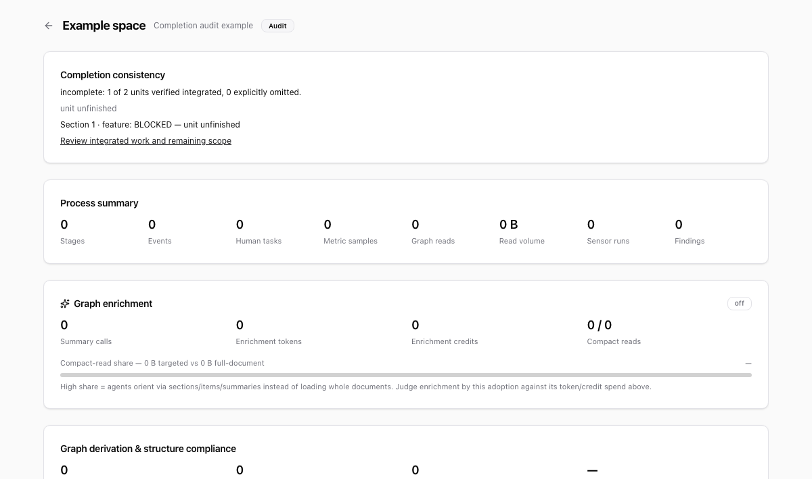

# Recovery ownership

A worker may change recovery state only while both ownership tokens match:
`META.orchestratorRunId` identifies its execution run, and
`STAGE.stageCallbackId` identifies its stage attempt. The orchestrator supplies
the run token in the dispatch, and the worker carries both tokens into its MCP
process. A consistent read helps diagnose state; the write transaction enforces
ownership even if a rewind happens after that read.

| Transition                  | Ownership and replay behavior                                                                                                                                                                                                             |
| --------------------------- | ----------------------------------------------------------------------------------------------------------------------------------------------------------------------------------------------------------------------------------------- |
| Claim a stage               | Check the active META run and claim the callback without replacing the saved conversation. Repeating the same RUNNING callback is allowed; a different callback cannot claim a RUNNING stage.                                             |
| Open an agent question      | Create HUMAN, park STAGE, and update the linear META wait in one transaction. Unit questions park only their own stage. HUMAN records the creating run and callback.                                                                      |
| Open an engine gate         | Create HUMAN and park META atomically, conditional on the run. The durable gate-open step also retires a specific legacy gate if its later META ownership check fails.                                                                    |
| Answer                      | For owned gates, check the active run and, for agent questions, the creating callback with the pending-to-answered write. Deliver the callback from the committed answer row, including a binding that raced the endpoint's initial read. |
| Unpark                      | Both engine and stage gates use the same conditional transition. Already RUNNING with the same run token and no pending gate means the write previously committed; another owner or another pending gate means retirement.                |
| Finish or fail a worker     | Check the run and callback in the same transaction as the stage write. A retired result stops orchestration without failing a replacement attempt.                                                                                        |
| Retire an unusable question | Check the stage callback and gate identity. Clearing META also requires its expected pending gate. Cleanup errors cannot replace the original recovery error.                                                                             |

Engine-gate durable operation names and order remain compatible with the
implementation before the recovery PR. The replay fixture is frozen from commit
`590ace6`; its checkpoints are resumed with the current implementation in tests.

Legacy synchronous dispatches lack ownership tokens and retain their existing
behavior. The worker does not guess an owner to overwrite an unverified legacy
stage after a failed recovery read. Deploy the orchestrator and runtime changes
together; an already running container on an older image does not acquire these
checks retroactively.

Storage must accept a write to persist FAILED state. During a complete outage the
worker preserves its structured failure, while durable dispatch and callback
reconciliation remain the recovery backstop. These guards protect process state;
they do not undo provider requests or Git operations already in flight.

## Completion boundaries

New histories capture completion policy 1 in the existing `load-meta` result.
The shared unit-completion evaluator validates the pinned, resolved workflow's
expected sections, current-plan units, repository integration evidence and scoped
human omissions. Section fan-in and final success use the same evaluator against
persisted process state. Missing rows, unfinished work and partial integrations
cannot pass; missing provenance, read failures and ambiguous legacy omissions
remain unverified. Serial workflows and sections excluded by approved workflow
scope/composition remain valid. Pre-deploy `MERGED` rows without an
`integrationResults` attribute retain their supported integrated meaning, including
multi-repository retries and rewinds past completed sections. New integrations
always write the attribute; explicit empty, invalid or incomplete evidence never
receives this legacy exemption. PR-per-unit integration still requires its
per-repository PR records. Unpinned historical serial intents without unit work
keep their success presentation without unit-completion diagnostics. Cancelled
executions and recorded aborts from the current run are classified as aborted
before workflow-pin resolution, without implying that their work was integrated.
Missing or truncated execution reads remain unverified.

Required integration writes are not best-effort. A lost response is reconciled
from persisted state; an unrecorded integration stops the lane before dependent
work can proceed. Final status and its completion receipt commit together under
run, status, META revision and unit-plan conditions. Initial publication rechecks
completion before opening a PR. These checks never rerun models or repair rows.
Marker-absent histories (policy 0) retain their saved operation sequence and
terminal step. The intermediate completion implementation was not released and
has no separate replay path. Saved historical successes are never rewritten.

A terminal success with unfinished or unverified work is shown honestly in the
intent detail. Accepted omissions remain partial delivery, not execution defects.
This release does not add automatic preservation-and-continuation recovery for
finished incomplete intents. Existing orphan-lane/PR-review repair and ordinary
rewind remain supported; rewind resets affected lanes, including integrated work,
and clears omission receipts for the work explicitly being retried. Original
answers and events remain historical. Preserve runtime and methodology pins.

Deploy the runtime, orchestrator, intents API and frontend from the same release.
No automatic production audit, status migration or runtime repinning is performed.

## Gateway grant retirement

With the MCP Gateway enabled, every grant consumer (the Gateway's
`mcp-interceptor`, engine-data, the credential broker and the source-control
`runtime` alias) refuses a retired grant; `mcp-tools` acts only on context the
interceptor admitted. A grant is retired one by one when its use ends (`GRANT#<jti>`: a stage
or workspace-init callback, a failed dispatch, a synchronous command that returned), or with every
grant of its execution by a deliberate stop (`EXEC#<executionId>`: cancel,
delete, rewind, recompose, lane repair, the durable watchdog). A run that ends on
its own writes no execution record. The writers live in
`lambda/shared/gateway-grant-retirement.js`; the HTTP handlers use
`lambda/intents/grant-retirement.js` and the durable orchestrator uses
`lambda/v2-orchestrator/grant-retirement.js`.

A jti whose retirement could not be written is recorded on META in
`pendingGrantRetirements`. For an execution grant, every consumer reads META
first and treats a recorded jti as retired, so there is no window in which it is valid again. `/start`,
rewind, recompose and lane repair retire the recorded jtis and clear the set
before they relaunch; their relaunch write is conditioned on the set being
absent, so a jti recorded meanwhile (by a concurrent derive) is retired and the
write retried once.

| Failure                                                                                                  | Persisted state                                                                                                                                                                                                        | Response                                                                                                                                                        | Retry                                                                     |
| -------------------------------------------------------------------------------------------------------- | ---------------------------------------------------------------------------------------------------------------------------------------------------------------------------------------------------------------------- | --------------------------------------------------------------------------------------------------------------------------------------------------------------- | ------------------------------------------------------------------------- |
| Execution retirement write fails before cancel, rewind, recompose, lane repair or delete                 | Nothing changed: the write comes before any state change                                                                                                                                                               | 503 `grant_retirement_unavailable`, log `GATEWAY_GRANT_RETIREMENT_FAILED`                                                                                       | Retry the same request                                                    |
| The run changed while the request was in flight                                                          | Nothing changed when the first retirement detects it: the execution write is conditioned on the run id the request read. A lane repair that detects it after stopping the durable run keeps the state it already wrote | 409 `run_superseded`                                                                                                                                            | Refresh and retry                                                         |
| Lane repair: the second retirement, after the durable run was stopped, fails                             | The execution is FAILED with `repairRelaunch` recorded; `failureReason: lane_repair_grant_retirement_failed` is stamped on a best-effort basis                                                                         | 503 `grant_retirement_unavailable`                                                                                                                              | Retry the repair: it resumes from the recorded phase                      |
| Rewind or recompose: the second retirement, after the run id was replaced and the old run stopped, fails | Nothing relaunched; the run id stays retired. A rewind leaves the execution FAILED with `failureReason: rewind_grant_retirement_failed` (best effort); a recompose leaves it in its WAITING or FAILED status           | 503 `grant_retirement_unavailable`                                                                                                                              | Retry the same request                                                    |
| A recorded jti cannot be retired or cleared before a relaunch                                            | Nothing relaunched; `pendingGrantRetirements` kept                                                                                                                                                                     | 503 `grant_retirement_unavailable`, log `GATEWAY_GRANT_RETIREMENT_FAILED` (`GATEWAY_GRANT_RETIREMENT_PENDING` when jtis kept arriving during the retried write) | Retry the same request                                                    |
| A synchronous derive ran, its grant retirement failed                                                    | The jti is added to `pendingGrantRetirements`                                                                                                                                                                          | The command's own result                                                                                                                                        | None needed: consumers treat it as retired; the next relaunch retires it  |
| Same, and recording the jti failed too                                                                   | The command's effect is kept; nothing records the live grant                                                                                                                                                           | 503 `grant_retirement_unavailable`, log `GATEWAY_GRANT_RETIREMENT_FAILED` with reason `<command>_pending_record`                                                | Retry once the store recovers; the grant expires at its TTL               |
| A compose job is accepted                                                                                | The job runs in the background; its grant is not retired when it ends                                                                                                                                                  | 202                                                                                                                                                             | None: the grant expires after 15 minutes, or with an execution retirement |
| A compose dispatch fails or is refused                                                                   | The compose is marked FAILED and its grant retired at once, both best effort (a failed retirement is recorded as for derive; during a store outage the compose can stay PENDING)                                       | 503 (compose dispatch failed)                                                                                                                                   | Start a new compose                                                       |
| The orchestrator cannot retire a stage or command grant after its durable retries                        | The jti is added to `pendingGrantRetirements`, then the stage or run fails with `gateway_grant_retirement_failed`                                                                                                      | —                                                                                                                                                               | Rewind, recompose, lane repair or `/start` retire it before relaunching   |
| Same, and recording the jti failed too                                                                   | The run fails with `gateway_grant_retirement_failed` (`recorded: false`)                                                                                                                                               | —                                                                                                                                                               | Same; the grant expires at its TTL                                        |
| The watchdog cannot retire the grants of an expired durable run                                          | Nothing changed: the intent stays active                                                                                                                                                                               | —                                                                                                                                                               | The watchdog retries it on its next lap                                   |
| A consumer cannot read the retirement records                                                            | —                                                                                                                                                                                                                      | The call is denied: the verifier raises `GATEWAY_GRANT_RETIREMENT_UNAVAILABLE`, engine-data answers `grant_retirement_unavailable`                              | The caller's own retry                                                    |

Lane repair records its progress on META in `repairRelaunch` before the first
destructive step, with the run id it retired. In phase `cleanup`, a retried
repair redoes the idempotent cleanup for the recorded section and lanes instead
of re-checking eligibility (which the partial cleanup may have changed). Once
every cleanup step has landed, the phase becomes `relaunch`; a retry then only
performs the guarded relaunch. The record is cleared once the orchestrator is
invoked, so a failed invoke, rolled back to FAILED, can be retried too.

## Scheduled maintenance sweeps

Every minute the intents Lambda runs two sweeps over the sparse GSI3 index: the
durable watchdog (`ACTIVE_EXECUTIONS`) first, then the unit PR-wait reconciler
(`PR_WAITS`). Each tick checks one page (`DURABLE_WATCHDOG_LIMIT` and
`PR_WAIT_RECONCILER_LIMIT`, 100 by default, at most 500), starting after the
index key recorded in its cursor item (`MAINTENANCE#durable-watchdog` and
`MAINTENANCE#pr-wait-reconciler`, sort key `CURSOR`, not indexed). The cursor
wraps to the start after the last page, so a lap of `ceil(rows / page)` ticks
reaches every active intent and every parked PR wait (with the exceptions
below).

- **Overlapping ticks.** A tick claims its page by moving the cursor past it,
  conditional on the version it read, before it touches a row. The tick that
  loses checks nothing; repairs still carry the `orchestratorRunId` condition.
- **At most once per lap.** If the invocation dies after the claim (timeout,
  crash), the claimed rows wait for the next lap. The delay is bounded by one
  lap; with fewer rows than a page there is none.
- **Time budget.** The watchdog may use 40% of the remaining invocation time,
  at most 20 s, and the reconciler 60% of what is left, at most 30 s, so a tick
  ends inside the one-minute schedule interval. A sweep starts no new row after
  its budget, and stops waiting on a provider read (the durable status lookup,
  a PR status) still in progress at the deadline; nothing has been written for
  that row yet. Rows left unchecked go back to the next tick: the cursor
  returns to the last checked row. A row cut off while it was the first of its
  tick is reported as an error instead, with the warning `Sweep moved past a
  row whose provider call outlasted the budget`, and the lap moves past it, so a
  provider that never answers cannot hold the lap on one row. Only these reads
  are bounded: DynamoDB calls, the grant retirement of a repair and the wake of
  a lane run to completion.
- **One sweep failing.** A failure in one sweep is logged
  (`Scheduled maintenance sweep failed`, with the sweep name) and reported as
  `failed` in the result, and the other sweep still runs. The invocation
  succeeds: the next tick is the retry, so a failing sweep never reaches the
  function's asynchronous retries or its on-failure destination.
- **Manual repair.** `repair-durable-executions` without `candidates` advances
  the same cursor as the scheduled ticks, checks one page within at most 50 s
  and returns `contended`, `deferred` and `lapCompleted` with the counts. With
  the AWS CLI, raise `--cli-read-timeout` above that (for example 90).
- **Rows that leave the index.** A cursor whose row was completed, cleared or
  deleted still works, since the next query is a range condition after that
  key. A missing cursor item starts a new lap; a stored cursor that is not
  valid is replaced and logged as an error.
- **Rollback.** Earlier releases ignore the cursor items. Deleting both items
  after a rollback is safe and avoids an inflated first `lapMs` when upgrading
  again.
- **Evidence.** Each tick logs `Scheduled maintenance sweep` with the sweep
  name, `trigger` (`schedule` or `manual`), the counts, `deferred`,
  `contended`, `elapsedMs`, `lapAgeMs` (time since the current lap started)
  and, when a lap ended in that tick, `lapCompleted` and `lapMs`. `manual`
  means `repair-durable-executions`; invoking `reconcile-provider-state` by
  hand sends the schedule's payload, so it is logged as `schedule`.

## Run a bounded read-only completion audit

`scripts/audit-completion.mjs` is an operator-run, read-only diagnostic. It emits
JSON Lines with intent/execution/run IDs, state, reasons, unit counts and bounded
summary metrics. No scheduled infrastructure, account scan, automatic recovery,
provider calls or model calls are installed.

The existing authorized intent **Audit** page shows completion state, reasons and
remaining units for terminal executions. Integrated units refer to the intent
branch; they do not prove final PR publication or merge. Cancellation and recorded
aborts remain aborted, and historical serial executions without unit work do not
gain a unit-completion card.



Try the sanitized fixture first; it needs no AWS credentials and deliberately
exits 2 with one incomplete execution:

```bash
node scripts/audit-completion.mjs \
  --fixture scripts/test/fixtures/completion-audit-example.json \
  --project example \
  --from 2026-10-01T00:00:00.000Z --to 2026-10-02T00:00:00.000Z
```

After explicitly choosing a project, interval and read-only AWS profile:

```bash
node scripts/audit-completion.mjs \
  --profile platform-read --region eu-central-1 \
  --table YOUR_V2_PROCESS_TABLE --blocks-table YOUR_BLOCKS_TABLE \
  --artifacts-bucket YOUR_ARTIFACTS_BUCKET \
  --project YOUR_PROJECT_ID --status SUCCEEDED \
  --from 2026-10-01T00:00:00.000Z --to 2026-10-02T00:00:00.000Z \
  --limit 100 --page-size 25 --max-pages 10 \
  --record-limit 2000 --max-requests 5000 \
  --checkpoint /tmp/completion-audit-checkpoint.json \
  >> /tmp/completion-audit.jsonl
```

The time interval is **execution start time**, inclusive `from`, exclusive `to`,
in normalized ISO UTC format. GSI1 supports project/status/start-time discovery;
each discovered META is verified on the base table. Use separate invocations
for SUCCEEDED, FAILED or CANCELLED. No cross-project discovery is available.
The default status is SUCCEEDED.

Limits apply per invocation: at most 1,000 executions, 100 pages of at most 100
items, 10,000 completion records per execution, and 10,000 application AWS read
requests. Defaults are 100 executions, 10 pages of 25, 2,000 records and 5,000
requests, including the initial STS account-identity read. SDK retries are limited
to two attempts per request; credential-provider authentication/refresh requests
are outside this application-read budget. Runtime
finalization uses the 2,000-record limit and reports unverified if exceeded.
This bounds reads, not a wall-clock deadline. The process table and blocks table
need targeted GetItem/Query permissions (and index Query); pinned methodology
bundles need GetObject on the artifacts bucket. The command rejects writes and
scans even if its credentials are more privileged. The CLI resolves credentials
once per invocation and uses them for both STS identity and data reads. Live
checkpoints bind that immutable AWS account ID, region, tables and artifacts
bucket; switching profiles within the same account is allowed.

Exit codes: **0** means the batch finished with only complete/partial/aborted
results, **2** means incomplete work, unverified evidence or a command failure,
and **3** means a clean batch stopped before discovery finished. Inspect the
summary's `finished`, `discoveryUnverified`, `budgetExhausted` and `requests`
fields even on exit 2. Exhausting the request budget reports
`stopReason: "budget_exhausted"` and checkpoints after the last fully assessed
intent. An interrupted intent is not counted or reported as examined; resume
retries its complete assessment, including pinned plan and current-record checks.
This also applies before the first intent or on the final discovery page.

Rerun with the checkpoint until `finished: true`. If a batch cannot assess even
one intent, increase `--max-requests` within its hard cap; raising that budget
does not change discovery scope. Changing the project, status, time interval,
page/execution/record limits or data source requires a fresh checkpoint. Version-1
checkpoints are rejected because older audits could advance past unaudited work;
retain them for evidence and start a fresh version-2 checkpoint.
Standard output can be appended as above; `--output FILE`
instead replaces that file with the current batch. Checkpoints are written only
after output, so interruption can repeat findings but cannot advance past
unwritten output. Deduplicate monitoring by execution/run IDs when ingesting
repeated batches. A completed checkpoint contains `null`; using it again starts
a fresh audit. Delete a checkpoint to deliberately rescan the chosen interval.

Legacy workflow snapshots that reference mutable stage definitions without
captured methodology pins or a completion-policy section receipt are also unverified:
resolving today's definitions cannot prove their historical section list.

An unavailable plan, read failure, concurrent recovery or ambiguous legacy data
is **unknown**, never clean or definitely corrupt. Budget exhaustion leaves the
assessment unfinished and resumable, without inventing unknown findings.
The audit observes current terminal execution records; it does not reconstruct
every retired durable run. The GSI can lag, so repeat the same bounded interval
after it has settled. Review each finding in the intent audit UI. Finished incomplete intents do not
have automatic preservation recovery: an ordinary rewind reruns affected work,
or a new intent can implement the remaining scope. No production audit or recovery
is required as part of installing this detection capability.
