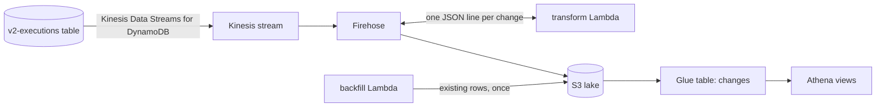
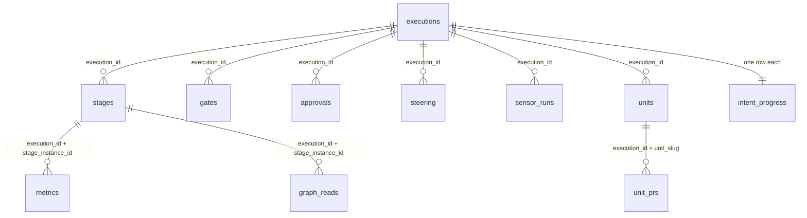

# Reporting Lake

The reporting lake is an optional, durable change log of intent execution, queryable with SQL through Amazon Athena. DynamoDB keeps only the current state of each execution row. The lake keeps every change, so you can report on how runs moved over time: time in each status, gate wait, rewinds, attempts and throughput. It's off by default.

It holds execution state only. The knowledge graph (projects, artifacts, requirements) isn't in the lake yet, so project names aren't either: `project_id` is the platform's space ID.

## How it works



- A Kinesis streaming destination on the `v2-executions` table sends every insert, update and delete to Firehose. The destination is a separate resource, so the table definition doesn't change.
- The transform Lambda turns each change into one JSON line, and Firehose writes it to S3 under `executions/record_type=<sort-key prefix>/dt=<yyyy-MM-dd>/`. Changes usually reach the lake within one to two minutes (`reporting_buffer_seconds` sets the buffering).
- A Glue table, `changes`, reads the lake with partition projection, so there's no crawler to run.
- Terraform creates the Athena views from `terraform/modules/reporting/views/*.sql`, and recreates them when a file changes.

## Enabling it

Set this in your `.tfvars` file and deploy:

```hcl
reporting_enabled = true
```

Then copy the rows that already exist into the lake. The backfill Lambda scans the table, writes each row as a `SNAPSHOT` change, and stops before its timeout. Invoke it until it reports `done`:

```bash
FN=$(terraform -chdir=terraform output -raw reporting_backfill_function_name)
payload='{}'
while :; do
  aws lambda invoke --function-name "$FN" --cli-binary-format raw-in-base64-out \
    --payload "$payload" /tmp/backfill.json >/dev/null
  cat /tmp/backfill.json; echo
  [ "$(jq -r .done /tmp/backfill.json)" = true ] && break
  payload=$(jq -c '{runId, startKey}' /tmp/backfill.json)
done
```

Run it after the deploy that enabled the lake, once the streaming destination is active. A change streamed after a row was read sorts after that row's snapshot, so the views still show the newest state. Running it again is safe, but it adds another snapshot of every row.

History starts at the backfill. Before then, each row has a single point: its state when it was copied.

| Variable                                | Default     | Purpose                                                 |
| --------------------------------------- | ----------- | ------------------------------------------------------- |
| `reporting_enabled`                     | `false`     | Create the lake                                         |
| `reporting_buffer_seconds`              | `60`        | Firehose buffering before writing to S3 (60–900)        |
| `reporting_kinesis_shard_count`         | `1`         | Provisioned shards; `0` switches to on-demand           |
| `reporting_athena_bytes_scanned_cutoff` | 10 GiB      | Per-query scan limit in the workgroup                   |
| `reporting_lake_start_date`             | day created | First `dt` partition the table covers                   |
| `reporting_alarm_actions`               | `[]`        | SNS topics for the freshness and transform-error alarms |

The lake runs a Kinesis shard (or on-demand stream), a Firehose stream with dynamic partitioning, and three small Lambdas, plus S3 storage and Athena queries. Check [Kinesis Data Streams](https://aws.amazon.com/kinesis/data-streams/pricing/), [Firehose](https://aws.amazon.com/firehose/pricing/) and [Athena](https://aws.amazon.com/athena/pricing/) pricing for your region.

### What's left out

The transform doesn't write:

- agent output transcripts (`OUTPUT#` rows);
- agent sign-in bookkeeping;
- on the execution header: the intent prompt, the starter's email, the credential binding, and the MCP server references;
- the GSI key attributes.

The lake still holds gate prompts and answers, steering messages, people's display names and Cognito subjects, so grant access to it as you would to the platform's own data. The bucket blocks public access, denies requests without TLS, and is encrypted with SSE-S3. With `deletion_protection = true` it can't be destroyed while it holds objects, because its history can't be rebuilt from the table.

## Querying

Use the workgroup and database from the Terraform outputs:

```bash
WG=$(terraform -chdir=terraform output -raw reporting_athena_workgroup_name)
DB=$(terraform -chdir=terraform output -raw reporting_glue_database_name)
aws athena start-query-execution --work-group "$WG" \
  --query-execution-context Database="$DB" \
  --query-string "SELECT status, count(*) FROM executions GROUP BY status"
```

For a BI tool, attach the `reporting_reader_policy_arn` output to its role. The policy allows read-only queries in the reporting workgroup.

Use the views. The `changes` table is the raw change log: every row ever written, including repeats, deletes and old versions.

## Data model



Join keys:

- **`execution_id`** identifies one run of an intent. Every view carries it.
- **`project_id`** is the space ID, on `executions` and `intent_progress`.
- **`intent_id`** identifies the intent. It also identifies the intent in the knowledge graph.
- **`stage_instance_id`** identifies one concrete run of a stage. Construction stages have one per unit lane. Gates, approvals and sensor runs point at it.

Timestamps are UTC `timestamp` values.

### `executions`

One row per intent run, from the execution header (`META`). Key: `execution_id`.

| Column                                                     | Meaning                                                                        |
| ---------------------------------------------------------- | ------------------------------------------------------------------------------ |
| `project_id`, `intent_id`, `title`                         | The space, the intent and its title                                            |
| `status`                                                   | `DRAFT`, `CREATED`, `RUNNING`, `WAITING`, `SUCCEEDED`, `FAILED` or `CANCELLED` |
| `is_active`                                                | `status` is `CREATED`, `RUNNING` or `WAITING`                                  |
| `waiting_on_human`                                         | The run is parked on a gate                                                    |
| `current_phase`, `current_stage`                           | Where the run is now                                                           |
| `workflow_id`, `workflow_version`, `scope`                 | The pinned workflow, its version and the scope                                 |
| `agent_cli`, `pr_strategy`                                 | The agent CLI and PR strategy chosen at start                                  |
| `construction_gate_autonomy`, `construction_autonomy_mode` | Whether construction gates were waived: `gated` or `autonomous`                |
| `rewind_from_stage_id`                                     | Set when the run was relaunched from a mid-plan stage                          |
| `started_by`                                               | Display name of the person who started it                                      |
| `source_provider`, `source_ticket`, `source_url`           | The tracker ticket the intent came from, if any                                |
| `failure_reason`                                           | Why a failed run failed                                                        |
| `started_at`, `updated_at`, `completed_at`                 | Timestamps; `completed_at` is set for finished runs                            |

### `stages`

One row per stage instance that has started or been skipped. Key: `execution_id` + `stage_instance_id`.

| Column                       | Meaning                                                                                                                    |
| ---------------------------- | -------------------------------------------------------------------------------------------------------------------------- |
| `stage_id`, `phase`          | The workflow stage and its phase                                                                                           |
| `unit_slug`, `section_index` | The construction lane, for unit stages                                                                                     |
| `state`                      | `PENDING`, `RUNNING`, `WAITING_FOR_HUMAN`, `SUCCEEDED`, `FAILED` or `SKIPPED`                                              |
| `attempt`                    | `0` for the first run; one more for every rewind or retry                                                                  |
| `resolved_model`, `cli`      | The model and CLI the stage ran with                                                                                       |
| `started_at`, `completed_at` | Start and finish of the current attempt                                                                                    |
| `human_wait_seconds`         | Total time parked waiting for people                                                                                       |
| `elapsed_seconds`            | From start to finish, or to now if still open                                                                              |
| `agent_seconds`              | `elapsed_seconds` minus `human_wait_seconds`. It can be slightly negative while a park is open, so clamp at 0 when summing |

Stage rows exist only once a stage is reached, so counting them gives stages reached, not the size of the plan.

### `gates`

One row per human gate: a question, approval or validation. Key: `execution_id` + `human_task_id`.

| Column                                     | Meaning                                                       |
| ------------------------------------------ | ------------------------------------------------------------- |
| `stage_instance_id`, `unit_slug`           | The stage, and lane, that asked                               |
| `kind`                                     | `approval`, `question`, `review-verdict` or `validation`      |
| `checkpoint`                               | Set when the gate is a consolidated confirmation              |
| `status`                                   | `pending`, `answered`, `approved`, `rejected` or `superseded` |
| `prompt`, `answer_json`                    | What people were asked, and the recorded answer as JSON       |
| `answered_by`, `answered_at`, `created_at` | Who answered, when, and when the gate opened                  |
| `wait_seconds`                             | From opening to answer, or to now if pending                  |

`superseded` means a cancel or rewind retired the gate before anyone answered it. Leave it out of answer-time measures.

### `approvals`

One row per approval receipt, the durable record that an authorisation was given. Key: `execution_id` + `kind` + `stage_instance_id` + `attempt`.

| Column                                                | Meaning                                                                              |
| ----------------------------------------------------- | ------------------------------------------------------------------------------------ |
| `kind`                                                | The receipt kind, for example `plan-approval`, `stage-approval` or `sensor-override` |
| `stage_instance_id`, `stage_id`, `phase`, `unit_slug` | The stage it authorised                                                              |
| `attempt`, `choice`                                   | The stage attempt, and the decision recorded                                         |
| `decided_by`, `decided_at`, `human_task_id`           | Who decided, when, and the gate it came from                                         |
| `is_current`                                          | `false` once a later rewind or retry of the stage means it no longer counts          |

### `steering`

One row per human course correction. Key: `execution_id` + `steer_id`.

| Column                                    | Meaning                                                              |
| ----------------------------------------- | -------------------------------------------------------------------- |
| `kind`                                    | `gate-steer`, `revision`, `rewind` or `artifact-edit`                |
| `status`                                  | `pending`, `consumed` (delivered to the agent) or `superseded`       |
| `message`                                 | What the person said                                                 |
| `target_stage_id`, `target_gate_id`       | The stage a rewind restarts from, or the gate a correction refers to |
| `created_by`, `created_at`, `consumed_at` | Who, when, and when the agent received it                            |

### `sensor_runs`

One row per post-stage sensor check. Key: `execution_id` + `sensor_run_id`. Columns: `stage_instance_id`, `unit_slug`, `sensor_id`, `kind`, `severity` (`advisory` or `blocking`), `result` (`PASS`, `FAIL`, `INCONCLUSIVE` or `BLOCKED`), `held` (the result blocked the stage) and `run_at`.

### `units` and `unit_prs`

`units` has one row per construction lane (key: `execution_id` + `unit_slug`), with `section_index`, `kind`, `state`, `batch_index`, `failure_reason`, `created_at`, `started_at` and `merged_at`.

`unit_prs` has one row per lane and repository pull request (key: `execution_id` + `unit_slug` + `repository`), with `provider`, `pr_number`, `url`, `state`, `comment_count`, `created_at`, `merged_at` and `closed_at`.

### `metrics` and `graph_reads`

`metrics` has one row per agent usage sample (key: `execution_id` + `metric_id`): `stage_instance_id`, `unit_slug`, `resolved_model`, `tokens_input`, `tokens_output`, `credits`, `context_window_pct`, `metrics_json` (the whole sample) and `recorded_at`. A sample is a point reading, and a stage can record several. Take the maximum `context_window_pct` per stage, and check whether a measure is cumulative before summing tokens.

`graph_reads` has one row per knowledge-graph read an agent made (key: `execution_id` + `read_id`): `stage_instance_id`, `unit_slug`, `tool`, `bytes`, `result_count` and `read_at`.

### `intent_progress`

One row per intent run: every `executions` column plus headline numbers. Key: `execution_id`.

| Column                                                                        | Meaning                                          |
| ----------------------------------------------------------------------------- | ------------------------------------------------ |
| `age_hours`                                                                   | From start to finish, or to now                  |
| `stages_started`, `stages_succeeded`, `stages_skipped`, `stages_failed`       | Stage rows by state                              |
| `stage_restarts`                                                              | Sum of `attempt` across stages                   |
| `agent_hours`, `human_wait_hours`                                             | Summed stage time, working and waiting on people |
| `gates_pending`, `gates_answered`, `gates_rejected`, `oldest_pending_gate_at` | Gate counts and the oldest open gate             |
| `rewinds`, `revisions`                                                        | Steering of those kinds                          |
| `units_total`, `units_merged`, `units_failed`                                 | Construction lanes; failed includes blocked      |

### `decision_log`

One row per human decision from three sources: `source` is `gate` (an answered gate), `approval` (a receipt) or `steering`. Columns: `kind`, `outcome`, `decided_by`, `decided_at`, `stage_instance_id` (the target stage for steering), `unit_slug` and `summary`. A gate answer usually also writes a receipt, so count decisions with `source = 'gate'` and use the `approval` rows for what was authorised.

### History views

These read the change log, so they show how state moved rather than only where it is now.

| View                       | One row per                                     | Columns                                                                                                   |
| -------------------------- | ----------------------------------------------- | --------------------------------------------------------------------------------------------------------- |
| `execution_status_history` | status an execution entered                     | `execution_id`, `status`, `entered_at`, `left_at` (null while current)                                    |
| `stage_state_history`      | state, or new attempt, a stage instance entered | `execution_id`, `stage_instance_id`, `stage_id`, `unit_slug`, `attempt`, `state`, `entered_at`, `left_at` |

### The `changes` table

Use it only for history the views don't cover. It's partitioned by `record_type` (the lower-cased sort-key prefix, or `other`) and `dt` (UTC day), so filter on `dt` to limit what's scanned.

| Column                        | Meaning                                                                                                       |
| ----------------------------- | ------------------------------------------------------------------------------------------------------------- |
| `event_id`                    | DynamoDB change ID, or `snapshot-…` for backfilled rows                                                       |
| `event_name`                  | `INSERT`, `MODIFY`, `REMOVE` or `SNAPSHOT`                                                                    |
| `event_time`, `event_ts_us`   | When the change happened; `event_ts_us` is epoch microseconds and orders changes to one row                   |
| `pk`, `sk`                    | The DynamoDB key                                                                                              |
| `execution_id`, `entity_type` | The run, and the record type (`Execution`, `Stage`, `HumanTask`, …)                                           |
| `item`                        | The row as a JSON string; the old image for `REMOVE`. Read fields with `json_extract_scalar(item, '$.field')` |

## Counting rules

- **Repeats.** The feed delivers at least once. The `latest` view keeps the newest change per DynamoDB key, and every current-state view builds on it, so a repeated or late change isn't counted twice. Raw `changes` queries need the same treatment.
- **Rewinds.** A rewind or retry increments `stages.attempt`. Earlier approval receipts stay with `is_current = false`, and a pending gate becomes `superseded`. Decide whether a measure wants the current attempt or all of them.
- **Deleted intents** can leave a bare `META` row with no type; `executions` skips it.
- **Drafts.** `DRAFT` runs were composed but never started, and their `started_at` is when the draft was created. Filter `status <> 'DRAFT'` for throughput and cycle-time measures.

## Changing the views

The views read the platform's internal record shapes, defined in `lambda/shared/v2-process-keys.js`. When a record shape changes, update the matching file in `terraform/modules/reporting/views/` in the same change. The raw change log is kept, so a corrected view applies to the full history at the next deploy.

A new sort-key prefix lands in `record_type = 'other'` until it's added to `lambda/reporting/record-types.json`, which both the transform and the Glue partition projection read.
